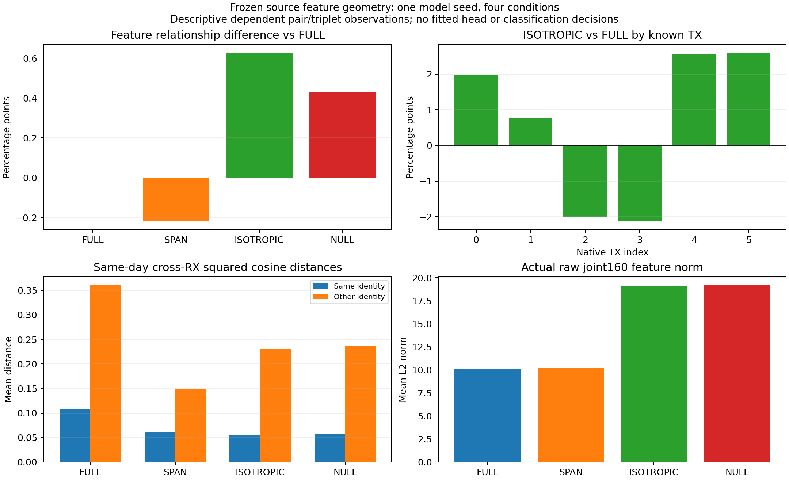

# SIG_TIME＋RDrop：冻结特征跨 RX 关系完整诊断

**ANALYZED / VERIFIED。全空间一致性对照的源端正迹象也出现在实际 joint160 中，并非只有默认 W 指标改善。** ISOTROPIC 的特征关系满足率比 FULL 高0.627664个百分点；该观察仍是同一个已开发源折、同一个模型seed，不是独立训练确认或目标泛化证明。NULL 主配方的FAIL保持关闭。

| 条件 | 特征关系满足率 | 相对 FULL（百分点） | 同身份距离均值 | 异身份距离均值 | 距离均值间隔 | 父 run 默认头 RX1 准确率 |
|---|---:|---:|---:|---:|---:|---:|
| FULL | 92.4757% | +0.0000 | 0.108587 | 0.359934 | 0.251347 | 77.6984% |
| SPAN | 92.2578% | -0.2179 | 0.060763 | 0.148553 | 0.087789 | 77.5397% |
| ISOTROPIC | 93.1034% | +0.6277 | 0.055155 | 0.230175 | 0.175019 | 79.1270% |
| NULL | 92.9063% | +0.4306 | 0.056604 | 0.237165 | 0.180561 | 78.3333% |

这里的关系满足率是：同一天内，对每个fit RX3/4/6/8的anchor，比较held RX1的同TX样本距离与异TX样本距离；同TX更近记1，数值近等记.5。它没有拟合分类器、原型或特征变换，也没有输出分类决定。父run默认头准确率列只复用已冻结的源结果作上下文，不是本次新推理评分。距离为统一FP64单位特征上的2−2cosine；相对FULL的三种条件均来自同一套物理样本。

更高关系满足率并不等于所有几何指标变好。ISOTROPIC同身份距离从0.108587降到0.055155，异身份距离也从0.359934降到0.230175，平均距离间隔反而从0.251347降到0.175019。它支持相对距离排序的源端改善，不能说类间绝对间隔整体扩大，也不能由此断定监督信号的因果作用。

分层收益并不一致：ISOTROPIC相对FULL在3个day均为正，但fitRX仅2/4为正、已知TX仅4/6为正；TX2和TX3分别−2.010204、−2.128231个百分点。72个TX/fitRX/day cell中31正、30负、11相等。全部分层和配对差见feature_groups.csv、paired_geometry.csv；不按某个TX设置新机制或专属权重。这些组合共享大量样本，不作独立样本显著性或模型种子统计。

| 条件 | raw 特征范数均值 | 总体均值向量能量占比 | raw 离均值能量 |
|---|---:|---:|---:|
| FULL | 10.077678 | 84.5333% | 15.755357 |
| SPAN | 10.235596 | 93.9075% | 6.386548 |
| ISOTROPIC | 19.100467 | 90.4530% | 34.868412 |
| NULL | 19.170039 | 90.1740% | 36.148655 |

特征范数变化值得继续解释：ISOTROPIC raw范数均值约为FULL的1.895倍，总体均值向量能量占比由84.5333%升到90.4530%；同时离均值能量也由15.755357升到34.868412，不能据此把全部特征称为塌缩。上表能量矩是在看到保存特征的范数增加后补充的描述性统计，明确属于事后分析。没有将估计均值用于中心化预测、关系得分、选模或新阈值；预登记关系指标和旧资格均未改变。总体均值分量也不是已识别的RX噪声。raw范数、均值能量与归一化后角度的变化需要分开研究，不能把当前改善简单归为“表征更紧凑”。

本轮只物化1404唯一visible source L：144fit L（72cell各原生前2包）和1260held RX1 L（18cell各70包）。fit锚点不是源总体随机样本；held RX1也已用于此前开发。四模型完全共享输入，各1404实际eval feature前向，合计5616；每模型2合成包ownCP no-query smoke，合计8。每模型10080同身份pair、50400异身份pair、3528000三元关系、144anchor/86aggregate；四条件只是同一个模型seed的不同训练条件。没有U/V/target IQ或target truth、训练/EMA/头拟合/CP写入，默认头保持父训练时联合学习的原权重，诊断中整个模型冻结。

独立核验读取保存的4份FP32特征，用FP64单位向量的直接平方欧氏距离重算，而worker使用点积2−2cosine；全部576anchor的严格胜出/tie计数与344个分组均对齐，距离总和最大差1.42e-13。物理ID/label/RX/day、cell数量和fit/held互斥独立核对。全部198state、nonpersistentbuffer、gradslot、counter和auxaudit保持。独立分析0新增IQ或模型前向。raw物理ID、标签、特征、CP和日志保存在privateartifact，不进Git。

执行提交 `ae8ae696210ef7f08c2571952692db9f3d672e6e`；父源训练提交 `78ad998e9dcb5653573fa801538e914189833d20`，父成本80model-epoch/17760步另列。ordinary N607一次preflight、archive SHA本地/远端比较与remote compile均VERIFIED；独立捕获CPU进程PID/CWD/argv和CPU2/CUDA空，首个CP smoke时live，终态日志由55增到426字节。四CP smoke及完整短stdout、配置和4行结果核对通过，远端耗时约6.329秒，无失败、重发或健康进程变更。初次审查发现的Tensor/NumPy兼容P1在发布前修复，一次定向回归与定向复核PASS；真实四份特征保存及度量已完成。

当前结论：保留原版RDrop的完整E20/E50三seed clean正收益，以及ISOTROPIC的单seed源默认头＋无拟合头特征关系正迹象；不恢复NULL、不把本诊断当作科学晋级。尚缺独立源训练确认、Fisher权重作用的对照和创新机制的完整E20/E50三seed目标证据。下一步只提出有源码／源证据支撑的独立RDrop训练假设，重点区分有用方向一致性与范数／总体均值变化，并另行固定公平源对照；当前无新训练或目标矩阵自动触发。总目标ACTIVE。

以下保留发布前固定方案和边界，历史PLANNED以页首终态为准。

# SIG_TIME＋RDrop：冻结特征跨 RX 关系诊断

状态 PLANNED。本轮仅分析四个已冻结源模型的实际部署joint160，不新增训练、分类头或目标测试。父实验 20261016-phase1-SIGTIME-rdrop-curvature-completion-sourcefold-s2026092702-m4-r01 的主NULL资格FAIL保持；全空间ISOTROPIC相对FULL少错18包、CE降低的单seed源对照正迹象保留，尚未独立确认。这里检查这组默认头观察是否伴随跨RX特征几何变化，不把新的诊断指标作为晋级或救跑门槛。

固定来源是父实验FULL/SPAN/ISOTROPIC/NULL四个final20 student，执行代码 78ad998e9dcb5653573fa801538e914189833d20。各自scratch20/4440步、fit RX3/4/6/8、day1/2/3、六TX、L5040/U45360hidden/V21600、自身EMA、0target、默认头联合训练、final-only。全部source_proof在任何CP反序列化之前执行，真实角色/继承相符；不加载全5源RX或未知来源权重。父训练4×20=80model-epoch单列，本轮0轮/0更新。

仅从原visible L6300carrier中按原生索引选每个TX/fitRX/day cell前2包，共144fitL；RX1每TX/day全部70包，共1260heldL。共1404唯一L物化一次、四模型共享。fit144属于四模型实际L5040，held1260属于原visible L且与四模型训练/U/V角色全部不交。U/V只核对既有句柄，无IQ或标签物化；target不存在loader，0IQ/truth。源RX1之前已用于开发，本诊断不是新盲测。物理ID首列是eq_i而非TX，合法标签逐包与native tx_i核对。

全部模型eval且关闭梯度，输入clean无增强/无dropout。用actual id_feat_joint160，转FP64后按统一eps1e−4归一化，要求原范数>eps。计算平方余弦距离d=clip(2−2uᵢ·uⱼ,0,4)，不拟合头、原型、变换或阈值。对每个fitanchor，只比较同一天的70个held同TX与350个held异TX距离；若同TX距离小于异TX超过1e−12记1，差绝对值≤1e−12记.5，否则0。此数值tie band在读取数据前固定，用于浮点近等关系，不是分类阈值。汇总称“关系满足率”，不能称识别准确率。

每模型10080个同身份pair、50400个异身份pair、3528000个三元比较；144anchor记录，overall＋4fitRX＋3day＋6TX＋72cell共86分组。72cell各2个fitanchor。将报告关系满足率、同/异身份距离均值及间隔和分层，不输出分类决定。成对／三元组合高度相关，不能当作独立物理样本或模型seed；模型seed仅2026092702，4个是训练条件。

成本：1404源L物化；四模型各1404实际feature前向，合计5616；每模型首步自己的真实CP做2合成包no-query smoke，合计8，PASS立即继续。无optimizer/backward/EMA/头拟合或CP写入。全部198state、nonpersistentbuffer、gradslot、特征counter及auxaudit不变。每模型独占PROJECT/runs/20261016-phase1-SIGTIME-rdrop-feature-geometry-source-s2026092702-m4-r01/ARM/config.json、features.npz、result.json。source选择、逐anchor结果和rawfeatures均保留privateartifact，不进Git。独立分析可用保存features重算全部关系，无需再读IQ或前向。

CPU14协议负例、ideal/tie/reversed精确计数、分组、标签和坐标置换/正比例缩放检查PASS；实际模型joint160在临时W扰动前后逐位一致，所有state/buffer/gradslot/counter恢复并保持。检查8合成身份前向、0真实IQ/CP/更新/头拟合。行配置与输出目录唯一性通过。一次独立新诊断审查发现1项P1：已知远端旧Torch/NumPy数组桥接不兼容。发布前改为一次tolist→NumPy转换并复用；禁用Tensor.numpy的保存→回读→关系入口检查PASS，FP32往返精确、0桥接调用、0新增模型/IQ/CP前向。该问题一次定向复核PASS，其余无P0/P1，见review.json；没有重复全审或父训练。

本诊断没有科学晋级阈值。更好的已知身份跨RX关系最多补充源端特征证据，不能证明原头收益全由特征造成、训练机制的因果效果、三seed稳定、新TX或目标泛化；较差几何也不能单独否定所有部署读出。关闭的NULL及其他失败配方保持，不扫描alpha/温度/层/seed/epoch，不启动确认或主测试。新训练方向须有独立假设和公平对照。

唯一owner `codex/root/SIGTIME-RDrop-feature-geometry-20261016`，ordinary N607 CVS-RFFI、CPU2/loader0、CUDA_VISIBLE_DEVICES空，0GPU实验进程。CWD PROJECT/releases/cvs_SIGTIME_rdrop_feature_geometry_source_20261016_r01；命令 `CVS-RFFI/bin/python -u experiments/cvs_rdrop_feature_geometry/runner.py experiments/cvs_rdrop_feature_geometry/configs/request.json`。不可覆盖root PROJECT/runs/20261016-phase1-SIGTIME-rdrop-feature-geometry-source-s2026092702-m4-r01。一个实际Git提交、一次ordinary preflight、一个release archive本地/远端SHA比较、remotecompile；独立回读PID/CWD/argv/CPU/日志或终态产物。短任务若先完成，只报告终态证据，不虚构live观测。协议/输入/状态变更/非有限/运行错误保留输出、失败且不重发，不改变健康或无关进程。预期产物和全部行见experiment.json。goal ACTIVE。
