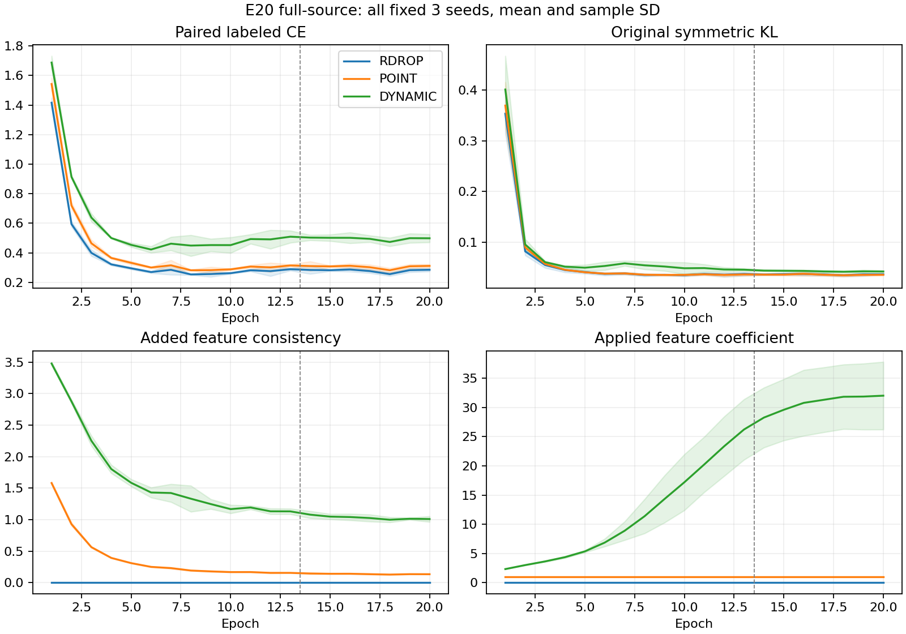

# E20完整源训练信号

状态VERIFIED。6新增行与3个匹配原RDROP控制，共39960步/180 model-epoch/180个完整epoch记录。新增日志已逐步读取；旧控制复用既有完整审计。统计不使用目标指标，不选择新参数、不改变健康E50训练，也不构成源域分数放行条件。

| 条件 | final L CE | 全程原KL | 末轮原KL | 全程辅助loss | 平均应用系数 | U接受比例 |
|---|---:|---:|---:|---:|---:|---:|
| RDROP | 0.285408 | 0.056409 | 0.036972 | 0.000000 | 0.000000 | 1.387335% |
| POINT | 0.311071 | 0.057503 | 0.035951 | 0.312438 | 1.000000 | 1.087176% |
| DYNAMIC | 0.498995 | 0.068476 | 0.042456 | 1.463950 | 18.138215 | 0.215168% |

POINT 的特征辅助系数恒为1。DYNAMIC 按已冻结公式逐步匹配未中心化P与中心化参照C的联合160特征边界梯度范数，系数停止梯度且没有截断。逐seed系数均值、最大值、P/C及实际辅助边界梯度范数见JSON/CSV，所有调用与对应真实训练步骤一致。它没有匹配参数梯度、学习率/裁剪后的AdamW位移或梯度方向，不能把特征范数匹配称为等优化强度。

完整原KL始终保留，辅助loss与真实部署t1/t2/SIG参数更新均已核验，不能把本次负结果解释成“损失没有执行”或“只训练了分类头”。新增损失、CE和KL数值处于不同度量，标量比值不等于梯度比例；上述曲线只能描述实际联合训练，不能单独确认RX捷径、特征塌缩或目标下降的原因。默认分类头与原CE/KL仍正常联合训练，未另训诊断分类头。

U配方和真值隔离保持，学生与自身EMA的改变可能改变实际伪标签接受量；因此即使U日程相同，实际接受量也不必相同。每行U观察396900，接受量差异在CSV保留。不能把由整个联合轨迹造成的变化全部归因于某一个坐标性质。

本统计使用既有完整日志分析，零新增IQ、网络前向、checkpoint或truth读取、优化与头拟合。完整实际测试性能见[E20测试汇总](E20_summary.md)，主E50矩阵继续固定运行；不据本统计调系数、提前停止或选择性重跑。
