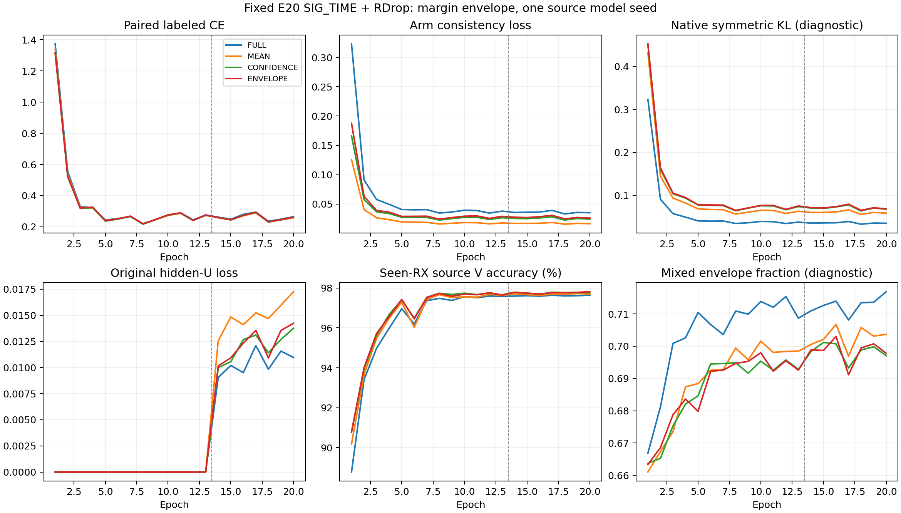

# SIG_TIME＋身份间隔包络 RDrop：完整源域结果

**FAIL：未达到固定源域条件，关闭本次配方，不扩大矩阵或访问目标。** 四个固定 E20 模型均完成，完整独立核验 VERIFIED。只改变 RDrop 一致性目标，原 SIG_TIME、默认分类头结构和联合训练、增强、U、EMA、优化器保持。以下是单个固定模型 seed2026092701、合法 held source RX1 的开发结果，不是目标泛化或完整三种子结论。

| 条件 | RX1 错误 /1260 | 准确率 | mean CE | final L CE |
|---|---:|---:|---:|---:|
| FULL | 195 | 84.5238% | 0.632068 | 0.265473 |
| MEAN | 264 | 79.0476% | 0.734764 | 0.258606 |
| CONFIDENCE | 270 | 78.5714% | 0.816141 | 0.261307 |
| ENVELOPE | 286 | 77.3016% | 0.832211 | 0.262016 |

| ENVELOPE 相对对照 | 准确率差（百分点） | 修正 / 新增错误 | mean CE 差 |
|---|---:|---:|---:|
| FULL | -7.2222 | 6 / 97 | +0.200143 |
| MEAN | -1.7460 | 16 / 38 | +0.097447 |
| CONFIDENCE | -1.2698 | 10 / 26 | +0.016069 |

预登记条件：四行训练健康=True；包络混合证据比例达到10%=True；相对三对照同时严格少错且 CE 不高的最终资格=False。FULL 是原版双向 KL；MEAN 是停止梯度的概率均值教师；CONFIDENCE 与 ENVELOPE 在每次实际前向中使用相同的教师真类概率，但竞争类条件分布分别为均值教师关系与包络关系。跨训练轨迹两模型的实际教师置信度可不同，不能把本控制解释成两模型全程数值完全一致。四臂也未匹配梯度范数或 AdamW 位移。

| 对照 | 样本转移 | 数量 | 对照 mean CE | 包络 mean CE | 对全体 CE 差的贡献 |
|---|---|---:|---:|---:|---:|
| FULL | 均正确 | 968 | 0.125056 | 0.150924 | +0.019873 |
| FULL | 新增错误 | 97 | 0.672647 | 1.231456 | +0.043019 |
| FULL | 均错误 | 189 | 3.196877 | 4.129802 | +0.139939 |
| FULL | 修正错误 | 6 | 0.982466 | 0.417997 | -0.002688 |
| MEAN | 均正确 | 958 | 0.152424 | 0.140735 | -0.008888 |
| MEAN | 新增错误 | 38 | 0.716161 | 1.000866 | +0.008586 |
| MEAN | 均错误 | 248 | 2.962263 | 3.475608 | +0.101039 |
| MEAN | 修正错误 | 16 | 1.120357 | 0.861132 | -0.003292 |
| CONFIDENCE | 均正确 | 964 | 0.137612 | 0.145810 | +0.006272 |
| CONFIDENCE | 新增错误 | 26 | 0.808573 | 0.963161 | +0.003190 |
| CONFIDENCE | 均错误 | 260 | 3.327636 | 3.365160 | +0.007743 |
| CONFIDENCE | 修正错误 | 10 | 0.947253 | 0.804135 | -0.001136 |

CE 转移贡献按全部1260归一化，并已对齐整体 CE 差。描述性分组不能单独证明过置信、欠置信或新 TX 迁移。全部 day、TX、Macro-F1、混淆矩阵、成本和完整训练统计见同目录 CSV 与 results_analysis.json。TX 分层使用 native tx_i/标签0至5；物理 ID 首列是 eq_i，并非 TX。

- FULL：4440 步，混合证据 401599/568320（70.6642%）；目标归一化最大误差 3.58e-07，置信度匹配最大误差 0，真类概率支配违规 0；固定 E20 源 V 97.6343%。
- MEAN：4440 步，混合证据 394238/568320（69.3690%）；目标归一化最大误差 2.98e-07，置信度匹配最大误差 0，真类概率支配违规 0；固定 E20 源 V 97.7037%。
- CONFIDENCE：4440 步，混合证据 392495/568320（69.0623%）；目标归一化最大误差 3.58e-07，置信度匹配最大误差 0，真类概率支配违规 0；固定 E20 源 V 97.7731%。
- ENVELOPE：4440 步，混合证据 392626/568320（69.0854%）；目标归一化最大误差 3.58e-07，置信度匹配最大误差 0，真类概率支配违规 0；固定 E20 源 V 97.8148%。

图包含全部20轮，无最高 V 选模。FULL 行的包络统计只用于诊断，并未参与它的训练目标；native KL 在其余三行也只是诊断。实际所有17760步、80 model-epoch、四份完整 stdout、八份初末 CP 和5040个源默认头决定已核验；逐步重构原 closed loss＋0.5×(CE2−CE1)＋实际 consistency loss 的最大误差 2.38e-07。四臂 198 个初始张量逐位一致，实际 t1、t2、SIG_TIME 投影与默认 W 均有非零权重更新；真实 joint160 初末改变、与 feature-only 逐位对齐，临时改 W 不改变导出特征。它证明训练和导出接线，不独立证明收益全部来自特征或新身份泛化。

每行 L5040/U45360hidden/V21600，RX1 全路径排除，固定 final20 自身 student 和自身 EMA，无任何模型祖先。四行共2273280次额外 L 身份前向、1585472次循环 U 观察、5040次 held 决策，另每行144个 fit L anchor 已读取但未拟合。分析额外0真实 IQ、0真实 source/target 模型前向、0头拟合、0优化器步、0checkpoint写入；另32个合成包检查导出边界。原始逐包预测、CP、日志留在不可变远端 root，不进 Git。

执行提交 `7827a9a6b04764e690ecaf90457666435017c824`，本轮全部进程已结束，无技术失败或重训。先前原版 RDrop E20/E50 三种子 clean 均值83.942857%/84.340079%及互补掩码、差分梯度、跨 RX 证据的全部正负观察保留，数据口径不同不混合汇总。最大证据蒸馏存在已有研究，本次不声称全球首创、统计显著、目标盲测、新 TX 或卫星部署有效。goal 继续 ACTIVE。

<!-- ENVELOPE_FINDINGS_20261016 -->
本轮改变了后续判断：三种停止梯度教师的终轮 L 拟合与源 V 均略好，但 held RX1 都更差。使用同一个原生对称 KL 函数度量各自真实训练前向时，三者终轮不一致性均高于 FULL。包络也没有胜过真类概率匹配控制，因此本轮不支持竞争类最大证据合成的独立收益。累计接受 U 是可重复观察数，不是独立物理样本数，其精度未知；更多接受量不能作为成功依据。

| 条件 | final 双 CE 均值 | final 原生对称 KL | final 源 V | 累计接受 U 观察 | held RX1 错误 |
|---|---:|---:|---:|---:|---:|
| FULL | 0.264836 | 0.035320 | 97.6343% | 6863/396368 | 195 |
| MEAN | 0.258054 | 0.058906 | 97.7037% | 7237/396368 | 264 |
| CONFIDENCE | 0.260946 | 0.068049 | 97.7731% | 7609/396368 | 270 |
| ENVELOPE | 0.261632 | 0.068834 | 97.8148% | 7594/396368 | 286 |

这是完整源轨迹的描述性证据，不能把退化单独归因于停止梯度、正则强度或教师形状。相同 alpha 并不使不同一致性算子具有相同梯度强度，损失标量也不是梯度范数。本轮不依据这些结果扫描 alpha 或救跑已关闭包络。

后续仅两项优先动作：先在固定原版 FULL 源 checkpoint、同一合法 fit L 批次和同一对 dropout 前向下，对四种现有算子比较实际 joint160、浅中层、SIG_TIME 和默认 W 的梯度方向与范数，0 训练更新、0 拟合头、0 target；再根据该源测量决定是否提出一个保留原版双向一致性的新算子。当前尚未执行该梯度诊断，也未发布下一训练候选，不把计划写成实测。

以下保留发布前机制和固定判据。

# SIG_TIME＋身份间隔包络 RDrop：源域预登记

状态 RUNNING，四行启动 VERIFIED。本轮只改变 RDrop 的一致性训练目标，4 个模型均从零训练 E20，暂不访问目标测试集。上一版互补掩码完整 E50 主条件失败，已关闭；原版 SIG_TIME＋RDrop E20/E50 三种子正收益及所有负结果保留，见[完整结果](../20261015-phase1-SIGTIME-rdrop-paired-masks-e20e50-clean-manysig-m12-r01/report.md)。

待验证假设：随机子模型可能分别保留对不同竞争身份有用的证据。直接对齐两个输出会让较弱的证据影响较强的一侧。把每个竞争身份对应的较强间隔组合为共同软目标，可能让两个视图学习对方保留的判别证据。它也可能只增加自信或放大噪声，以下对照专门检验这些解释。

对同一个实际增强后的 L 样本，原生独立 dropout 得到 logits z1、z2，合法标签 y。令 a_vc=z_vc−z_vy，包络目标 r=softmax(min(a_1,a_2))，计算后停止梯度。因此 log(r_y/r_c)=max(z1_y−z1_c,z2_y−z2_c)，r_y≥max(p1_y,p2_y)。这是目标分布的数学性质；共享参数反传、AdamW 更新、训练 CE 或泛化性能没有同样的保证。

| 条件 | 一致性目标 |
|---|---|
| FULL | 原版双向对称 KL，两个概率参数均反传 |
| MEAN | 两次概率的算术均值 r，停止梯度；平均 KL(r∥p1)、KL(r∥p2) |
| CONFIDENCE | 使用包络 r_y，竞争类条件分布来自 MEAN；停止梯度后用同样平均 KL |
| ENVELOPE | 竞争身份逐项最大间隔形成 r，停止梯度后用同样平均 KL |

四行均为原双 CE 均值＋一致性损失（alpha=1）＋原 U 损失。CONFIDENCE 与 ENVELOPE 的目标真类概率逐包相同，区别在竞争类之间的关系，避免把单纯提升置信度当作关系学习。该对照不保证梯度范数或优化位移相同。所有分支都只复用同一实际增强 L128，不重抽增强、不改变 dropout 掩码分布，也不增加模型前向次数。

旧 SIG_TIME、RAW_HZ、普通增强、LS=.01、默认 6×160 cosine 分类头 scale30/eps1e−4、AdamW lr.0002/wd.0001、cosine、旧 U 门控及自身 EMA 保持。骨干和网络默认分类头按原流程联合训练；不冻结、替换、重训头，不另训诊断分类器。损失梯度实际进入浅层 t1、中层 t2、SIG_TIME 与默认 W。部署网络与默认推理不新增参数或额外视图。

模型 seed 固定为第一预定义值 2026092701，四行独立 scratch E20=13L＋7U、222 步/轮。训练前真排除源 RX1，fit RX3/4/6/8，day1/2/3 和六 TX 不变；实际 L5040/U45360hidden/V21600，U 真值不可读，V 只监测。固定 final20 用 checkpoint 内默认头预测 1260 个合法 held L，保留逐包 CE、margin、真类概率；RX1 之前已作开发，不能称新盲测。144 个 fit L anchor 由共用 helper 读取但未拟合或参与训练，公开计入成本。

科学资格在首次训练前固定：四行 final L CE≤.5；ENVELOPE 相对其余三行均严格少错且 mean CE 不高；来自两视图不同竞争类的混合证据包比例≥.1；实际 teacher 归一化误差≤2e−6、置信度对照差≤1e−6、真类质量支配违规为 0。PASS 只进入另行预登记的固定 RX3 排除源确认，四臂/seed/E20 不变，确认前不发主测试。FAIL 关闭此配方，不扫 alpha、温度、层、种子或轮次救跑。目标成绩不回流任何选择。

成本 4×20=80 model-epoch／17760 更新；每行 568320 次额外 L 身份前向、396368 次循环 U 观察、1260 次 held L 决策，四行合计 2273280、1585472、5040。训练只继承代码，无任何 checkpoint/teacher/EMA/optimizer 祖先；初始 CP 每行 2 个合成包 smoke 后立即继续。CPU/CUDA 实现检查各 1280 合成包，均为 0 真实 IQ、0 CP 加载、0 优化器步、0 头拟合、0 target。

CPU/CUDA 各 56 个协议负例、5 个科学否决用例通过。包络数学、教师停梯度、标签置换/独立 logit 平移不变性、同预测时零梯度、原 KL 全梯度逐位一致通过。四臂实际 198 个初始张量相同，CE/logits/原生 RNG 相同，FULL 的实际原版参数梯度在浮点容差内一致。一次独立下一运行 P0/P1 审查 PASS，无 P0/P1；证据见 local_verification.json、review.json。本地初次导入命名错误在任何训练前修正，不算模型性能结果。

执行环境 ordinary N607 CVS-RFFI，CWD PROJECT/releases/cvs_SIGTIME_rdrop_margin_envelope_source20_20261016_r01；命令 `CVS-RFFI/bin/python -u experiments/cvs_sigtime_rdrop_envelope20/runner.py experiments/cvs_sigtime_rdrop_envelope20/configs/matrix.json`；唯一 owner `codex/root/SIGTIME-RDrop-margin-envelope-20261016`；不可覆盖 root `PROJECT/runs/20261016-phase1-SIGTIME-rdrop-margin-envelope-sourcefold-s2026092701-m4-r01`。实际 Git 身份写 release_commit.txt，模型代码依赖 b3ac442e2d33a5b315fb3251c30e0ad7083566bc，共用训练器显式指向 FOLD release 的 default-head-only 版本。预期产物见 experiment.json。发布仅一次 ordinary preflight、单 archive 本地/远端 SHA 比较、remote compile，随后验证 PID/CWD/argv/GPU/日志增长；所有 owner 和 preCUDA 进程计入每 GPU≤3，CPU2、loader0。协议、输入、非有限损失、输出碰撞或 worker 技术错误保留产物并停止 pending，不自动重发或停止健康/无关进程；低分不会触发技术重跑。

文献边界：[R-Drop](https://arxiv.org/abs/2106.14448) 已有同样本双随机子模型一致性；[CA-MKD](https://arxiv.org/abs/2201.00007) 已用真值评估教师可靠性；[最大 LLR 共蒸馏](https://www.nature.com/articles/s41592-026-03050-9) 已逐项选择较强证据并蒸馏回模型。最大相对证据合成本身不能宣称首创。本项目的待证点是将它用于同包随机子模型的身份一致性训练，并通过真类置信度匹配对照检验竞争类关系的独立作用。有限检索不能证明不存在相同方法，也不能从蛋白任务的证据推出 RFFI 收益。
