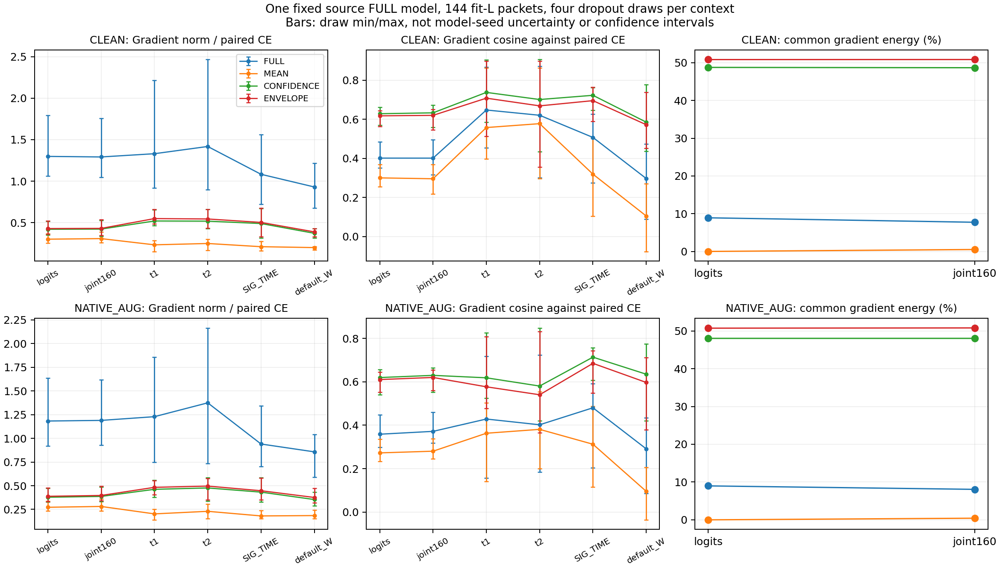

# SIG_TIME＋RDrop：同权重同输入梯度诊断结果

**ANALYZED / VERIFIED。原版 RDrop 与三个替代算子不仅方向不同，传到实际特征参数的梯度强度也明显不同。** 本诊断只解释局部算子行为；它不产生新的识别率，也不能判定上一轮退化由哪个因素造成。包络配方的源域 FAIL 保持关闭，原版 RDrop 的完整 E20/E50 三种子正收益保留。

固定原版 FULL 源 final20 模型、144 个已见 fit L、同一对原生 dropout 前向图；CLEAN 和原普通增强各固定 4 次抽样。模型种子只有 1 个。以下为 4 次抽样的比值均值，分母为每次同图的 FULL 梯度，不是跨训练模型的梯度比较。

| 上下文 | 算子 | joint160 范数 / FULL | t1 范数 / FULL | t2 范数 / FULL | SIG_TIME 范数 / FULL | 默认 W 范数 / FULL |
|---|---|---:|---:|---:|---:|---:|
| CLEAN | FULL | 1.0000 | 1.0000 | 1.0000 | 1.0000 | 1.0000 |
| CLEAN | MEAN | 0.2402 | 0.1883 | 0.1933 | 0.1982 | 0.2209 |
| CLEAN | CONFIDENCE | 0.3302 | 0.4213 | 0.4008 | 0.4532 | 0.4138 |
| CLEAN | ENVELOPE | 0.3371 | 0.4473 | 0.4234 | 0.4676 | 0.4315 |
| NATIVE_AUG | FULL | 1.0000 | 1.0000 | 1.0000 | 1.0000 | 1.0000 |
| NATIVE_AUG | MEAN | 0.2391 | 0.1805 | 0.1850 | 0.1974 | 0.2204 |
| NATIVE_AUG | CONFIDENCE | 0.3299 | 0.3988 | 0.3719 | 0.4655 | 0.4245 |
| NATIVE_AUG | ENVELOPE | 0.3390 | 0.4206 | 0.3895 | 0.4846 | 0.4521 |

原普通增强下，FULL 本身的 t1/t2/SIG_TIME 梯度范数分别为 paired CE 的 1.2285/1.3744/0.9400；MEAN 对应为 0.2028/0.2299/0.1812。故不能把相同 loss 系数视为相同特征学习力度。MEAN 与 FULL 的方向也并不相同：原普通增强下 t1/t2/SIG_TIME 余弦为 0.8469/0.8451/0.8939，而不是只相差一个常数缩放。

| 上下文 | 算子 | joint160 对 CE 余弦 | joint160 共同梯度能量 | 每次 144 包中与 CE 反向包数均值 |
|---|---|---:|---:|---:|
| CLEAN | FULL | 0.4012 | 7.7304% | 41.00 |
| CLEAN | MEAN | 0.2958 | 0.5117% | 7.50 |
| CLEAN | CONFIDENCE | 0.6329 | 48.6892% | 57.50 |
| CLEAN | ENVELOPE | 0.6200 | 50.8612% | 59.25 |
| NATIVE_AUG | FULL | 0.3718 | 8.0645% | 39.50 |
| NATIVE_AUG | MEAN | 0.2804 | 0.4309% | 7.00 |
| NATIVE_AUG | CONFIDENCE | 0.6298 | 48.0233% | 55.00 |
| NATIVE_AUG | ENVELOPE | 0.6202 | 50.7825% | 56.75 |

MEAN 在 logits 上的共同梯度能量约为 2×10⁻¹²，即概率均值停梯度的代数近似抵消；joint160 中仍约 0.43% 至 0.51%，因为两次视图的分类映射 Jacobian 不同。ENVELOPE 的 joint160 共同分量约 50.8%，原版约 7.7% 至 8.1%。这些结果进一步说明替代目标同时改变共同／差分比例、强度和方向，不能把历史差异只归因于“去掉共同梯度”或教师置信度。

ENVELOPE 的批量梯度对 CE 余弦更高，但逐包反向数量也更多，两者测量对象不同。较少反向包或更高 CE 余弦都没有在本诊断中被验证为泛化判据；先前源训练也没有支持据此直接取代 FULL。共同／差分是两输出梯度的正交代数分解，不保证共享编码器中心不动。未模拟 clip、AdamW 一二阶状态或真实优化位移，不把梯度范数变化等同有效学习率变化。

图中误差棒仅表示 4 次 dropout 抽样的最小／最大值，不表示独立模型种子差异或统计置信区间。完整 240 条记录、60 组均值和范围见 gradient_records.csv、gradient_summary.csv 与 results_analysis.json。

本轮仅物化 144 个唯一 fit L，72 个 TX/RX/day cell 每格 2 包；2 上下文×4 抽样×2 前向×144=2304 个身份前向包次，另 2 个真实 checkpoint 合成无 query smoke 包。40 次 autograd.grad、240 个记录、0 optimizer/EMA/头拟合更新；全部 198 个 state 张量、非持久 buffers、grad 槽和特征计数器保持。U/V/held RX1/target IQ 与 target truth 均未访问，没有输出分类决定。父模型的 20 训练轮单列，不算作本轮新增训练。

远端执行约 8.263 秒，执行提交 `e09aad8224c64827bd29be62d4bfb989f2571601`，父训练提交 `7827a9a6b04764e690ecaf90457666435017c824`。进程在第一次回读前已完成；本侧通过独立回读 completion、progress、配置、提交、8 个批次和完整短 stdout 核实终态，无 failure/fatal。没有捕获独立 live PID/CWD/日志增长，不把 submit 中的进程声明当作 live 实证。未重发、重启或覆盖输出。

本侧独立复核全部样本 cell、记录数量、有限性、范数比、CE/FULL 自对照和能量分解关系；没有重新计算远端原始梯度向量。原始物理 ID、IQ、checkpoint、日志和私有环境留在不可变远端及本地产物目录；公开仅聚合与无物理 ID 的数值记录。

下一机制继续以原版双向 RDrop 为控制，先研究原版预测一致性未覆盖的实际特征变化；不得通过扫描 alpha、temperature、seed 或 epoch 救跑已失败的 MEAN/CONFIDENCE/ENVELOPE。诊断本身没有科学晋级条件，不授权目标测试或扩完整训练矩阵。新候选须另行固定假设、必要对照与源域 E20 证伪方案。默认分类头随骨干联合训练的约束保持。当前总目标 ACTIVE。

以下为发布前固定方案和审查记录，历史 PLANNED 表述仅描述发布前状态。

# SIG_TIME＋RDrop：同权重同输入算子梯度诊断

状态 PLANNED。本轮是冻结源模型上的机制诊断，不新增训练。包络 E20 四行已完整失败关闭，原版 RDrop 的 E20/E50 三种子正收益保留。新诊断要区分不同一致性算子的局部梯度方向与强度，不能把上轮退化直接归因于停止梯度或置信度。

固定来源为 20261016-phase1-SIGTIME-rdrop-margin-envelope-sourcefold-s2026092701-m4-r01 的 FULL-RX1-s2026092701 final20 student，训练代码 7827a9a6b04764e690ecaf90457666435017c824，自己从零20轮、4440步、fit RX3/4/6/8、day1/2/3、6TX、L5040/U45360hidden/V21600，final-only、自身EMA、0target、默认头联合训练。按原版控制的角色固定选择，不按分数排名。调用已有 source_proof 核对真实角色与祖先后才加载；其他 RX 契约或未知权重禁止。父训练成本20轮单列，本诊断更新为0。

从既有 L6300 carrier 的原生索引按 TX/RX/day cell 顺序取每格前2包，仅 fit RX3/4/6/8，144个唯一有标签 L；核对其原生 opaque ID 属于该父模型实际 L5040。U/V 只核对既有角色句柄，不读取 IQ/真值；held RX1、target、星地均不访问。数据不新划分、不重新验证或生成摘要签名，复用 VALIDATED_ONCE 源句柄。

同144输入测 CLEAN/NATIVE_AUG 两个上下文，后者按原 native build_aug_base_cfg、make_augmentor、configure_augmentor_for_epoch(min(20,13))，只生成一次普通增强给两次前向复用，无星地拼接。每上下文固定4个 dropout seed2026101601/02/03/04；增强 seed=对应seed+43210，在独立保留流中抽样，所以不消耗配对 dropout 流。四次抽样不是四个模型种子。

每次只计算两次原生 identity-only 前向，所有算子复用同一真实 logits/joint160 图。比较 CE（两次 LS.01 CE 均值）与已有 FULL/MEAN/CONFIDENCE/ENVELOPE，不改任何算子；只做 autograd.grad，记录 logits、joint160、t1.pw、t2.pw、SIG_TIME.local_projection、默认 W 的梯度 L2、对 CE/FULL 余弦与范数比，以及 CE＋算子总梯度对 CE 的关系。joint/logit 两视图共同／差分能量是正交代数分解，不等于共享编码器中心不动；不同视图 Jacobian、clip、AdamW moments 均未模拟。只测3处指定特征参数，不冒称全部骨干逐参数结论。

参数仍允许 autograd 以测量导数，但没有 optimizer/backward累计/EMA/头拟合或checkpoint写入。每次结束严格比对全部state张量、nonpersistent buffers、空parameter.grad和特征计数器；train模式仅用于随机dropout，随后恢复eval。CPU实际模型9协议负例、30记录、真实joint160梯度连通、浅中层/SIG/W有限非零梯度与state/gradslot不变 PASS，288合成包、0数据/CP/更新。worker首步自己的固定真实CP做2合成包无query smoke，PASS后立即继续。

成本：一个固定源模型，144个真实 L materialization；2contexts×4draws×2forwards×144=2304身份前向包次，另2个合成smoke包；40次autograd.grad、240个梯度记录，0优化更新、0训练轮、0另训头、0U/V/RX1/target IQ。不输出分类决定或性能指标，不做target scorer。CPU144均衡batch与历史GPU128训练批次不同，不能称历史训练步骤重放。

没有科学晋级阈值，不以该诊断挑alpha或救跑包络。结果只用于解释局部梯度，不能证明历史准确率差的原因、真实AdamW位移或通用特征能力；新机制若提出，必须另行固定方案与公平源训练验证。

唯一owner codex/root/SIGTIME-RDrop-operator-probe-20261016，ordinary N607 CVS-RFFI，CPU2/loader0，CUDA_VISIBLE_DEVICES为空、占用GPU进程0。CWD PROJECT/releases/cvs_SIGTIME_rdrop_operator_probe_20261016_r01；命令 `CVS-RFFI/bin/python -u experiments/cvs_rdrop_operator_probe/runner.py experiments/cvs_rdrop_operator_probe/configs/request.json`；不可覆盖root PROJECT/runs/20261016-phase1-SIGTIME-rdrop-operator-gradient-source-s2026092701-r01。一次聚焦新诊断P0/P1、一个实际Git提交、一次preflight、单archive SHA比较和remote compile；发布后核对PID/CWD/argv/CPU环境/日志增长或终态产物。技术错误保留输出、失败且不自动重发，不改变健康或其他owner。预期8批次、progress/completion/selected_L和stdout；原始物理ID、CP及日志不进Git，公开只存聚合。实际Git身份在release_commit.txt。

一次独立新诊断 P0/P1 审查 PASS，未发现 P0/P1。已核对源证明先于 CP 加载、144fitL opaque ID/标签边界、原生增强与独立随机流、冻结状态、CPU bootstrap 和不可变输出；未重复训练机制审查。见 review.json。
