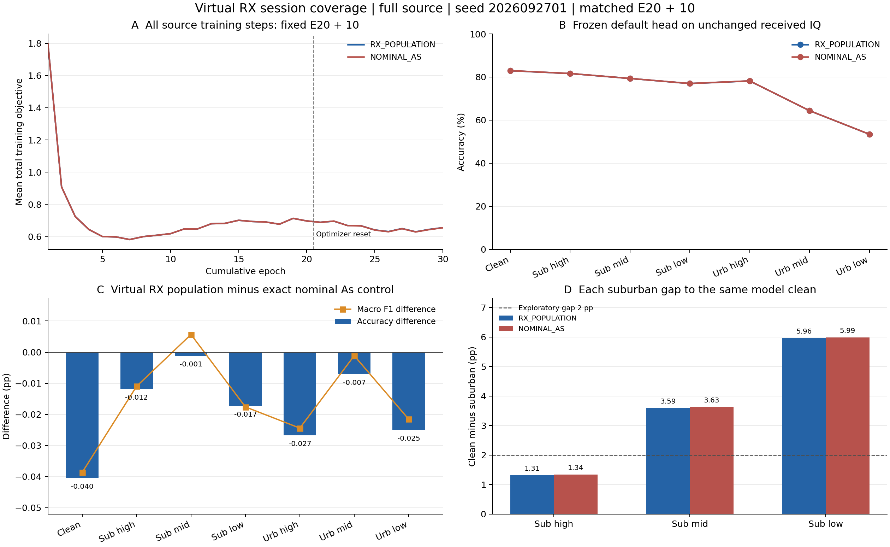

# 完整接收先验的虚拟会话覆盖：E30 负结果

状态：**ANALYZED／VERIFIED；固定配方失败并关闭**。同一个全源普通 As E20 学生及 ownEMA 追加 10 轮，累计 E30／6660 更新；全部七视图预测与独立 truth-last 评分完成。执行 commit：`6f70fbee2deff6a634130c0cb094f70cfce80e89`。原 worker698001／dispatcher697976 均已自然结束，失败标记为空，未改其他健康任务。

本轮只检验“原 As 固定 15 个模拟接收会话是否限制身份学习”。150 个新虚拟会话全部实际生效，但相对严格同父、同预算普通 As，clean −0.040476 pp、mid urban −0.007143 pp、low urban −0.025000 pp，七视图准确率均下降。预定 low 至少 +0.5 pp、clean/mid 不降条件失败。关闭固定配方，不换会话键／刷新间隔／幅度／seed／父模型／预算救跑，不扩种子。单 seed 微小负差只反证这套固定配方达到要求，不能证明接收多样性普遍无用。

## 模型、数据与唯一变化

F＋跨 RX 同 TX、三路 SIG_TIME、统一 Sinc CENTER_25K／CENTER_UNITS、joint160、原默认 cosine W6×160 与骨干联合训练、NoExplicitCFO 和必要内部补偿保持。全部源 RX1/3/4/6/8、day1/2/3、L6300／U56700 隐藏 TX／V27000、split392005，不留出训练 RX，不换5580/720。用户已明确没有可靠的更长上下文映射，后续继续使用现有 **256 点 IQ**。

父为完整源 CONCAT-s2026092701 的 fixed-final20，无其他模型继承，来源和逐角色物理 ID 与本次契约匹配；不按目标排名选择。与 nominal E30 FULL_AS 复用相同父学生和自身 EMA，重置 AdamW lr.0002／wd.0001、cos10，原 U／门控／teacher／segment cache 规则不改。是 E20＋10，不是 scratch30 或精确 optimizer resume。旧基准目标暴露背景保留，不声明新独立盲测；目标不参与参数、父、选模、晋级或选择性重跑。

唯一科学变化：每个累计 epoch21..30×原 RX/day/eq，共 150 个虚拟接收会话，轮内稳定。直接调用原 receiver_for_session／原 receiver seed20261016423；true IQ 幅度范围±.2dB、正交误差±1°、RX oscillator std200Hz、校准估计误差 std.05dB/.2°均沿用原先验，不按 TX/sig/标签设硬件。原记录的真实 RX、物理 ID 和源 IQ 没有被替换或反演，未新增 PA/DAC/量化/剪裁或 TX IQ 变换。

H、几何、遮挡、noise seed/namespace 和完整 residual/post_sync/NoEQ/reference30/reflect 路径保持，一次完整处理，质量／锁定／频相补偿／AGC 依赖仍由原程序计算。属于 A_s 先验覆盖变化，不是新 A_g 证明。旧校准刷新只改变 estimated IQ，保留15组 true硬件；其失败不改判，本次没有调整该旧配方的参数。

原 ordinary 与 As 两对 RDrop 各.5，L128物理样本归一化，4L前向，SupCon .1 只作用于共有 ordinary 对；每对复用同一个已生成 IQ。As 从 raw-before-ordinary 产生，不叠加普通 AWGN/multipath，全部有标签 As 监督，无urban置信筛选；新增 loss／部署参数／头拟合／U规则／NN前向均0。

## 七视图正式身份识别

每视图168000相同物理样本，合计1176000正式决策；全部prediction/logp固定后，独立CPU scorer连接truth。直接使用checkpoint内默认头，测试received IQ／SNR／信道及困难样本不改。

|场景|普通 As 准确率 %|会话覆盖准确率 %|差 pp|会话覆盖宏 F1 %|会话覆盖最差 RX %|
|---|---:|---:|---:|---:|---:|
|clean|82.963690|82.923214|-0.040476|82.492762|73.012500|
|suburban high|81.620238|81.608333|-0.011905|81.182966|73.000000|
|suburban mid|79.329762|79.328571|-0.001190|78.906731|71.558333|
|suburban low|76.977381|76.960119|-0.017262|76.553301|69.641667|
|urban high|78.189286|78.162500|-0.026786|77.709439|70.562500|
|urban mid|64.371429|64.364286|-0.007143|63.908101|58.641667|
|urban low|53.447024|53.422024|-0.025000|52.878423|48.920833|

会话覆盖模型三个suburban距自身clean为 **1.314881／3.594643／5.963095 pp**，普通As为1.343452／3.633929／5.986310 pp。差距略缩小伴随clean下降，不作为联合收益；只有high达到2pp首轮探索条件。

相对同数据、同E20＋10预算的B00 clean85.268452%，候选clean净 **−2.345238 pp**；low53.422024%未超过60%。本行只隔离一个As变化，没有新Ag或四因子／交互项证据。完整联合目标保持ACTIVE，未完成，不把历史不同实验增益相加。

## 完整匹配与同包错误变化

857项实际native参数仅run_id／candidate_id／output_dir不同。两行4440条完整L/U物理序列逐条相同，L6300／U56700全部覆盖，新增2220更新，非有限loss/梯度跳步0。2220条参考目标和2220条Sinc单位记录完整；逐步重算.5commonRD＋.5AsRD＋.1SupCon及两对CE/KL，最大误差1.0728836064011205e-7，全部4L／128As／同IQ／零重抽／全As监督符合。150个虚拟会话覆盖完整10×15笛卡尔积，150/150 true硬件与原固定会话不同；这只证明覆盖变化，不是身份收益。

|场景|修复|新增错误|准确率差 pp|clean 与场景同时正确差 pp|
|---|---:|---:|---:|---:|
|clean|119|187|-0.040476|-0.040476|
|suburban high|149|169|-0.011905|-0.039881|
|suburban mid|185|187|-0.001190|-0.028571|
|suburban low|176|205|-0.017262|-0.032738|
|urban high|148|193|-0.026786|-0.051190|
|urban mid|290|302|-0.007143|-0.031548|
|urban low|331|373|-0.025000|-0.036905|

low修复331／新增373，净多42错；clean修复119／新增187，净多68错。clean与low同时正确82983／对照83045，净少62；共同clean正确139192包中low修复270／新增307，净少37，不能将局部修复记为联合改善。

252个6×6混淆矩阵的准确率、固定六类macroF1和有支持类macroaccuracy重算一致，42个RX/TX/day分区逐元素相加等于overall，最大误差2.22e−16；七视图配对数与正式差值一致。[全部126个分层结果](stratified_results.md)保留所有RX/TX/day和场景，没有选取有利子集。[结果汇总](result.json)与[独立评分复算](result_summary.json)保存完整判定。

## 实际成本与限制

父E20／4440更新复用，新增E10／2220更新，累计E30／6660更新。新增L1136640包NN已包含于student_train1703640中；student_eval324002、teacher_train0／eval567000、预测1176002（含预测CP合成smoke2）、发布真实CP无query合成smoke2，合计 **3770646新增NN包前向**。ownEMA继承eval计数2已扣除，0新teacher或诊断头。

As完整物理处理284160次，新虚拟receiver draw150次、应用284160次，额外滤波／完整信道预跑0；无新NN不等于零物理CPU成本。源段墙钟1244.791744s，预测42.127735s，独立评分CPU墙钟3.472919s。共享资源时序与历史收尾差异存在，墙钟差不作为纯会话采样开销归因。

旧nominal原训练在保存安全权重后自身final加载收尾异常，完整瞬态sourceeval计数未落盘；既有零更新恢复已完成合法七视图评分，本次只复用，不重训重测。训练更新、L/U与L训练前向匹配；不宣称缺失的旧eval总成本也精确匹配。11条旧可选诊断N/A转null并保留路径，不是本次loss/梯度或正式分数非有限。

所有独立分析只读已有日志、分数、正确性数组及父20轮日志，0新IQ／CP／rawtruth／NN／更新。报告分析入口补齐缺失的旧日志工具为本包log_io，图标签同步修正；只读进程执行，训练release／权重／预测均未修改。未新增科学 gate、审批或重审。

[独立PDF图](figures/RXpopulation_matched_E30.pdf)

## 执行与交接

run：`20261017-phase1-F-crossRX-RXpopulation-e20plus10-s2026092701-m1-r01`；owner codex/root/F-RXpopulation-E30；CWD PROJECT/releases/cvs_F_RXpopulation_E30_20261017_r01；命令 CVS-RFFI/bin/python -u experiments/cvs_rx_population30/runner.py。N607普通账户／CPU2／单GPU按全部owner每GPU最多3实验安排；源输出位于PROJECT/runs/20261017-phase1-F-crossRX-RXpopulation-e20plus10-s2026092701-m1-r01，原产物保留。

一次独立P0/P1审查PASS；36协议负例、120同latent配对（共360完整合成处理）、150虚拟会话重复性／原生回放PASS。发布单archive比对／remotecompile／真实CP noquery smoke／PID-CWD-argv-CUDA-GPU-loggrowth均已核实。实际配置见[独立核对](actual_config_verification.json)，状态见[执行证据](execution_evidence.json)。

固定配方关闭，当前没有由合法源证据支持的新训练候选；不将本结果用于目标驱动调参、选择父权重或选择性重跑。A_g跨域身份提取、A_s必要增量和二者联合保留收益仍待证明。E30上限、全部源RX和256点IQ约束继续有效。
