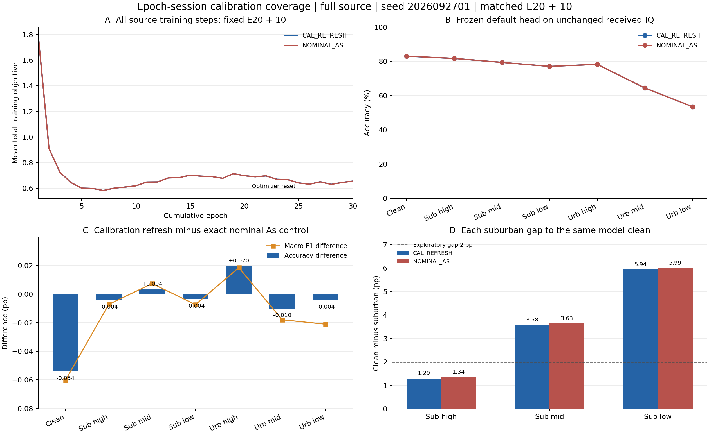

# 原分布校准刷新 A_s：E30 完整匹配负结果

状态：**ANALYZED／VERIFIED；固定校准刷新配方关闭**。执行commit f375e6cc47cfb7d5e7b069b0bd912d5bf8819a0e。原worker与dispatcher已自然完成，新增10轮／2220更新、累计E30／6660更新，七视图1176000个正式决策及独立CPU truth-last评分全部完成。没有重启、重训或重测旧nominal控制。

本轮唯一假设是：只按epoch／原RX-day-eq刷新既有分布的接收校准估计误差，减少训练对固定15组模拟校准状态的依赖，可以改善星地身份识别。150组新估计确实生效，但相对普通As，clean −0.054167 pp、mid urban −0.010119 pp、low urban −0.004167 pp；原“low至少+0.5 pp且clean/mid不降”条件失败，关闭固定配方，不调尺度／刷新间隔／seed／父／预算救跑，不自动扩种子。

## 模型、数据与唯一变量

F＋跨RX同TX、三路SIG_TIME、统一Sinc CENTER_25K／CENTER_UNITS、joint160、原cosine默认头及骨干联合训练、NoExplicitCFO和必要逐包补偿均保持。全部源RX1/3/4/6/8、day1/2/3、L6300／U56700 TX隐藏／V27000、split392005；无训练RX留出或5580/720替代。

候选与nominal E30控制严格从同一个完整普通As的source-final20学生及自身EMA加载，追加10轮。AdamW／cos10重置lr.0002/wd.0001，原U及segment计数／temporal cache复位、ordinary冻结父实际E13，SupCon累计E21至30为.1。属于同父E20＋10，不是scratch30或精确optimizerresume。父由单算子隔离确定，未按目标分数排名；此前基准暴露背景保留，不声明新的独立盲测。目标不用于参数、候选、父、seed或重跑选择。

唯一变化是原模拟器的estimated IQ校准：每个累计epoch21至30×15原session，共150组。estimated amplitude=true＋N(0,.05dB)，estimated quadrature=true＋N(0,.2°)，私有seed20261017541；误差尺度继承既有Config，不拟合源或目标。实际150/150新估计与原估计不同，15组true amplitude／quadrature／CFO逐项保持。传播、注入噪声、quality／lock／frequency／phase／AGC依赖仍走原完整residual一次，没有完整信道预跑或新滤波。

这属于A_s采样变化，不是已证明的A_g、真实RX替换或TX IQ标签保持通则。原ordinary／As RDrop两对各.5，每物理L128归一化、4L前向，每对使用同一已生成IQ，As从raw-before-ordinary生成；所有合法有标签As监督，无urban置信筛选。新loss、U规则、teacher、部署参数及额外NN前向均为0。

## 完整日志与匹配性

两条完整新增段均有10轮／2220实际step／4440条L-U物理序列，逐条相同；L6300／U56700全覆盖，284160 L及567000 U观察。68项实际普通增强、U、父、预算参数一致。候选2220参考目标、2220 Sinc单位日志完整，非有限loss／梯度跳步0。

逐步独立重算.5 commonRD＋.5 AsRD＋.1 SupCon和两对CE＋KL关系，2220/2220通过，最大误差1.1920929e−7；4L／128As／同IQ／零增强重抽／全As监督均一致。15个原session与150个epoch-session完整笛卡尔积逐项核实，true硬件字段未改。

旧nominal原R03在保存安全权重后因自身final加载检查收尾异常，参考／单位／完整前向瞬态计数未落盘；缺项保留。其E30权重已在既有零更新恢复run完成合法评分，本次不重训练或重测它。候选沿用已修复的自身final加载路径，收尾正常。

## 七视图正式识别

每视图168000相同原物理样本。七视图prediction与logp全部固定后，独立CPU scorer才连接truth；直接使用checkpoint默认头，0头拟合。receivedIQ、测试SNR／信道与困难样本完全不改。

|场景|普通As准确率 %|校准刷新准确率 %|差 pp|刷新宏F1 %|刷新最差RX %|
|---|---:|---:|---:|---:|---:|
|clean|82.963690|82.909524|-0.054167|82.471078|72.754167|
|suburban high|81.620238|81.616071|-0.004167|81.186769|73.095833|
|suburban mid|79.329762|79.333333|0.003571|78.908382|71.687500|
|suburban low|76.977381|76.973810|-0.003571|76.563511|69.758333|
|urban high|78.189286|78.208929|0.019643|77.752345|70.662500|
|urban mid|64.371429|64.361310|-0.010119|63.891270|58.604167|
|urban low|53.447024|53.442857|-0.004167|52.878864|48.979167|

刷新模型三个suburban距自身clean为 **1.293452／3.576190／5.935714 pp**；普通As为1.343452／3.633929／5.986310 pp。只有high达到2pp首轮探索条件。差距略缩小主要伴随clean下降，不能作为“suburban接近clean”成功。

校准刷新clean82.909524%，相对同预算B00 clean85.268452%净 **-2.358929 pp**；low53.442857%仍未超过60%。没有clean净收益、新Ag证明或完整联合成功。单As隔离不是新的四因子，不跨实验相加增益；旧clock Ag与有限窗quality固定负结果继续关闭。

原条件：low增量≥+.5pp失败，clean不降失败，mid urban不降失败，每suburban不低于控制.25pp通过；必须全部满足。本次不晋级或自动扩seed。单seed微小差不能证明广泛校准模型无效，只反证该固定配方达到所要求收益。

## 同包错误变化与全量分层复核

|场景|修复|新增错误|准确率差 pp|clean与场景同时正确差 pp|
|---|---:|---:|---:|---:|
|clean|127|218|-0.054167|-0.054167|
|suburban high|181|188|-0.004167|-0.004762|
|suburban mid|209|203|0.003571|-0.005357|
|suburban low|212|218|-0.003571|-0.007143|
|urban high|228|195|0.019643|0.023810|
|urban mid|331|348|-0.010119|-0.027381|
|urban low|381|388|-0.004167|0.002976|

low urban修复381／新增388，净多7错；clean修复127／新增218，净多91错。clean与low同时正确83050／对照83045，净多5（+.002976pp），不足以抵消clean和low绝对指标失败。共同clean正确139161包中low修复321／新增310，净多11正确，仅记录局部重分配，不将其当联合目标完成。

252个既有6×6CM的accuracy、固定六类macroF1、有支持类macroaccuracy全部独立重算，最大误差2.22e−16；42个RX／TX／day分区逐元素相加等于overall，七视图配对数与正式分数一致。完整[分层表](stratified_results.md)保留所有126组层对比，无挑选场景、RX、TX或day。

## 实际成本与局限

父20轮／4440更新复用单列；新增10轮／2220更新，累计30轮／6660更新。新增学生train1703640 NN包（L1136640＋原U567000）、学生源eval324002、教师train0／eval567000；ownEMA继承eval计数2已扣除。正式预测1176000，预测CP合成smoke2、发布真实CP无query合成smoke2；合计 **3770646新增NN包前向**。源eval含source合成smoke2及固定后的额外V评估，不更新权重、头、EMA、门控；旧nominal完整源eval计数不可恢复，不声称所有eval总成本精确匹配。训练更新、L/U及L训练前向安排匹配。

150次校准状态生成、284160次校准估计应用，额外物理滤波与完整信道预跑均0；原传播和噪声照常生成。新增源段1232.904540s，预测42.134798s，独立CPU评分3.360722s。旧nominal保存源段1217.304243s，包含不同收尾与共享资源时序，墙钟差不能归因成纯校准开销。不得把不增加NN写成零物理／CPU成本。

全部分析只读现有源日志、分数与正确性数组，0新IQ／CP／raw truth／NN／更新。11项历史可选诊断N/A在分析JSON中转null并列路径；正式分数和实际训练目标均有限，不是模型非有限失败。一次P0/P1、发布smoke、归档传输、remotecompile及原PID/CWD/argv/GPU/loggrowth证据见verification.json，无重复审批或重跑。

源代码与实际计数证实校准覆盖增加；正式身份识别否定本固定收益假设。当前本实验已完成并关闭，没有新训练候选晋级。A_g跨域身份提取和A_g＋A_s联合目标仍为ACTIVE、尚未证明；后续新问题仍需独立合法源证据，不能据本次目标差值调整校准或其他候选。

[PDF图](figures/calibration_refresh_matched_E30.pdf)

## 原发布记录（历史状态保留）

以下RUNNING／E21是当时观察，以本页顶部完成状态为准。

状态：**RUNNING／VERIFIED**。执行commit f375e6cc47cfb7d5e7b069b0bd912d5bf8819a0e。一次归档传输、remote compile、同引擎检查、真实CP无query2包smoke均PASS；原worker PID/CWD/argv/GPU和源step日志228585→293911字节增长已独立核实。严格同父学生／ownEMA／空优化器初始化通过，现已观察新增E1／累计E21、222／累计4662更新、L113664 NN／As28416；原进程健康，尚无final30或正式识别结果。唯一假设：保持原 practical 传播、噪声、接收质量／锁定及真实注入硬件参数不变，仅将原模拟器校准估计误差按源 epoch／RX-day-eq 刷新，能减少对固定15校准状态的依赖并改善星地身份识别。代码证据为原 receiver_for_session 由固定 seed＋RX/day/eq生成同一个true-plus-error估计，现有训练15状态全程复用；它不是已证明的性能瓶颈。

唯一模型 CAL_REFRESH-s2026092701 从完整普通 As 的固定source-final20及自身EMA严格追加10轮，累计E30／6660更新；对照是现成同父nominal E30 FULL_AS，不重训、重测或从失败quality/clock模型继承。父只由严格算子隔离确定，非目标分数排名。承认此前基准已暴露，不声明新的独立盲测；目标分数不用于校准幅度、分布、seed、父、选模、选择性重跑或后续扩种子。

F＋跨RX同TX、三路SIG_TIME、统一Sinc、joint160、原默认cos头与骨干联合训练、NoExplicitCFO及必要补偿保持。全部原RX1/3/4/6/8、day1/2/3，L6300／U56700 TX隐藏／V27000，split392005；无源训练域留出、无5580/720替代。AdamW／cos10复位lr.0002、wd.0001、原U/ownEMA、segment/cache复位、ordinary冻结父实际E13、SupCon累计E21至30为.1，与nominal相同。不是scratch30或精确optimizerresume。

原 true amplitude／quadrature／CFO 永远保持15个session。仅estimated amplitude=true＋N(0,.05 dB)，estimated quadrature=true＋N(0,.2°)；尺度直接继承既有Config，不拟合源/目标。新私有seed20261017541按RX/day/eq和累计epoch21..30产生150组共享估计，label不参与；同epoch同session重复调用一致。原latent seed、h、噪声方差、几何、state、quality／lock／phase／frequency／AGC规律保持，同一原IQ只过一次完整residual。无新物理滤波、完整信道预跑、A_g、loss、U机制、teacher、NN前向或部署参数。数字变换已接收IQ不等于真实RX替换；不修改或校正源TX身份非线性/IQ特征，不把校准多样性命名为已证域泛化。

原ordinary／As RDrop两对各.5，物理L128归一化、4L前向，各对同一已生成IQ，clean监督份额保持；As从raw-before-ordinary生成，全部合法有标签样本监督，无urban置信筛选。预期新增2220更新、L1136640包NN、As284160、原U567000；校准估计实际draw150，估计应用284160；教师／源eval／预测／smoke／墙钟实际单列，父20成本复用另列，0超过E30预算。

固定final10／累计30后自动clean＋六practical，每视图168000，七视图prediction与logp全部固定后独立CPU truth-last。测试receivedIQ、SNR、信道与困难样本不变。全部RX/TX/day、accuracy／macroF1／worstRX、各suburban绝对值及自身clean差、修复／新增错误与clean场景同包联合正确均报告。

固定反证：相对nominal低urban增量不足.5pp，或clean／midurban下降，或任一suburban下降>.25pp，关闭该固定识别配方，不调整误差幅度／刷新间隔／seed／父／预算救跑、不自动扩seed。还须报告完整目标：clean对同预算B00净正、low>60%、各suburban自身clean差≤2pp首轮探索条件，不能降低clean缩差；此单As隔离不构成新四因子或联合成功。

32项协议负例、240同latent合成配对（另240原参考＋240重复验证调用）PASS，覆盖LOS/PARTIAL/BLOCKED；只变估计参数，h／quality／lock／freq／原噪声方差相同，输入及全局NumPy RNG不变；合成IQ最大相对变化.00760068。本地合成检查0真实IQ／CP／NN／更新；发布smoke另有1真实CP／2合成NN／0查询。这是实现证据，不能替代真实标签保持／识别收益。唯一独立P0/P1审查PASS（0 P0／0 P1）。旧自身final loader修复原样保留。

owner codex/root/F-calibration-refresh-E30；不可覆盖root PROJECT/runs/20261017-phase1-F-crossRX-calibration-refresh-e20plus10-s2026092701-m1-r01，CWD PROJECT/releases/cvs_F_calibration_refresh_E30_20261017_r01，命令 CVS-RFFI/bin/python -u experiments/cvs_calibration_refresh30/runner.py，N607普通账户／CPU2／每GPU最多3总实验进程含其他owner。实际代码commit由release_commit与resolved写入，一次N607preflight、一个归档传输比较、remotecompile、首步真实匹配CP无query2包smoke PASS即继续，再一次PID/CWD/argv/GPU/loggrowth核实。仅数据／来源／非有限／预测不全／输出冲突／系统技术失败停止run-owned流程并保留，不自动重试，不修改旧健康任务。

REJECTED_EXTRA_GATE：单独设计审批／额外hash或报告完备审批在用户明确最小实验工作流下NONBLOCKING；无新增审批层。
