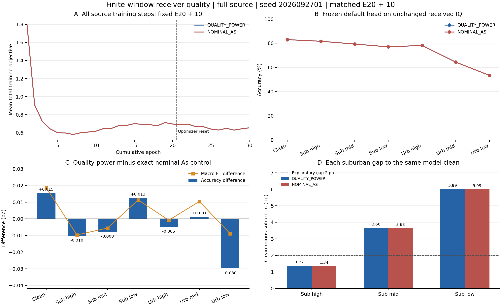

# 有限窗接收质量 A_s：E30 匹配结果

状态：**ANALYZED／VERIFIED；固定配方因识别收益失败而关闭**。执行 commit 0eec04fb2b99f0cfecf6ddd18d6eda085dcf58c7。新增一行已经自然完成 E20＋10、累计 E30／6660 更新、clean＋六 practical 全部 1176000 个正式决策和独立 CPU truth-last 评分。没有重训、重测旧 nominal 控制，没有留出任何源训练 RX。

原假设是以同一原始 IQ 的有限窗 H*x 功率代替白输入期望功率来决定 practical 接收质量，同时保留传播、注入噪声、锁定与补偿的依赖。全源物理检验通过，只证明处理确有差异。实际识别 low urban 相对普通 As **−0.029762 个百分点**，没有达到预定 +0.5 个百分点，故关闭；不改窗口、噪声、系数、seed 或预算救跑，不自动扩种子。

## 同预算和数据边界

底座是 F＋跨 RX 同 TX 对比学习：三路 SIG_TIME、统一 Sinc CENTER_25K／CENTER_UNITS、joint160、原 cosine 头及骨干联合训练，NoExplicitCFO 与必要逐包补偿保留。全部 RX1/3/4/6/8、day1/2/3；L6300、U56700 TX 隐藏、V27000、split392005，既有物理角色不变，不使用 L5580/L_dev720。

候选和既有 nominal E30 从同一个普通 As source-final20 及其自身 EMA 严格加载，追加10轮。AdamW／cos10 重置（lr0.0002、wd0.0001），U 原规则及分段计数／temporal cache 重置，ordinary 冻结父实际 E13，SupCon 累计 E21 至 E30 为0.1，IQ 算子 epoch20／step4440 偏移。它是固定 E20＋10，不是 scratch30 或精确优化轨迹恢复。父与矩阵固定在此前新 E20 目标成绩读取前；不根据目标排名选父。

两条完整10轮日志均有2220实际更新、4440条L/U序列；全序列逐条相同，覆盖完整6300 L与56700 U，每段284160 L／567000 U观察。68项实际普通增强、U、父、预算相关参数一致；每步4个L前向、128 As、原对比项0.1，非有限loss／梯度跳步为0。候选还保留2220参考目标和2220 Sinc单位记录，逐步物理裁剪计数1至2220。旧 nominal R03 收尾自身final误拒绝后的瞬态参考／单位／完整前向计数未落盘，这一缺项保持披露，不能补写为已记录。其固定权重已在既有零更新恢复run完成合法评分。

## 七视图正式结果

每视图168000原物理样本。两行全部七视图 prediction 与 logp 完成后，独立 scorer 才读取真值；默认头直接预测，0头拟合。测试 received IQ、SNR、信道与困难样本均不修改。

|场景|普通 As 准确率 %|有限窗质量准确率 %|差值 pp|有限窗宏 F1 %|有限窗最差 RX %|
|---|---:|---:|---:|---:|---:|
|clean|82.963690|82.979167|0.015476|82.550087|73.000000|
|suburban high|81.620238|81.610119|-0.010119|81.184257|73.066667|
|suburban mid|79.329762|79.322024|-0.007738|78.895534|71.620833|
|suburban low|76.977381|76.989881|0.012500|76.582274|69.775000|
|urban high|78.189286|78.184524|-0.004762|77.733028|70.570833|
|urban mid|64.371429|64.372619|0.001190|63.919695|58.616667|
|urban low|53.447024|53.417262|-0.029762|52.891078|49.025000|

有限窗质量三个 suburban 与自身 clean 的差为 **1.369048／3.657143／5.989286 pp**，普通 As 为1.343452／3.633929／5.986310 pp。只有 high 达到首轮2 pp探索目标。有限窗 clean 82.979167%，相对同预算无新增 As 的B00 clean85.268452%仍为 **−2.289286 pp**；low53.417262%未超过60%。因此没有 clean 净收益或完整联合成功。clean 的 +0.015476 pp也不能作为新 A_g 或跨 RX 泛化证明。

预登记条件逐项判定：low增量≥0.5 pp失败；clean不降、mid urban不降、每 suburban不低于控制0.25 pp均通过。必须全部满足，故不晋级。该单As隔离不是新的四因子矩阵，不把不同实验增益相加，时钟Ag负结果仍关闭。

## 错误变化和独立复核

|场景|修复|新增错误|准确率差 pp|clean 与场景同时正确差 pp|
|---|---:|---:|---:|---:|
|clean|179|153|0.015476|0.015476|
|suburban high|152|169|-0.010119|0.004167|
|suburban mid|185|198|-0.007738|-0.003571|
|suburban low|227|206|0.012500|0.032738|
|urban high|212|220|-0.004762|-0.005357|
|urban mid|349|347|0.001190|0.010714|
|urban low|380|430|-0.029762|-0.035119|

low urban修复380、破坏430，净多50错；clean和low同时正确82986，对照83045，净少59。两模型共同clean正确的139226包中，low修复289、破坏359，净多70错，不能声称只是把错误重新分配后取得联合收益。

已从既有分数的252个6×6混淆矩阵独立复算accuracy、固定六类宏F1及有支持类宏accuracy，最大误差2.22e−16；42个RX／TX／day分区总和逐元素等于overall，七视图配对计数与正式分数全部一致。无新增raw truth、IQ、CP或NN。完整分层见[stratified_results.md](stratified_results.md)。

## 实际训练与前向成本

父20轮／4440更新单列复用，本行只新增10轮／2220更新，累计30轮／6660更新。新增学生train前向1703640包（其中L1136640、原U567000），学生源eval324002包，教师train0、教师eval567000包；自身EMA继承计数eval2已扣除。正式预测1176000包，预测CP合成smoke2，release真实CP无查询合成smoke2；本次全部新增NN包前向合计 **3770646**。源eval324002含源合成smoke2及固定后的额外V评估，均不更新骨干、头、EMA或门控。旧nominal的完整源eval计数未保存，不能声称所有eval成本精确相同；训练更新与L/U观察及训练前向安排匹配。

As观察284160；额外物理功率预滤波284160次；完整信道预跑0。15358次改变有效接收处理（5.404702%），5332次改变锁定。包含原信道在内的quality/channel计算413.959091 s，不是单独额外预滤波耗时。新源段1283.589175 s，旧nominal保存的源段1217.304243 s；来源于各自运行及收尾流程，不能把墙钟差全归因于预滤波或据此宣称精确加速比。候选预测43.638670 s、CPU评分3.246234 s另列，不计入训练E30。

## 结论与边界

源物理18900配对与训练实际15358差异支持“接收质量计算会改变处理”，正式匹配识别否定“该固定质量口径带来所要求的星地收益”。这不证明真实有限窗功率无物理意义，也不证明更广泛A_s无效。训练loss全10轮与控制几乎重合，loss下降或源健康不能替代正式身份收益。单seed结果不作多seed稳定结论。11项历史可选诊断N/A非有限值在分析JSON中转为null并记录路径；正式分数、实际更新和训练loss均有限，这不是模型非有限失败。

本实验完成收尾；Ag跨域身份提取与Ag＋As联合目标保持ACTIVE、尚未证明。当前没有晋级的新训练候选。下一项必须由未使用目标反馈的源域或物理证据提出，先核实实际调用路径与最小可证伪条件。

[PDF图](figures/quality_power_matched_E30.pdf)；执行环境与命令、停止条件见下列原发布记录。原记录的RUNNING与E1是当时观察，已由本页顶部完成状态覆盖。

## 原发布记录（保留）

状态：RUNNING／VERIFIED。执行 commit 0eec04fb2b99f0cfecf6ddd18d6eda085dcf58c7；单归档比较、remote compile、实际引擎数值检查、真实 CP 无查询2包smoke、严格父与ownEMA、空optimizer复位、PID/CWD/argv/GPU／日志增长均已核实。已观察新增 E1／累计 E21、222／累计4662更新；未完成E30或正式评分。唯一假设：用实际原始 IQ 的有限窗 H*x 功率决定 practical 接收质量，保留传播、噪声和补偿依赖并改善识别。依据是完整原 L6300／5 RX 的18900同信道物理配对：1010（5.34%）改变有效处理、355改变lock；不是身份识别收益。

只新增 QUALITY_POWER 一行，从完整源普通 FULL_AS 的 source-final20 学生和自身 EMA 严格追加10轮，累计 E30／6660更新。复用已完成同父 FULL_AS E30 对照，不复训或重测对照，不继承失败时钟 Ag。父是为唯一算子匹配固定的 source-final20，原五行预算与父在新 E20 目标读取前固定，不按目标排名选父。两行同父、同初始化规则、AdamW／cos10复位（lr0.0002/wd0.0001）、原 U／EMA规则与分段计数／temporal cache复位、ordinary冻结父实际E13、SupCon累计E21至30权重0.1、同场景／seed／IQ随机流；不是 scratch30 或精确 optimizer resume。

全部源 RX1/3/4/6/8、day1/2/3、L6300／U56700 TX隐藏／V27000、split392005；无训练域留出或5580/720替代。F＋CROSS_RX、三路SIG_TIME、统一Sinc、joint160、默认cos头及骨干正常联合训练、NoExplicitCFO／内部逐包补偿保持。无新Ag、loss、U机制、诊断头、部署分支或参数。

原传播核 h 保持。每 As 用同一 raw、原 reflect 边界做一次 H*x 功率预滤波，除以不变的参考噪声方差，再传给原 residual.process；完整残差引擎只处理一次，不先生成另一份完整信道或叠加信道。保留参考噪声30dB、原几何／状态／硬件／校准抽样及依质量联动的相位／频率处理和AGC。采集噪声未知，此口径仍不是真实总 SNR。正式 received IQ／测试 SNR／信道／样本完全不改。

As走 raw-before-ordinary，不重复旧 AWGN／multipath／PA；全部合法有标签As监督，不筛urban置信。ordinary和As的 RDrop 对各权重0.5、按128物理样本归一化；每对同一生成IQ、4次L前向，clean份额与完整普通拼接一致。每 As 额外一次纯物理功率预滤波，0额外网络前向；预滤波计数和实际CPU／墙钟单列，不称零成本。

固定 final10／累计30，自动clean和六practical，每视图168000物理样本。七视图 prediction/logp 全固定后 exec 独立CUDA为空CPU scorer连接truth。报告全部RX/day/TX、宏F1、最差RX、suburban绝对值／自身clean差、同包修复和新增错误。此单As隔离不是新四因子，不把旧Ag增益与本候选相加预测联合成绩。

预定放弃条件：相对同父nominal As，low urban增量不足0.5个百分点，或clean／mid urban下降，或任一suburban下降超过0.25个百分点，即关闭该固定配方；不据目标成绩调窗口／噪声／系数／seed救跑或自动扩种子。另报告完整联合目标：clean相对同预算B00净正、low>60%、各suburban与自身clean差≤2pp探索条件，不以降低clean缩小差距。单seed局部正差不完成总目标。

本地21项协议负例＋48单次物理实现例（另48参考调用），覆盖LOS/PARTIAL/BLOCKED，PASS；0真实IQ/CP/NN/更新，compile PASS。限定独立P0/P1审查一次PASS。旧native收尾加载自身final误拒绝，只在本新副本修复：缓存声明父或原loader读取本run自身final，其余拒绝；正负路径已直接验证，旧任务不改。发布首步执行一次真实CP无查询2包smoke，默认头及严格父数据证明通过即继续。

owner codex/root/F-practical-power-E30。不可覆盖root PROJECT/runs/20261017-phase1-F-crossRX-practical-power-e20plus10-s2026092701-m1-r01；CWD PROJECT/releases/cvs_F_practical_power_E30_20261017_r01。命令 CVS-RFFI/bin/python -u experiments/cvs_practical_power30/runner.py。N607普通账户、CPU2、每GPU最多3个总实验进程含其他owner。一次N607资源检查实际回读已完成。执行commit在release_commit／resolved记录；一个发布归档和一次传输核对、remote compile、首步smoke及PID/CWD/argv/GPU／日志增长依既有最小流程。停止仅数据／来源／非有限／预测不全／输出冲突／系统技术失败，保留产物，无自动重试，不动其他健康任务。

新增训练10 model-epoch／2220更新；父20／4440单列，累计30／6660。复用nominal对照的原20＋10另记，不计为新训练。预期新增L网络包1136640、As284160、功率预滤波284160、原U567000观测；教师、学生源评估、smoke和实际墙钟分别记录。无超过 E30 的预算。
