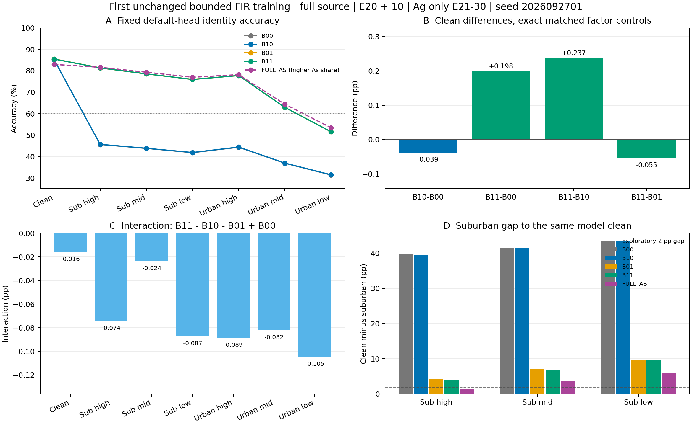

# 固定平滑 IQ 滤波首次训练 E30：最终结果

**ANALYZED／VERIFIED；本固定训练配方未通过预定条件，关闭。完整联合研究仍 ACTIVE。**

两条新增行均完成匹配父 E20＋10／累计 E30／6660 更新，全部五源 RX 与 L6300／U56700 隐藏 TX／V27000 保持，没有训练域留出。各行先完成七视图 1176000 个固定接收 IQ 决策及 logp，再由独立 CPU truth-last 评分；新增正式决策共2352000。原默认 cosine 头随骨干联合训练，0另训头，0测试 IQ／SNR／信道／覆盖修改。

执行 commit：`97f260f469a47a000eed8ab84e8507a3cd0ca37d`。完整配置与矩阵见 [experiment.json](experiment.json)，全部 RX/TX/day 及 Macro-F1 见 [stratified_results.md](stratified_results.md)，配对错误、成本与复算结果见 [result_summary.json](result_summary.json)。

## 正式身份识别结果

下表单位为 %。B00/B01 为原已冻结匹配 E30 控制；新增 B10/B11 的 FIR 仅在累计 E21 至 E30 启用，不能称完整30轮 Ag。FULL_AS 使用更高 A_s 监督份额 .5，而四因子为 .25；保留作普通强拼接背景，不将其差异归为纯 A_g。

|视图|B00|B10：新 A_g|B01：原 A_s|B11：联合|普通 FULL_AS|
|---|---:|---:|---:|---:|---:|
|clean|85.268452|85.229167|85.522024|85.466667|82.963690|
|practical_high|45.612500|45.682738|81.348214|81.344048|81.620238|
|practical_mid|43.804762|43.851786|78.537500|78.560714|79.329762|
|practical_low_suburban|41.807143|41.875595|75.968452|75.949405|76.977381|
|practical_high_urban|44.342857|44.420238|77.791667|77.780357|78.189286|
|practical_mid_urban|36.883929|36.945833|62.930952|62.910714|64.371429|
|practical_low_urban|31.398810|31.475000|51.576190|51.547619|53.447024|

|比较|clean 差（pp）|low urban 差（pp）|
|---|---:|---:|
|B10-B00|-0.039286|0.076190|
|B11-B00|0.198214|20.148810|
|B11-B10|0.237500|20.072619|
|B11-B01|-0.055357|-0.028571|

B11 clean 相对 B00 虽有 +0.198214 pp，但既有 B01 本身已有 +0.253571 pp；新增 FIR 相对 B01 反而为 −0.055357 pp。B10 的独立 clean 收益为 −0.039286 pp，未达到预定 +0.2 pp。不能把联合模型的净 clean 正值归功于新 A_g。

B11 相对 B01 的 mid urban −0.020238 pp、low urban −0.028571 pp，低 urban 增量未达到 +0.5 pp，mid 保持条件也失败。各 suburban 相对 B01 在 −0.25 pp 保护范围内，但这些条件通过不抵消泛化与 urban 失败。当前固定种子下不支持新增滤波具有所需收益；该结论不扩展为所有 FIR 或所有种子必然无效。

low urban：修复507个、产生555个新错误，净少正确48个；clean：修复173个、新错266个，净少93个。clean 与 low 同时正确的样本净少94个；两模型均 clean 正确的143411个样本中，low 修复425／新错465。输入保护通过、实际滤波发生及全部数据访问合法，均没有替代正式身份收益。

## 交互与 suburban 目标

交互为 A(B11)−A(B10)−A(B01)＋A(B00)，七视图均为负：

|视图|交互项（pp）|
|---|---:|
|clean|-0.016071|
|practical_high|-0.074405|
|practical_mid|-0.023810|
|practical_low_suburban|-0.087500|
|practical_high_urban|-0.088690|
|practical_mid_urban|-0.082143|
|practical_low_urban|-0.104762|

B11 suburban 高／中／低准确率分别81.344048%／78.560714%／75.949405%，相对自身 clean85.466667% 的差为4.122619／6.905952／9.517262 pp，均未达到首轮2 pp探索目标。相对 B01 的差距微缩伴随 clean 降低，不能记作所需净改善。B11 low51.547619% 未超过60%；FULL_AS low53.447024% 仍更高，其 clean82.963690% 也有代价。整体联合目标未完成。

## 完整验证与实际成本

两行各2220步记录与4440条 L/U批次序列完整；分别与对应匹配控制逐条相同，全部 L6300/U56700 被观察到。857个实际参数仅 run_id、candidate_id、output_dir 不同；监督尺度复算最大误差 B10=1.1921e−7、B11=1.0729e−7。所有2220步均四次 L前向、同 IQ RDrop 对、0重抽、0 U真值、0非有限跳步；全部已生成有标签 A_s 均监督。

全部142080次／行 FIR 选择、逐步核计数及 RX/day/核分组均由完整物理序列独立重建并一致；12核均实际使用。RMS相对误差最大3.5763e−7；额外 FIR MACC 每行4801167360。host enqueue 2.988751／3.021468 s 单列，不能当完整 GPU耗时。原有限窗 PSD 保真失败仍保持，既有全源 raw 输入身份保护仅证实输入保护。

|项目|B10 新增段|B11 新增段|
|---|---:|---:|
|actual_steps|2220|2220|
|parent_steps|4440|4440|
|cumulative_steps|6660|6660|
|L_forward_packets|1136640|1136640|
|student_train_forward_packets|1703640|1703640|
|student_eval_forward_packets|324002|324002|
|teacher_train_forward_packets|0|0|
|teacher_eval_forward_packets|567000|567000|
|Ag_training_observations|142080|142080|
|As_training_observations|0|142080|
|elapsed_seconds|743.267947|1000.928408|

各行额外预测 NN1176002（含自身 checkpoint smoke2）；预测 wall43.974281／42.331626 s，独立 scorer 的 **CPU_wall_seconds** 为3.467096／3.211995 s，不能当纯 CPU处理器时间。两新增行的正式训练／源评估／自身 EMA／预测加全源输入检查共7705092包 NN前向；父 E20成本与本地／远端合成检查分别记录，没有新模型分支或额外教师。

已评分五行的630个混淆矩阵、105个完整分区求和、所有七视图正确数与配对错误重算一致，最大指标误差0。两新增行实际更新总4440，模型和 worker 自然终止；未停止或修改健康旧任务。既有目标基准已经暴露，本次不声称新的独立盲测；目标未用于选择核、幅度、父权重、模型、轮次、seed、晋级或重跑。

## 本轮结论与下一步边界

已证实：代码确实施加固定有界 FIR，保持指定输入保护与成本控制；原 ordinary practical 控制已有实际星地适应收益。本轮新增滤波没有带来所需 clean 或 urban 增量，七视图交互均负，本固定 E21至E30 训练配方关闭，不改核／幅度／边界／父／seed／预算救跑，不自动扩种子或构造 A_s(A_g(x))。不从本次两个子权重按目标成绩挑选后续父模型。

本轮唯一待检验假设已完成反证，当前没有另一个已获合法源证据支持的新训练候选。下一最小实验尚未确定；需先形成与既有失败路线不同的源证据，不能据这些目标分数反向调节候选。完整目标保持 ACTIVE，不把单种子局部变化、源健康或流程闭合当成完成。

[可导出 PDF 图](figures/fixed_FIR_E30.pdf)

## 冻结前预登记与发布记录

以下保留当时范围、停止规则和状态；当前状态以上述最终结果为准。

状态：RUNNING／VERIFIED。B10 已完成训练、七视图预测及独立评分；B11 继续固定预算训练。run_id：`20261017-phase1-F-crossRX-spectralIQ-firsttrain-e20plus10-s2026092701-m2-r01`。实际矩阵与 seed 见 [experiment.json](experiment.json)，本地检查及限定独立审查见 [verification.json](verification.json)。

用户最新预算为 E30，基线为 F＋跨 RX 同 TX 对比学习。全部源 RX1/3/4/6/8、day1/2/3、L6300／U56700 隐藏 TX／V27000、split392005 保持，没有训练域留出或 L 内部再划分。使用 F 三路 SIG_TIME、统一完整 Sinc 修正、真实 joint160、既有默认 cosine 头，骨干和头按原流程联合训练。保留 NoExplicitCFO 和必要逐包补偿。

## 问题与历史负结果

唯一假设：既有源 RX 关联支持的轻度有界平滑观测变化，在相同训练份额下首次训练能改善跨 RX clean，并保留普通 practical 适应。这里检验学习效用，不宣称数字滤波替换真实 RX。

旧源研究 `20261016-diagnostic-F-crossRX-spectralIQ-fitL-s2026092701-m1-r01` 仍为 FAIL_FIXED_FILTER_CLOSED：跨 TX/day 的 RX 谱关联及默认头身份保护通过，但有限窗 PSD 与循环参考的保真条件失败；没有训练过 FIR 模型。本轮不改判旧结果，不重算或放宽旧阈值，不更换核、幅度、边界、统计拟合、RX 子集或随机种子。原 L5040 只用于拟合源输入统计，包含于当前 L6300；不继承旧四 RX 分类模型权重。新模型实际使用全部五 RX。

旧普通 practical 拼接已显示 urban 适应收益与 clean 代价；时钟、接收校准刷新、有限窗质量、PDP 形状、MMSE 混合及等均值 N0 的固定配方失败均保留。最新包络统计假设亦失败，不重复这些训练路线。

RDrop 是既有随机子网络正则，不记作 IQ A_g。历史 SIG_TIME 两前向与 RDrop 的正收益来自不同 clean 配方；旧 ORIGINAL／TWO_CE／RDrop 完整匹配登记尚未发布，当前 F＋跨 RX 配方也没有完整三者 E30 星地比较。该证据缺口如实保留，不新增阻断闸门、不将不同实验增益相加。

## 最小矩阵与模型来源

| cell | 新增 A_g | A_s | 来源与增量 |
|---|---|---|---|
| B00 | 无 | 无 | 复用已冻结匹配 E20＋10 的 B00 |
| B10 | 固定 FIR，仅 E21 至 E30 | 无 | 从同 B00 的全源 E20 父独立追加 10 轮 |
| B01 | 无 | 原 practical | 复用已冻结匹配 E20＋10 的 B01 |
| B11 | 固定 FIR，仅 E21 至 E30 | 原 practical | 从同 B01 的全源 E20 父独立追加 10 轮 |

新增行仅 FIR_B10-s2026092701、FIR_B11-s2026092701。匹配对照来自 `20261017-phase1-F-crossRX-clock-e30-score-recovery-s2026092701-m5-r01` 的 nonAg B00/B01，不使用旧 clock Ag 父模型。B10 父为完整源拼接参照的 REPEAT/source-final20；B11 父为完整源四因子的 B01/source-final20。均按固定末轮产生、从零初始化且实际源角色一致；继承自身 EMA，重置 AdamW 与原生 cosine10。不是恢复完整 optimizer 轨迹，也不是从零完整 E30 Ag。加载时只复用已有匹配来源证据与数据句柄，拒绝来源不明、契约不匹配及目标参与选模的权重。

每行父成本 E20／4440 更新，新增 E10／2220 更新，累计 E30／6660 更新；两行新增 20 model-epochs／4440 更新。原 U 规则、教师、门控、SupCon 层位及权重不变；不使用 U TX 真值、不新增 U 增强。测试结果不影响父模型、核、幅度、损失、轮次、seed、行顺序或选择性重跑。

## 实际 IQ 与监督路径

保留旧 ordinary 的实际父参数和 E13 日程；不是完全无增强对照。每步共有 ordinary128 的同 IQ 两次 RDrop 前向占监督 .5，extra128 的同 IQ 两次前向占 .5；总 L 尺度为 1，另加原 SupCon .1。extra 中按既有交替 mask 分 64 A_g 槽和 64 A_s/control 槽。

A_g 仅在对应 ordinary 槽之后施加一次原 structured FIR：33 tap Hann、reflect16、去除数值中心延迟、原包 RMS 恢复；原核响应最大绝对幅度不超过 .5 dB。所有原 12 个 structured 核等概率，物理五元组＋累计 epoch/step＋独立 seed20261017991 决定选择；不依赖 TX 标签，不消耗原全局随机流。RMS 恢复可消除纯增益，但保留相对频率响应；不增加 PA、DAC、剪裁、CFO、AWGN 或多径。边界延拓及有限窗与循环参考差异继续明确保留。

A_s 在另一槽从原 L raw 输入调用原完整 practical residual/post_sync 处理一次，不先经过 ordinary，不连续施加完整星地信道。传播、噪声、接收质量及补偿依赖保持；全部合法有标签 A_s 参与监督，不设高置信前置条件。本轮不构造 A_s(A_g(x))，组合视图留待独立问题。共同原监督份额和四次 L 前向保持，对照控制重复前向。

每行新增 L 神经网络包前向 1136640，A_g 观测 142080；A_s 为 B10 的 0 或 B11 的 142080。FIR 额外物理计算与 host enqueue 时间单列，不冒称同 FLOPs；原 U、教师、源评估、测试、wall 各自记录。FULL_AS 的 A_s 剂量 .5、高于四因子的 .25，复用作普通强拼接背景参照，差异不归因于纯 A_g。

## 输入检查、执行与停止

本地聚焦检查 PASS：41 个协议负例、128 个合成 FIR 包、64 次原公式复算，最大误差 4.7684e−7；原 RNG／输入未变、包重排不变；实际 F 参数 900722，合成 NN4，真实 IQ／CP／更新均 0，编译 PASS。一次限定 P0/P1 审查发现自身 final 重载问题；已接入父缓存／自身 final 原生加载／其他来源拒绝策略，一次定向复核 PASS。

启动首步 CPU2、CUDA 空：加载两个匹配全源父 checkpoint，完成真实 checkpoint 无 query 合成 smoke4，并在原 L6300 对 raw＋12 原核共 163800 个默认头决策。总 163804 NN、2 CP、1 原缓存、0 更新／target。沿用原身份保护要求：每核整体下降不超过 .5 pp，各 RX／TX／day 不超过 1 pp。该检查只约束 raw 源输入，不证明旧 ordinary＋FIR 交互无害或训练有益，也不恢复旧 PSD 保真结论。失败保存 SOURCE_INPUT_REJECTED、零训练、零 target；通过则同 dispatcher 自动训练两行，不再申请审批。

本地发布：`python -m experiments.cvs_spectral_train30.publish`；远端 CWD：`PROJECT/releases/cvs_F_spectralIQ_firsttrain_E30_20261017_r01`；入口：`CVS-RFFI/bin/python -u experiments/cvs_spectral_train30/runner.py`。一次 N607 preflight、一次 release archive 传输比对、远端编译／合成检查、启动后 PID/CWD/argv/GPU/日志增长读回。执行 commit 以同 release 的 release_commit.txt 为准；本地登记占位由发布时写入实际 commit。

不可变输出：`PROJECT/runs/20261017-phase1-F-crossRX-spectralIQ-firsttrain-e20plus10-s2026092701-m2-r01`；独占 row/source、prediction、scores、logs。普通账户，CPU2；所有 owner 合计每 GPU 不超过 3 实验进程且预留 12 GB。没有自动重试、换 seed 或追加预算。源身份保护失败科学关闭；启动后低分不技术停止。仅协议越界、来源/数据错误、非有限值、不可执行、输出碰撞、正式 prediction/scorer 无法闭合等所属技术故障停止本 run，保留产物且不干预健康旧任务。

每行固定 final10／累计30 后自动预测 clean＋六 practical，各 168000 原固定接收 IQ；本行七视图全部完成并固定 prediction/logp 后独立 CPU truth-last 评分。无需等待另一行，不改测试 SNR、信道、received IQ 或样本覆盖。预期 source/final checkpoint、实际 args／训练与增强计数、source_guard、七视图 prediction／score／CM／配对错误、成本、completion、result 等产物；未完成评分不能记为实验完成。

## 预定判据与边界

固定单种子反证条件：B10 clean−B00 至少 +.2 pp；B11 clean−B00 非负；B11 low urban−B01 至少 +.5 pp、mid urban 不降；各 suburban 相对 B01 不低于 −.25 pp。任一失败即关闭此固定训练配方，不改核/幅度/父/seed/预算救跑。全部通过仍仅为本配方单种子结果，不自动晋级或扩种子。

必须报告 B10−B00、B11−B00、B11−B10、B11 low−B01、各 suburban 绝对值及相对自身 clean 的差，以及每视图交互 B11−B10−B01＋B00、修复/新增错误与 clean/场景共同正确变化。完整联合目标仍要求 clean 正净收益、low urban>60%、每 suburban 距 clean 的首轮探索目标 2 pp；不能靠 clean 下跌缩小差距。本轮尚无训练或正式评分结果，联合研究保持 ACTIVE。

## 发布读回

执行 commit `97f260f469a47a000eed8ab84e8507a3cd0ca37d`，push 与远端分支 OID 一致；一次 N607 preflight／archive 传输比对／编译／远端合成检查 VERIFIED。dispatcher657760；worker658533/GPU0 与658606/GPU1 的 PID、CWD、入口及 CUDA/GPU 归属已独立读回；日志初始 6873／6863 bytes，训练增长待后续记录。

源身份输入保护 PASS_SOURCE_IDENTITY_ONLY：163804 NN、2 CP、1 原缓存、97.370152 s、0 更新／target。B10/B11 父 raw 源准确率99.396825%／98.666667%；原12核均通过既定整体与 RX/TX/day 保护条件。仅输入保护通过，旧 PSD 保真失败与训练效用未知均不变。

实际模块与父 E13 日程复算见 [ordinary_audit.json](ordinary_audit.json)：scale=0.2506003339，PA 概率0.0350840；DAC=0、class-signature=false；循环移位概率0.0877101、最大8点；CFO 概率0.0877101、最大0.0001002401 cycles/sample；通用AWGN概率0.1002401、SNR20至36dB；多径概率0.0451081、2至4tap/最大delay1。不是只读取默认概率。normal路径先DC/taper，再移位/幅度/相位/CFO/相噪/多径/AWGN，最后可选PA；此旧PA不作为本轮新标签保持结论。增强事件多为batch gate，内部参数按包抽取；旧移位为循环拼接风险，未在本轮新加。新FIR恢复输入ordinary RMS，并不删除其已有缩放；practical槽从raw开始，未重复叠加普通AWGN/多径。RDrop每对共享同一已生成IQ，额外重抽0。上述补充仅代码/参数读取，0 IQ／CP／NN／更新／target，不作新增晋级门槛。
