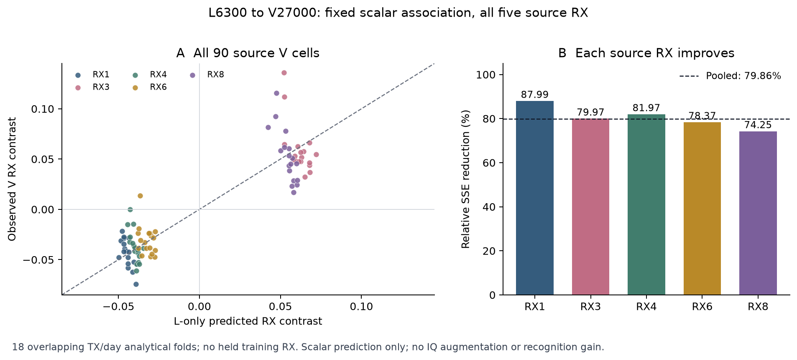

# 全源 RX 的 L→V 统计确认：完成与边界

本行已 ANALYZED／VERIFIED，实际执行提交 f6eee0d13b61edcbd5e85c50bca1b1177a2e675c。固定源判据全部通过，结论仅为 SOURCE_ASSOCIATION_CONFIRMED_ONLY。没有构造 IQ 增强、加载模型或测量身份识别率，完整联合目标仍 ACTIVE。

## 实际结果

使用全部 5 个源 RX [1,3,4,6,8]、3 day、6 TX，L6300 和原 V27000 的物理 ID 互斥。90 个 L 单元和 90 个 V 单元全部保留；没有留出训练 RX，没有使用 L5580/dev720。固定 window80:160、lag20 内部补偿、居中圆度幅值观察器未改。18 折仅用其他 TX 和 day 的 L 单元估计 RX 对比，再在被留 TX/day 的 V 单元读出；每折仍包含全部 5 RX。

|固定条件|实测|结果|
|---|---:|---|
|全局相对零 RX 对比基线的 SSE 降幅 ≥20%|79.860766%|通过|
|正收益折数 ≥15/18|18/18，最小降幅 41.624808%|通过|
|每个 RX 的 SSE 不高于其零对比基线|5/5|通过|

零对比基线 SSE 为 0.22371419293624834，L 预测的 SSE 为 0.04505432589071508。这些是标量统计预测误差，不是身份识别错误率，也不是模型性能提升。18 折共享部分拟合样本，不能按独立训练重复或 18 个模型种子解读。

|源 RX|相对 SSE 降幅|L 圆度单元均值的平均|V 圆度单元均值的平均|
|---|---:|---:|---:|
|1|87.988322%|0.02057303|0.02036448|
|3|79.967924%|0.12723735|0.12347180|
|4|81.972056%|0.02553869|0.02682257|
|6|78.368411%|0.03294064|0.03316173|
|8|74.253010%|0.11967399|0.11677146|

全部 44 个错误 RX 指派保持描述用途。最佳错误指派的 SSE 为 0.03894775393618183，降幅 82.590397%，比正确指派多降 2.729631 个百分点。该结果支持 RX 关联量可由多个 RX 共享，不能识别每个 RX 的唯一硬件参数。旧 4 RX circularity 实验的原 FAIL 和固定候选关闭不改判；本行不恢复镜像增强或任何已关闭 IQ 配方。

## 独立核验与实际成本

独立 reader 不导入观察器、core 或原判定函数，从全部 33,300 个已保存包描述（166,500 个标量）重建 180 个单元、18 折、5 RX 和全部 44 错误指派，固定判据与终态一致。最大绝对数值差 8.881784197001252e-16。reader 没有重读 IQ 或重算观察器数值变换，不能把它当作第二次独立 IQ 实验。

源 worker 读取 33,300 个唯一合法源 IQ，生成 166,500 个标量；模型／checkpoint／NN／teacher／梯度／optimizer 更新／训练 IQ 变换／target 均为 0。worker 墙时 4.717915 s，独立标量复算 0.149517 s，传输、预检和工程检查时间不计入这两个数。既有 source cache 创建是历史成本，本行没有重新产生，也不声称免费创建。

launcher 首步合成检查通过：14 个权限／配置负例，2 个正构造、4 个负构造；33300 合成角色元数据、6300 合成标量 reduction、7 次解析评估、1260 单元评估。开发期独立 reader 的完整合成数据核对与 CP／Utruth／target 三反例另见 local_verification.json；这些均无真实 IQ／NN／更新。唯一 P0/P1 审查通过；一次 archive 本远端比较、远端编译和启动 PID/CWD/argv 核实均 VERIFIED，随后进程自然结束，完整 result/completion/recount 保存。没有重跑、额外审查或干预旧任务。

## 已证实、未证实与下一步

本行证实固定圆度幅值的 RX 对比可以从 L 迁移到原 V 的互斥物理样本，跨所留 TX/day 的方向一致。L/V 仍共享源 TX/RX/day 采集条件，V 曾用于本项目健康分析，不能宣称全历史未见盲测、全新硬件／日期泛化或因果分离。V 的 RX 居中使用合法源标签，仅用于本统计读出，不能直接部署。

仍未证实可分离的纯 RX IQ 因子、标签保持的逆变换或随机变换、Ag 的跨 RX clean 收益及 Ag+As 联合收益。标量幅值未确定复数方向，也不能排除 TX/RX／采集条件的交互。不能仅凭本结果改写 TX IQ 失衡、把 digital received-IQ 操作称为替换真实 RX，或自动选择幅度并训练。

当前最值得保留的 Ag 假设是：跨 TX/day 可迁移的源 RX 观测变化，可能提供身份保持增强的依据。它现在只获得了统计关联证据。下一项需要一个与已关闭配方有实质区别、幅度和物理作用可说明的具体算子；没有该算子时不启动模型。若具体算子不能通过事先固定的源身份保护，或后续匹配 B10/B11 无独立 clean 正收益／无相对 B01 的 practical 增益，则放弃该具体增强；不据目标调幅、重选父模型或救跑。

最新正式识别证据仍是 L-only SAM 的匹配三行 E30：普通 As 相对 No-As 的 clean −2.523810 个百分点，mid urban +27.185119，low urban +21.779762；其 low 为 53.442857%。SAM 相对普通 As 的 clean +0.125 个百分点，但全部 6 practical 下降，固定方案关闭。这些真实识别结果不能与本行 SSE 降幅相加，也不能推算超过 60%。

全部后续训练继续 F＋跨 RX 同 TX、E30、256 点 IQ、5 源 RX、完整 L6300／U56700 TX 隐藏／V27000、joint160、默认 cosine 头及原联合训练、原 U 规则。没有训练完成，因此本行没有 clean＋六 practical 预测或 truth-last；不把源统计状态当模型发布完成。
