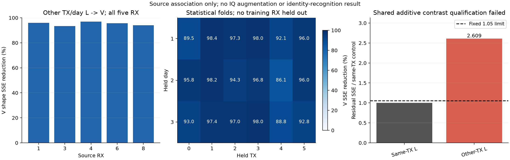

# 周期信号形状：完整源 L→V 结果

状态：ANALYZED／VERIFIED；固定资格条件未全部满足，按原计划关闭。

共享RX形状对V差异的SSE降低 94.711077%，18/18统计折、5/5RX均改善；但共享残余SSE=0.732224436，同TX条件控制=0.280646912，比值2.609059超过固定1.05。故跨TX/day可迁移RX关联得到支持，统一加性偏移的资格假设失败。该比例不是识别准确率，也没有IQ变换、训练、teacher或target。

|源RX|零偏移SSE|共享RX预测SSE|SSE降低 %|
|---|---:|---:|---:|
|1|1.839567498|0.073835500|95.986258|
|3|4.170515677|0.275897852|93.384563|
|4|1.805444617|0.054724538|96.968916|
|6|1.828852324|0.079078356|95.676067|
|8|4.200109083|0.248688191|94.079006|

|固定条件|实际|判定|
|---|---:|---|
|RX形状Frobenius RMS≥.02|0.392208692|PASS|
|V相对SSE降低≥20%|94.711077%|PASS|
|正收益折≥15/18|18/18|PASS|
|每个RX的SSE不增|5/5改善|PASS|
|共享SSE≤同TX控制的1.05倍|2.609059|FAIL|

共享预测每折使用50个L单元、3500包；同TX控制使用10个L单元、700包。两个控制只拟合L，全部5RX始终保留；V仅用于评价，不更新任何状态。90L单元与90V单元全部保留。原V此前已用于源健康与其他源分析，本行不是新的独立硬件盲测。

完整33300包、666000复因子条目、72000单元矩阵条目、180单元、18统计折已经独立复算；矩阵最大误差1.5266e-16，指标最大误差2.2204e-16。源worker耗时3.736284秒，reader 1.033196秒；真实CP/NN/更新/头拟合/teacher/target全0。完整源L6300、U56700的TX隐藏、V27000、全部RX[1,3,4,6,8]、256点与后续F＋跨RX同TX/E30边界保持，没有训练域留出。

该结果否定本固定共享偏移资格，不否定RX关联本身。对于理想归一化信号投影P，一个共享线性响应H产生的形状为 HPHᴴ/tr(HPHᴴ)（忽略数值保护项）；它与P的差通常随输入P变化。因此同TX控制更好，不能单独证明RX算子必须依赖TX标签。这是代数解释，不是当前数据已经识别出H，也不改写本行FAIL或复活旧FIR/phase/RXMIX候选。

当前唯一值得继续检验的假设：共享的输入作用算子，能否比固定加性偏移解释这部分TX条件变化。后续最小检验应只从L估计受物理约束的同一RX响应，再预测其他TX/day的原V形状；不读取新IQ、不构造训练增强或访问target。若不能跨TX/day预测全部RX，或必须引入TX专属参数，就放弃该共享算子假设。尚未确定或验证任何新IQ算子，不启动模型训练。

[全部单元和18折统计](source_result.json) · [独立复算](independent_recount.json) · [执行与成本](execution_verification.json)。完整代码/配置执行提交 a4c557c5706a85427e190906c231f7cbe231de4e。

