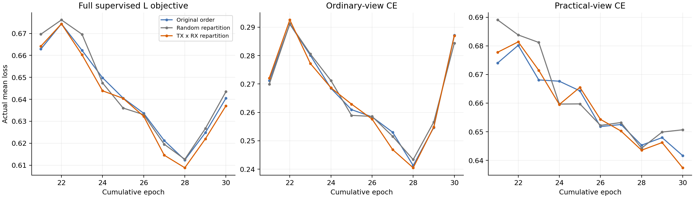
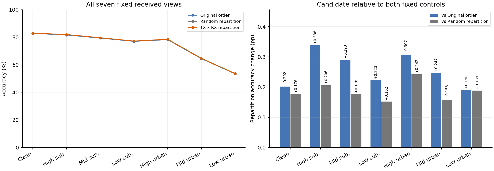

# 原完整 practical 的 L 批次组成：三行 E30 检验

状态：ANALYZED／VERIFIED。七视图小幅单seed改善，但lowurban增量未达到固定+.5pp；候选关闭，完整联合目标未完成。

## 终态结果：小幅改善，固定增量条件未通过

三行均完成同父 E20＋10、累计 E30／6660 更新；每行 168000 个固定物理样本×7视图，共3528000个正式决策。默认cos头直接预测后独立truth-last评分，三worker与dispatcher均自然退出，无技术failure。全部3行、全部10轮和全部评分均保留，没有按结果选行或重跑。

|视图|原顺序准确率 %|随机重组 %|TX×RX 重组 %|相对原顺序，百分点|相对随机，百分点|
|---|---:|---:|---:|---:|---:|
|clean|82.752381|82.777976|82.954167|0.201786|0.176190|
|high suburban|81.602976|81.735119|81.941071|0.338095|0.205952|
|mid suburban|79.333333|79.447619|79.623810|0.290476|0.176190|
|low suburban|76.976786|77.047024|77.199405|0.222619|0.152381|
|high urban|78.218452|78.282738|78.525000|0.306548|0.242262|
|mid urban|64.382738|64.472024|64.629762|0.247024|0.157738|
|low urban|53.441071|53.442857|53.631548|0.190476|0.188690|

单seed下，候选相对两个控制的七视图accuracy与macro-F1均为正增量；这是有限的识别结果，不是只看组成指标或辅助loss。但low urban相对原顺序仅+.190476pp，相对随机+.188690pp，均未达到预登记+.5pp，尽管clean/midurban/suburban保护条件通过。固定决定为CLOSED_FIXED_BATCH_REPARTITION_FAILED_RECOGNITION_BENEFIT；不改变池大小、seed、父、损失或预算补救，不从该target结果扩种子／晋级。不能把“未达固定增量”误写成“完全没有改善”，也不能把小幅单seed改善写成联合成功。

候选clean82.954167%、lowurban53.631548%；三个suburban绝对准确率81.941071%／79.623810%／77.199405%，与自身clean差1.013095／3.330357／5.754762pp。mid/low suburban未达到探索≤2pp，lowurban也未超过60%。本矩阵全部3行有As，没有本轮同一loader随机流的无As参照；因此不能用本表证明相对严格匹配B00的clean净收益，不计算或补造A_g×A_s交互。新增IQ Ag仍为false，完整联合目标ACTIVE。

## 配对错误与域／身份代价

相对原顺序：clean修复958／新增619错，净+339；lowurban修复1873／新增1553错，净+320。clean与low共同正确从82936增至83218（+282），说明该净增量并非全部靠牺牲clean换来；相对随机共同正确亦净+300。

增益并非所有RX/TX一致。相对原顺序，clean的RX14-7／20-1分别−.241667／−.233333pp，候选最差RX72.975%低于原顺序73.216667%。TX20-19的clean／midurban／lowurban分别−.757143／−.760714／−.617857pp。不能宣称跨接收机或全部身份共同改善；全部逐RX/TX/day对照见[分层结果](stratified_results.md)和[378个混淆矩阵](formal_metrics.json)。

## 完整训练路径与独立复算

每行完整10轮／2220step／370池／4440条L/U批序列／2220条reference及Sinc-unit记录连续闭合；L曝光284160、U567000，唯一物理L6300／U56700，全部5源RX×3day。三行370个输入池及可见L标签逐池完全相同，全部2220条U序列相同，857项实际args仅candidate_id/output_dir不同。每步As128、L4、Utruth隐藏，全部stdout扫描无Traceback/OOM/Killed/非有限跳步。逐包IQ/标签/metadata排列一致，无丢弃或增加曝光。

实际TX×RX组成平方偏差：原4.062613／随机4.085796／均衡.783273，候选空单元0；数学组织作用成立，但大小不能替代识别收益。监督目标按.5(commonCE+KL)+.5(AsCE+KL)+.1SupCon逐步独立重算，最大误差1.342e−7，原clean/As权重和总尺度未改变。SupCon含正例数量相关的常数，跨组成的loss数值不直接代表更好的身份提取；只用于完整训练追踪。末期ordinary CE反弹照实保留，没有改选E28或挑较低loss轮次。

独立CPU复算378个6类CM、63组分区和、21组同物理包配对，accuracy/macro-F1/macro-accuracy及已发布摘要完全一致，最大指标误差0；额外IQ/CP/NN/原truth读取/更新均0。实际各row prediction均先固定7视图，再由单独CPU进程接truth；fixedreceivedIQ=true，queryfit=false，headfit=0。[完整源日志分析](source_analysis.json) · [独立结果](result.json)。

图由完整冻结汇总生成，PNG/PDF均保存，PNG独立读回检查。图表不访问IQ、模型或原始truth，0NN/更新。

## 最终成本与交付边界

|实际成本／每row|原顺序|随机重组|TX×RX 重组|
|---|---:|---:|---:|
|新增更新／累计更新|2220／6660|2220／6660|2220／6660|
|L学生NN|1136640|1136640|1136640|
|含U学生训练NN|1703640|1703640|1703640|
|学生源eval/smoke NN|324002|324002|324002|
|教师eval／train NN|567000／0|567000／0|567000／0|
|As生成包|284160|284160|284160|
|正式预测NN（含2包smoke）|1176002|1176002|1176002|
|训练墙钟秒|1264.324|1251.942|1230.837|
|预测墙钟秒|42.497|43.480|44.386|
|独立评分CPU秒|3.238|3.229|3.369|
|池组织局部计时秒|1.714|1.987|2.008|

池局部计时覆盖合并／重排／metadata记账，不包含全部逐batch索引复制等开销；全部开销包含在完整墙钟中。不从不同GPU和并发条件的时间差声明加速。每row新增总NN3770644，三row加共享发布smoke2包，共11311934；开发合成检查及全部离线分析/图表0NN。父原E20训练3661082NN／4440更新／20model-epoch共享一次，本轮30新model-epoch／6660新更新；各row累计E30，逻辑累计90与实际不同训练成本50model-epoch分别披露。历史父正式评估不重做、不算本轮新增。无新增teacher、loss、部署模块或头拟合。

执行代码commit c7b257262d895622f31214d60bfa65906eb4910e；分析工具commit c8153a3e56630952fb2a69eff2b27ed2748e2ea0。普通账户预检、一个release archive比较、remotecompile、一次P0/P1及首步真实父CP/noquery smoke通过。最终PID785637/785712/785788和dispatcher785610均不存在，completion、全部source/defaulthead预测/score及原始私有日志齐全。[执行证据](execution_evidence.json)。原始IQ/权重/预测/日志/私有运行配置不进Git，只有汇总、曲线和分析进入报告。

本轮唯一假设已完成固定终态检验：减少批次组成波动在这个seed产生小幅全视图增量，未达到预设urban增量；固定候选关闭。当前没有可据此晋级的IQ泛化候选或已完成的联合模型，不从目标排名挑父或继续补seed。

## 原预登记和启动记录

以下保留发布前固定假设、矩阵、stop rule及中途快照；不代表当前仍在运行。

## 依据与唯一假设

只回放原完整源 CONCAT/s2026092701 的4440步采样日志及原source契约：568320次合法L曝光、6300个不同物理L，5源RX1/3/4/6/8与day1/2/3全保留。未打开IQ、checkpoint、U真值、target或目标评分。按冻结数据层的TX/RX/day/eq/sig规范和源索引顺序连接可见L，所有记录字段及opaqueL成员一致；不解析U TX。初次部分物理键因6个合法L候选而拒绝，补全实际冻结索引后完成，旧失败输出保留，无模型或训练成本。

默认跨RX对比项先用当前batch均值/标准差（detach）标准化描述，再逐包L2和对比，因此批次组成会影响对比计算。原启用3330步的所有128锚点均有效，完整metadata4440步也无无效锚点；不能把问题归因于缺正例。

|metadata回放|TX×RX计数平方偏差均值|每批空单元均值|最少正例数的跨批均值|
|---|---:|---:|---:|
|原顺序|4.029354|0.364640|10.164189|
|随机重组|4.054264|0.376802|10.188514|
|TX×RX重组|0.772237|0|13.993018|

偏差相对每单元128/30计算，不是梯度方差或识别指标。740个6×128池内，每个物理出现次数精确保持（含原重复），每单元在6输出批计数差≤1。[完整回放](metadata_replay.json)、[分析程序](../../../analysis/cvs_batch_repartition_metadata_20261018.py)。103个合成池及真实metadata回放通过，IQ/CP/NN/更新均0。

唯一待检验假设：减少L批次TX×RX组成波动，能改善原practical与跨RX对比的联合训练，在同一个默认模型中保护clean并改善low/mid urban。元数据变化尚未证明识别收益。不同于已关闭的整批六步排序、ordinary按RX分组、传播分组和dropout耦合；这些旧路线不重开。

## 固定矩阵和预算

3行 ORIGINAL、RANDOM、TX_RX_BALANCED，全部严格加载同一个原完整源 ordinaryAs scratch-final20 学生＋自身EMA，来自 20261017-phase1-F-crossRX-fullsource-concat-e20-s2026092701-m3-r02/CONCAT-s2026092701；固定预算冻结、非target排名、无其他祖先。原L6300/U56700隐藏TX/V27000、split392005、全部5源RX不留出。每行继续10轮，累计E30/6660更新，重置AdamW/cosine10，SupCon沿E21..30绝对权重.1；旧ordinary为父实际E13日程。这不是scratch30，不与关联对话的R25/教师U路线合并。

三行同样缓冲6×128，分别原顺序／随机重组／TX×RX均匀分配；每轮222步=37完整池，10轮370池，无末池丢弃。Lloader seed20261018131、Uloader20261018132、repartition20261018121+poolindex。共同隔离CPU loader RNG，保证同输入池不受模型/增强RNG消耗影响；U仅隔离loader RNG，保留原shuffle/邻近批次、weak/strong、旧gate、ownEMA及loss，不按U标签分组。

F三SIG_TIME、统一Sinc CENTER_25K/CENTER_UNITS、joint160、默认cos6×160/scale30、NoExplicitCFO及必要内部补偿、骨干与头正常联合训练不变。每L原.5RD(ordinary)+.5RD(完整practical(raw))，每对共享同一生成IQ；原SupCon仅ordinary两次，所有合法有标签As监督，无urban置信筛除。0新IQ操作/PA/DAC/量化/剪裁/损失/teacher/部署参数/额外NN。批重组会改变旧batch级增强门和信道namespace对应的物理包，不冒称逐包IQ完全配对。原传播/噪声/质量/补偿/15session硬件依赖保持，一包仅一次完整As。

父E20/4440共享一次；新增3×10=30 model-epoch/6660更新；各模型累计30，逻辑累计90与独立训练成本50（父20＋新30）分列。每row预计物理L/ordinary/As各284160，L学生1136640NN，含原U学生训练1703640，教师eval567000；source eval/smoke、正式预测、CPU/内存/池重组和wall实测单列。额外NN=0不等于组织操作零成本。父既有训练NN3661082，不计本轮新训练。

## 固定反证与自动收尾

全部3行固定final10/cumulative30，V仅health，不挑checkpoint或row。每row完成即自动clean＋六practical的168000×7预测，全部固定后独立CPU truth-last评分；不等整批结束，不改变received IQ/SNR/信道/困难样本。

TX_RX_BALANCED分别相对ORIGINAL和RANDOM：clean不降、low urban至少+.5百分点、mid urban不降、每suburban最多−.25百分点。任一失败关闭固定6批/30单元重组，不换池大小/seed/父/层位/系数/预算救跑。所有预登记终态均报告；target不用于扩种子、晋级、重排或选择性重跑。最终clean净收益、low>60%、各suburban距自身clean探索≤2百分点仍照实报告，不能降低clean缩差；这3行不能证明新增A_g或完整联合目标。

唯一owner codex/root/F-batchStratify-E30；普通N607账户，CPU2，共享容量每GPU最多3个全owner进程且≥12GB空闲，不停/热改旧任务。不可覆盖根 PROJECT/runs/20261018-phase1-F-crossRX-batchStratify-e20plus10-s2026092701-m3-r01；CWD PROJECT/releases/cvs_F_batchStratify_E30_20261018_r01；命令 CVS-RFFI/bin/python -u experiments/cvs_batch_stratify30/runner.py。[精确登记](experiment.json)、[配置](../../../configs/cvs_batch_stratify_e30.json)。

17聚焦负例、6个完整epoch边界/1332合成输出批/222池/对齐及RNG异常恢复PASS，0真实IQ/CP/NN；一次独立P0/P1 PASS。首步真实CP无query smoke后继续；一个Git代码配置commit、一个archive/一次传输比较/远端compile、一次PID/CWD/argv/GPU/log增长核对。仅输入/父/角色/非有限/输出冲突/不能合法预测等系统技术失败停止pending并保留产物，不自动重试，不影响健康旧任务。预期完整step/epoch/reference/Sincunit/LU序列、370池原metadata+permutation、默认头CP、7视图prediction/score、RX/TX/day配对、成本曲线及同row分析/Git交付；原始数据/权重/日志/预测保持私有。

## 发布后独立核实

执行commit `c7b257262d895622f31214d60bfa65906eb4910e`，远端Git OID匹配；普通N607预检、单archive比较、远端compile/checks通过。首步真实原父CP/noquery smoke PASS（1CP/2合成NN/0IQ），三worker严格相同parent学生/ownEMA加载通过。ORIGINAL PID785637/GPU3、RANDOM785712/GPU4、TX_RX_BALANCED785788/GPU5；CWD/argv/startticks/CUDA与GPU进程及日志增长独立核实。全部首轮222更新完成，实际L113664NN/As28416包，sourceRX1/3/4/6/8全部保留。

读取当时全部可解析step分别290/287/285条，均As128/L4/Utruth隐藏，无异常；gzip仍在写入，EOFError如实标为partial，不当成终态或失败。此为运行证据，不是完整训练成本或识别增益。预算不变，健康行继续；逐行E30后自动七视图预测与独立truth-last路径已随同一release发布。[执行快照](execution_evidence.json)。
