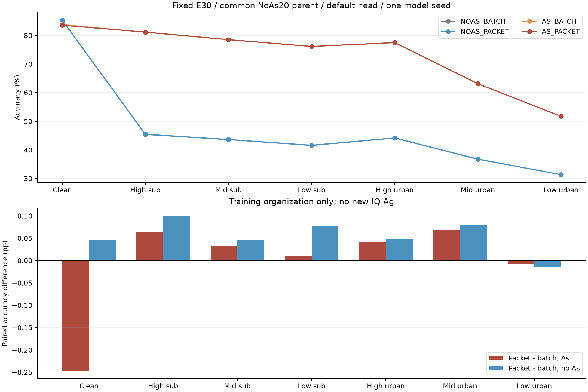
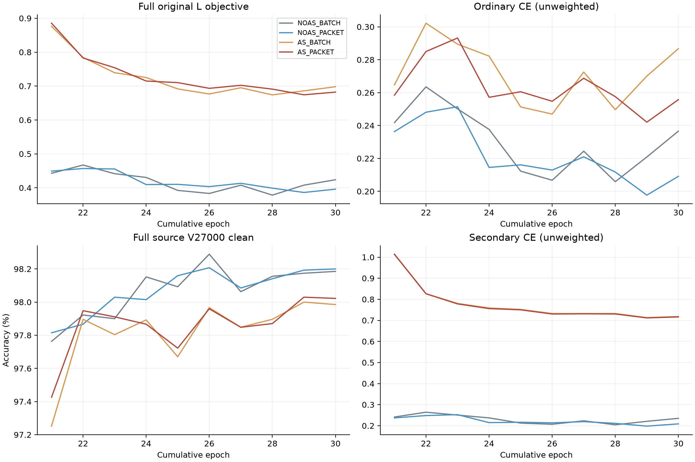

# 普通载波增强开关组织 × practical：四行 E30 完整结果

20261018-phase1-F-crossRX-carrierGate-e20plus10-s2026092701-m4-r01

状态：ANALYZED／VERIFIED。四行均完成新增10轮／累计E30、clean＋六practical默认头预测及独立truth-last。本轮为训练组织检验，没有新IQ Ag。

|模式|clean %|high sub %|mid sub %|low sub %|high urban %|mid urban %|low urban %|
|---|---:|---:|---:|---:|---:|---:|---:|
|NOAS_BATCH|85.318452|45.395238|43.597619|41.556548|44.146429|36.741071|31.363690|
|NOAS_PACKET|85.365476|45.494643|43.643452|41.632738|44.194048|36.820238|31.350000|
|AS_BATCH|83.792262|81.117857|78.510119|76.144048|77.477381|63.083929|51.737500|
|AS_PACKET|83.545833|81.180357|78.542262|76.154167|77.519643|63.152381|51.730357|

|同成本比较|clean pp|high sub pp|mid sub pp|low sub pp|high urban pp|mid urban pp|low urban pp|
|---|---:|---:|---:|---:|---:|---:|---:|
|AS_BATCH__NOAS_BATCH|-1.526190|+35.722619|+34.912500|+34.587500|+33.330952|+26.342857|+20.373810|
|AS_PACKET__AS_BATCH|-0.246429|+0.062500|+0.032143|+0.010119|+0.042262|+0.068452|-0.007143|
|NOAS_PACKET__NOAS_BATCH|+0.047024|+0.099405|+0.045833|+0.076190|+0.047619|+0.079167|-0.013690|
|AS_PACKET__NOAS_PACKET|-1.819643|+35.685714|+34.898810|+34.521429|+33.325595|+26.332143|+20.380357|
|AS_PACKET__NOAS_BATCH|-1.772619|+35.785119|+34.944643|+34.597619|+33.373214|+26.411310|+20.366667|

|训练组织 × As 交互|clean pp|high sub pp|mid sub pp|low sub pp|high urban pp|mid urban pp|low urban pp|
|---|---:|---:|---:|---:|---:|---:|---:|
|AS_PACKET−NOAS_PACKET−AS_BATCH＋NOAS_BATCH|-0.293452|-0.036905|-0.013690|-0.066071|-0.005357|-0.010714|+0.006548|

此交互不等于IQ Ag×As；未验证新IQ Ag，不能将该项填入用户要求的新IQ四格结论。

|模式|high suburban 距 clean pp|mid suburban 距 clean pp|low suburban 距 clean pp|
|---|---:|---:|---:|
|NOAS_BATCH|39.923214|41.720833|43.761905|
|NOAS_PACKET|39.870833|41.722024|43.732738|
|AS_BATCH|2.674405|5.282143|7.648214|
|AS_PACKET|2.365476|5.003571|7.391667|

源判据：CLOSED_FIXED_CARRIER_CORRELATION_SOURCE_FAILED。源跨行判定冻结并独立复算后，才由主分析读取正式分数。四行均为预登记必测，源科学失败不删除任何行。

|源 AS_PACKET 相对 AS_BATCH|draw0 pp|draw1 pp|固定每draw条件|
|---|---:|---:|---|
|clean|+0.000000|—|≥0|
|practical_high|+0.000000|-0.055556|≥−.25|
|practical_mid|-0.166667|-0.166667|≥−.25|
|practical_low_suburban|+0.666667|-0.111111|≥−.25|
|practical_high_urban|+0.055556|+0.111111|仅报告|
|practical_mid_urban|+0.166667|-0.222222|≥0|
|practical_low_urban|-0.055556|-0.555556|≥+.5|

源NOAS_PACKET相对NOAS_BATCH clean +0.055556pp（要求≥+.25pp）；源AS_PACKET相对NOAS_BATCH clean -0.500000pp（要求≥0）。全部条件：{"NOAS_clean": false, "AS_clean": true, "joint_clean": false, "midurban": false, "lowurban": false, "suburban": true}。
源条件失败，关闭固定phase/CFO开关相关性、概率／范围、父／seed／E30配方；不调组件、幅度、概率、父或种子救跑，不用正式局部涨分救回。

AS_PACKET相对普通AS_BATCH：lowurban修复2324、新增错误2336；clean修复669、新增错误1083。clean∩lowurban共同正确净变-0.024405pp。完整配对与双方clean正确集合保留result.json；所有RX/TX/day见stratified_results.md。

全部5源RX[1,3,4,6,8]／day[1,2,3]／L6300-U56700隐藏TX-V27000／split392005／256点保持，无训练域留出、无L5580/dev720。F＋跨RX同TX／SIG_TIME／统一Sinc／joint160／原cosine6×160 scale30联合训练；NoExplicitCFO及必要包内补偿保持，0另拟合头／部署参数。

四行同一个原fullsource REPEAT NoAs20 final学生及其ownEMA，各独立重置AdamW/cos10追加10轮，累计E30/6660更新；唯一父训练20轮/4440更新计一次，新增40model-epochs/8880更新，唯一累计60model-epochs/13320更新。As只在新增10轮施加；不能借用此前As20+10的分数替代本AS_BATCH，亦不是从零E30。父权重仅由固定源轮次确定，未由目标排序。

每物理L固定4次NN，.5RD(ordinary)+.5RD(同ordinary或practical(raw))+原.1 SupCon；每个RDrop对使用同一已生成IQ，NoAs第二对不重抽ordinary。As原128有标签包全部监督，不设urban置信度；practical直接处理raw，不在ordinary后重复完整星地信道。原U、EMA教师、门控和跨RX同TX对比规则均保持，无额外损失、VJP、分类头或网络分支。

唯一差异为L普通phase/CFO Bernoulli开关的跨包相关性：BATCH保留原整批开关，PACKET用私有生成器独立逐包；概率、参数范围、原AST顺序和外部Torch/Python/NumPy随机流不变。已有CFO增强是已审计旧配置，本轮未将CFO当身份特征，也未增加新的频率机制。BATCH本地与原完整增强逐位等价；本地CUDA不可用已披露，真实GPU执行以全量carrier记录和完成训练为证据。

|模式|phase实际概率|CFO实际概率|CFO最大cycles/sample|phase混合mask批数|CFO混合mask批数|
|---|---:|---:|---:|---:|---:|
|NOAS_BATCH|0.112770150271|0.087710116877|0.000100240134|0|0|
|NOAS_PACKET|0.112770150271|0.087710116877|0.000100240134|2220|2220|
|AS_BATCH|0.112770150271|0.087710116877|0.000100240134|0|0|
|AS_PACKET|0.112770150271|0.087710116877|0.000100240134|2220|2220|

完整读取并比对原生CSV／JSONL及observer全部epoch字段，读取四行各2220步／10epoch／4440 L-U序列（本轮使用原生加载器，没有370池自定义采样记录）、stdout、reference、Sinc units和2220 carrier记录，独立核对L6300/U56700物理曝光／合法可见L数据契约／匹配序列／实际参数及教师计数。载波选中数、k(k−1)有序对和跨行概率范围均复算；它们仅证明执行，不能替代识别收益。原L损失尺度按reference全步独立复算，train_loss_labeled单项不能代替整个监督目标。

源资格固定V1800／90单元各20包／全部5RX，clean1draw＋六practical各2draw：每行23400NN／21600物理处理／0更新；fullV27000的原生验证按真实计数另计（含训练前后额外读出）。正式每行7×168000固定received IQ默认头预测全部完成后独立CPU truth-last。测试SNR、信道、IQ和困难样本不变，无目标调参、选模、排序或选择性重跑。该已暴露基准不是新的独立盲测。

源52CM及RX分区、正式504CM／84分区／35错误配对独立复算一致，最大正式指标差0.0；分析0IQ／CP／NN／更新／rawtruth。新增训练＋源资格＋预测实际NN 15176176，共享真实父CP smoke2NN另列；本地／远端合成检查0模型NN／更新／VJP。原唯一E20父训练NN 3661082；真实As处理568320包。逐行实际学生／教师训练与验证、源读出、预测、墙时保留result.json，不隐去续训或教师成本。

正式探索条件：{"clean_net_positive": false, "lowurban_above60": false, "each_suburban_gap_at_most2pp": false, "source_qualified": false, "new_IQ_Ag_proved": false, "cross_seed_proved": false, "joint_goal_complete": false}。每suburban距自身clean≤2pp是预登记探索目标，同时检查clean净正收益，不能靠降低clean缩差。单seed、新IQ Ag和Ag×As收益均未被证明，完整联合目标ACTIVE。

普通账户发布、唯一真实CP无query smoke、所属PID/CWD/argv/GPU/loggrowth、单归档传输与compile均VERIFIED。四worker及dispatcher自然退出，0停止命令／旧健康任务修改。执行提交 `5278625865d49164872337853b0eda963b908e0e`。发布前POSIX路径及离线统计器的原生加载器要求错误均已修复并保留记录，未引发训练重跑。
