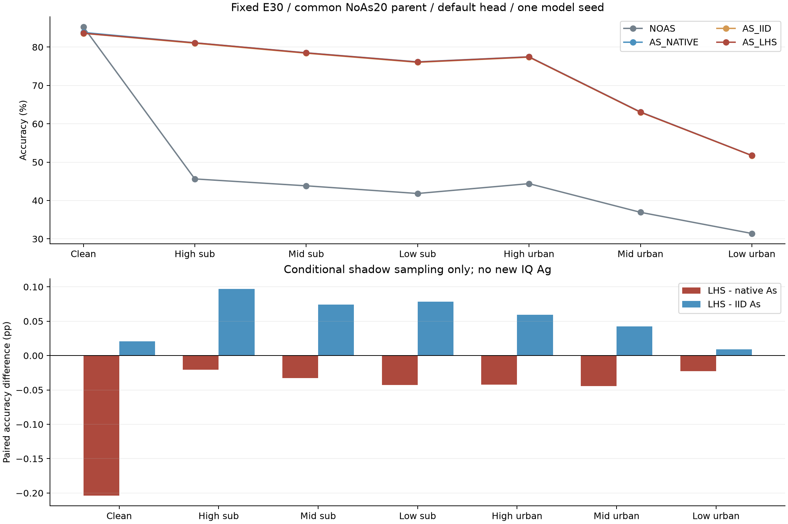
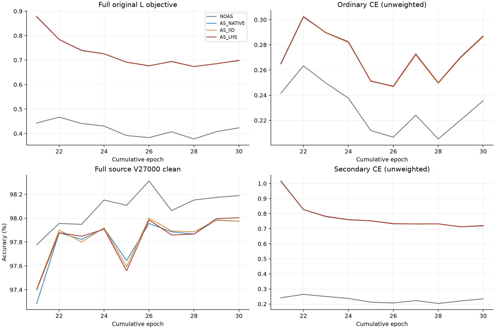

# 完整 practical 的阴影初值分层抽样：四行 E30 完整结果

20261018-phase1-F-crossRX-shadowLHS-e20plus10-s2026092701-m4-r01

状态：ANALYZED／VERIFIED。全部4行固定E30、默认头七视图预测及独立truth-last评分完成。本轮只改变原As的抽样组织，不是新增IQ Ag。

|模式|clean %|high sub %|mid sub %|low sub %|high urban %|mid urban %|low urban %|
|---|---:|---:|---:|---:|---:|---:|---:|
|NOAS|85.267857|45.632738|43.833929|41.833929|44.400000|36.929167|31.409524|
|AS_NATIVE|83.812500|81.129167|78.513095|76.148810|77.477381|63.093452|51.749405|
|AS_IID|83.588095|81.011310|78.405952|76.027381|77.375595|63.006548|51.717857|
|AS_LHS|83.608929|81.108333|78.480357|76.105952|77.435119|63.048810|51.726786|

|同预算配对比较|clean pp|high sub pp|mid sub pp|low sub pp|high urban pp|mid urban pp|low urban pp|
|---|---:|---:|---:|---:|---:|---:|---:|
|AS_NATIVE__NOAS|-1.455357|+35.496429|+34.679167|+34.314881|+33.077381|+26.164286|+20.339881|
|AS_IID__AS_NATIVE|-0.224405|-0.117857|-0.107143|-0.121429|-0.101786|-0.086905|-0.031548|
|AS_LHS__AS_NATIVE|-0.203571|-0.020833|-0.032738|-0.042857|-0.042262|-0.044643|-0.022619|
|AS_LHS__AS_IID|+0.020833|+0.097024|+0.074405|+0.078571|+0.059524|+0.042262|+0.008929|
|AS_LHS__NOAS|-1.658929|+35.475595|+34.646429|+34.272024|+33.035119|+26.119643|+20.317262|

|模式|high suburban距clean pp|mid suburban距clean pp|low suburban距clean pp|
|---|---:|---:|---:|
|NOAS|39.635119|41.433929|43.433929|
|AS_NATIVE|2.683333|5.299405|7.663690|
|AS_IID|2.576786|5.182143|7.560714|
|AS_LHS|2.500595|5.128571|7.502976|

源固定结论：CLOSED_FIXED_SHADOW_LHS_SOURCE_FAILED。源判定在主分析读取正式分数前冻结，独立整数计数复算一致。全部条件：{"AS_NATIVE_clean": true, "AS_NATIVE_midurban": false, "AS_NATIVE_lowurban": false, "AS_NATIVE_suburban": true, "AS_IID_clean": true, "AS_IID_midurban": false, "AS_IID_lowurban": false, "AS_IID_suburban": true, "joint_clean": false}。

|源AS_LHS相对控制|场景|draw0 pp|draw1 pp|
|---|---|---:|---:|
|AS_NATIVE|practical_mid_urban|-0.444444|-0.222222|
|AS_NATIVE|practical_low_urban|+0.444444|+0.055556|
|AS_NATIVE|practical_high|-0.111111|+0.055556|
|AS_NATIVE|practical_mid|+0.055556|+0.277778|
|AS_NATIVE|practical_low_suburban|+0.055556|+0.055556|
|AS_IID|practical_mid_urban|-0.055556|+0.000000|
|AS_IID|practical_low_urban|+0.444444|+0.166667|
|AS_IID|practical_high|+0.000000|-0.055556|
|AS_IID|practical_mid|-0.055556|+0.000000|
|AS_IID|practical_low_suburban|+0.000000|+0.111111|

源AS_LHS clean相对NOAS -0.444444pp。相对AS_NATIVE/IID clean均要求≥0；每draw lowurban≥+.5pp、midurban≥0、各suburban≥−.25pp。源通过仅为单seed源资格，不保证目标识别或联合目标。
固定源条件未通过，关闭shadow-only/scene-state分组/128batch/共同NoAs20父/seed/E30候选；不换变量、bin、组、父或seed救跑。正式局部涨分不改变源决定。
源clean相对AS_NATIVE +0.000000pp。
源clean相对AS_IID +0.000000pp。

AS_LHS相对AS_NATIVE：lowurban修复886／新增错924；clean修复279／新增错621；clean∩lowurban共同正确净差-0.061310pp。

AS_LHS相对AS_IID：lowurban修复605／新增错590；clean修复241／新增错206；clean∩lowurban共同正确净差-0.016667pp。

全部源L6300/U56700TXhidden/V27000，RX1/3/4/6/8、day1/2/3、6TX、split392005、现有256点均保留，无训练RX留出、无L5580/dev720。F＋跨RX同TX/SIG_TIME/统一Sinc/joint160/原cos6×160scale30联合训练保持；NoExplicitCFO及必要内补偿保留，0额外分类器、损失、门控或部署分支。

四行严格同一原fullsource REPEAT固定final20学生＋自身EMA，各独立重置AdamW/cos10追加10轮、累计E30/6660更新。父训练20轮/4440更新共享一次，新增40model-epoch/8880更新，唯一累计60model-epoch/13320更新；逻辑四模型累计120和实际不同。As仅新增10轮，不能称scratch30或与其他父的As30混用。

每物理L固定4次学生前向，.5RDordinary＋.5RDsameordinary或完整practical(raw)＋原SupCon/U；各RDrop对共享同一已生成IQ，NoAs不重抽ordinary。全部合法有标签As监督，无urban置信过滤；原U/oldgate/自身EMA不变。新增0NN/VJP/教师或训练参数，CPU抽样和日志成本实际另列。

As唯一变化为latent.z的跨包抽样相关性：原native、私有独立U→正态、同scene/state组随机概率分层U→正态。场景、state、geometry、scatter、原15硬件session和其他随机流保持；替换独立z后完整原process计算LOS/传播/噪声/质量/lock/补偿/AGC。N0、训练referenceSNR、测试SNR/信道/receivedIQ均保持，不裁尾、不筛样本。物理瞬时状态改变是抽样目的；统计边缘先验相同不意味着识别必升。

|As模式|实际包数|条件组种类数|z均值|z标准差|z最小/最大|逆CDF最大误差|抽样计时秒|
|---|---:|---:|---:|---:|---:|---:|---:|
|AS_NATIVE|284160|9|-0.000081|1.001381|-4.557844/4.406808|0|5.473781|
|AS_IID|284160|9|-0.002001|1.000415|-4.678178/4.457924|0|6.648742|
|AS_LHS|284160|9|-0.000112|0.999779|-4.532641/4.829196|0|6.982342|

计时仅覆盖随机draw/permutation/inverseCDF；分组、staging、JSON日志和其他开销均在完整训练wall中，不能称额外成本为0。完整读取各2220step/10epoch/4440L-U序列、reference/Sincunit/nativeCSV/nativeJSONL/observer全部字段和stdout；L/U物理曝光、实际参数、原损失尺度及教师计数独立核对。三个As各2220×128阴影记录全读，连接原L出现序列，重算全部条件组/概率区间/逆CDF与真实native state覆盖。该记录核对不重放原IQ，也不是身份保持或识别收益。

源读出每行固定V1800/90单元各20包，clean1draw＋六practical各2draw，23400NN/21600物理处理/0更新；完整V27000健康验证另计。正式每行7×168000全部预测固定后独立CPU truth-last，难样本不删，目标不参与参数、父、选模、种子或重跑。已暴露基准不称新独立盲测。

完整源52CM/RX分区、正式504CM/84分区、35个配对独立复算，最大正式指标差0.0；分析0原IQ/CP/NN/更新/rawtruth。新增训练＋源资格＋预测实际NN 15176176，共享父CPsmoke2NN单列；唯一原父训练NN 3661082。真实As处理852480包。实际学生、教师、更新、源验证、预测、CPU和wall逐row见result.json。

正式探索条件：{"clean_net_positive": false, "lowurban_above60": false, "each_suburban_gap_at_most2pp": false, "source_qualified": false, "new_IQ_Ag_proved": false, "cross_seed_proved": false, "joint_goal_complete": false}。各suburban距自身clean≤2pp为预登记探索目标，同时检查clean净正收益，不能降clean缩差。没有新增IQ Ag、无Ag×As交互、只有一个模型seed；完整联合目标保持ACTIVE。

[分层结果](stratified_results.md) · [源完整日志](source_analysis.json) · [源固定判定](source_qualification.json) · [正式混淆矩阵](formal_metrics.json) · [全部配对与成本](result.json)

## 本轮结论与范围

**固定阴影分层路线失败，停止晋级。** 源条件先于正式分数冻结为 CLOSED_FIXED_SHADOW_LHS_SOURCE_FAILED：相对原As，lowurban两draw增量+.444444/+.055556pp均低于+.5pp，midurban两draw为−.444444/−.222222pp；相对独立重抽控制亦有midurban下降且lowurban不足，clean相对NoAs−.444444pp。独立52个源CM及RX分区复算最大差2.7755575615628914e−17。

正式168000×7×4的4,704,000个决策已全部完成并独立评分。普通As相对NoAs，lowurban从31.409524%升至51.749405%（+20.339881pp），clean从85.267857%降至83.812500%（−1.455357pp）；这证实普通practical适应收益及clean代价同时存在。

AS_LHS的clean83.608929%、midurban63.048810%、lowurban51.726786%，相对原As分别−.203571/−.044643/−.022619pp，七视图accuracy全部为负增量。相对IID控制七视图小幅为正，但lowurban仅+.008929pp，不能忽略原As控制宣称有效。相对原As，lowurban修复886/新增924错；clean修复279/新增621错；clean∩lowurban共同正确净−103。相对IID的lowurban净+15而clean∩lowurban共同正确净−28，不能把微小单场景正差当联合收益。

候选三个suburban绝对准确率81.108333/78.480357/76.105952%，与自身clean差2.500595/5.128571/7.502976pp，均未达探索≤2pp。相对原As，三个suburban准确率均下降，间距缩小主要来自更大的clean下降，不能计作保护成功；相对NoAs的clean净差−1.658929pp，lowurban仍低于60%。

完整源日志2220step×4、10epoch×4、每轮680字段的原生CSV/JSONL/observer、4440条L/U序列×4、reference/Sincunit及stdout全部读取。L6300/U56700物理出现序列四行完全一致，实际857项args仅candidate_id/output_dir不同，NN预算相等，全部5源RX/3day保持。三种As各284160份真实训练观察，LHS全部条件概率区间及逆CDF一致；这只证明机制实际执行，没有抵消识别负结果。

新增实际NN15,176,178（训练＋源读出＋正式预测15,176,176，公共真实父CPsmoke2）；唯一父原E20训练3,661,082NN单列，合计18,837,260。实际3条As共852480次训练物理处理；源资格4×21600=86400次另列，远端合成670次、本地三个通过的检查共30+414+414=858次均为工程检查，模型NN均0。新增8880更新；父20＋4×10=60个不同model-epoch，各模型累计E30。额外VJP0、新教师0；原教师eval各567000、train0。分析/图表0IQ/CP/NN/更新/rawtruth。条件draw/permutation/inverseCDF局部CPU计时Native5.473781s/IID6.648742s/LHS6.982342s，不能将该局部计时当全部额外开销；完整wall逐row保留。

原dispatcher及4worker PID均不存在，全部completion/defaulthead预测/独立truth-last产物完整、无failure；不以退出码单独判完成。训练执行Git 0a9e6541efc3a806cf3dc20e08b4c4ec9dc22ba3；独立复算Git d7b047a5ce8189c6b86ce8d0cf6a11eb83095b30。原IQ、权重、预测向量、物理ID、日志和私有runtime留原不可覆盖根，没有删除、重启或修改旧任务。

本轮唯一假设已被固定四行实验否定，不改变量、分组、bin、seed、父或预算救跑。不把IID控制较弱造成的小幅正差解释为有效As。当前无新的source-qualified IQ Ag或As组织候选，A_g×A_s联合收益未证明；原完整目标ACTIVE，不标完成。

图表由全量冻结汇总生成，PNG已独立读回检查，PDF同时保留。
