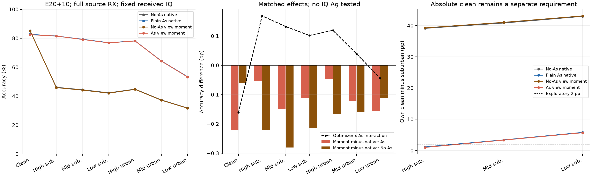
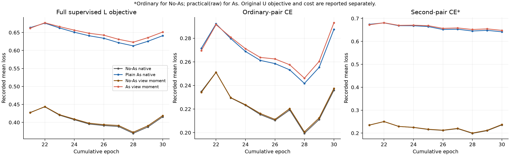

# 逐视图二阶矩 × practical：完整单种子 E30 结果

20261018-phase1-F-crossRX-viewMoment-e20plus10-s2026092701-m4-r01

结论：固定逐视图二阶矩配方失败并关闭。普通As clean82.697024%／midurban64.338095%／lowurban53.407143%；候选82.475595%／64.216667%／53.251786%，相对普通As为−.221429／−.121429／−.155357pp，七视图准确率全部下降。候选suburban差.981548／3.322024／5.672619pp，差缩小伴随clean下降；low修复1042却新增1303错，clean∩low联合正确净少319。NoAs配方也七视图全降，不能由部分正优化器×As交互推断有效。源clean/mid/low条件已先行失败，正式结果不用于救回。

状态：ANALYZED／VERIFIED。四行均完成新增 10 轮、累计 E30、七视图默认头预测与独立 truth-last。此项检验训练组织，没有新的 IQ A_g。

|模式|clean %|high sub %|mid sub %|low sub %|high urban %|mid urban %|low urban %|
|---|---:|---:|---:|---:|---:|---:|---:|
|NOAS_MEASURE|85.189881|46.104167|44.399405|42.275595|44.819643|37.358333|31.754762|
|AS_MEASURE|82.697024|81.547024|79.301786|76.915476|78.164881|64.338095|53.407143|
|NOAS_VIEW|85.129762|45.882738|44.119048|42.061310|44.654167|37.197619|31.643452|
|AS_VIEW|82.475595|81.494048|79.153571|76.802976|78.118452|64.216667|53.251786|

|比较|clean pp|high sub pp|mid sub pp|low sub pp|high urban pp|mid urban pp|low urban pp|
|---|---:|---:|---:|---:|---:|---:|---:|
|AS_MEASURE__NOAS_MEASURE|-2.492857|+35.442857|+34.902381|+34.639881|+33.345238|+26.979762|+21.652381|
|AS_VIEW__AS_MEASURE|-0.221429|-0.052976|-0.148214|-0.112500|-0.046429|-0.121429|-0.155357|
|NOAS_VIEW__NOAS_MEASURE|-0.060119|-0.221429|-0.280357|-0.214286|-0.165476|-0.160714|-0.111310|
|AS_VIEW__NOAS_VIEW|-2.654167|+35.611310|+35.034524|+34.741667|+33.464286|+27.019048|+21.608333|
|AS_VIEW__NOAS_MEASURE|-2.714286|+35.389881|+34.754167|+34.527381|+33.298810|+26.858333|+21.497024|

|优化器 × As 交互|clean pp|high sub pp|mid sub pp|low sub pp|high urban pp|mid urban pp|low urban pp|
|---|---:|---:|---:|---:|---:|---:|---:|
|AS_VIEW−NOAS_VIEW−AS_MEASURE＋NOAS_MEASURE|-0.161310|+0.168452|+0.132143|+0.101786|+0.119048|+0.039286|-0.044048|

这是优化器配方 × As 交互；Ag×As 交互未测量，不能填 0 或冒称四格 IQ 增强完成。

|模式|high suburban 距 clean pp|mid suburban 距 clean pp|low suburban 距 clean pp|
|---|---:|---:|---:|
|NOAS_MEASURE|39.085714|40.790476|42.914286|
|AS_MEASURE|1.150000|3.395238|5.781548|
|NOAS_VIEW|39.247024|41.010714|43.068452|
|AS_VIEW|0.981548|3.322024|5.672619|

源判据：CLOSED_FIXED_VIEW_SECOND_MOMENT_SOURCE_FAILED。独立复算源判定后才读取正式目标 scores。全部四行均为预登记必测，源科学失败不取消正式评价。

|源 AS_VIEW 相对 AS_MEASURE|draw 0 增益 pp|draw 1 增益 pp|预登记要求（每 draw）|
|---|---:|---:|---|
|clean|-0.222222|—|≥0|
|practical_high|+0.000000|-0.166667|≥−.25|
|practical_mid|-0.055556|-0.111111|≥−.25|
|practical_low_suburban|-0.166667|-0.222222|≥−.25|
|practical_high_urban|-0.111111|-0.166667|仅报告，无晋级阈值|
|practical_mid_urban|-0.222222|-0.333333|≥0|
|practical_low_urban|-0.166667|-0.222222|≥+.5|

NOAS_VIEW clean 相对 NOAS_MEASURE：+0.111111 pp，要求不低于 −.25 pp。条件结果：{"clean": false, "midurban": false, "lowurban": false, "suburban": true, "NOAS_clean": true}。

固定源条件失败，关闭本系数 1／存储坐标／父／seed／优化与预算配方；不以目标局部涨分救回，不调整系数或选择性重跑。

全部源 RX[1,3,4,6,8]、day[1,2,3]、L6300/U56700 隐藏 TX/V27000、split392005、256 点保持；未留出训练 RX，未使用 L5580/dev720。F 三路 SIG_TIME／统一 Sinc CENTER25K+UNITS／joint160／原 cosine6×160 scale30、NoExplicitCFO 及必要内部补偿保持，默认头随骨干联合训练，另拟合头为 0。

NoAs 两行由固定原 REPEAT20 初始化，As 两行由固定原 CONCAT20 初始化；同处理严格同父和自身 EMA，重置 AdamW/cos10 后各追加 10 轮，累计 E30/6660 更新。跨 As 父权重不同，但来源、数据角色和初始化规则相同，均为原 final20；不是从零 E30。原阶段13L+7U，新增10U（仍含 L 监督），累计13L+17U。

四行保持每物理 L 4 次 NN 和每步 2 次额外 VJP，稳定 .5 RD(ordinary)+.5 RD(secondary)+原 SupCon。NoAs 的 secondary 重用相同 ordinary，As 的 secondary 为完整 practical(raw)；各 RDrop 对两次前向共用同一份已生成 IQ。ordinary 旧增强仍保留，NoAs 不是完全无增强。原全部卫星 L 都参与监督，不依赖 urban 置信度；没有 ordinary 后再施加完整信道。原 U/教师/门控规则保持，但优化器参数轨迹变化会影响后续 U 预测。

gO=grad(.5 RDordinary)，gS=grad(.5 RDsecondary)，g 为含原 SupCon/U 的 native 总梯度，c 为原物理 clip5 系数。MEASURE 使用原 AdamW；VIEW_SECOND 只在二阶矩增加 (1−β2)c²(gO−gS)²，分歧系数固定为 1，原一阶矩、当前总梯度、Sinc 分组 lr/eps/物理 decay 不改。原矩公式并非 bug，候选也不是全梯度方差无偏估计；实际收益只由身份识别结果判断。

完整读取四行各2220步/10epoch/370池/4440条L-U序列、原stdout、参考及Sinc units记录，核对全量 L6300/U56700、全部可见标签/物理顺序、实际参数允许差异和独立教师成本。独立复算8880矩记录、26640三坐标见证的一阶/二阶矩递推；只验证保存的三坐标见证，不声称从标量重构整个优化器。源52个CM及RX分区、正式504个CM/84分区/35配对均独立复算；分析0IQ/CP/NN/更新/rawtruth。

源资格固定 V1800/90单元各20包/全部5RX，clean一次、6practical各2draw；每行23400 NN/21600物理处理/0更新。正式每行7×168000固定 received IQ 默认头预测全部完成后，独立CPU truth-last。测试 SNR、信道、received IQ 和困难样本保持；target 不用于幅度、系数、父、候选、seed、轮次或重跑选择。基准此前已暴露，不能宣称新的独立盲测。

逐RX/TX/day所有正式分层保留在 stratified_results.md；修复/新错、双方clean正确集合、clean∩scene联合正确保留在 result.json，避免把错误迁移冒充改善。训练图报告完整原目标日志；train_loss_labeled 仅原首个 CE，不能替代 .5RD＋.5RD＋SupCon 的完整目标。

新增真实训练＋源资格＋正式预测 NN=15176176；两唯一 E20 父 NN=7322164。真实CP共享smoke 4NN、本地合成F2048NN/42合成更新/86额外VJP、远端检查F2048NN/23合成更新/46额外VJP分开计。新增真实8880更新/17760额外VJP，两个唯一父8880更新，各读出累计30轮，唯一累计80 model-epochs/17760真实更新。逐行实际teacher/评价/预测/源物理处理/墙时见 result.json。

正式目标条件：{"clean_net_positive": false, "lowurban_above60": false, "each_suburban_gap_at_most2pp": false, "source_qualified": false, "IQ_Ag_proved": false, "cross_seed_proved": false, "joint_goal_complete": false}。suburban差≤2pp为预登记探索目标，不能通过降低clean满足；未验证IQ A_g、跨seed稳定性及Ag×As联合收益，整体联合目标仍未完成。

执行提交：5e88542e9d6a0127fe323205a864f8ebc0645231；独立分析代码提交：35b68cd1bc69029bd03004159454ec77d6f5104c。

