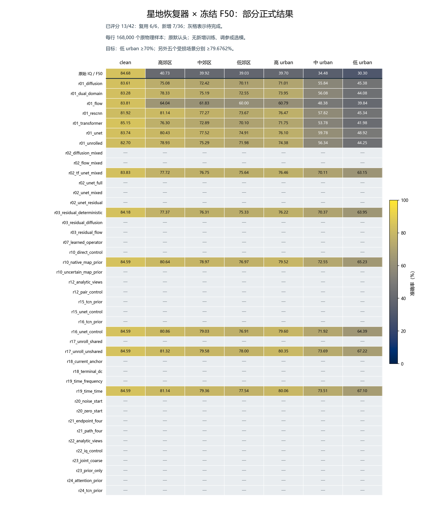

# 既有恢复器正式测试补齐 R26

状态：**RUNNING**。原训练恢复器共 42 行；已核验复用 6/6 行，新增正式评分 7/36 行。矩阵尚未完成，当前统计不能冒充全部候选结论。

用户明确要求补齐测试，因此本轮不以历史源域资格过滤；历史 source_decision、权重、采样和预算原样保留。所有行固定后才启动目标预测，测试成绩不回流训练、结构、参数、seed 或选择性重跑。

每行测试 168000 个原物理样本，固定 clean、三郊区和三 urban；直接使用原 F50 seed2026092701 与原联合训练默认头。恢复器只输出 IQ，PAMF 全部分支从同一 IQ 推导。每行全部七视图完整预测后，由独立 CPU scorer 连接 truth。代码 `12c1f236c9ac9d2f883340c9a3dfbb4564877930`。

|原训练行|clean|高郊区|中郊区|低郊区|高 urban|中 urban|低 urban|状态|
|---|---:|---:|---:|---:|---:|---:|---:|---|
|原始 IQ / F50|84.68|40.73|39.92|39.03|39.70|34.48|30.30|既有配对基线|
|[r01_diffusion](../20261019-phase1-pamf-restoration-selfsup-manysig-m7-r01/report.md)|83.61|75.08|72.42|70.11|71.01|55.84|45.38|新增已评分|
|[r01_dual_domain](../20261019-phase1-pamf-restoration-selfsup-manysig-m7-r01/report.md)|83.28|78.33|75.19|72.55|73.95|56.08|44.08|新增已评分|
|[r01_flow](../20261019-phase1-pamf-restoration-selfsup-manysig-m7-r01/report.md)|83.81|64.04|61.83|60.00|60.79|48.38|39.84|新增已评分|
|[r01_rescnn](../20261019-phase1-pamf-restoration-selfsup-manysig-m7-r01/report.md)|81.92|81.14|77.27|73.67|76.47|57.82|45.34|新增已评分|
|[r01_transformer](../20261019-phase1-pamf-restoration-selfsup-manysig-m7-r01/report.md)|85.15|76.30|72.89|70.10|71.75|53.78|41.98|新增已评分|
|[r01_unet](../20261019-phase1-pamf-restoration-selfsup-manysig-m7-r01/report.md)|83.74|80.43|77.52|74.91|76.10|59.78|48.92|新增已评分|
|[r01_unrolled](../20261019-phase1-pamf-restoration-selfsup-manysig-m7-r01/report.md)|82.70|78.93|75.29|71.98|74.38|56.34|44.25|新增已评分|
|[r02_diffusion_mixed](../20261019-phase1-reception-restoration-selfsup-manysig-m6-r02/report.md)|待完成|待完成|待完成|待完成|待完成|待完成|待完成|补测中|
|[r02_flow_mixed](../20261019-phase1-reception-restoration-selfsup-manysig-m6-r02/report.md)|待完成|待完成|待完成|待完成|待完成|待完成|待完成|补测中|
|[r02_tf_unet_mixed](../20261019-phase1-reception-restoration-selfsup-manysig-m6-r02/report.md)|83.83|77.72|76.75|75.64|76.46|70.11|63.15|复用正式结果|
|[r02_unet_full](../20261019-phase1-reception-restoration-selfsup-manysig-m6-r02/report.md)|待完成|待完成|待完成|待完成|待完成|待完成|待完成|补测中|
|[r02_unet_mixed](../20261019-phase1-reception-restoration-selfsup-manysig-m6-r02/report.md)|待完成|待完成|待完成|待完成|待完成|待完成|待完成|补测中|
|[r02_unet_residual](../20261019-phase1-reception-restoration-selfsup-manysig-m6-r02/report.md)|待完成|待完成|待完成|待完成|待完成|待完成|待完成|补测中|
|[r03_residual_deterministic](../20261019-phase1-restoration-residual-refinement-selfsup-m3-r03/report.md)|84.18|77.37|76.31|75.33|76.22|70.37|63.95|复用正式结果|
|[r03_residual_diffusion](../20261019-phase1-restoration-residual-refinement-selfsup-m3-r03/report.md)|待完成|待完成|待完成|待完成|待完成|待完成|待完成|补测中|
|[r03_residual_flow](../20261019-phase1-restoration-residual-refinement-selfsup-m3-r03/report.md)|待完成|待完成|待完成|待完成|待完成|待完成|待完成|补测中|
|[r07_learned_operator](../20261019-phase1-restoration-learned-action-source-s2026092701-r07/report.md)|待完成|待完成|待完成|待完成|待完成|待完成|待完成|补测中|
|[r10_direct_control](../20261019-phase1-restoration-uncertainty-selfsup-s2026092701-m3-r10/report.md)|待完成|待完成|待完成|待完成|待完成|待完成|待完成|补测中|
|[r10_native_map_prior](../20261019-phase1-restoration-uncertainty-selfsup-s2026092701-m3-r10/report.md)|84.59|80.64|78.97|76.97|79.52|72.55|65.23|复用正式结果|
|[r10_uncertain_map_prior](../20261019-phase1-restoration-uncertainty-selfsup-s2026092701-m3-r10/report.md)|待完成|待完成|待完成|待完成|待完成|待完成|待完成|补测中|
|[r12_analytic_views](../20261019-phase1-restoration-analytic-views-selfsup-s2026092701-m2-r12/report.md)|待完成|待完成|待完成|待完成|待完成|待完成|待完成|补测中|
|[r12_pair_control](../20261019-phase1-restoration-analytic-views-selfsup-s2026092701-m2-r12/report.md)|待完成|待完成|待完成|待完成|待完成|待完成|待完成|补测中|
|[r15_tcn_prior](../20261020-phase1-restoration-fullresolution-selfsup-s2026092701-m2-r15/report.md)|待完成|待完成|待完成|待完成|待完成|待完成|待完成|补测中|
|[r15_unet_control](../20261020-phase1-restoration-fullresolution-selfsup-s2026092701-m2-r15/report.md)|待完成|待完成|待完成|待完成|待完成|待完成|待完成|补测中|
|[r16_tcn_prior](../20261020-phase1-restoration-iqonly-selfsup-s2026092701-m2-r16/report.md)|待完成|待完成|待完成|待完成|待完成|待完成|待完成|补测中|
|[r16_unet_control](../20261020-phase1-restoration-iqonly-selfsup-s2026092701-m2-r16/report.md)|84.59|80.86|79.03|76.91|79.60|71.92|64.39|复用正式结果|
|[r17_unroll_shared](../20261020-phase1-restoration-unrolled-selfsup-s2026092701-m2-r17/report.md)|待完成|待完成|待完成|待完成|待完成|待完成|待完成|补测中|
|[r17_unroll_unshared](../20261020-phase1-restoration-unrolled-selfsup-s2026092701-m2-r17/report.md)|84.59|81.32|79.58|78.00|80.35|73.69|67.22|复用正式结果|
|[r18_current_anchor](../20261020-phase1-restoration-iterative-controls-selfsup-s2026092701-m2-r18/report.md)|待完成|待完成|待完成|待完成|待完成|待完成|待完成|补测中|
|[r18_terminal_dc](../20261020-phase1-restoration-iterative-controls-selfsup-s2026092701-m2-r18/report.md)|待完成|待完成|待完成|待完成|待完成|待完成|待完成|补测中|
|[r19_time_frequency](../20261020-phase1-restoration-alternating-tf-selfsup-s2026092701-m2-r19/report.md)|待完成|待完成|待完成|待完成|待完成|待完成|待完成|补测中|
|[r19_time_time](../20261020-phase1-restoration-alternating-tf-selfsup-s2026092701-m2-r19/report.md)|84.59|81.14|79.36|77.54|80.06|73.51|67.10|复用正式结果|
|[r20_noise_start](../20261020-phase1-restoration-flow-start-selfsup-s2026092701-m2-r20/report.md)|待完成|待完成|待完成|待完成|待完成|待完成|待完成|补测中|
|[r20_zero_start](../20261020-phase1-restoration-flow-start-selfsup-s2026092701-m2-r20/report.md)|待完成|待完成|待完成|待完成|待完成|待完成|待完成|补测中|
|[r21_endpoint_four](../20261020-phase1-restoration-endpoint-selfsup-s2026092701-m2-r21/report.md)|待完成|待完成|待完成|待完成|待完成|待完成|待完成|补测中|
|[r21_path_four](../20261020-phase1-restoration-endpoint-selfsup-s2026092701-m2-r21/report.md)|待完成|待完成|待完成|待完成|待完成|待完成|待完成|补测中|
|[r22_analytic_views](../20261020-phase1-restoration-analytic-unrolled-selfsup-s2026092701-m2-r22/report.md)|待完成|待完成|待完成|待完成|待完成|待完成|待完成|补测中|
|[r22_iq_control](../20261020-phase1-restoration-analytic-unrolled-selfsup-s2026092701-m2-r22/report.md)|待完成|待完成|待完成|待完成|待完成|待完成|待完成|补测中|
|[r23_joint_coarse](../20261020-phase1-restoration-joint-coarse-selfsup-s2026092701-m2-r23/report.md)|待完成|待完成|待完成|待完成|待完成|待完成|待完成|补测中|
|[r23_prior_only](../20261020-phase1-restoration-joint-coarse-selfsup-s2026092701-m2-r23/report.md)|待完成|待完成|待完成|待完成|待完成|待完成|待完成|补测中|
|[r24_attention_prior](../20261020-phase1-restoration-fullresolution-priors-selfsup-s2026092701-m2-r24/report.md)|待完成|待完成|待完成|待完成|待完成|待完成|待完成|补测中|
|[r24_tcn_prior](../20261020-phase1-restoration-fullresolution-priors-selfsup-s2026092701-m2-r24/report.md)|待完成|待完成|待完成|待完成|待完成|待完成|待完成|补测中|

单位为准确率（%）。阈值仍为低 urban≥70%，另外五种 impaired 场景各≥79.67619047619047%（原始 clean84.67619047619047%−5 个百分点）；恢复 clean 损伤另列。

完整逐 TX/RX/day 的准确率、Macro-F1、修复/损伤/净修复、混淆矩阵、波形/FFT 与配对 clean 特征见[汇总](summary.json)和[逐组指标](row_metrics.csv)。独立重算 1638 组的混淆矩阵、准确率、Macro-F1、修复算术及各 TX/RX/day 分区，均一致。

已评分结果的附加身份诊断（只读既有完整预测，0 新预测、0 拟合）：

|原训练行|低 urban 修复数|损伤数|clean 判对部分的恢复准确率|clean 判错部分的恢复准确率|六受损场景全对数|
|---|---:|---:|---:|---:|---:|
|r01_diffusion|44878|19545|48.83%|26.30%|39257/168000|
|r01_dual_domain|44267|21115|47.25%|26.56%|32397/168000|
|r01_flow|39221|23185|42.74%|23.82%|32664/168000|
|r01_rescnn|44740|19478|48.56%|27.51%|33566/168000|
|r01_transformer|42933|23311|44.24%|29.51%|26702/168000|
|r01_unet|49845|18569|52.66%|28.23%|41285/168000|

这里的 clean 判对／判错按同一样本原 F50 的 clean 决定与 TX 真值划分，分别为142256／25744条；只作评分后诊断。六视图相关，不增加独立样本量，不形成部署集成。完整逐 TX/RX/day、修正方向和正交误差见汇总的 paired_identity_diagnostic；全 IQ 的较好校正方向可能主要来自大信道分量，不能直接证明细微 RF 指纹的唯一归属。

42 个模型训练阶段为 TX 无标签模拟配对自监督：利用合法 L6300/U56700，0 TX 标签、0 已训练 F 权重/输出、0 target；允许 clean 配对。原 F50 本身使用源域身份监督，整条链不是完全无监督。识别改进可支持统计上的输入身份保留，不能证明所有生成细节唯一属于该发射机。当前仅单模型 seed，已暴露测试基准，不是新的独立盲测。

资源为 N607 GPU pool0/1/5/7、最多两个本任务 worker，每卡一个；保护其他 owner。首次42原checkpoint＋2个 L_s 无 query smoke PASS，52项聚焦检查和一次独立 P0/P1 审查 PASS。精确逐行来源、六类 seed、命令、环境/CWD、路径、GPU 与停止规则见[登记](experiment.json)。

这些跨轮管线具有不同的父组件、训练损失和累计训练成本，是冻结管线的实际表现比较，不能把跨轮差异全部归因于网络类型。原训练来源及预算可点击表中各行查看；历史报告中的 source-only／未测 target 保留为当时状态，本轮补测成绩统一记录于 R26。原始 clean 是同基座的配对参考，不是数学上的识别上限。新增行的推理耗时包含恢复器、原 F50 和预测文件写入；复用结果不冒充本轮重新测得的全管线耗时。

