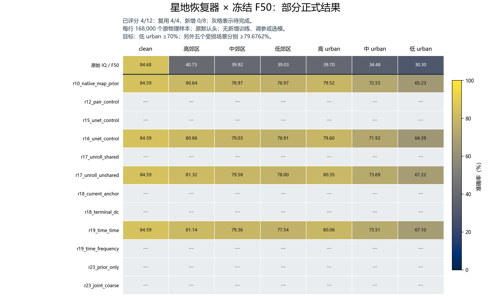

# 后续源域正收益 U-Net 的正式补测 R27

状态：**RUNNING**。固定12条管线，8条新增、4条复用；已评分0/8条新增及4/4条复用。未完成行不参与性能结论。

用户限定R23这类后续仅报告源域、具有正收益的U-Net。原R26全量队列已停止且产物保留。本子集先按源域1800个同物理样本、原F50/defaulthead的六受损场景均值相对预声明对照严格正增益和clean下降≤0.1个百分点固定；目标测试成绩不参与筛选或排序。优先运行R23 prior_only、joint_coarse。R10为复用的固定控制。源收益为单seed点估计，微小提升不冒充显著性或每场景改善；历史完整source qualification原样保留。

|管线|源域对照|源六场景均值增益（百分点）|源 low urban 增益|源 mid urban 增益|
|---|---|---:|---:|---:|
|r10_native_map_prior|固定参考|—|—|—|
|r12_pair_control|r10_native_map_prior|+0.2315|+0.7778|+0.4444|
|r15_unet_control|r10_native_map_prior|+0.0926|+0.3333|+0.2778|
|r16_unet_control|r15_unet_control|+0.4722|+1.8889|+0.5556|
|r17_unroll_shared|r16_unet_control|+0.5648|+2.0000|+0.4444|
|r17_unroll_unshared|r16_unet_control|+0.4630|+2.4444|+0.7222|
|r18_current_anchor|r17_unroll_unshared|+0.4630|+1.2222|+1.1667|
|r18_terminal_dc|r17_unroll_unshared|+0.7778|+1.5000|+1.2222|
|r19_time_time|r17_unroll_unshared|+0.5556|+1.4444|+1.1111|
|r19_time_frequency|r19_time_time|+0.2407|-0.1667|+0.4444|
|r23_prior_only|r17_unroll_unshared|+0.0370|-0.3889|+0.2778|
|r23_joint_coarse|r23_prior_only|+0.0648|+0.2778|-0.2222|

每条管线使用原冻结权重，0新增训练、0头拟合、0状态更新。原F50 seed2026092701及原联合训练默认头直接读取恢复的单一IQ，FFT/PA/时域/统计全部由同一IQ派生。正式测试是R05固定168000个物理样本的clean＋六种practical；每行七视图有限预测及ID全部固定后，由独立CPU scorer连接truth。方法commit `09986121a50a5b33726a6d0106127deec6e433e6`。

|原训练行|clean|高郊区|中郊区|低郊区|高 urban|中 urban|低 urban|状态|
|---|---:|---:|---:|---:|---:|---:|---:|---|
|原始 IQ / F50|84.68|40.73|39.92|39.03|39.70|34.48|30.30|既有配对基线|
|[r10_native_map_prior](../20261019-phase1-restoration-uncertainty-selfsup-s2026092701-m3-r10/report.md)|84.59|80.64|78.97|76.97|79.52|72.55|65.23|复用正式结果|
|[r12_pair_control](../20261019-phase1-restoration-analytic-views-selfsup-s2026092701-m2-r12/report.md)|待完成|待完成|待完成|待完成|待完成|待完成|待完成|补测中|
|[r15_unet_control](../20261020-phase1-restoration-fullresolution-selfsup-s2026092701-m2-r15/report.md)|待完成|待完成|待完成|待完成|待完成|待完成|待完成|补测中|
|[r16_unet_control](../20261020-phase1-restoration-iqonly-selfsup-s2026092701-m2-r16/report.md)|84.59|80.86|79.03|76.91|79.60|71.92|64.39|复用正式结果|
|[r17_unroll_shared](../20261020-phase1-restoration-unrolled-selfsup-s2026092701-m2-r17/report.md)|待完成|待完成|待完成|待完成|待完成|待完成|待完成|补测中|
|[r17_unroll_unshared](../20261020-phase1-restoration-unrolled-selfsup-s2026092701-m2-r17/report.md)|84.59|81.32|79.58|78.00|80.35|73.69|67.22|复用正式结果|
|[r18_current_anchor](../20261020-phase1-restoration-iterative-controls-selfsup-s2026092701-m2-r18/report.md)|待完成|待完成|待完成|待完成|待完成|待完成|待完成|补测中|
|[r18_terminal_dc](../20261020-phase1-restoration-iterative-controls-selfsup-s2026092701-m2-r18/report.md)|待完成|待完成|待完成|待完成|待完成|待完成|待完成|补测中|
|[r19_time_time](../20261020-phase1-restoration-alternating-tf-selfsup-s2026092701-m2-r19/report.md)|84.59|81.14|79.36|77.54|80.06|73.51|67.10|复用正式结果|
|[r19_time_frequency](../20261020-phase1-restoration-alternating-tf-selfsup-s2026092701-m2-r19/report.md)|待完成|待完成|待完成|待完成|待完成|待完成|待完成|补测中|
|[r23_prior_only](../20261020-phase1-restoration-joint-coarse-selfsup-s2026092701-m2-r23/report.md)|待完成|待完成|待完成|待完成|待完成|待完成|待完成|补测中|
|[r23_joint_coarse](../20261020-phase1-restoration-joint-coarse-selfsup-s2026092701-m2-r23/report.md)|待完成|待完成|待完成|待完成|待完成|待完成|待完成|补测中|

准确率单位为%。低urban目标≥70%，其他五受损场景各≥79.67619047619047%（同一F50原始clean84.67619047619047%减5个百分点）。恢复clean损伤单列。原clean为配对参考，不是数学上限。

[全部指标](summary.json)包括逐TX/RX/day准确率、Macro-F1、混淆矩阵、修复/损伤/净修复、波形/FFT、配对clean特征及原训练来源；[逐组数据](row_metrics.csv)可复核。独立重算504组混淆矩阵、准确率、Macro-F1、修复算术和分区均一致。

恢复器训练采用合法L6300/U56700上的TX无标签模拟配对自监督，允许clean配对，训练0TX标签、0已训练F权重/输出、0target；原F50使用过源域身份监督，整条链不称完全无监督。统计识别收益、逐TX表现和同物理IQ校正支持输入身份保留，但不能证明每个生成细节唯一属于输入发射机；全IQ校正可能主要反映大信道分量。跨轮父组件与累计成本不同，不把管线差异全部归因于网络类型。

N607普通账户，最多两个本任务GPU worker，每卡一个；67项聚焦检查、一次独立P0/P1审查、真实checkpoint＋2个L_s无query smoke；一归档SHA对照与远端compile。命令、环境/CWD、资源、不可覆盖路径、停止规则见[登记](experiment.json)。技术失败保留健康进程和所有输出，pending暂停派发，无自动重试。目标为已暴露的ManySig practical残余信道仿真基准、单模型seed，不宣称新盲测、新TX或在轨部署有效性；结果不回流调参、候选重排或选择性重跑。

Macro-F1按固定6类平均；单TX分组主要看accuracy（该TX召回率），其余无样本类为零。新增推理耗时包含恢复器、F50和写入，复用行不冒充本轮新测耗时。

相对各自预声明控制管线的正式测试差值（百分点；负数表示下降；两行均完整评分才列出）：

|管线|对应控制|clean|高郊区|中郊区|低郊区|高 urban|中 urban|低 urban|
|---|---|---:|---:|---:|---:|---:|---:|---:|
|r17_unroll_unshared|r16_unet_control|+0.000|+0.457|+0.552|+1.086|+0.752|+1.764|+2.822|
|r19_time_time|r17_unroll_unshared|+0.000|-0.182|-0.217|-0.458|-0.289|-0.171|-0.114|

这张表检验后续修改是否在测试集上增加收益，不能用相对原始受损 IQ 的大幅改善替代这个比较。

