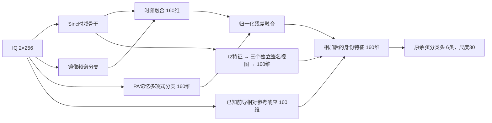

# 三视图 PAMF＋REPL＋固定时间打乱：完成结果、结构及普通 PL 对照

状态 VERIFIED／ANALYZED。16个新模型及其预测、独立评分共48阶段全部完成，无失败；三视图整组评分确实早于任一单视图训练。原普通PL论文队列继续用户暂停，不自动恢复。

## 统计口径

Main split，ManySig六类；源RX [1,3,4,6,8]、D1–D3；L_s/U_s/V=6300/56700/27000。模型seed2026092701至08，数据split392005；各模型从零、20＋10＋20=E50／11100更新。固定最终轮，默认头联合训练；U的TX始终隐藏。

测试为未见RX [0,2,5,7,9,10,11]，cross_rx126000条与cross_both42000条，合计每景168000条；先加混淆矩阵再计算合并Accuracy/Macro-F1。六景平均是六个practical准确率的算术平均；±为跨模型种子样本标准差。这里全部是直接识别，没有DURA。D0为更早未见日，不声明未来日期外推。

## 本轮完整结果与普通PL

普通PL现有匹配Main split三视图对照只含01/02/03三个种子，且保持自然时间顺序。因此不把八种子均值减三种子均值当作配对增益。下表差值仅使用两者共有的01/02/03。

|场景|本轮REPL＋打乱，8种子均值 %|本轮REPL＋打乱，共同3种子 %|普通PL，共同3种子 %|共同种子配对差，百分点|
|---|---:|---:|---:|---:|
|Clean|86.6307|86.9188|84.9817|+1.9371|
|郊区 high|80.4393|80.0706|79.7760|+0.2946|
|郊区 mid|77.8644|77.5663|77.2804|+0.2859|
|郊区 low|75.4145|75.1980|74.8367|+0.3613|
|城市 high|76.9389|76.5980|76.3812|+0.2169|
|城市 mid|62.7428|62.5171|62.4034|+0.1137|
|城市 low|51.7464|51.5046|51.4786|+0.0260|
|六景平均|70.8577|70.5758|70.3594|+0.2164|

|结构与方法|seed数|Clean准确率 %|六景平均准确率 %|
|---|---:|---:|---:|
|三视图＋普通PL，原顺序|3|84.9817 ± 0.1893|70.3594 ± 0.9576|
|三视图＋原版REPL，原顺序，历史|3|85.7268 ± 0.6415|70.0855 ± 0.4689|
|三视图＋REPL＋打乱，历史|3|86.7107 ± 0.4959|70.7634 ± 0.8787|
|三视图＋REPL＋打乱，本轮共同子集|3|86.9188 ± 0.7617|70.5758 ± 0.4566|
|三视图＋REPL＋打乱，本轮完整|8|86.6307 ± 1.0082|70.8577 ± 0.4990|
|单视图＋REPL＋打乱，本轮完整|8|86.3488 ± 0.7215|70.3578 ± 0.4650|

三视图本轮八种子的Clean Macro-F1为86.3385 ± 1.0898%，六景平均Macro-F1为70.5833 ± 0.5348%。

共同三种子：Clean差值为+1.9371±0.8752个百分点，3/3为正；六景平均为+0.2164±0.5236个百分点，2/3为正。最难low urban只多0.0260个百分点，不能称为明确城市低仰角鲁棒性突破。标准差不是显著性检验。

原顺序的三视图REPL相对原顺序普通PL：Clean +0.7450个百分点，六景平均 -0.2738个百分点。因此，现有证据支持“REPL＋此固定时序重排这个组合的Clean更好”，并不支持“REPL本身在六景普遍优于PL”。三视图＋普通PL＋同一固定重排仍无匹配结果；未借本次结果查询追加训练。

历史86.7107%／70.7634%来自旧三种子。新共同三种子为86.9188%／70.5758%，新八种子为86.6307%／70.8577%；三者分别列出，不混称同一重现值或用历史单项替换本轮负项。

## 每个三视图模型的结果

|模型seed|Clean %|六景平均 %|
|---|---:|---:|
|2026092701|86.5387|70.9864|
|2026092702|87.7958|70.0841|
|2026092703|86.4220|70.6567|
|2026092704|85.7792|70.5931|
|2026092705|85.1238|70.5722|
|2026092706|88.1732|71.1209|
|2026092707|86.2006|71.0885|
|2026092708|87.0119|71.7596|

## 实际部署结构

已加载本轮完成的三视图seed01真实checkpoint，CPU/eval上以1条合法L_s IQ读回各层尺寸；target读取0、更新0。完整模型232993参数，输入FP32 [B,2,256]，输出6类，采样率25MHz，预处理沿用equalized1／unitRMS。

### 时域、频域和PA骨干

|模块|实际操作与尺寸，不含batch维|
|---|---|
|时域输入|24个长度79的可学习Sinc滤波器分别作用I/Q，产生48×256；再拼接48通道三阶非线性基和4通道高频强调，合计100×256。Sinc为CENTER_25K坐标，CENTER_UNITS优化映射。|
|时域CNN|1×1卷积100→48，GroupNorm/ReLU；平均下采样至48×128；深度可分离t1：48→72、核5、池化2，得72×64；t2：72→96、核5、池化2，得96×32；t3：96→96、核3、无下采样；全局平均池化及96→160线性。t1–t3 Dropout0.10。|
|频域输入|原IQ的FFT镜像配对，32频带，4通道分别为正频log功率、负频log功率、log功率比、镜像不对称度，4×32；频带门控。|
|频域CNN|深度可分离卷积4→16→32→32，核5/5/3，前两层池化2，尺寸4×32→16×16→32×8→32×8；全局池化、32→160，另加3维频谱统计的160维投影。Dropout0.05。|
|时频融合|时域160＋频域160＋圆对称性统计1拼为321维，经321→160线性、ReLU、Dropout0.45。|
|PA分支|原IQ以4个记忆抽头、阶数1/3/5作复数记忆多项式提升，产生24实通道；包络门控；普通膨胀卷积24→48→64→64，核7/7/5、膨胀率1/2/4，前两层平均池化2；256→128→64→64；全局池化及64→160，另有3维PA频谱统计投影。分支Dropout0.08。|
|骨干残差融合|时频160维与PA160维分别LayerNorm，以逐维可学习tanh增益相加；PA初始增益0.25。没有另训分类头。|

### 相对参考响应分支

使用公开Wi-Fi前导参考，对每包独立取[80,160)窗口，4个长度20周期；固定320个延时模板，间隔1/16采样点。内部估计相对频偏并补偿，但显式CFO身份坐标置0；29维接口中28维活跃。29→64→160，经SiLU及LayerNorm，以逐维tanh增益残差加入骨干，增益初值0。它描述接收相对响应，仍可能包含接收机、信道和均衡影响，不应称为已分离的真实TX硬件参数。

### 三视图签名及时间打乱

从t2的96×32特征读出；三个独立1×1投影各为96→6，tanh后得到32×6路径，各分成4个长度8窗口。每个窗口固定按零起始索引[0,5,3,6,2,1,4,7]重排，首尾保留；再附加0至1的时间坐标。训练、U与测试保持同一排列。

实现中每窗口描述为7维一阶总增量＋21维二阶反对称面积，共28维；不是7＋49维的完整二阶张量。四窗口拼成112维，三独立视图拼336维，再336→160线性、LayerNorm，以0.2×tanh(g)残差加入，初始增益0.05。时间打乱发生在这一特征分支内，不打乱原IQ，也不打乱整个时域骨干。首尾不变使一阶总增量保持，变化主要进入二阶面积项；不能据当前准确率断言全部时间信息无用。

### 参数与分类

|组成|参数数|
|---|---:|
|时频／PA骨干，含联合分类头|164225|
|参考响应投影＋逐维增益|12800|
|三签名视图、336→160投影、归一化及增益|55968|
|完整识别器|232993|

最终160维身份特征归一化，与6×160的默认头权重归一化后计算余弦，尺度30。REPL和普通PL不因半监督目标而增加部署参数；固定打乱没有可训练参数。

## REPL与普通PL的训练差异

|项目|普通PL对照|本轮原版REPL＋打乱|
|---|---|---|
|L目标、默认头|完整L浅中层跨RX对比、ordinary/raw配对KL、As真实CE且As KL0、LS0.01|相同|
|阶段|E1–13只有L；E14–50联合L/U的普通PL|E1–13只有L；E14–20普通PL；E21–50完整REPL|
|U伪标签|当前学生eval/no_grad，阈值0.95，U256，权重1|相同伪标签来源／阈值／U256，REPL总权重6|
|U学生前向|每批1次CE|每批6次：普通增强／混合槽／raw配对，KL、浅中层对比、联合160维对比|
|U特征操作|无附加特征配对机制|同伪身份跨RX保护MixStyle，概率0.5、Beta0.1；六前向共享同一配对方案；实际160维特征接收机外推alpha0.25|
|梯度处理|原生更新|以完整L目标为锚的逐组U梯度保护，U/L范数上限1|
|EMA／原U复杂门控|均无EMA或原生U门控|无EMA或原生U门控，但存在REPL所声明的保护／配对／梯度机制，不能称为普通PL|
|推理时|三视图，保持原顺序|三视图，固定上述重排；都只保留同一个原默认头|

两者50轮、11100更新与可见标签预算一致，但计算量不等价。每模型实际U曝光2097900包次，其中E14–20为396900，E21–50为1701000。普通PL学生U前向2097900包次；REPL为396900＋6×1701000=10602900包次。每模型L前向总8524800包次相同；伪标签接受率与逐段计数保留在远端原source进度和REPL状态。不能把相同epoch写成相同训练FLOPs。

## 证据与文件

执行代码3ff8f4b7e85b5608f5b45350aa18081499a7ef1d；新run 20261027-phase1-pamf-repl-shuffled-views-m16-r02。普通PL及历史REPL来自20261024-phase1-PAMF-REPL-completion-m201-r01中的F0对应原默认头／raw读出。全部25行评分已核对预测完整、truth_last及target_feedback_forbidden标志，新16行固定E50／11100、target/U真值／另训头读取0。

本地按保存混淆矩阵独立重算的八种子Clean／六景均值和样本SD与远端analysis一致，误差小于1e-10；原始逐样本IQ、预测、权重、真值和私有环境未放入本报告。results_per_seed.csv、results_summary.csv与results_paired_vs_PL.csv保留各口径。
