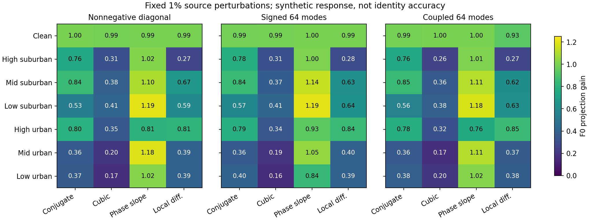

# 微弱源IQ变化的恢复响应：三类固定协方差网络

**84/84单元及2688条配对响应通过独立向量复算。** 固定原R07 draw1的224条训练记录，35L_s/189U_s、五源RX，每个源场景32条。三个G均为原final30，原F0只计算连续特征；没有TX真值、分类头、V/OE或目标输入。

四种合成方向为共轭、幅度三次项、相位斜坡、局部差分，强度固定为源IQ RMS的1%。用记录的真实源Action构造y+Aδ，保留原来的噪声，不重新归一化；恢复器仍自行盲估全部内部量，没有获得真实Action。比较恢复前后差分与δ，以及F0恢复差分与F0(clean+δ)−F0(clean)。

投影增益以32条记录的内积总和除以参考变化能量总和计算；1表示沿参考方向的响应量相同，0表示该方向无净响应，负值表示反向。归一化误差还计算了偏离参考方向的变化，增益接近1不保证完整响应正确。这些比例不是身份信息恢复率。

| 低档城区合成方向 | 网络 | IQ投影增益 | IQ相对平方误差 | F0投影增益 | F0相对平方误差 |
|---|---|---:|---:|---:|---:|
| 共轭 | 非负方差 | 0.4655 | 0.5430 | 0.3676 | 0.5900 |
| 共轭 | 有符号64方向 | 0.4566 | 0.5551 | 0.3951 | 0.5708 |
| 共轭 | 耦合64方向 | 0.4423 | 0.5435 | 0.3849 | 0.5747 |
| 幅度非线性 | 非负方差 | 0.4284 | 0.5852 | 0.1718 | 0.9494 |
| 幅度非线性 | 有符号64方向 | 0.4148 | 0.6258 | 0.1608 | 0.9008 |
| 幅度非线性 | 耦合64方向 | 0.4002 | 0.5926 | 0.1994 | 0.8483 |
| 相位斜坡 | 非负方差 | 0.7051 | 1.1956 | 1.0245 | 4.7291 |
| 相位斜坡 | 有符号64方向 | 0.6696 | 1.2233 | 0.8368 | 4.0726 |
| 相位斜坡 | 耦合64方向 | 0.6832 | 1.1742 | 1.0215 | 6.2412 |
| 局部差分 | 非负方差 | 0.6494 | 0.4838 | 0.3883 | 0.9718 |
| 局部差分 | 有符号64方向 | 0.6160 | 0.4967 | 0.3934 | 0.8823 |
| 局部差分 | 耦合64方向 | 0.5773 | 0.5310 | 0.3762 | 1.1141 |

在这组低档城区源记录上，幅度非线性的IQ投影增益约0.40至0.43，F0投影增益约0.16至0.20；clean中的对应F0增益约0.99至1.00。源端平均重建目标没有保证这些合成方向的响应保留。局部差分的低城区F0增益约0.38至0.39，也存在明显变化。

相位斜坡需同时看误差：低城区F0投影增益约0.84至1.02，但相对平方响应误差约4.07至6.24。仅把某一方向增益提高到1不能消除偏离方向的响应，也可能放大无关变化。

三版在相同源记录、相同方向和相同信道/噪声下比较；各场景使用不同的固定记录集合，因此跨场景差异不能直接解释为只改变信道的因果效应。记录来自训练L_s/U_s，不是新的独立验证集。这四种变化是源端代理，不能证明真实发射机指纹丢失的比例，也不保证加入响应损失后Main改善。

独立NumPy从完整保存向量复算全部84格、2688个响应对，统计量最大差2.22e-16、摘要最大差6.66e-16；额外只读取同一224条源clean IQ核对1%能量，平方比例最大误差4.36e-11。零额外神经前向或真值读取。

实际三G/F0源检查、CPU2/nice10/CUDA为空及进程/命令/日志增长已独立核实，全部模型状态保持。当前结果支持将方向响应作为独立源端机制对照，尚不改变任何在训候选、默认DURA或验收门槛。

[全部84格数值](response_cells.csv) · [核验结果与实验边界](verified_results.json)

## 低城区相位斜坡的逐记录误差分布

对原低城区 32 条记录和原先保存的四种响应向量做事后统计，不新增模型前向、训练、TX 真值或目标输入。令参考特征变化为 `u = F0(clean + δ) − F0(clean)`，实际恢复特征变化为 `v = F0(G(received + Aδ)) − F0(G(received))`。每条的相对平方误差为 `||v − u||² / ||u||²`；32 条的参考能量均大于 `1e-16`。上文原有聚合值是分子之和除以分母之和，与下表逐记录误差中位数采用不同权重。

| 固定恢复器 | 特征响应聚合误差 | 逐记录中位数 | 逐记录 90% 分位 | 误差大于 1 的记录数 | 误差分子最大的 4 条占总分子 | 同 4 条占总参考能量 |
|---|---:|---:|---:|---:|---:|---:|
| 非负方差 | 4.7291 | 2.4460 | 14.9473 | 25／32 | 56.03% | 44.36% |
| 有符号 64 方向 | 4.0726 | 2.8472 | 16.2777 | 24／32 | 53.76% | 19.04% |
| 耦合 64 方向 | 6.2412 | 4.3481 | 22.5153 | 25／32 | 56.44% | 19.27% |

该合成方向上，较高的特征响应误差不只是由一两条记录造成；但尾部有明显集中。数值大于 1 的含义是响应误差能量大于参考响应能量，并不意味着发射机身份信息损失超过 100%。相位斜坡也可能包含识别无关或接收机相关的变化，不是已验证的真实发射机硬件导数。32 条源训练记录的统计量不构成总体分布估计，也无法证明增加 F 特征差分损失可以提升 Main 准确率。

本次用 NumPy 从已保存的原始特征响应重新计算参考能量、实际能量、内积与误差，与原每记录四列统计逐项核对通过；聚合结果与上表一致。该结果只支持在合法源 L_s/U_s 范围内研究识别特征方向和响应可靠度的受控对照；在训方案、默认模型和目标测试矩阵不作更改。
