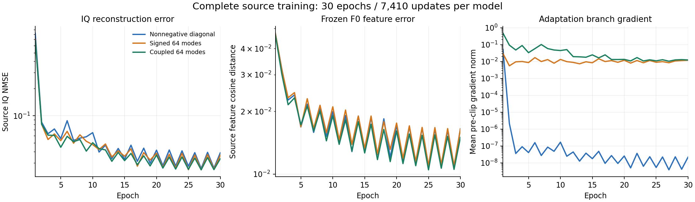

# 三类条件协方差恢复器：完整30轮源训练比较

**耦合版在29/30轮的源IQ误差低于非负方差版，在27/30轮的连续F0特征误差更低。** 这是完整训练轨迹的结果，不能替代正式识别收益。全部三版固定最终30轮/7410步，未选取更好轮次。

复用三版已通过的最终源审计，核对全部90轮日志；每版每轮63000条、L_s6300/U_s56700，累计1890000次源曝光。全部源排列、原先验固定、模型及优化器有限、参数头实际更新和final=E30均已核实。此前源比较已验证三版完整30轮顺序/draw及共同物理E0逐值一致；本次再核对学习率和所有轮次的预算。

全源先验与排除当前源RX的先验分别用于15轮。非负方差版没有记录prior fraction这一标量；其实际ebb279ff版本的共享训练入口、noisy_readout和choose_prior调用链已核实奇数轮全源、偶数轮其他RX。另两版的30轮prior fraction日志逐项核实。没有将缺少的日志字段填成观测值。

| 模型 | 30轮平均IQ NMSE | 全源先验15轮 | 其他RX先验15轮 | 平均F0余弦距离 | 平均F0标准化误差 |
|---|---:|---:|---:|---:|---:|
| 非负逐点方差 | 0.071421 | 0.090311 | 0.052531 | 0.017682 | 0.164361 |
| 有符号64方向 | 0.064243 | 0.080814 | 0.047671 | 0.018090 | 0.166631 |
| 耦合64方向 | 0.061163 | 0.077786 | 0.044541 | 0.016955 | 0.158007 |

这里的平均数覆盖从初始化到最后一轮的全部训练，包括首轮较大的误差；不是冻结模型验证集误差。全源与其他RX列属于不同epoch/draw，不能将两列差值当作同条样本替换先验的因果效应。

| 最终第30轮，同一draw/其他RX先验 | 非负方差 | 有符号64方向 | 耦合64方向 |
|---|---:|---:|---:|
| IQ NMSE | 0.038820 | 0.036403 | 0.033436 |
| 频谱误差 | 0.068542 | 0.066273 | 0.064679 |
| F0余弦距离 | 0.016501 | 0.016436 | 0.015000 |
| F0标准化误差 | 0.163853 | 0.161845 | 0.148958 |
| Action相对MSE | 0.009763 | 0.009682 | 0.009865 |
| 噪声log MSE | 0.047636 | 0.046818 | 0.048260 |

有符号版的源IQ误差在24/30轮较低，但F0余弦距离仅3/30轮较低，完整训练的平均F0误差略高。耦合版同时改善了这两项源拟合指标；它没有表现出非负增量版的近零分支梯度。三版物理估计轨迹已产生差异，结构、参数映射和随机计算路径也不同，因此这不是固定物理估计器下只改变非对角项的单因素实验。

上述结论只用于描述已经完成的源训练。现有完整Main结果、两个clean总体保护和预登记匹配比较分别记录于各版analysis.md；源曲线不作为选模、修改在训模型或目标反馈。此前共同前20轮报告作为当时快照保留，本报告补齐整个固定预算。

本次新增IQ读取、神经前向、TX/目标真值读取、拟合或训练更新均为0。

[全部90轮数据](source_family_final30.csv) · [核验摘要](source_family_final30.json) · [此前E20快照](source_family_progress_E20.md)
