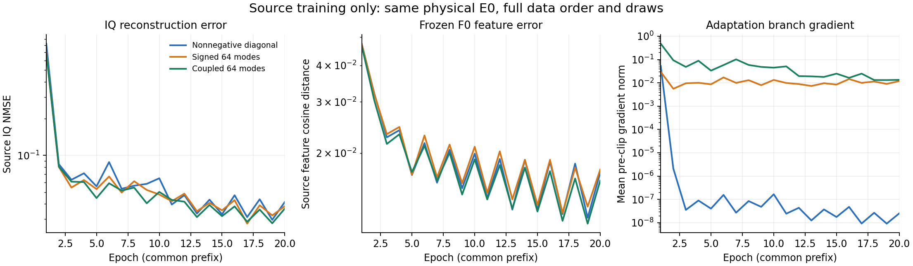

# 三类条件协方差恢复器：共同前20轮源训练比较

**耦合协方差分支已实际学习，源IQ与连续F0特征误差较低；正式Main收益尚未验证。** 本报告检查观察时全部69轮日志及对应保存状态：非负方差版27轮、有符号版22轮、耦合版20轮。跨模型比较固定使用共同前20轮，没有选取较好的checkpoint或取消后续训练。

三版完整30轮源顺序与draw逐值一致，物理分支E0的全部共同参数和原mean/C缓冲逐值一致。每版共同前20轮为4940次更新、1260000次源曝光，奇数轮使用全源先验、偶数轮使用排除当前源RX的先验。所有已完成轮次的完整源排列、预算、真实源检查、物理/适配分支实际更新、有限模型与优化器状态、固定先验均已核实。

训练轨迹中的物理参数已经出现差异，因此以下是三条完整训练轨迹的比较，不是固定同一个物理估计器的单因素适配头实验。源记录重复曝光也不构成126万条独立测试样本。

| 模型 | 20轮平均IQ NMSE | 全源先验10轮 | 其他RX先验10轮 | 平均F0余弦距离 | 平均F0标准化误差 |
|---|---:|---:|---:|---:|---:|
| 非负逐点方差 | 0.090380 | 0.121920 | 0.058839 | 0.019619 | 0.179232 |
| 独立有符号64方向 | 0.080637 | 0.108340 | 0.052934 | 0.020138 | 0.182485 |
| 耦合64方向 | 0.076790 | 0.103904 | 0.049675 | 0.018915 | 0.173611 |

以上均为训练期间逐记录聚合损失。全源/其他RX列同时对应不同epoch和draw；不可将两列差异直接视为先验替换的因果效应。不同模型在相同epoch使用相同源顺序和draw，逐轮明细完整保留。

## 当前分支行为

- 非负方差版第20轮平均相对增量为2.4033e-9，分支梯度范数为2.5166e-8。该参数化在当前损失下学到了几乎不增加方差；参数确实更新，不能简单叫作没有训练或程序故障。
- 有符号版第20轮约64.85%的方向系数为负，平均系数−0.2589，分支梯度范数0.01191。它实际使用了方差收缩，而非只沿非负增量方向调整；共同20轮中有14轮的IQ NMSE低于非负方差版，但平均F0特征误差略高。
- 耦合版第20轮的非对角变化量明确非零，正对角映射平均斜率0.4756，分支梯度范数0.01340。共同20轮中有19轮的IQ NMSE低于非负方差版；平均IQ、频谱与两种连续F0特征误差也较低。它尚未表现出非负增量版的近零变化现象。

| 第20轮，同一draw/其他RX先验 | 非负方差 | 有符号64方向 | 耦合64方向 |
|---|---:|---:|---:|
| IQ NMSE | 0.041506 | 0.038373 | 0.036659 |
| 频谱误差 | 0.071737 | 0.069562 | 0.068329 |
| F0余弦距离 | 0.017123 | 0.017566 | 0.016097 |
| F0标准化误差 | 0.168283 | 0.169295 | 0.156648 |
| Action相对MSE | 0.011802 | 0.012052 | 0.012549 |
| 噪声log MSE | 0.072709 | 0.067904 | 0.085080 |

## 对研发的含义与边界

这些源证据支持继续检验允许方差收缩和方向耦合的先验表达：两种新分支确实参与了学习，耦合版也同时改善了源IQ和连续特征拟合。结构、输出范围、映射与训练数值轨迹共同变化，不能把差异单独归于非对角项或某个激活函数。

当前没有这三版的完整Main结果，也没有用源训练损失替代真实TX识别、clean保持或六景3pp验收。所有模型继续原final30/7410与完整七景流程，不按这些曲线选择checkpoint、早停、增加轮次或重排候选。

本次只读取已有训练日志、源排列和保存状态，零新IQ、神经前向、TX/目标真值、拟合或训练更新；没有新增模型实验。

[全部69轮数据](source_family_all_available.csv) · [共同20轮逐项比较](source_family_common_E20.csv) · [核验摘要](source_family_progress_E20.json)
