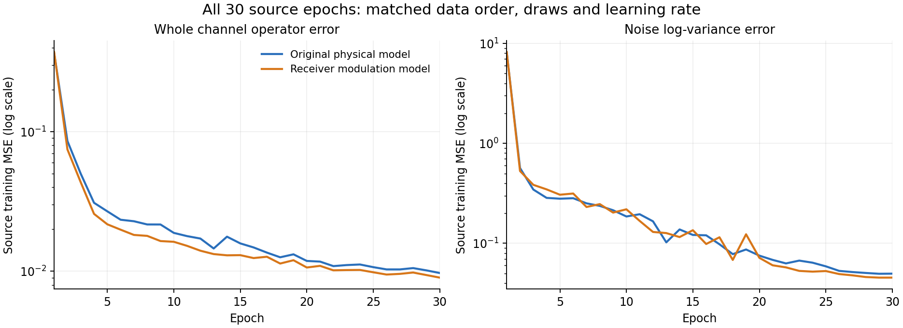

# 物理接收调制估计与分量监督，从零单阶段 30 轮：完整 Main 结果

**六景1/6；两个clean总体净-66/-29。** 原地面完整Tri-SIG-TIME SSL/defaulthead。raw clean145385/168000=86.538690476%；每景至少140345/168000=83.538690476%，两个clean总体分别保护111019和34366条。

| 场景 | DURA | 新版 | 距raw clean | 相对DURA | 距门槛少对 |
|---|---:|---:|---:|---:|---:|
| clean | 86.615476% | 86.482143% | 0.056548 pp | -0.133333 pp | — |
| 高档郊区 | 84.343452% | 83.657143% | 2.881548 pp | -0.686310 pp | 0 |
| 中档郊区 | 83.016071% | 82.395238% | 4.143452 pp | -0.620833 pp | 1921 |
| 低档郊区 | 81.322024% | 80.766071% | 5.772619 pp | -0.555952 pp | 4658 |
| 高档城区 | 83.049405% | 82.386310% | 4.152381 pp | -0.663095 pp | 1936 |
| 中档城区 | 75.705952% | 75.182738% | 11.355952 pp | -0.523214 pp | 14038 |
| 低档城区 | 68.801190% | 67.238095% | 19.300595 pp | -1.563095 pp | 27385 |

## 同记录真实TX修复与损伤

| 场景 | 相对DURA修复 | 损伤 | 净变化 |
|---|---:|---:|---:|
| clean | 229 | 453 | -224 |
| 高档郊区 | 5623 | 6776 | -1153 |
| 中档郊区 | 7095 | 8138 | -1043 |
| 低档郊区 | 8551 | 9485 | -934 |
| 高档城区 | 6820 | 7934 | -1114 |
| 中档城区 | 12424 | 13303 | -879 |
| 低档城区 | 16179 | 18805 | -2626 |

## 预登记原物理版同样本比较

| 场景 | 原物理版 | 新版 | 净正确数变化 | 准确率变化 |
|---|---:|---:|---:|---:|
| clean | 86.572619% | 86.482143% | -152 | -0.090476 pp |
| 高档郊区 | 83.500595% | 83.657143% | +263 | +0.156548 pp |
| 中档郊区 | 82.139286% | 82.395238% | +430 | +0.255952 pp |
| 低档郊区 | 80.539286% | 80.766071% | +381 | +0.226786 pp |
| 高档城区 | 82.183333% | 82.386310% | +341 | +0.202976 pp |
| 中档城区 | 75.047619% | 75.182738% | +227 | +0.135119 pp |
| 低档城区 | 67.198214% | 67.238095% | +67 | +0.039881 pp |

原物理版完整14个候选预测单元、同物理ID、同F0及raw/DURA控制流在连接truth前核实。paired_changes.csv保留两个总体全部TX/RX/day等分组的修复与损伤。该对照同时改变调制参数化及分量监督，不能将差异单独归因于其中一个因素。

## 完整源训练对照

原物理版和新版的全部30轮源记录顺序、draw、曝光数、步数和学习率已逐项核实相同。第30轮完整Action相对MSE分别为0.00972509与0.00901296；噪声log MSE为0.04974598与0.04541007。全部30轮见source_physical_comparison.csv。

这些是训练过程中聚合的源物理量误差，不是冻结验证误差、真实TX准确率或单因素因果效应。新版另含调制/FIR监督，总loss不可直接横比；两次执行的共享资源状态不同，epoch时长也不代表独占加速。

## 方法、成本和证据边界

包级主路/镜像复增益，加独立线性与局部相位。用原源模拟真值监督调制、FIR、完整算子与噪声。独立冻结 Main 七景。

All G parameters scratch seed2026092701 and identity physical heads. No learned model ancestry. Original source-only Gaussian statistics.

Original source-only simulator physical supervision, L_s6300/U_s56700. Zero true TX, F0 guidance, V/OE/novel/target training.

全部30轮/7410步、63000条每轮完整源排列、189000次L_s和1701000次U_s曝光已核实。最终权重逐值等于E30技术状态，源先验固定，模型/优化器有限，各参数头实际更新。源目标组成复算最大误差1.02e-09。训练期间F0前向行数0，完整source审计见training_final_audit.json。

实际训练阶段3001.537秒；epoch计时合计2992.637秒、均值99.755秒。两个预测阶段共2480.720秒。均为共享负载整阶段计时，含相应初始化/数据读取/真实源检查等成本，不是B1时延或独占提速倍数。

原Main两总体七景三流42单元全部固定后独立truth-last。再次复算全部1302组、868raw配对及DURA/clean配对，最大指标差1.24e-14，raw/DURA复用判决差0。公开CSV只包含聚合数据；各总体TX/RX/day/RX×day和macro-F1完整保留。combined_group_metrics.csv从互斥总体的混淆计数合并，不平均百分比。

低档城区67.238095%，相当于raw clean准确率的77.697149%；这是任务准确率保留比例，不是IQ信息恢复比例或理论上界。

代码、模型、source-only数据及最终30轮冻结点保持原预登记；资源调度只改变等待条件，全部科学阶段实际使用原release/commit。当前结果不用于调整其他在训候选、按场景组合或重新选择checkpoint。默认DURA保持，整个研究目标仍依完整逐景与clean保护证据判断。
