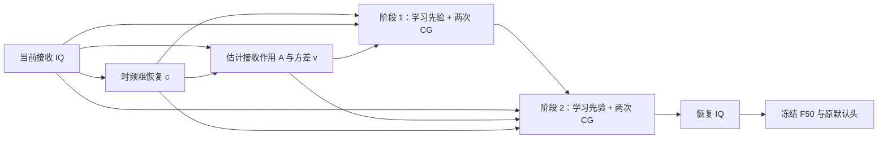

# DURA v1.0：默认恢复器与机制

2026-10-21，用户在完整七场景与实测时延结果公布后，明确指定本版作为后续恢复网络默认版本。正式名称为 **DURA v1.0**，中文名为 **双阶段展开恢复网络**，部署标识为 `dura_v1`。DURA 为 Dual-stage Unrolled Restoration Architecture，表示双阶段展开恢复结构。CUDA Graph 与残差复用（Residual Reuse，RR）保留为固定执行方式，不放入主名称。名称是本项目版本名，不宣称新算法或独立论文方法。

## 固定内容与使用约定

默认恢复器同时固定网络、权重与执行方式。机器可读定义见 [frozen_version.json](../experiments/pamf_stage2_inference/frozen_version.json)。

| 项目 | 固定值 |
|---|---|
| 架构 | R69 `stage2` / `StageDistilled`，完整 266951 个唯一参数 |
| 权重 | `runs/20261021-phase1-restoration-R65-four-route-s2026092701-m4-r69/stage2/native_map_prior/final.pt`，源 E20/4940 |
| 权重生成代码 | `b2a2ce937a64654e17e84c2aa817b9da4257a48f` |
| 已验证执行代码 | `47c264286ca689f060a3f36aafb763fe209a6f06` |
| 推理入口 | `experiments.pamf_stage2_inference.engine.InferenceEngine` |
| 执行选项 | `reuse=True, graph=True, native=False`，冻结 eval，FP32，TF32 关闭 |
| 恢复预算 | 两个 prior 调用，每阶段两次 CG，共四次 CG；每个 IQ 窗口 27 次 FFT/IFFT |
| 输入与输出 | 当前 FP32 `[B,2,256]` 接收 IQ → 同尺寸恢复 IQ；输出保持完整 256 点 |
| 识别对照 | 原 F50 `20261016-phase1-F-supcon-e50-clean-manysig-m9-r02`，seed2026092701，checkpoint 原默认头 |
| 验证记录 | `20261021-phase1-restoration-stage2-graph-s2026092701-r01`，结果提交 `b108f574db15a09c855a394f408ccb8a4e80463c` |

以后未限定的“恢复器”“恢复网络”“当前恢复版本”默认指本版。原 R17 保留为历史完整恢复器对照，R65 `prune_after10` 保留为三阶段父版，R69 `stage2` native 保留为同权重执行对照。它们不会再因名称相近而替代本版。新的网络、权重、求解预算、精度或执行方式必须另记版本及比较，用户明确指定后才更换默认。其他 owner 的健康任务保持原计划。

本次固定复用现有权重，没有新训练、新选模、移动或覆盖 checkpoint。本版与 F 配合的正式证据来自 Phase1 七景工程基准；将其接入其他数据契约或 Phase2，仍须按对应协议核对权限与来源，现有结果不自动扩展为那些场景的有效性结论。

## 一次推理怎样完成



图中的 F 只参与需要识别的调用。恢复器本身输出 IQ，运行时不需要 clean、模拟器真实参数、教师、TX 标签或历史样本。

### 1. 时频粗恢复：给求解器一个初值

粗恢复模块先计算当前 IQ 的频域及共轭镜像表征，用小网络估计主频谱与镜像修正，再由时域多尺度网络融合。最终采用残差形式，得到粗恢复 `c`。频域分支限制其预测修正系数的范围，恢复 IQ 本身没有幅度裁剪。

它提供初始波形和后续阶段共同使用的参照。初值 `x₀=c`，不为每个阶段重复计算粗恢复。

### 2. 当前窗口的接收作用估计

作用估计器读取当前接收 IQ `y` 和粗恢复 `c`，预测归一化的 64 抽头复数 FIR、逐点复数主系数与镜像系数，以及该窗口一个正的实数方差 `v`。它构成实线性算子：

\[
A(x)=m\odot H_h(x)+q\odot\overline{H_h(x)}.
\]

`H_h` 是带反射边界的 FIR 运算，`m` 与 `q` 为主系数和镜像系数。镜像项使它能够表示共轭耦合；求解器使用与该算子配套的真实伴随 `A*`，内积为复数内积的实部。这里的 A 是从观测学习得到的接收作用近似，不是已知真实信道参数，也不声称能唯一分离传播、接收机与发射机失真。

每个输入只估计一次 A 和 v，两阶段共用。v 在同一窗口内沿时间保持常数，不是逐点可变的噪声图。当前固定的先验尺度为 `τ=0.1169459182403555`。

### 3. 两次“学习先验＋软一致性”恢复

第 k 阶段先计算当前估计不能解释的接收残差及其反投影：

\[
e_k=A^*(y-Ax_{k-1}).
\]

将 e 做窗口 RMS 归一化后，先验网络读取九个实数通道：接收 IQ 两通道、粗恢复两通道、当前恢复两通道、归一化反投影残差两通道和 log(v) 一通道。输出构成先验波形：

\[
p_k=c+\tau D_k([y,c,x_{k-1},\operatorname{norm}(e_k),\log(v)]).
\]

代码中的 log(v) 先截断到 [-16,4] 再除以 8。Dₖ 是保留的轻量多尺度网络。两阶段保留已有的跨阶段长卷积权重共享关系，阶段相关的其他参数仍按 checkpoint 加载；参数量按唯一参数统计。

随后用上阶段 x 作为初值，执行两次共轭梯度（CG）更新，近似求解：

\[
\min_x\;v^{-1}\lVert y-Ax\rVert^2+\tau^{-2}\lVert x-p_k\rVert^2.
\]

第一项约束恢复结果经 A 后能够解释当前观测，第二项限制结果偏离学习先验的程度。它是软约束，允许存在噪声与模型误差。两阶段共四次 CG，不运行到收敛；固定迭代预算是该版本定义的一部分。

### 4. 两阶段权重怎样得到

R69 的两阶段学生从 R65 `prune_after10` 三阶段父版初始化，复制粗恢复、作用估计器，以及原第 2、第 3 个 prior 的权重与共享关系。随后在合法源域 IQ 上完成 E20/4940 更新：学生第 1 次输出学习教师第 2 次输出，学生第 2 次输出学习教师第 3 次输出。

实际训练目标为最终配对 clean IQ 归一化误差、0.05 倍多尺度谱误差，以及权重从 1 线性降至 0.1 的两阶段对齐 IQ 蒸馏误差。保留的学生组件联合优化，教师冻结；不读取 TX 真值、F 权重或 F 输出来训练恢复器，也不使用 V/target 更新。完整继承成本仍保留，不能将学生新增 E20 当作从零训练总成本。

本版的“两阶段”明确指推理中的两次恢复迭代。这次运行加速直接复用上述已训练权重，新增训练更新为 0。相对 R65，prior 调用从 3 次减到 2 次，CG 从 6 次减到 4 次，参数从 273765 减到 266951；主要计算精简来自迭代次数，而不仅是参数减少。

## 三项执行优化怎样叠加

### CUDA Graph：减少反复调度

这条恢复链包含许多卷积、FFT、小张量运算和四次 CG。普通执行会反复由 Python/CPU 发起 GPU 运算。CUDA Graph 对指定设备和批量形状预热并捕获整条调用链，后续重放已捕获的运算。

每次重放都会复制当前输入到图的输入缓冲区，返回值另行 clone；下一次推理不会覆盖调用方持有的上一次结果。图按设备及输入形状分别缓存，首次预热/捕获成本和多个批量图池的显存单独记录。图固定执行结构，输入数值每次更新；它不缓存历史预测。

恢复器单独调用时捕获 G，接原 F 时捕获 G+F。两者都经同一个 InferenceEngine，正式预测和测速共用执行路径。没有混合精度、量化或自动 native 回退。

### 同步优化：保留检查，集中主机读取

原路径在算子、方差和迭代中包含张量有效性判断，Python 读取 GPU 上的布尔值会触发等待。固定路径把有限性、正方差和阶段状态检查放在 GPU 内累计，最后只把合并结果读回主机一次；发现异常仍报错。同时使用冻结 eval 与 `inference_mode()` 执行。

这里减少的是推理内部 CPU/GPU 往返。测速仍在调用边界同步，输入 copy、独立输出 clone 和最终有效性判断都计入，没有通过取消测量同步缩短计时。

### 残差复用：减少重复的物理算子

prior 已经需要 `e=A*(y-Ax₀)`，其中 x₀ 是当前阶段初值。普通 warm-start CG 以 `δ₀=x₀-p` 为初始偏移，还会计算：

\[
r_0=A^*\{v^{-1}(y-Ap)\}-A^*\{v^{-1}A(x_0-p)\}-\tau^{-2}(x_0-p).
\]

因为 A 是实线性的，且 v⁻¹ 是每窗口一个实数标量，整理得：

\[
r_0=v^{-1}\underbrace{A^*(y-Ax_0)}_{\text{已为 prior 计算的 }e}-\tau^{-2}(x_0-p).
\]

因此可以直接复用 e，省去构造 CG 初始残差时重复的正向/伴随运算。第二次 CG 得到最终 x 后，也省去不会再被读取的残差和方向更新。两次 CG 的有效解更新都保留，整个两阶段程序的 FFT/IFFT 调用由 43 次降到 27 次，减少约 37.2%。

该整理依赖当前的实线性算子和窗口常数方差；未来若改为逐点方差或非线性 A，须重新推导。它没有复用前一个样本的波形或状态。FP32 运算顺序变化可能带来舍入差异，因此分类一致性以完整测试核对，不宣称逐位等同。

## 已验证结果与解释范围

正式测试共 168000 个固定物理样本 × 七视图，使用同一个原 F50/defaulthead，全部预测固定后独立 truth-last。相对原两阶段 native，六景分类决定完全一致；high urban 两条由错变对。1,176,000 次预测仅这两条分类变化。

| 场景 | 原两阶段准确率 | 本版准确率 |
|---|---:|---:|
| clean | 84.677976% | 84.677976% |
| high suburban | 82.825000% | 82.825000% |
| mid suburban | 81.560714% | 81.560714% |
| low suburban | 80.058333% | 80.058333% |
| high urban | 81.744643% | 81.745833% |
| mid urban | 75.486310% | 75.486310% |
| low urban | 68.889881% | 68.889881% |

N607 RTX 3090 GPU4，同卡 FP32/TF32off，三轮交替，B1 稳态中位数：

| 范围 | 原两阶段 native | 本版 | 时延下降 |
|---|---:|---:|---:|
| G | 31.938862 ms | 3.955169 ms | 87.616% |
| G+F | 41.220936 ms | 4.531972 ms | 89.006% |

G+F 加速约 9.096 倍，P95 为 4.990450 ms。GPU 输入预加载，不含 host 数据加载、传输或排队；图捕获单独报告。历史 44.0007 ms 属于先前测速，本版加速比使用本轮同卡 41.220936 ms 对照。完整七景 IQ/features/logits 产物墙钟为 199.492 s，包含读取、传输和写文件，不能拿批量吞吐替代 B1 时延。

三项优化联合实测成立；本轮没有对其单独耗时收益做完整因子消融，不能将 89.006% 分摊成各项的独立贡献。七景无下降证明了本轮冻结 F50 的识别保持，尚不能证明波形中每一项真实 TX 细节完全恢复。low urban 尚未达到 70%，其他五受损环境距 raw clean≤5pp 也未全部满足；固定默认版本不等于这些长期性能目标已完成。

完整分组、净纠错、数值差异、图池内存、批量 1/8/32/128 时延及来源见 [七景与时延报告](../automation_reports/CV-SincNet/20261021-phase1-restoration-stage2-graph-s2026092701-r01/report.md) 和 [结果数据](../automation_reports/CV-SincNet/20261021-phase1-restoration-stage2-graph-s2026092701-r01/results.json)。

## 调用方式

使用所列执行 commit 及其依赖，严格加载所列原 checkpoint 后调用：

```python
import torch
from experiments.pamf_r65_four_route.runtime import load_checkpoint
from experiments.pamf_stage2_inference.engine import InferenceEngine

torch.backends.cuda.matmul.allow_tf32 = False
torch.backends.cudnn.allow_tf32 = False
model, payload = load_checkpoint(checkpoint_path, "cuda:0")
assert (payload["arm"], payload["epoch"], payload["updates"], payload["code_commit"]) == (
    "stage2", 20, 4940, "b2a2ce937a64654e17e84c2aa817b9da4257a48f"
)
model.eval().requires_grad_(False)
engine = InferenceEngine(model, reuse=True, graph=True, native=False)
(restored_iq,) = engine(received_iq)  # CUDA FP32 [B, 2, 256]
```

需要识别时，在构造 engine 时传入同样冻结的原 `reader`：`InferenceEngine(model, reader, reuse=True, graph=True, native=False)`，返回恢复 IQ、窗口方差均值、特征及 logits。source 角色/继承检查与正式评测继续沿原 launcher，不以简化调用示例替代实验协议。
