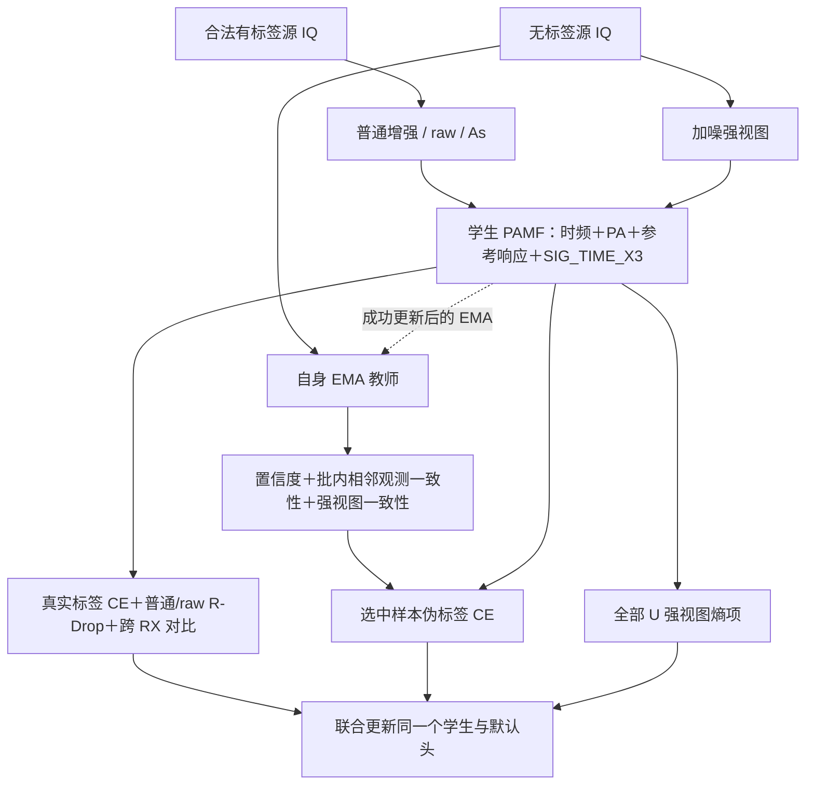

# PAMF 最终识别器：T1 E30＋20，累计 13L＋37U

> 2026-10-25 状态更新：本文保留历史定义。当前 PAMF 半监督方法暂用[普通伪标签](PAMF_CURRENT_METHOD_20261025.md)，本文方法不再作为当前半监督主方法。

2026-10-21 用户指定“T1：去除 As 独立 KL，续训20、总计E50”作为 PAMF 最终版本，并明确累计日程为 **13L＋37U**。最终方法标识为 `pamf_t1_e50`，含义是路径签名增强、跨接收机特征约束与选择性一致性伪标签联合训练的 PAMF 识别器。机器可读定义见 [pamf_final_t1_e50.json](../configs/pamf_final_t1_e50.json)。本次为已完成方法的指定与机制分析，没有新训练、预测、选轮或改动权重。

## 最终版本身份与证据

| 项目 | 固定内容 |
|---|---|
| 已完成默认模型 | `20261020-phase1-T1-AsKL0-e50-s2026092701-m2-r01/E30PLUS20-s2026092701` |
| 权重 | 上述 row 的 `source/final_ssdg.pth`，固定最终学生，不用 EMA 权重替代部署学生 |
| 父模型 | `20261019-phase1-FcrossRX-AsTemperature-e30-s2026092701-m2-r02/T1-s2026092701/source` 的 FINAL30 学生及自身 EMA |
| 训练代码 | `971fd16ac342f3523c4e3112f437e678f32ca459`；科学实现 `ed652af1f7b427cb7cff293e6b6185ca76a32bec` |
| 七景测试代码 | `ace90948e4dc62df5ec909176f2948802825a774` |
| 结构 | 原 F：`SIG_TIME_X3 + CENTER_25K + CENTER_UNITS`，默认 160 维特征及六类 scale30 余弦头联合训练 |
| 数据 | ManySig equalized1、unitRMS、IQ `[B,2,256]`、Fs25MHz；原 split392005、L6300/U56700/V27000；U TX 隐藏 |
| 固定预算 | E20/4440＋E10/2220＋E20/4440＝E50/11100，累计13L＋37U |
| 正式证据 | 固定168000物理样本×clean及六practical，各row全七预测固定后独立CPU truth-last |

方法依据来自原 run 报告、实际已完成 E50 的 `resolved_config.json`、`actual_native_args.json`、`completion.json` 和继承模块源码；没有仅凭继承配置中出现的字段就认定机制已启用。原训练 wrapper 总参数记录为900722，包含保留但损失关闭的原生辅助模块，不把它直接当成纯部署身份网络参数数目。

用户在已揭示单seed工程基准结果后指定最终路线；不是新的独立盲测。三seed续训复现另属 `20261021-phase1-T1-AsKL0-e30plus20-m3-r01`，本次不重跑或改动该owner，也不据缺少的新seed评分宣称三seed已完成。当前固定的单模型权重为已完成seed2026092701。

## 一个完整半监督方法的组织

PAMF 可以表述为：以时频、PA与参考响应融合为基础，用带时间坐标的局部路径特征增强序列表示；用跨RX同TX对比及按视图区分的一致性监督改善源域泛化；用自身EMA和多条件门控选择无标签样本，再联合优化伪标签分类与熵约束。结构、监督学习与无标签学习优化同一个识别器和原默认头。

## 结构组成：推理时保留的部分

### 原 PAMF 融合主干与参考响应

身份网络沿用 `lite_d/no_dac` 的时域、频域与PA路径。残差融合头对基础表示与PA表示分别做归一化，再用逐通道有界可学习增益叠加；不是多分类器投票。PA路径描述输入中的非线性相关模式，不等于独立恢复了真实发射机功放参数。

参考响应分支利用公开 Wi-Fi L-STF 激励模板，从当前包内窗口计算相对接收传递、重复性和质量等特征，经投影后以可学习残差注入160维表示。当前实际输入策略屏蔽显式CFO标量，29个槽位中28个有效；内部CFO补偿仍保留。参考响应仍混合RX、信道和均衡等影响，不声称完成物理因素的严格解耦，也不声称整个网络对CFO或接收机严格不变。

### SIG_TIME_X3：三组有时间坐标的路径特征

从实际 `t2` 的96通道时序特征读取三个并行视图。每个视图有独立可学习的 `1×1 Conv:96→6` 和 `tanh`，构成六维局部特征路径。每条路径划成四个连续窗口，每窗口追加0至1的相对时间坐标，成为七维路径。

每窗口计算一级路径增量的7个分量和二阶反对称有向面积的21个分量，共28维。它捕捉局部变化的先后和特征随时间的关联；实现是一级增量＋二阶反对称路径项，不是完整二阶迭代积分张量。时间坐标是窗口内相对位置，不是时间戳、TX或RX标签。

四窗口得到112维，每个视图各算一份；三视图拼接336维，经单个线性层投影到160维、LayerNorm及有界残差增益，再加到原融合特征。该模块有55968个参数，增益初值0.05、上界幅度0.2。三组是同一网络内的独立投影视图，最终只有一个160维表示和一个分类头。没有加入 MEAN_VAR/COV 视图或三模型集成。

### Sinc 参数坐标与优化单位

可学习Sinc前端保留24个、长度79的原滤波器生成方式，频率写为 `p=p₀+25000q`，以初始频率为中心优化偏移。`CENTER_UNITS` 同时映射Sinc参数组的学习率、Adam epsilon、物理频率衰减和梯度裁剪；不是只改一个变量名。

具体映射由原执行代码固定，Fs为25MHz；不叠乘旧倍率，不新增滤波器或优化步数。它属于数值优化机制，不是额外损失或新的半监督分支。推理按保存的原点和偏移还原频率，合成滤波器。

## 监督部分：按视图设置分类与一致性约束

定义一对相同IQ、不同训练随机性输出的损失：

\[
\operatorname{CE}_2=\tfrac12[\operatorname{CE}_{0.01}(p_1,y)+\operatorname{CE}_{0.01}(p_2,y)],\qquad
\operatorname{RD}=\operatorname{CE}_2+\tfrac12[KL(p_1\|p_2)+KL(p_2\|p_1)].
\]

R-Drop的KL系数为1，CE使用label smoothing0.01。每一对重用完全相同的已生成IQ，不在第二次前向重新抽取增强，因此该KL约束的是随机网络输出的一致性。

每步取原L128，执行三对、总计六次身份前向：

| 一对前向的输入 | 数量 | 该对的监督 |
|---|---:|---|
| 实际生成的普通增强 | 128 | 两次CE＋对称KL |
| 普通64与As64拼成同一mixed batch | 128 | 普通槽两次CE＋KL；As槽只做两次真实标签CE |
| 原始raw | 128 | 两次CE＋对称KL |

As使用原始L IQ生成完整practical residual/post_sync观测，不先叠普通增强，不做生成后均衡或按置信度丢弃。训练场景固定为low suburban、mid urban、low urban；正式测试仍为七景。As仅使用合法L标签。T1固定温度T=1、默认头scale30，部署没有温度缩放；T6、CSIL/MoPC蒸馏都不属于本版。

监督损失的精确组织为：

\[
L_L=0.5\operatorname{RD}_{ord128}
+0.25\operatorname{RD}_{ord64}
+0.25\operatorname{CE}_{2,As64}
+0.25\operatorname{RD}_{raw128}
+\lambda_{RX}L_{RX}.
\]

两个ordinary项来自不同实际前向及采样槽，不能把它们伪装成同一个数值项。总CE剂量为1.25，保持原实现，没有再归一化成1。**去除As独立KL并不取消R-Drop，也不移除As增强或其真实标签CE。** 本版未增加ordinary与As之间的跨视图logits KL。

### 浅中层跨RX对比

在实际普通增强的 `time_down` 与 `t2.pool` 两层提取每通道时间均值和总体标准差；做当前L batch的detached统计标准化和L2归一化。正对为同TX、不同物理RX，负对为不同TX，同TX同RX不放入CROSS_RX分母。

温度0.2，系数前5轮为0，此后10轮线性升至0.1；固定的E50尾段继续使用原累计日程。两深度与两次R-Drop前向取均值，复用现有特征，不增加额外神经前向或分类头。ORD128表示只有原128个ordinary锚点；As不加入对比锚点，无U真值参与配对。该约束鼓励跨接收机同类特征相近，但最终泛化收益仍以冻结测试验证。

## 无标签部分：自身EMA与选择性一致性

教师是同一学生的指数滑动平均，不是外部模型。成功优化更新后按衰减0.999更新教师参数，复制相应buffer，教师不反传。FINAL30续训保留其自身EMA；部署使用固定FINAL50学生。

EMA对当前未额外加噪的U IQ产生硬伪标签和置信度。选择掩码由三个有效条件相与：

1. **RX/day分组置信度。** 当前U batch内按源域RX/day分组，取置信度0.86分位数，截断到[0.92,0.97]作为该组门槛。
2. **批内相邻观测一致性。** 同一batch、同RX/day/eq中，需要另一个同预测、双方置信度至少0.8的样本，且sig_i与base_index距离都不超过2。不是跨batch缓存或跨epoch稳定性库，不读TX真值。
3. **强视图一致性。** 对U加入标准差0.015的高斯噪声，学生强视图argmax须与EMA伪标签相同。

`pseudo_domain_gate=False`，所以没有额外的域分类头正确性门控。只对被选择U计算硬伪标签CE；没有样本被选择时该CE为0。熵项在全部U强视图预测上求均值，而不是只对通过掩码的样本计算。

本版总目标可写为：

\[
L=L_L+0.16L_{PL}+0.01L_{ent}.
\]

上述U项在半监督阶段启用。自身EMA和三条件筛选使它属于选择性一致性伪标签方法，不能写成仅固定阈值的普通PL。U_s真实TX一直隐藏；实际伪标签精度不能由隐藏标签日志中的0推断，配置也不能替代接受率和实际有效曝光的统计。

## 13L＋37U与训练日程

| 累计轮次 | 轮数 | 学习方式 |
|---|---:|---|
| E1至E13 | 13 | 监督阶段：L上的CE、有效R-Drop、As与按日程启用的跨RX约束 |
| E14至E20 | 7 | 原半监督阶段，L与U共同参与 |
| E21至E30 | 10 | 自身E20学生/EMA追加，L与U共同参与，原cos10续训段 |
| E31至E50 | 20 | 自身FINAL30学生/EMA追加，L与U共同参与，重置AdamW、cos20与temporal cache |

13＋7＋10＋20＝50，半监督轮数7＋10＋20＝37。**“37U”表示37轮联合使用L和U，不是37轮只用U。** 每轮222步，固定最终学生E50/11100；最后增量为20轮/4440步。基础AdamW lr2e-4、weight decay1e-4、cosine至1e-6，Sinc参数组使用上述单位映射。

这与从零E50的33L＋17U／cos50是不同日程；不能把二者差异归因于单一初始化或总轮数。原E30继承训练成本完整保留，不把最终权重描述成只训练20轮。

## 推理与未纳入机制

推理保留时频／PA融合、参考响应、Sinc、三视图路径模块和原默认头，单次读取当前输入；Dropout关闭。训练用的增强、R-Drop第二前向、跨RX正负对、EMA教师、U门控及熵损失不参与部署判决，也不拟合新的分类头。

本版不包含MixStyle、Fishr、域对抗/GRL损失、正交/互信息解耦、外部CSIL/MoPC教师、T6温度、epoch-bank、额外U特征对齐、U星地一致性或DURA恢复训练。配置里某些未激活模块仍有默认非零超参数，不代表实际运行那些方法。

## 已完成性能与DURA边界

seed2026092701在原固定七景输入上的独立评分：

| 场景 | T1 E30＋20准确率 |
|---|---:|
| clean | 85.2458% |
| high suburban | 81.2982% |
| mid suburban | 78.8506% |
| low suburban | 76.2393% |
| high urban | 77.9274% |
| mid urban | 63.7024% |
| low urban | 52.4161% |

完整比较见[原E50报告](../automation_reports/CV-SincNet/20261020-phase1-T1-AsKL0-e50-s2026092701-m2-r01/report.md)及[逐景/分组比较](../automation_reports/CV-SincNet/20261020-phase1-T1-AsKL0-e50-s2026092701-m2-r01/test_results_comparison.md)。这是本身份网络在原固定输入上的结果，不是DURA恢复后的结果。

最终识别器PAMF-T1-E50与恢复器[DURA v1.0](DURA_V1.md)分别固定。DURA此前的4.531972ms、clean84.677976%、low urban68.889881%来自DURA＋原F50默认头，不能改标成DURA＋本T1-E50。新组合的识别率与时延需单独冻结测试；本次命名/方法指定不触发该新实验，也不覆盖既有对照。

## 核查入口

- T1的As KL0与T=1：`experiments/cvs_as_temperature84/{design,loss,model}.py`。
- 原six-L、raw控制与ORD128：`experiments/cvs_noise_shape_factorial43/model.py`、`experiments/cvs_crossview_supcon41/{model,relations}.py`。
- SIG_TIME_X3与Sinc单位：`experiments/cvs_rdrop_sinc_units/{model,x3_features,descriptors,coordinate,optimizer}.py`。
- 物理融合与参考响应：`experiments/cvs_residual_identity/model.py`、`experiments/cvs_reference_identity/model.py`；实际输入策略另见`cvs_source_identity_readout/input_policy.py`。
- 隐藏U与默认头训练入口：`cvs_phase1_stack/runtime.py`、`experiments/adv3b02_xuc/code/SSDG/train_ssdg.py`中的`_threshold_mask`、`temporal_neighbor_agreement_mask`、`_compose_unlabeled_closed_loss`。
- E30＋20身份与累计预算：`experiments/cvs_t1_e50/{plan,design,source,model}.py`；三seed扩展为`experiments/cvs_t1_e50_confirm`，不得混淆从零SCRATCH50。

源码依赖按原发布链读取，真实E50生效配置与上述值已只读核对。相关元数据留在既有实验路径及本机私有分析目录，不将checkpoint、原始日志或机器状态提交到Git。
