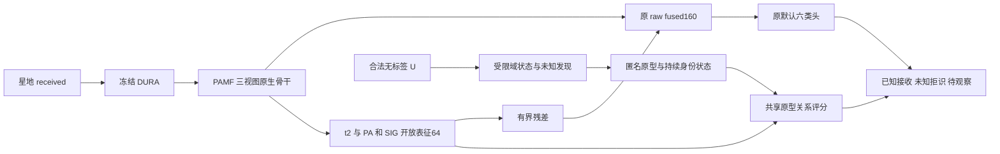

# PAMF Phase3 开放世界表征与学习机制再设计

后续主线改为直接优化 PAMF 的源端训练任务和可部署表征，使网络同时学习设备身份、注册集合成员关系与跨接收机跨日匹配。候选暂称 **PAMF-OW**，用于区分现有固定 PAMF；本设计尚无新训练成绩，不替换 Phase1/2 的默认模型。

优先检验的假设是：**在源端轮换注册集合，并以跨 RX/day 的支持与查询构造成员判断任务，能否使开放判决迁移到新接收机，同时保住原六类身份性能。** 无标签适应和匿名注册继续属于完整目标，按下述阶段接入。数值验收沿用 targets v3，不以设计完成代表 Phase3 达标。

## 现有证据如何改变设计

| 已完成工作 | 核实结果 | 对新设计的影响 |
| --- | --- | --- |
| 固定原 F0 的 paired 拒识 | RX24-1 星地 Q：A_K 65.9722%、C_K 88.3681%、R_U 76.3889%；宏 AUROC 91.7306% | 表征仍有排序信息，不能据此断言整个网络无效；工作点与域迁移均需研究 |
| 原生骨干 OE 与 VICReg | 源 P1 主 energy：A_K 90.7259%、R_U 25.3968%；VICReg 未证明改善未知身份结构 | 已经训练过 PAMF 本体；重复这些损失或只加轮数不足以构成新假设 |
| 原默认头 OE 加结构保持 | 目标 A_K 55.5556%、R_U 60.4167%；原 F0 总损伤 17.3611 pp，其中闭集损伤 4.3403 pp | 将所有 OE 推向六类均匀输出可能与身份目标冲突，需改变学习任务并控制共享梯度 |
| reciprocal 目标适应 | A_K 68.9236%、R_U 60.7639%；35 条纯新类 U 簇，未来 A_N 仅 11.4583% | 伪身份 CE 和 U 簇纯度不能证明未知保护或未来注册成功 |
| 冻结身份的二元图 | A_K 68.2292%、C_K 90.7986%、R_U 57.2917%；负种子仅 10/27 为真未知 | 六类低置信度不能直接作为未知标签；固定身份也不能保证成员判断可靠 |

这些结果分别约束身份保持、成员关系迁移和未来注册，尚不能证明单一失败原因。历史结果与判定全部保留。主要证据见[源表征结果](PAMF_PHASE3_STAR_REPRESENTATION_RESULTS_20261029.md)、[默认头 OE 结果](PAMF_PHASE3_STAR_RELATION_OE_RESULTS_20261030.md)、[reciprocal 结果](PAMF_PHASE3_STAR_RECIPROCAL_ADAPTER_RESULTS_20261030.md)及[二元图结果](PAMF_PHASE3_STAR_BINARY_GRAPH_RESULTS_20261030.md)。

## 保留骨架并增加开放表征

保留当前三视图 SIG-TIME、固定排列 `[0,5,3,6,2,1,4,7]`、时频支路、PA 记忆多项式和参考响应。原 160 维默认六类余弦头仍与骨干联合训练，不冻结骨干后另训身份头。原 F0 的 E50/11100、Tri-SIG-TIME SSL 祖先不改写；Phase3 开放增量单独命名和计费。

新增 64 维开放表征，从同一次可微前向取得三类信息：t2 `[B,96,32]` 的时间均值与标准差共 192 维、PA160、SIG160，拼成 512 维。拟用 `Linear512→64 / GELU / Linear64→64 / LayerNorm64 / unit-normalize`。时间均值和标准差在单条记录内部计算，不使用 Q 批统计。

开放表征不直接拼入显式接收机参考响应。参考响应用于已有校正及后续受限域适应；NoExplicitCFO 的第 27 坐标继续屏蔽，内部 CFO 补偿保留。是否成功区分硬件与信道，须用跨 RX/day 结果证明，不能凭支路名称宣称已完成物理解耦。

为使新增表征同时接受原身份监督，增加 `64→160` 投影与零初始化逐维增益，作为原 raw fused160 的有界残差：

\[
f_{OW}=f+0.1\|f\|_2\tanh(g)\odot\operatorname{unit}(H z_{open}).
\]

初始 g=0，原默认头输入精确回到原 f；训练时残差范数至多为原 f 范数的 0.1。这个限幅不是 2pp 性能保证。原 raw fused160 不整体单位化，仍只在原余弦头内部归一化。

新增共享关系评分器接收 `abs(z-p)` 与 `z*p` 共 128 维，经 `128→32→1` 输出“属于该原型身份”的分数。它没有固定 TX 槽号，同一规则用于源旧类原型和未来匿名原型；它不替代旧六类默认身份头。集合成员分数取当前所有注册原型的关系分数最大值；旧类被接收时，身份仍取原默认头，关系分数不另行选择旧 TX。

按上述层定义，开放投影、身份残差投影及增益、关系评分器分别约为 37120、10560、4161 参数，新增共 51841；识别器估算为 284834 参数。**这是设计计算，实际构造器、可训练参数与部署参数须实测核对**，不能把训练 wrapper 中未使用的 domain 网络算入识别器。

训练必须使用原生可训练构造器。现有 frozen reader 的 Sinc 滤波器路径包含 no_grad，仅设置 requires_grad 不足以恢复训练。可复用 `source_open_embedding_train.make_trainable_model` 及无 detach 的中层捕获方式；历史冻结分支导出器只供分析，不能拿其 NumPy 缓存冒充端到端优化。Sinc 的 CENTER_25K 物理坐标、优化器和 clip 语义保持。

## 源端训练注册集合成员关系

第一次验证只改源端开放训练，不先用目标伪标签修补它。临时注册集合 S 随 episode 改变，评分器只接收原型与样本特征，不接收真实类号或固定槽号。对同一源设备，它在包含自己的 S 中应被接收，在排除自己的 S 中应被判为非成员。

主 episode 从六个合法源旧类中轮换留一个作临时非成员，即五个临时注册类。支持和 episode-query 都来自 L_s，但物理记录互斥；支持排除 query 的 RX 和 day，显式训练跨 RX 且跨 day 的匹配。临时类别槽随机排列，防止评分器记忆列号。

**这里的非成员是相对于临时注册集合的训练代理。** 原 F0 祖先见过全部六类和五个源 RX；留一旧类或 RX 不能消除继承，也不能称严格未见类别／接收机实验。它的价值是训练集合变化后的判决规则。真正的拟合未见设备表现仍需 OE 身份以外的数据和跨 RX 未来 Q 验证。

OE6134 只提供 outside-six 成员监督，不读其真实 TX/K，不按 OE 真身份构造正对，也不将全部 OE 强行聚成一个新类。源 L 已有同 TX、RX/day 均不同的正对，每 anchor 有 560 条合法候选；这是不同接收记录，不是同步发射配对。U_s 隐藏 TX 始终不开放。

第一轮采用三个同结构、同初始化、同样本轨迹与同预算的对照：

| 行 | 编码器训练 | 关系评分器训练 | 用途 |
| --- | --- | --- | --- |
| S0 | 原完整 L 监督骨架与原 F0 KD | 六类固定注册集合；开放特征 detach 后训练成员评分 | 匹配的源监督编码器增量控制 |
| S1 | S0 加成员损失对编码器的联合梯度 | 六类固定注册集合，L 为成员、OE 为非成员 | 区分联合开放训练与冻结读出 |
| M | 与 S1 同样联合更新 | 轮换五类注册集合，留一 L 类及 OE 为非成员 | 唯一主候选，检验任务式成员学习 |

S0 的辅助评分器仍使用 OE 成员监督，不能称全流程无 OE 或纯 CE。这个矩阵是学习机制比较；不把它写成项目规定的 CE-only 网络结构消融。三行的原默认身份头始终联合更新。

拟固定每行从原 E50 独立增量 2220 步，模型 seed2026092701，采样 seed2026103017、原型槽排列 seed2026103018；fresh AdamW，基础 lr1e-4，保留原物理单位优化设置。累计原生 F 更新为13320，不由 IID 窗口推称自然 epoch。三行共享原 L128 监督批；另共享每类 16 条 episode-support、每类 16 条 episode-query 和 OE64。支持与查询的来源、额外前向及实际曝光单列，不能将额外样本藏在相同步数内。OE 按可见 RX/day 的非空域等权采样，不补空 TX cell。

初始目标为原完整 L 目标、同输入原 F0 的 logits KD（T=2、权重1），以及成员损失（权重0.1）。成员损失由等权的两部分组成：样本与原型配对的均衡 BCE，以及最大关系分数对应的集合成员均衡 BCE。源 L 的配对标签为是否同 TX，集合标签为是否属于当前 S；OE 的两种标签均为非成员，仍不使用其真实 TX。两项正负分别归一化，避免原型数改变造成负对数量支配。三行都保留两项，仅改变表中的集合与梯度路径。

原完整 L 骨架中的跨 RX 对比、ordinary/raw KL、As CE 等实际启用项明确记录；Phase3 新消费的 ordinary/raw 都是星地输入，不引入 clean。首轮不新造星地 episode，原有增强槽只能消费既定 P1 星地记录及明确登记的变换。

共享参数上的成员梯度沿用已有 L 锚定思想：冲突方向投影，并限制其范数；新增关系评分器独立接收成员梯度。三行保护规则一致。该规则只约束当前源批的一阶冲突，不保证目标 A_K，仍需实测。

先不重新加入已失败的 uniform-six OE、raw fused VICReg 或 Gram 保持作为主创新。未知间结构是否保留，以拟合未见设备的匹配／聚类诊断和未来 A_N 报告；不会把低训练损失当作未知身份保真。任务式评分仍可能过拟合源六类，若拟合未见设备无收益，该假设即未获支持，不能用源训练 episode 的高准确率替代。

## 无标签域适应与未知发现如何接入

源端 M 验证后，目标端从其冻结状态独立初始化。旧六类身份头和主体参数冻结，优先只适应参考响应及浅中层的低容量、跨样本共享域参数。适应目标在源端跨 RX/day 的训练 episode 中预先选择，不能到目标 Q 上选目标函数或步数。

目标 U 分成可靠已知、候选未知和待观察三种状态。可靠性由训练好的集合成员关系、原型匹配及跨视图／邻域稳定性共同判断；低 MSP 不直接提供未知硬标签。待观察样本可被系统拒识，但不能从指标分母剔除，也不立即成为负种子。

对可靠已知可使用受限的身份一致约束；对候选未知保持局部结构和跨观测一致性，不做旧六类硬 CE；对待观察样本暂不做身份伪监督。全 U 的接收机／信道分布也不能直接对齐到六类已知分布，否则可能把真实未知拉入旧类区域。

这一步需独立比较 DA0、相同可靠集的普通 self-PL、受限域适应。所有状态与阈值先于 Q 冻结；身份变化与接收集合变化分开报告。共享小容量参数和限幅是可检验的约束，不是跨 RX 未知拒识保证。具体适应损失及更新预算在该阶段的新 run 中固定，不从第一轮 Q 数字反推参数。

发现从候选未知中自主估计簇数，允许零簇，不读取真实 K 或每类配额。现有固定 U384 只有一个接收日，bootstrap 或 ID 分半稳定不能称跨日验证。新表征的跨日能力先由源 L 的训练任务建立，再由独立未来 Q 检验。

## 匿名注册需要共同的判决尺度

已完成实验中，U 内半径与未来跨日距离不匹配；old gate 绝对优先虽保住旧 label，却可能使被误认为已知的新类无法注册。新的方向是让旧原型和匿名原型使用同一 64 维表征与共享关系评分，并在源端任务中训练注册前后的竞争。

源训练的后续任务使用临时“4 类已注册、1 类到达、1 类仍未知”角色，轮换全部源旧类。episode-U 对算法隐藏标签，按实际无标签发现流程形成簇；源训练标签只用于外层损失与误注册评价。它仍是训练代理，不是严格未知测试。目标端没有对应标签。

新匿名原型先进入待确认状态，以 unique 物理记录支持数、成员排斥与结构稳定性控制误注册。评分半径和竞争裕量应通过源跨 RX/day 训练任务学习或固定，不能仅由同一 U 簇的 95% 内部距离确定。未知拒识、发现和注册均需计入失败设备。

匿名身份可以在有充分关系证据时参与联合竞争，不再把“永远不能覆盖已接收旧类”当最终解决方案。其代价必须用同 DA 下注册前后的旧类 A_K 实测，仍受 2pp 上限约束；未经未来测试不能宣称保护成立。旧类胜出时，身份继续由原默认头给出，不把关系评分器偷偷改成旧类替代分类头。

当前 U384/Q864 只能检验一次发现到未来观测。持续注册最终需要预先固定的 U1/Q1/U2/Q2 等物理互斥角色；历史 Q 不能转 U。新到达匿名 ID 的映射在相应 U 的独立评分端固定，已有匿名 ID 不在后续 Q 重匹配。此前注册类也必须计入下一轮已注册类接收与保持指标。

## 数据 验证与推进顺序

| 角色 | 数据量 | 本设计允许用途 |
| --- | ---: | --- |
| 源 L_s | 6300 | 原六类身份、RX/day、源训练 episode 与原型 |
| 原 U_s | 56700 | 保留 Phase1 SSL 祖先；首轮增量不新消费，现有 G10 cache 不含该角色 |
| 源 V | 27000 | 模型冻结后 known-only 阈值校准，不更新表征／评分器或早停 |
| 源 OE | 6134 | outside-six 成员关系及可见域信息，真实 TX/K 隐藏 |
| source novel | 3150 | 冻结后独立评分；已开发暴露，不训练或调阈值 |
| 目标 U | 384 | 后续无标签适应、发现及匿名注册 |
| 未来 Q | 864 | 冻结后逐条预测与独立评分 |

源五 RX 与目标 RX24-1 互斥；U 为 2021-03-08、Q 为 2021-03-15，均源已见日期。全部新增 IQ 为原 G10 星地 received 或同观测经冻结 DURA 的 P1；默认第一轮三行均使用 P1，不改变信道实现。旧 paired P0/P1 结果是历史基线，不能把不同路径的差值全部归因于网络改动。

推进分四步：

1. **先验证源端开放 PAMF。** 实现三行匹配矩阵，原生梯度与 checkpoint smoke 后执行固定预算；source L 形成状态、V 校准，source novel 和预登记开发 Q 独立评分。第一步不适应 U、不注册新类，但完整目标不缩减。
2. **再验证无标签域适应。** 同一主源模型完成 DA0/DA1 配对，检验 A_K 正收益与未知保护同时成立。不能只报已知接收上升。
3. **再验证一次匿名注册。** 完整四态、U-only 映射、未来所有到达类和 later 未知联合评分；U 簇纯度只作诊断。
4. **最后验证持续注册及独立确认。** 新预登记流式角色、多个 RX 与三模型 seed；真实类数不进入算法，正式 RX24-18 保留到相应确认阶段。

三行首先是单模型 seed 的可证伪矩阵；source unknown 90% 不是额外发布入口，不因它失败取消预登记开发测试。主候选固定 M，控制得分更高不能替换主，不按 Q 选择 checkpoint、追加当前 row 预算或选择性重采样。实施时每个 row 按项目流程自动完成冻结预测、独立评分、同 row 分析和 Git 交付。

当前 Q 的 practical_high 三未知计数为 0/4/2，缺一个必需未知类，因此不能认证全部六场景完整通过。这是验证覆盖限制，不是方法性能不可能达标的证明。当前固定池保留诊断身份；完整确认必须另行预登记覆盖充分的独立合法记录，不能事后删除缺类、改 pooled 指标或重抽信道补齐。新数据容量与历史 query 排除须先按元数据核实，不在此猜测可用量。

验收仍为逐 TX 宏 A_K/R_U/H-score，C_K≥90%、星地跨 RX R_U≥90%、A_K≥原同输入原 F0 闭集宏准确率−2pp。并列报告新候选自身 closed−open，以区分表征收益与误拒。未来 A_N≥80%、同 DA 注册旧损失≤2pp、应注册集合 C_K≥90%、后来未知 R_U≥90%。H 不替代单项约束，缺覆盖保留 N/A。

正式训练默认 N607，每卡最多新增两个本任务训练／预测进程，实际显存足够才启动；不干预其他 owner。设计本身不启动新训练，具体 run 的命令、路径、实际参数、预算和停止规则在实施前按最小流程登记。当前完整目标保持 ACTIVE。

## 研究依据与适用范围

[PEELER](https://openaccess.thecvf.com/content_CVPR_2020/html/Liu_Few-Shot_Open-Set_Recognition_Using_Meta-Learning_CVPR_2020_paper.html) 说明可用任务式训练学习开放判决；本设计借鉴注册集合变化的思路，不照搬其熵最大化或宣称复现。其图像实验不是 PAMF 的性能证据。

[OpenMatch](https://proceedings.nips.cc/paper_files/paper/2021/hash/da11e8cd1811acb79ccf0fd62cd58f86-Abstract.html) 将开放集检测与无标签学习联系起来；本设计借鉴“成员判断与身份伪标签分开”的思路，已有 PAMF OVA 负结果仍限制直接迁移。

[Generalized Category Discovery](https://openaccess.thecvf.com/content/CVPR2022/html/Vaze_Generalized_Category_Discovery_CVPR_2022_paper.html) 研究已知与新类混合的无标签集合，并讨论类别数估计；本项目还要求跨 RX、固定未来逐条 Q 和持续身份保持，不能直接沿用全测试集聚类权限。

[Open-Set Recognition: a Good Closed-Set Classifier Is All You Need?](https://arxiv.org/abs/2110.06207) 提醒需要控制闭集训练质量。因此新设计同时优化原默认头监督并报告闭集损伤，不以“闭集与开集必然冲突”解释所有负结果。新机制是否有效，只由后续同条件实验决定。
