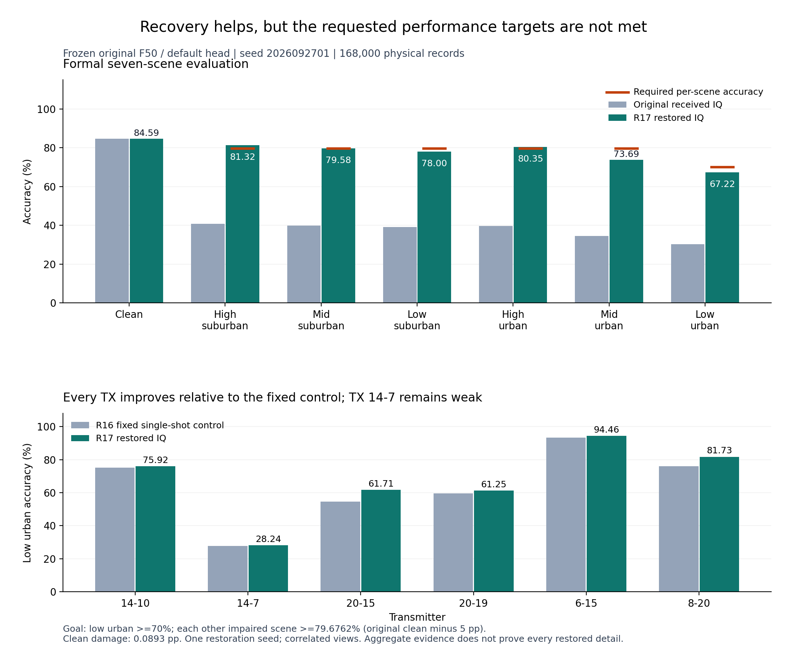
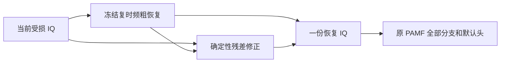

# 独立星地观测恢复器：实现与当前证据

已有可复用的独立恢复器，训练使用源 L/U 的 IQ 和模拟接收退化，不读取 TX 标签、不使用 F 损失。冻结原 F50 的完整正式测试已证明统计识别收益；逐条生成细节的 TX 真实性仍未证明，clean 也存在小幅损伤。目标保持 active，不能把对原受损输入的统计收益写成普遍身份认证保证。

## 最新完成的正式比较：R19

R19 在固定源域验收中选定 `time_time`，连接原 F50 seed2026092701/defaulthead，完成原168000条物理记录×七视图。它的源low urban为88.2778%，较R17增加1.4444pp，但正式low urban仅67.1030%，比R17低0.1137pp；六个受损正式场景均未超过R17。**本轮源域提升没有转化为正式跨接收机提升，70%/五场景各距原始clean≤5pp的总目标仍未达到。** `time_frequency` 虽平均源IQ误差更低，却因TX20-19的源损伤未合格，保留结果且0target。

|正式场景|R17（%）|R19（%）|R19−R17（pp）|R19距原始clean（pp）|验收|
|---|---:|---:|---:|---:|---|
|clean|84.5869|84.5869|+0.0000|0.0893|损伤单列|
|高仰角郊区|81.3190|81.1375|-0.1815|3.5387|通过|
|中仰角郊区|79.5780|79.3613|-0.2167|5.3149|未通过|
|低仰角郊区|77.9964|77.5381|-0.4583|7.1381|未通过|
|高仰角城区|80.3536|80.0649|-0.2887|4.6113|通过|
|中仰角城区|73.6851|73.5137|-0.1714|11.1625|未通过|
|低仰角城区|67.2167|67.1030|-0.1137|17.5732|未通过|

原始clean仍为84.6761904762%，其余五受损场景各自下限79.6761904762%，本轮只有2/5通过；恢复clean损伤0.0893pp单列。没有按正式分数调整R19、选择性重跑或回流R20；R20的固定/随机起点设计和提交早已固定。

配对诊断复用原预测与同物理clean：low urban恢复判断与clean判断一致的比例从31.9923%升至72.5649%；但沿用clean原有错误判断有15135条，匹配clean不等于TX正确。clean可正确识别的142256条子集中，恢复准确率为75.0576%，这是条件子集，不能代替全量67.1030%。low urban相对原受损输入修复70872条、损坏9042条。六个相关受损视图全部正确的物理样本从18150条增加到87994条；这是描述统计，不是部署集成，也不增加独立样本数。误差方向投影及正交修正能量已按TX/RX/day保留，仍不能证明每个生成细节的身份归属。

两行新prior各E20/4940，完整L/U曝光、恢复训练TX/F/target读取均为0；source V标签只用于验收，历史F50监督知识单列。两行权重已取回本机，严格加载并直接连接原F50/defaulthead验证有限输出和逐包一致性。R19可复用权重目录为 `local_artifacts/pamf_restoration/trained/20261020-phase1-restoration-alternating-tf-selfsup-s2026092701-m2-r19/{time_time,time_frequency}/final.pt`，使用 `experiments.pamf_alternating_restore.runtime.load_checkpoint`；未合格的频域行没有正式部署效果结论。[R19完整报告](../automation_reports/CV-SincNet/20261020-phase1-restoration-alternating-tf-selfsup-s2026092701-m2-r19/report.md)和[汇总](../automation_reports/CV-SincNet/20261020-phase1-restoration-alternating-tf-selfsup-s2026092701-m2-r19/summary.json)包含七场景、逐TX/RX/day、完整成本和配对诊断。追踪记录为7 verified、1 deferred，实验工作完成，持续总目标仍active。

## 当前生成式消融结果：R20（仅源域）

相同完整初始速度场、同数据和随机流的 sigma0=0/.02 两行均完成E20/4940，源V1800条×七视图完整16步采样后独立评分。两行均未通过既定波形和身份保护，0target；不得将下表的源准确率当作新的正式跨接收机结果。

|源V场景|零起点（%）|随机起点（%）|
|---|---:|---:|
|clean|98.4444|98.4444|
|高仰角郊区|97.7222|97.8333|
|中仰角郊区|96.1111|96.2222|
|低仰角郊区|94.3889|94.5000|
|高仰角城区|96.7222|96.7222|
|中仰角城区|87.0556|87.4444|
|低仰角城区|78.1111|78.0556|

六受损源视图平均IQ NMSE分别0.03320103/0.03359369，高于R17的0.02291145。随机起点在固定源low urban前128条、三个独立完整draw上的类别分歧为14/128=10.9375%，超过5%上限；零起点分歧为0是构造属性，却没有恢复身份性能。低训练路径误差并未预测完整采样效果；训练/验证分布和路径暴露不同，不能仅据两种误差的差异确定唯一原因，也不据此否定所有流匹配方法。

两行均取回并严格加载，直接连接原F50/defaulthead，固定epsilon的逐包/合批输出一致，无标签或参数更新。全L/U完整曝光、恢复训练0TX/F/target读取；两行负结果、逐TX/RX/day、三draw及成本保留于[R20完整报告](../automation_reports/CV-SincNet/20261020-phase1-restoration-flow-start-selfsup-s2026092701-m2-r20/report.md)。追踪7 verified、1 deferred。持续总目标尚未达到，最近的正式结果仍为上述R19，R17仍是已登记的历史正式对照。

## 历史正式参考：R17

R17 的 `unroll_unshared` 先通过固定源域条件并冻结，再连接原 F50 seed2026092701 和原默认头完成 168000 条物理记录×七视图。恢复训练全量使用 6300 L/56700 U、各 20 轮/4940 次更新，读取 TX 标签、F 权重/输出和目标数据均为 0。源 V 标签用于冻结前的独立验收，历史 F50 使用过监督训练，因此整条流程不称完全无标签。

|场景|原受损输入（%）|R17 恢复（%）|距原始 clean（pp）|用户要求|
|---|---:|---:|---:|---|
|clean|84.6762|84.5869|0.0893|损伤单列|
|高仰角郊区|40.7327|81.3190|3.3571|≤5 pp，通过|
|中仰角郊区|39.9167|79.5780|5.0982|≤5 pp，未通过|
|低仰角郊区|39.0298|77.9964|6.6798|≤5 pp，未通过|
|高仰角城区|39.6982|80.3536|4.3226|≤5 pp，通过|
|中仰角城区|34.4833|73.6851|10.9911|≤5 pp，未通过|
|低仰角城区|30.2994|67.2167|17.4595|≥70%，未通过|

**70%/五场景各距原始 clean≤5 pp 的总目标尚未达到。** 原始 clean 固定为 84.6761904762%，其他五场景各自下限为 79.6761904762%；不使用恢复后的 clean 降低验收基准。

低 urban 的六 TX 和七目标 RX 总体准确率均高于固定 R16 单次恢复对照，但 TX14-7 仅为 28.2393%。相对原受损输入修复 71187 条、损坏 9166 条；固定 512 位置参考池内，自己的配对 clean 特征相似度高于其他 TX 的比例为 49.9994%。这些是独立 truth 侧的统计证据，不能据此声称每个补出细节属于输入 TX。[R17 完整正式报告](../automation_reports/CV-SincNet/20261020-phase1-restoration-unrolled-selfsup-s2026092701-m2-r17/report.md)保留逐 TX/RX/day、repair/damage、特征指标及成本。



图中的橙线是每个场景独立的验收下限；灰色/绿色为原输入/恢复输入。下图比较固定 R16 单次恢复与 R17 的逐 TX 准确率。[SVG](figures/pamf_formal_r17_20261020/formal_recovery.svg)与[机器可读数值](figures/pamf_formal_r17_20261020/metrics.json)可复用。图表只读取既有正式评分汇总，不产生新预测。

本机完整恢复器权重位于 `local_artifacts/pamf_restoration/trained/20261020-phase1-restoration-unrolled-selfsup-s2026092701-m2-r17/unroll_unshared/final.pt`，使用 `experiments.pamf_unrolled_restore.runtime.load_checkpoint(path, device)` 严格加载。它包含冻结 coarse、作用估计器和三套先验。输入只有当前 `[B,2,256]` IQ，输出一份 IQ，再由原 PAMF 一致计算 FFT/PA/统计/时域分支；没有额外身份分类头。导入与本地验证应从登记工作树 `code/worktrees/standard_ce_baselines_20261010` 执行，避免混入根目录历史镜像依赖。

后续 R18 只根据 R17 源域机制证据比较当前估计锚点与 CG 位置；训练和源选择不读取 R17 目标评分。以下 R02/R03/R07/R09 等内容保留为历史实现和对照。

## 统一输入与输出

早期源域冻结主线为 R03 deterministic：

\[
\widehat x=b(r)+s\,C(r,b(r)),\quad s=0.1169459182403555.
\]

b 是冻结 R02 复数时频粗恢复器；C 是新学的多尺度残差修正器。推理只接当前受损 IQ，输出一份 IQ；原 PAMF 从这份 IQ 实际计算 FFT、PA、时间等分支及原默认头。没有独立预测一份与 IQ 不相容的 FFT。



训练目标是对应原地面接收 IQ，而非理想 TX 波形。L/U 分别6300/56700条，标签均不进入恢复训练；父 E20＋新增 E20，累计 E40。源生成使用原生同潜在信道的 full/residual，15%clean/60%residual/25%full，E20固定4940更新。源 V不更新持久状态，原模型选择在目标前冻结。它属于具有 clean 源波形的模拟自监督，不是完全无 clean 数据训练。

## 六类网络的实际覆盖

|报告类别|实际实现和训练|当前证据|
|---|---|---|
|R1 残差1D U-Net|R02 residual/full/mixed三版，独立scratch E20|完成源比较，未作为新增目标候选|
|R2 复数时频U-Net|R02 tf_unet_mixed，正确负频率镜像、统一IQ输出|源波形A冻结；完整正式读出R04/R09|
|R3 物理展开|R06真实/估计作用诊断；R07学习作用＋6步软CG，新增E20|R07平均源NMSE增加1.5535%，SOURCE_NOT_QUALIFIED，0目标访问|
|R4 条件扩散|R02多尺度v-prediction，64档cosine噪声、16步DDIM|源128条×3draw类别切换56.25%，未通过身份稳定性|
|R5 条件流匹配|R02直线配对路径、16步Euler；不是I2SB|源类别切换51.5625%，未通过身份稳定性|
|R6 粗恢复＋残差生成|R03 diffusion/flow及deterministic控制，新增E20|生成版切换31.25%/7.03125%，均高于5%；源A/B冻结deterministic控制|

生成式负结果保留，没有按目标真值挑生成 draw、改seed或选择性重跑。R07物理版本使用15%clean/85%residual且只监督作用/噪声，与R03配方不同，不能把它们当成仅一个模块不同的严格匹配消融。

## 原 F50 的完整结果

固定原 F50 CROSS_RX-s2026092701、原默认头，168000条正式物理记录；七视图和三组预测全部固定后独立 truth-last。新增模型/头/适配更新为0，恢复 IQ 直接复用原 R04/R05。

|场景|原F50（%）|coarse（%）|residual（%）|
|---|---:|---:|---:|
|clean|84.6762|83.8321|84.1786|
|高仰角郊区|40.7327|77.7238|77.3673|
|中仰角郊区|39.9167|76.7458|76.3125|
|低仰角郊区|39.0298|75.6357|75.3315|
|高仰角城区|39.6982|76.4631|76.2244|
|中仰角城区|34.4833|70.1131|70.3726|
|低仰角城区|30.2994|63.1500|63.9458|

低城区六 TX、七目标 RX均改善，但 TX14-7的准确率仍只有27.1571%。clean下降0.4976个百分点。配对原clean特征的接近度改善也只构成统计证据；512参考位置中配对更近的比例为44.5131%，不能据此宣称所有补出细节属于真实TX。

完整郊区 Macro-F1、修复/损坏、逐 TX/RX/day 与特征指标见 [R09正式报告](../automation_reports/CV-SincNet/20261019-phase1-restoration-formal-FcrossRX50-s2026092701-r09/report.md)。原E200 cleanF和E30 AsF属于不同读出，见 [R05报告](../automation_reports/CV-SincNet/20261019-phase1-restoration-formal-frozen-residual-s2026092701-r05/report.md)；其中AsF低城区两TX有负收益。R07独立负结果见 [源物理估计报告](../automation_reports/CV-SincNet/20261019-phase1-restoration-learned-action-source-s2026092701-r07/report.md)。

## 复用已有权重

在项目顶层和已验证 Phase1 Python 环境下使用。下列权重是本地私有artifact引用，未进入Git；R03 final.pt 包含冻结coarse和corrector的完整状态，不需要重新训练。

```python
from pathlib import Path
import torch
from experiments.pamf_residual_restore.runtime import load_checkpoint
from experiments.pamf_fcrossrx_readout.frozen import load_reader

artifacts = Path("local_artifacts/pamf_restoration")
restorer, _ = load_checkpoint(
    artifacts / "trained/20261019-phase1-restoration-residual-refinement-selfsup-m3-r03/residual_deterministic/final.pt",
    "residual_deterministic", "cpu",
)
frozen_F = load_reader(
    artifacts / "fcrossrx50_reference_20261019_r01",
    Path("local_artifacts/datasets/phase1_manysig_reference_20261019/source_cache"),
    "cpu",
)

@torch.inference_mode()
def restore_and_read(received):
    # 与原数据一致的float32 [B,2,256]当前接收IQ；不输入clean或信道真值。
    restored = restorer(received)
    spectrum = torch.fft.fft(
        torch.complex(restored[:, 0], restored[:, 1]), norm="ortho"
    )
    # FFT导出供检查；原PAMF各分支继续按原图从restored实际计算。
    return dict(iq=restored, fft=spectrum, logits=frozen_F(restored))
```

加载器严格检查原来源、数据角色和checkpoint配置，不替换分类头，不拟合参数。现有 CPU完整1800源V诊断及本次N607正式读出已覆盖这两个实际模型的复合前向。这里的 source_cache 仅供既有 Phase1 契约核对，不能把该示例当作 Phase2/星上部署访问source的许可。

当前最高风险是严重退化中的不可辨识细节和恢复不确定性；后续机制只能由合法源证据研发，目标结果不得回流调参、选模或选择性重跑。多seed、独立物理族与真实在轨身份验证仍未完成。

## 本轮验证与追踪

在已验证的本机 Phase1 Python 中实际分别执行 `python -X utf8 -m pytest -q tests/test_pamf_action_restore.py`（11项通过）及 `python -X utf8 -m pytest -q tests/test_pamf_formal_f50.py`（最终8项通过）。N607实际执行compile、模块入口、真实源checkpoint smoke、R07完整E20源评分及R09完整原F50独立truth-last评分，原进程均已退出且产物完成。

[R07追踪](PAMF_ACTION_RESTORE_R07_20261019.md)为7项已验证、1项延期；[R08/R09追踪](PAMF_FORMAL_F50_R08_20261019.md)为5项已验证、1项延期。合计12项已验证、2项延期、0项功能需求拒绝或阻断。R07属于条件性物理近似且未通过源科学标准；这些执行验证不等于最终逐细节身份真实性已证明。

## R10观测不确定性对照

三种网络各E20/4940、完整L/U、0TX/F训练及七源视图已完成，科学状态SOURCE_NOT_QUALIFIED。uncertain平均源NMSE=0.02747268，同预算direct=0.02885981，原R03=0.02836140；低城区身份变化相对R03 +1.5000pp，但最差TX -1.9934pp，不晋级、0新target。含三档郊区、各TX/RX/day、方差控制、累计成本和预登记条件逐项结果见[R10完整报告](../automation_reports/CV-SincNet/20261019-phase1-restoration-uncertainty-selfsup-s2026092701-m3-r10/report.md)。源身份验收使用V标签，恢复训练仍0TX/F；不把端到端选择称为完全无标签。direct/physical存在初值偏差，两个物理组初值一致；后续代码已修复，未追溯热改R10。

## R11原生噪声软MAP正式确认与最新验收

用户明确lowurban≥70%，另外五个受损场景分别距同一原F/seed原始clean≤5pp；恢复后clean损伤单列。冻结native的168000×七视图及原F50/defaulthead独立truth-last已完成。lowurban=65.2292%，用户数值标准USER_PERFORMANCE_NOT_MET；原clean=84.6762%，恢复后clean=84.5863%。三郊区、三urban、逐TX/RX/day、净纠错、波形和配对身份特征见[R11完整报告](../automation_reports/CV-SincNet/20261019-phase1-restoration-formal-nativeMAP-F50-s2026092701-r11/report.md)。R10原uncertain拒绝不变，R11仅源选择native；0新训练、无目标反馈，不宣称整个逐细节恢复目标完成。

可复现本轮固定native权重时，使用现有同一IQ派生视图示例，将恢复器加载替换为：

```python
from experiments.pamf_uncertainty_restore.runtime import load_checkpoint as load_native_map

restorer, metadata = load_native_map(
    artifacts / "trained/20261019-phase1-restoration-uncertainty-selfsup-s2026092701-m3-r10/native_map_prior/final.pt",
    "cpu",
)
assert metadata["kind"] == "native_map_prior"
```

它包含coarse、作用估计器和prior的完整冻结状态，输入仍仅为当前float32 IQ `[B,2,256]`，不读clean、TX、场景或真实作用。全部FFT/PA/time按前文原F计算。该权重在本机已用真实2条L_s严格加载，R11又完成原F50全七视图验证；它尚未满足70%/5pp性能目标，不以可运行替代有效性完成。


R12 参数无关 PAMF 解析视图实验（同父权重两组新增 E20/4940、0 TX/F 训练、全 L/U）已完成：SOURCE_NOT_QUALIFIED。源 lowurban 父 / pair / 解析为 82.1667% / 82.9444% / 82.9444%，六场景平均 NMSE 为 0.02760034 / 0.02699101 / 0.02759046。未通过固定源条件，保持 0 target。[完整报告](../automation_reports/CV-SincNet/20261019-phase1-restoration-analytic-views-selfsup-s2026092701-m2-r12/report.md)。用户 70%/各场景与原始 clean 差距≤5pp 目标保持，不以源成绩代替目标成绩。


2026-10-20更新：R14源作用/prior诊断完成，R13技术故障保留、单点上下文修复后新root执行；0训练/target。已知作用＋原生噪声代理使平均NMSE降低15.4053%，源低城区82.1667%→82.7222%，中城区89.8889%→89.8333%，未达到预登记作用估计优先门槛。prior单独输出clean退化至96.0556%，不能独立部署。保留三郊区/三城区/clean和TX/RX/day全部945分层；[完整报告](../automation_reports/CV-SincNet/20261019-diagnostic-restoration-action-fidelity-F50-s2026092701-m5-r14/report.md)。该源反事实不是70%/5pp正式结果，也不是oracle理论上界；持续目标active。


R15 全分辨率 TCN 对照已完成：SOURCE_NOT_QUALIFIED。两行均 scratch prior20/4940、全L/U、0TX/F训练，只继承冻结R07 coarse/action。源低城区 native / 新U-Net / TCN 为 82.1667% / 82.5000% / 78.4444%；六场景平均 NMSE 为 0.02760034 / 0.02734310 / 0.02912038。未通过全部固定源条件，0target。[完整报告](../automation_reports/CV-SincNet/20261020-phase1-restoration-fullresolution-selfsup-s2026092701-m2-r15/report.md)。最终70%/各场景距原始clean≤5pp目标保持，不把源成绩当目标成绩。


R16 IQ-only严格配对消融完成：SOURCE_NOT_QUALIFIED。两新prior各20/4940、全L/U、0TX/F训练，实际每结构完整epoch0与R15一致，原FFT对照复用。源低urban U-Net FFT/IQ、TCN FFT/IQ为 82.5000% / 84.3889% / 78.4444% / 82.3333%。固定U-Net主候选未过源条件，0target，无改选TCN。[报告](../automation_reports/CV-SincNet/20261020-phase1-restoration-iqonly-selfsup-s2026092701-m2-r16/report.md)。70%/其余五场景距原始clean≤5pp目标保持，source不替代正式。


R17 三步物理展开完成：SOURCE_QUALIFIED_TARGET_ANALYZED，选定 unroll_unshared。全L/U、0TX/F训练，两新prior各20/4940、三次Core与3×2CG。源低urban单次/共享/不共享为 84.3889% / 86.3889% / 86.8333%。选定展开与固定单次正式两行自动确认完成。正式选定展开 low urban为67.2167%，70%条件未通过；其他五场景有2/5达到原rawclean−5pp。数值总目标尚未达到，完整身份真实性及稳定性边界仍须保留。[完整报告](../automation_reports/CV-SincNet/20261020-phase1-restoration-unrolled-selfsup-s2026092701-m2-r17/report.md)。70%/其余五场景距原始clean≤5pp目标保持，source不替代正式。


R18 当前锚点与末端CG比较：SOURCE_NOT_QUALIFIED，选定 None。各新prior20/4940、全63000L/U、0TX/F/target训练，四固定源参考保护。本轮没有新正式目标集成绩，持续目标尚未证实。[完整报告](../automation_reports/CV-SincNet/20261020-phase1-restoration-iterative-controls-selfsup-s2026092701-m2-r18/report.md)。持续目标保持active。


R19 时域—频域交替与同容量时域比较：SOURCE_QUALIFIED_TARGET_ANALYZED，选定 time_time。各新prior20/4940、全63000L/U、0TX/F/target训练，四固定源参考保护。正式 low urban 为 67.1030%，70% 条件未通过；其余五场景 2/5 达到原始 clean−5 pp。数值总目标未达到。[完整报告](../automation_reports/CV-SincNet/20261020-phase1-restoration-alternating-tf-selfsup-s2026092701-m2-r19/report.md)。持续目标保持active。


R20 固定起点与随机起点流匹配：SOURCE_NOT_QUALIFIED，选定 None。各新prior20/4940、全63000L/U、0TX/F/target训练，四固定源参考保护。本轮没有新正式目标集成绩，持续目标尚未证实。[完整报告](../automation_reports/CV-SincNet/20261020-phase1-restoration-flow-start-selfsup-s2026092701-m2-r20/report.md)。持续目标保持active。


R21 四步路径／实际终点目标：SOURCE_NOT_QUALIFIED，选定 None。各新prior20/4940、全63000L/U、0TX/F/target训练，五固定源参考保护。本轮没有新正式目标集成绩，持续目标尚未证实。[完整报告](../automation_reports/CV-SincNet/20261020-phase1-restoration-endpoint-selfsup-s2026092701-m2-r21/report.md)。持续目标保持active。


R22 三步解析观测量目标：SOURCE_NOT_QUALIFIED，选定 None。各新prior20/4940、全63000L/U、0TX/F/target训练，五固定源参考保护。本轮没有新正式目标集成绩，持续目标尚未证实。[完整报告](../automation_reports/CV-SincNet/20261020-phase1-restoration-analytic-unrolled-selfsup-s2026092701-m2-r22/report.md)。持续目标保持active。


R23 coarse联合恢复目标：SOURCE_NOT_QUALIFIED，选定 None。各新prior20/4940、全63000L/U、0TX/F/target训练，五固定源参考保护。本轮没有新正式目标集成绩，持续目标尚未证实。[完整报告](../automation_reports/CV-SincNet/20261020-phase1-restoration-joint-coarse-selfsup-s2026092701-m2-r23/report.md)。持续目标保持active。


R24全分辨率TCN／注意力三步恢复：SOURCE_NOT_QUALIFIED，选定 None。两个新prior各20/4940、全63000L/U、0TX/F/target训练，R23 prior_only仅复用源控制，六固定源参考保护。本轮没有新的正式目标集成绩，70%／5个百分点和身份细节归属目标仍未证实。[完整报告](../automation_reports/CV-SincNet/20261020-phase1-restoration-fullresolution-priors-selfsup-s2026092701-m2-r24/report.md)。持续目标active。
