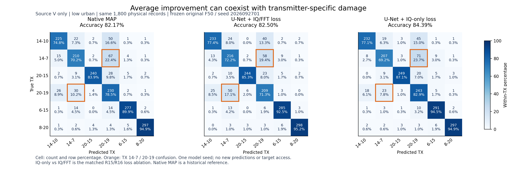

# 恢复平均收益与逐 TX 损伤：R15/R16 固定源域结果再分析

**R16 的 IQ-only U-Net 改善了平均恢复误差、平均身份准确率和配对 clean 特征相似性，但仍损伤 TX 14-7，尚不足以证明输入身份保真。**本报告只整理已经冻结、评分和公开的 source V 汇总，不新增预测、训练、模型选择或目标集访问。R16 原 `SOURCE_NOT_QUALIFIED` 决定保持。

数据来自 [R16 公开汇总](../automation_reports/CV-SincNet/20261020-phase1-restoration-iqonly-selfsup-s2026092701-m2-r16/summary.json)；完整预算与训练权限见 [R16 报告](../automation_reports/CV-SincNet/20261020-phase1-restoration-iqonly-selfsup-s2026092701-m2-r16/report.md)。三种读出均使用同一原始 F50 seed2026092701、原联合训练默认头和同一组 1800 条 source V 物理记录。训练 TX 标签/F 访问均为 0，V 标签仅在预测固定后独立评分使用。Native MAP 是 R10 历史参考；R15 U-Net IQ/FFT 与 R16 U-Net IQ-only 才是同结构、完整 epoch0 状态一致的数据/预算配对消融，实际 GPU 负载不同，未证明跨运行位级确定性。

## 具体损伤在哪些身份之间



每格同时列出数量及真实 TX 内百分比。以下是同一数据集上的混淆计数差异，**不是逐包预测转换表**，不能将计数差直接称作同一批样本被改判的数量。

| source low urban 指标 | R15 U-Net IQ/FFT | R16 U-Net IQ-only | 差异 |
|---|---:|---:|---:|
| 总体正确 / 1800 | 1485（82.5000%） | 1519（84.3889%） | +34 / +1.8889 pp |
| TX 14-7 正确 / 299 | 216（72.2408%） | 207（69.2308%） | -9 / -3.0100 pp |
| TX 14-7 → 20-19 误判 | 58（19.3980%） | 71（23.7458%） | +13 |
| TX 20-19 正确 / 293 | 209（71.3311%） | 243（82.9352%） | +34 / +11.6041 pp |
| TX 20-19 → 14-7 误判 | 50（17.0648%） | 23（7.8498%） | -27 |

两类之间的混淆呈不对称变化。它与原固定最差 TX 条件失败一致，说明不能仅用总准确率、最小 NMSE 或平均余弦距离晋级。现有聚合结果没有直接证明该现象由哪一种物理指纹成分造成，也不支持按具体 TX 设置分支、权重或阈值。

## 郊区、urban 与配对 clean 特征

“配对优先率”定义为：恢复特征与**同物理记录的原始 clean 特征**的余弦相似性，高于固定参考池内所有其他 TX clean 特征相似性的记录比例。参考池只取 512 个均匀位置，位置选择不依赖 TX；其他 TX 的排除在独立评分时使用源 V 标签。它不是完整全局检索、身份分类准确率或训练/推理条件，也不证明每个波形细节真实。

| source V 场景 | Native 准确率（%） | IQ/FFT 准确率（%） | IQ-only 准确率（%） | IQ/FFT 配对优先率（%） | IQ-only 配对优先率（%） |
|---|---:|---:|---:|---:|---:|
| clean | 98.4444 | 98.4444 | 98.4444 | 100.0000 | 100.0000 |
| 高仰角郊区 | 98.0000 | 97.9444 | 97.8333 | 99.5556 | 99.6111 |
| 中仰角郊区 | 96.6667 | 96.6667 | 96.9444 | 96.7778 | 97.7778 |
| 低仰角郊区 | 95.9444 | 96.0556 | 95.9444 | 96.1667 | 96.7222 |
| 高仰角城区 | 97.0000 | 96.8889 | 97.2222 | 97.7222 | 98.0556 |
| 中仰角城区 | 89.8889 | 90.1667 | 90.7222 | 85.7222 | 88.0000 |
| 低仰角城区 | 82.1667 | 82.5000 | 84.3889 | 76.1111 | 78.6111 |

低仰角城区的配对 clean 特征余弦距离从 IQ/FFT 的 0.03900506 降到 IQ-only 的 0.03575849；平均 margin 从 0.05840907 增到 0.06436304。平均特征关系改善与 TX 14-7 损伤同时存在，所以配对特征证据只能作为补充，不能替代逐 TX 分类、修复/损坏及 clean 兼容性。七种视图来自同一批物理记录，相互相关，不能当作七个模型种子。

## 冻结 F 特征约束的只读可行性

在本机两条合法 U_s 原始 IQ 上，冻结原 F50 所有参数，用轻微扰动 IQ 与其配对 clean 的归一化 joint160 特征平方距离检查反向传播。没有优化器、参数更新、分类头重训、类别概率条件、TX 标签文件读取或 target 访问；该检查未修改 R17。

两条 IQ 的梯度范数为 0.02886392、0.00708454，均有限且非零。随机方向自动微分为 -4.64818e-5；中心差分在步长 1e-3 时为 -4.88362e-5，在 3e-4 时为 -5.41331e-5。数值差分仅作局部支持性检查，未据此宣称所有分支梯度精确；原参考延迟选择含硬 argmax，只有分段连续路径。

这只证明总特征损失存在到 IQ 的梯度路径，尚未训练或验证其身份收益。若未来使用该指标训练，必须披露其引入了**有监督预训练 F 的知识**；当前训练不读 TX 标签不等于整个知识来源无监督，也需警惕迎合单一固定读出。原始可行性输出保留于本机 `local_artifacts/pamf_restoration/frozen_F_feature_gradient_feasibility_1792431726161274500.json`。

本补充不能替代正式验收。目标仍为正式 low urban ≥70%，其他五种受损环境分别 ≥同一冻结 F/seed 原始 raw clean−5 pp；原 raw clean 84.6761904762%，故下限 79.6761904762%。R16 保持 0 target；最新已完成正式 R11 low urban 为 65.2291666667%，目标尚未达到。单 seed、同引擎代理的源域现象不能当作跨模型种子、独立物理信道族或真实在轨证明。

图表的 [机器可读数据](figures/pamf_identity_r16_20261020/metrics.json)覆盖七场景；[SVG](figures/pamf_identity_r16_20261020/lowurban_confusions.svg)可用于矢量排版。[生成脚本](../tools/plot_pamf_identity_confusion.py)只读取既有公开汇总，并核对每场景记录总数、各 TX 分母、混淆矩阵对角准确率、原 F/default head 和源域权限字段；不读取 IQ、标签文件、预测数组或权重。使用新的输出目录复现：

```text
python -X utf8 tools/plot_pamf_identity_confusion.py --output local_artifacts/identity_figure_reproduction_NEW
```
