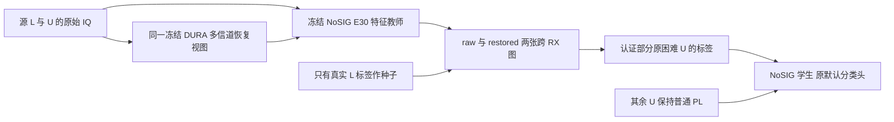

# 去 SIG_TIME 的 PAMF：恢复视图跨接收机图伪标签学习

状态：2026-10-26 用户要求先完整复盘后设计；图方法仍未完成真实数据验证或候选训练；NoSIG匹配基线及E30图教师准备已实现并核实运行，图核心算术已实现并通过4项聚焦检查，尚无新目标结果。工作名 **PAMF-RGPL（Restoration-aware Graph Pseudo-Labeling，恢复视图图伪标签学习）**，不是已验证的最终方法名。依据见[完整复盘](../../automation_reports/CV-SincNet/20261026-analysis-PAMF-SSL-retrospective-r01/report.md)。

## 当前范围与基底

后续本对话新实验统一使用 **NO_SIGNATURE**：整个 SIG_TIME_X3 路径描述支路替换为 `structural.NoSequence`，无该支路可训练参数／计算，基础时域、频域、PA、参考响应与160维默认头保持。它区别于只删除显式时间坐标的 NO_TIME。保留原完整L机制、默认分类头联合训练、source L/U/V权限及固定DURA v1/G-LU。

URealizations 四条旧 SIG_TIME 训练已按原配置完成全部源评估，均未通过原源条件；相对各自fixed控制仅+1／+1／+4／−1次净正确，只作独立历史证据。用户本次架构指令覆盖旧计划“通过源条件后扩旧SIG三种子”的后续动作，旧SIG不再新增扩展。既有权重和报告不改名。

找到 m201 中三个原同契约 `F0-A1B1-NO_SIGNATURE-F21-sSEED/segment20` 普通PL E20前缀。已核实三份complete/config、从零来源标记、原F0合同相等及权重文件存在。seed01 已额外核实实际state_dict无sequence参数、原6×160默认头、scratch来源及真实checkpoint smoke，并完成普通PL续10至固定新E30；seed02/03 仍只到元数据核实，使用前须实际张量／smoke检查。不能把带SIG E30部分加载、删除支路后称作同成本NoSIG父，不能用已曝光的REPL_NO_SIGNATURE F50作父。

旧CE_NO_SIGNATURE仅分类损失，与本轮完整监督骨架不同，不能冒充NoSIG匹配监督控制。历史去SIG在双跨子群有收益、全目标群体并非一致收益；这是用户指定结构后的新研发，不声称结构本身已普遍优越。

## 为什么改变学习信息来源

旧原E30三教师在完整source V27000上，25234条共识接受只错8条；排除的1766条却包含各教师459／426／434条错误，占各教师全部raw错误的平均98.2112%。困难池不是可以直接放开的干净标签池：三个G教师同类且各confidence≥.95时，三个受损恢复场景在该池精度只有88.01%／80.97%／69.97%；三raw教师Top-2候选并集仅覆盖92.02%的真类，Top-3为96.04%。

因此，新增机制需要从真实L标签和其他物理记录的结构中获得依据，而不是只复述同包教师判断。过去L单中心／多参照直接分类没有显著收益；本方案新增的是 **L-U-U图上的标签传播**，输出类别标签后再训练默认头，不把学生特征拉向旧坐标中心。图方法本身已有研究，本方案不声称发明标签传播或理论保证；PAMF中的有效性仍未知。[CVPR 2019原论文](https://openaccess.thecvf.com/content_CVPR_2019/html/Iscen_Label_Propagation_for_Deep_Semi-Supervised_Learning_CVPR_2019_paper.html)。

## 冻结源图：一个物理包只占一个节点

每个学生seed只用自己的冻结NoSIG普通PL E30为特征教师。节点仅原L6300与U56700，共63000；不含V／目标，不读U真类。L标签是唯一图标签种子，U的原伪标签不能作为传播种子。

分别构建raw图与restored图：

- raw节点向量为原默认头前的160维特征归一化。
- restored节点向量先对相同物理包四个固定实现×三个场景的12个G视图逐个归一化，求均值后再归一化。新旧实现均使用，不挑最好视图。H/G来自同一冻结G与原物理通道；不做IQ混合、额外噪声或G后波形归一化。
- 所有恢复视图聚合在同一个物理节点，不能把12份视图当12个独立样本或独立投票。
- 两图分别取不同source RX间的mutual 20-NN，排除自身、同物理ID与同RX边。边权统一为 `exp((cosine−1)/0.2)`；不按TX指定参数。用精确分块近邻，避免先引入近似搜索偏差；实现时记录实际内存和成本。

令W为对称非负边权、`S=D^(-1/2) W D^(-1/2)`。各图、各source RX s分别用其真实L标签one-hot矩阵Y^(s)作种子，计算：

`Q^(s) = 0.1 Y^(s) + 0.9 S Q^(s)`。

迭代至最大绝对差≤1e−6或最多200次；未收敛记技术缺项，不用目标结果更改次数。节点i属于RX r时，只合并 `s≠r` 的传播量后按类别归一化。这样该节点的标签来源排除自身RX的L种子；它仍不是“教师／G从未见过该RX”。孤立／无标签来源的节点不填均匀伪标签，直接回退普通PL。

一份图传播到类别空间后固定。训练中不刷新图、L特征、图概率或伪标签；避免把在线参照漂移与标签来源改变混在一起。后续是否刷新要另做独立对照，不是本版组件。

## 只为困难池新增经过验证的标签

初始困难池定义为该seed冻结NoSIG E30在raw上最大概率<.95。这个集合与旧三教师拒绝池不同，必须重新报告数量，不能沿用1766／6.54%为新模型事实。

记录i获得图标签b_i=1，需同时满足：

1. i属于上述固定困难池。
2. raw图与restored图argmax类别相同，两图各自归一化最大概率≥.95。
3. F0排除自身RX后，至少三个其他RX的L种子传播结果支持该类别：各RX传播量非零，且其归一化argmax相同。未来其他源数量设置使用统一公式 `min(3,|R_s|−1)`；只有一个source RX时不存在跨RX证据，b_i恒0，完整回退普通PL，不声称该设置有图增益。不同契约的图／教师／G须各自匹配，不能复用F0状态。

新标签为两图共同argmax。其余记录完整回退原raw self-PL，不额外丢弃高置信普通PL记录。图置信度不是校准正确率，两图也不独立；不能根据两图一致就宣称标签可靠。

**先做冻结源图诊断，不先训练：** 用固定图对每条原V独立做归一化近邻扩展；V不能成为图节点、改变边／归一化／传播量或影响其他V。扩展取20个不同RX源邻居，且V到邻居的距离须进入该邻居在原源图中的固定20-NN距离半径；使用已冻结源节点度／传播量加权后归一化，不重算源图度或传播。没有满足条件的边即不认证。V标签仅在预测固定后计算质量。先固定图/阈值，再观察新NoSIG的实际困难池：首轮F0要求新增认证不少于200条、实测精度≥99.5%，报告各RX/day/TX及相对原教师的纠正／引错；同时明确这是source V代理，不是真实U精度或泛化保证。质量不足则停止本候选，不批量换k／门槛直到过线，不打开U真值。

这个条件检验的是有没有足够的新身份信息，不是追求接受率数字。即使通过，也不等于目标集有效。未来正式启动前将该科学规则写入唯一run登记；本设计不自动启动或修改健康任务。

## 学生目标：替换困难样本的标签来源，控制总CE剂量

学生每步仍在raw做原eval self-PL门控：m_i表示当前confidence≥.95，y_i为当前argmax。b_i与图标签g_i来自上述冻结缓存，G不更新。新增分支与原PL逐样本互斥：

`L_U = mean_i [(1−b_i) m_i CE(pθ(x_i),y_i) + b_i ((1−ρ) CE(pθ(x_i),g_i) + ρ CE(pθ(v_i),g_i))]`。

主版本 `ρ=.25`，v_i为同物理恢复视图，场景／实现按固定整数日程轮换。困难样本的两份CE系数和为1，整个U batch归一；不另外叠加原错误self-PL、熵项、特征对齐、跨视图KL、梯度投影、在线原型或新分类头。其余高置信U维持原普通PL，不再对它们普遍新增恢复CE。

首轮沿既定source证伪约定，训练中的b_i还须满足`rx_i≠1`；RX1继续完整参与原L/rawPL，图诊断仍可独立评估其认证质量。这样后文“附加机制留出RX1”有实际含义。若该版本通过，首个正式三seed保持同一冻结mask，不在扩种子时悄悄改为全RX新增监督。全RX版本须另行固定同预算匹配对照，并披露数据使用差异。

原L完整监督骨架保留，默认分类weight正常与骨干联合更新。本版先使用原始任务CE更新分类头及特征，图只负责标签来源；不沿用旧恢复aux的head-shield或按旧SIG梯度校准的λ。是否需要shield是后续可检验因素，不与首轮信息来源变化捆绑。

全部方法累计E50/11100、13L37LU；图候选从同NoSIG E30独立+20，不串接旧研究F50。图教师、G及一次性缓存/图构建成本单列，不能因推理只一个F就称训练无额外成本。

## 最小匹配矩阵

先单学生seed01做源证伪，不同时发布多种新损失。匹配监督控制需单独核实／训练，不能从普通PL E30继承成“无U监督”。

| 行 | 标签来源／额外视图 | 回答的问题 |
| --- | --- | --- |
| NoSIG-Sup | 完整L、U关闭 | 新结构上的监督基线 |
| NoSIG-PL | 原raw self-PL | 新结构上的普通PL基线 |
| GraphRaw | 认证困难样本改用图标签，ρ=0 | 标签来源是否提供新信息 |
| GraphRaw2 | 同GraphRaw，两次raw CE按.75/.25 | 控制额外前向／dropout和CE分配 |
| RGPL | 同GraphRaw2，仅第二输入改为G视图 | 恢复域训练是否有独立正收益 |

GraphRaw2与RGPL使用相同图标签／接受集合／额外前向数，CE总剂量相同；图构建已使用G，不把GraphRaw称为“完全无G方法”。图生成的作用与学生恢复视图训练的作用通过这两步区分。L/U实际曝光、困难池覆盖、新增纠正及引错、各场景／RX/day/TX和完整训练曲线全部报告。

保留原source V27000八视图，源判断相对新NoSIG-PL：held额外分支RX1 G三景≥+.3pp、overall raw≥−.1pp，以及新增认证困难池净纠错为正；RX1只是该附加机制留出，不能称真正未见基座RX。该规则只能淘汰明显无效方案，不能作为目标集收益替代品。全部既定行完成后才决定是否扩新NoSIG三个学生seed，选模只用预登记源规则。

本次尚未证明任何图质量、GraphRaw训练收益或RGPL收益。若图没有提供可信的新标签，就不进入后两条；不能靠重新叠加旧loss回避证伪。为避免对照缺失，正式run登记应明确源诊断失败时哪些训练不启动，以及既有匹配基线如何保留。

## 三种子实际目标与报告

最终同一候选的2026092701/02/03，原F0目标RX所有日期168000包/seed，raw和同一原G-LU clean＋六practical全部预测固定后独立truth-last。保留cross_date30000另列、完整11设置的后续边界和已曝光基准背景。不能拼接不同候选最好的clean/raw六景/G六景。

既有绝对目标不降低；新增NoSIG控制也必须超过：

- raw clean≥max(85.98174603174603%，NoSIG-Sup均值+1pp，NoSIG-PL均值+1pp)。
- raw六景>max(72.0961970899471%，NoSIG-Sup均值+1.5pp，NoSIG-PL均值+1.5pp)。
- 同G-LU六景>max(78.07463624338624%，NoSIG-Sup+G均值，NoSIG-PL+G均值)。

新NoSIG控制尚未完成，因此以上max表达式不是已知新数值。三个seed SD不代表显著性，源V正确率不代表U实测正确率。推理仍为单个NoSIG F／同一固定单次G+F，不保留图或教师，不复用旧架构的延迟数字。

## NoSIG 基线已实际启动

`20261026-phase1-PAMF-NoSIG-RGPL-base-source-m2-r01`，执行代码`f5eb718af9bf461b6b0b9fa6b422f8794bc19103`。真实原NoSIG E20张量和scratch链已核实；真实NoSIG/defaulthead/G source smoke、PL L128/U256与Sup L128/U-off联合backward通过。两个worker在GPU0/3，PID/CWD/argv/GPU/step增长独立核实。NoSIG-PL先得到固定E30图教师，再+20作E50控制；Sup从零50完整L、U loader缺席。两者final自动V八视图。

已实现`experiments/pamf_channel_pl/rgpl_graph.py`的精确不同RX mutual邻居、对称归一化、按L种子RX分解的固定点传播、排除自身RX的双图认证和不更新源图的独立V扩展；4项数学／权限检查通过，包含线性解对照、U真值／V节点拒绝、类别置换等变和V批次独立。此为算法核心单元验证，尚未真实L/U建图，不是图标签质量或方法性能。下一步在真实NoSIG E30冻结后为原L/U/V分别提取raw及12个恢复视图特征；仅L/U建图，V只独立扩展与质量评分。

## 冻结源图诊断已实际启动

`20261026-diagnostic-PAMF-NoSIG-RGPL-sourceGraph-m1-r01` 使用已完成的新NoSIG-PL E30，执行commit `ba7efad5dee5820a392cdfc241701a228e366b10`。图核心与源权限边界共5项检查、唯一独立P0/P1审查、一次archive传输比对和远端编译通过。GPU4上的真实NoSIG E30/defaulthead/G L2 smoke PASS，PID/CWD/argv/GPU及进度增长已核实；开始原L/U/V的raw和12恢复视图特征提取。只有L/U建图，V不成为节点；未启动GraphRaw/GraphRaw2/RGPL训练。质量仍待定，不把算术检查或成功启动当作图伪标签正确率。详细状态见[本行报告](../../automation_reports/CV-SincNet/20261026-diagnostic-PAMF-NoSIG-RGPL-sourceGraph-m1-r01/report.md)。
