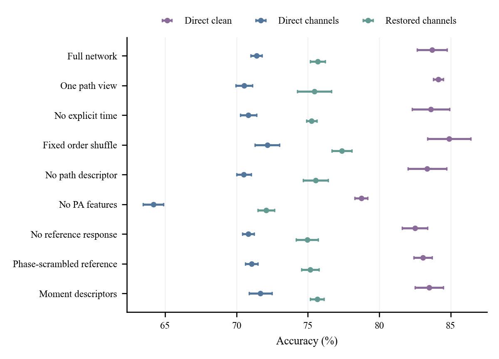
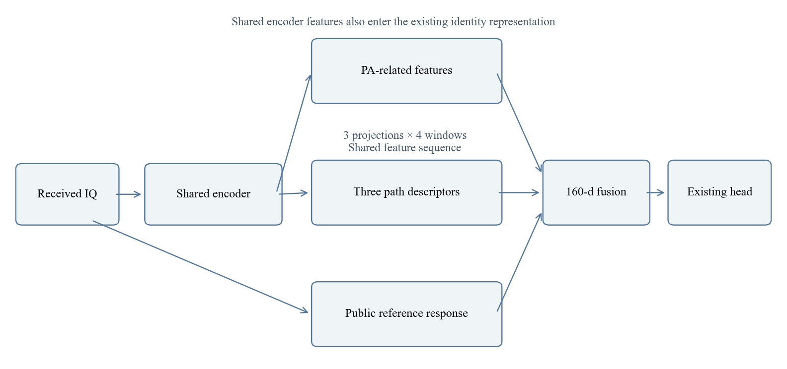
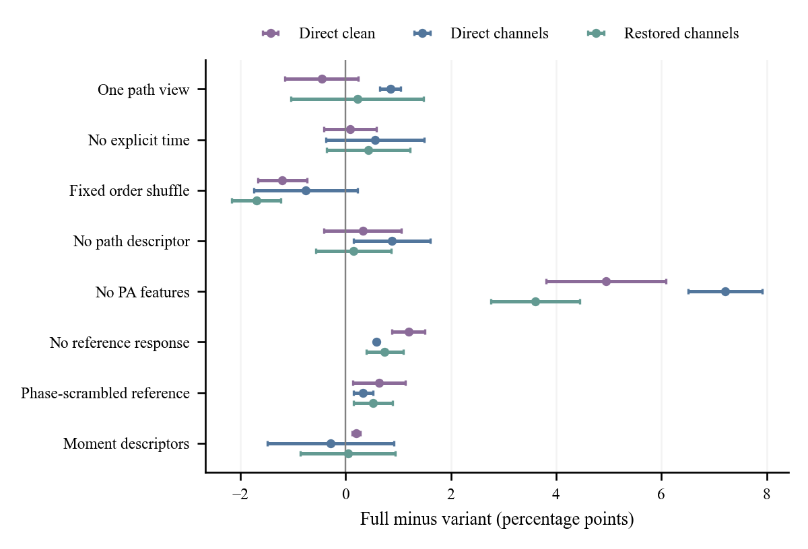
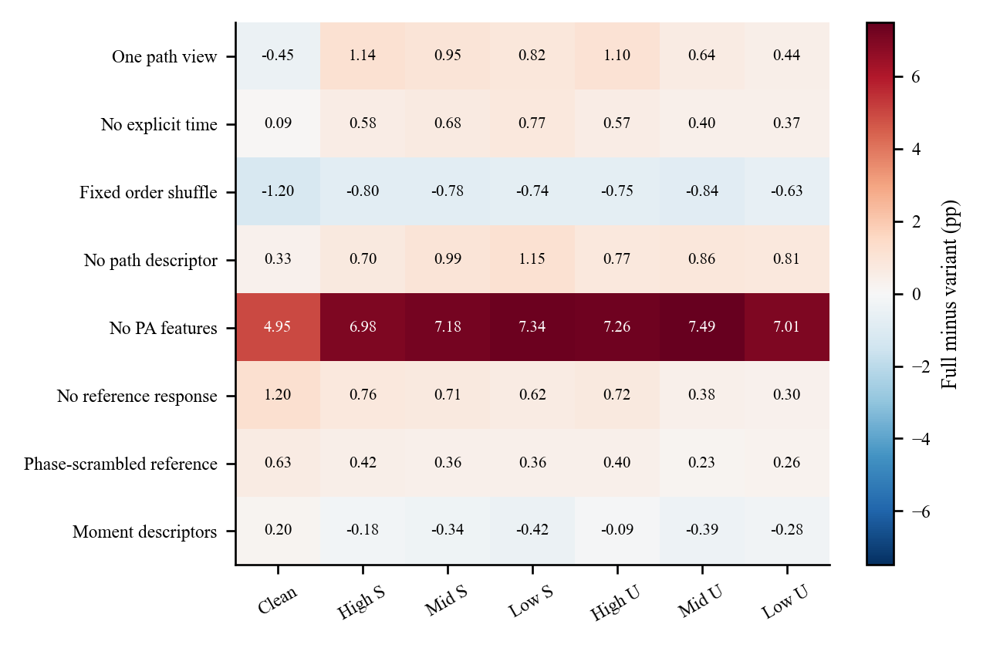
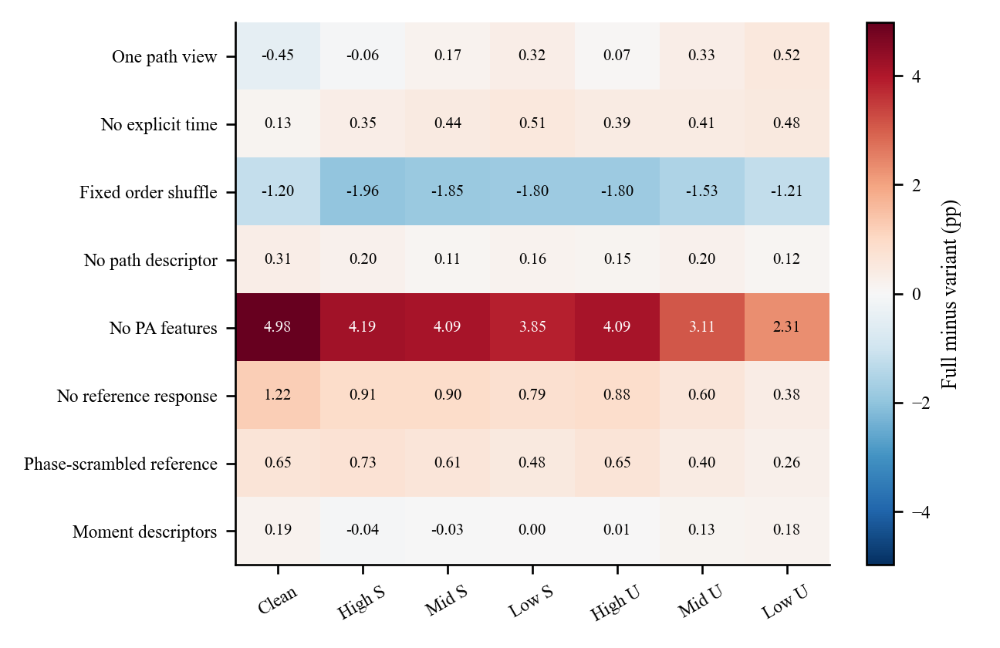
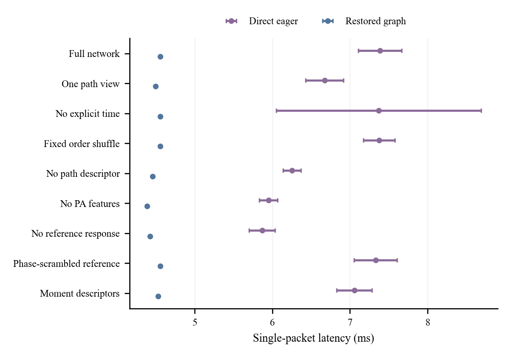
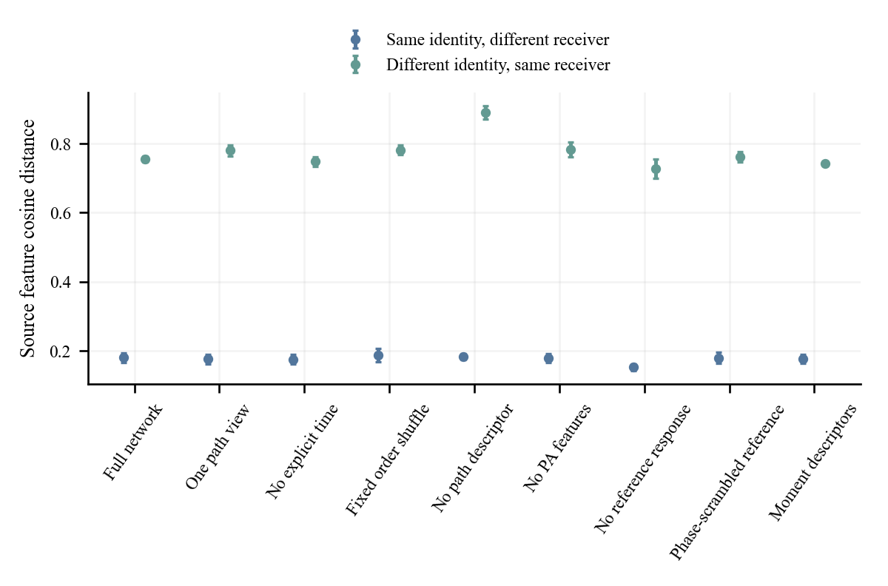

# PAMF 网络分支消融实验报告

仅分类损失的监督训练 | 9 种结构 × 3 次独立训练 | 已冻结评分 | 2026 年 10 月 25 日

功放相关支路是本面板中影响最大的被移除支路。跨接收机、六种信道平均准确率由完整网络的 71.3993±0.4039% 下降至 64.1881±0.7137%；同一训练种子内配对后，下降 7.2112±0.7008 个百分点。

参考响应支路有较稳定的小幅收益。路径描述、显式时间坐标和三视图的收益依赖测试条件；固定打乱局部顺序的对照在部分条件下反而更好。因此，现有证据支持保留功放相关支路，但不支持把所有设计都写成普遍、独立且必需的性能来源。

图 1  标准划分的跨接收机结果。点为三个模型均值，误差线为样本标准差；六景先在每个种子内等权平均。

本报告只展示这一监督结构面板及其匹配的恢复后读出。共 27 个独立识别器；接入 DURA 后的列复用相同识别器和同一个恢复器，不是另 27 个训练模型。本次新增训练、预测、目标真值访问和恢复器训练均为 0。

## 1  网络分支具体指什么

PAMF 从 256 点复数 IQ 中提取身份表示，输出既有默认分类头的六类预测。共享骨干的时频表示、功放相关信息、局部路径描述和公共参考响应共同形成部署特征；本报告的“分支”指实际前向计算结构。

图 2  分支依赖示意。共享骨干身份特征始终保留；示意图不表示各支路等权相加，也不表示存在三套独立骨干。

| 信息来源 | 实际作用与尺寸 | 本次控制 |
|---|---|---|
| 功放相关支路 | 包含功放相关计算块和统计投影，参与既有身份表示 | 删除相关计算块和投影，其他分支继续训练 |
| 局部路径描述 | 同一中间特征序列上学习 3 个投影；4 个局部窗口；每视图 112 维，拼接 336 维后映射到 160 维 | 单视图、去显式时间、固定顺序打乱、整路删除、矩统计替代 |
| 公共参考响应 | 由固定公共参考模板计算响应描述，经 29→64→160 投影、归一化和增益后融合 | 删除响应整路；或只打乱模板频谱相位 |

三个“视图”是同一共享中间特征的三个可学习投影，不是三个独立模型或三模型集成。所有结构继续使用原默认分类头联合训练，融合后的部署特征均保持 160 维。

## 2  九种结构设置及解释边界

| 结构 | 实际改动 | 解读时必须保留的边界 |
|---|---|---|
| 完整网络 | 全部既有支路保留；三视图路径描述、显式时间坐标和真实公共参考模板。 | 条件对照的基准，不预设它必然最优。 |
| 单视图路径描述 | 局部路径描述由三个投影视图改为一个；融合投影从 336→160 改为 112→160。 | 参数减少 36992，不能只把差异归因于视图数。 |
| 去除显式时间坐标 | 路径描述去掉显式时间坐标，保留六个投影通道；每窗口 21 维结果补 7 个零。 | 没有删除时域骨干，也没有消除全部顺序信息。 |
| 固定打乱局部顺序 | 每个 8 位置窗口保留首尾，固定打乱中间 6 个位置，再建立时间坐标。 | 固定同一置换贯穿训练和测试；不是逐次随机打乱原 IQ。 |
| 去除路径描述支路 | 整条路径描述输出置零，删除相应可学习池化结构。 | 共享骨干时频信息仍在；参数同时减少 55968。 |
| 去除功放相关支路 | 删除功放相关计算块及其统计投影，原位置返回零表示。 | 结构变化而非仅关闭一个损失；参数减少 11040。 |
| 去除参考响应支路 | 删除参考响应、响应投影及增益，保留其余身份特征。 | 参数减少 12800，不能单独证明参考信息的物理可辨识性。 |
| 打乱参考模板相位 | 固定打乱公共模板频谱的相位，保留幅度谱和全部可学习投影维度。 | 网络可适应固定错误模板；不是每次输入不可学习的随机破坏。 |
| 三视图矩统计替代 | 每窗口使用六维均值及 21 项上三角协方差，固定 27→28 维映射；仍为三视图。 | 学习参数数相同，描述的内在秩和信息类型仍不同。 |

保留时间坐标的路径描述：6 个投影通道加 1 个时间坐标，得到 7 项一阶增量和 21 项反对称二阶面积，共 28 项；4 个窗口合为 112 维。去掉时间坐标后维数先变为 6＋15＝21，再补零保持接口宽度。

本面板没有删除基础 Sinc 滤波器、整个时域骨干或整个频域骨干；不能把它称为对全部骨干模块的穷尽消融。

## 3  训练、数据和统计口径

| 项目 | 本面板固定设置 |
|---|---|
| 目标 | 普通输入分类交叉熵＋0.68×信道辅助槽分类交叉熵；标签平滑为 0 |
| 关闭的训练分支 | 不使用无标签训练数据、伪标签、教师、跨接收机对比损失、配对 KL 或独立分类头拟合 |
| 训练预算 | 每模型 50 轮、11100 次更新；20＋10＋20 分段，均沿自身模型续训 |
| 实际计算曝光 | 每次更新 128 个有标签物理包、384 次包前向；每模型 4262400 次包前向 |
| 重复训练 | 3 个预先固定模型种子；27 模型均从各自匹配结构起始并完成全部预算 |
| 训练信道 | 真实 ResidualChannel 的残余信道、同步后、不均衡设置；仅源训练 IQ 生成 |
| 信道混合 | 低郊区 0.40、中城市 0.35、低城市 0.25；预算进度＜0.20／＜0.45／其后对应施加概率 0.30／0.60／0.80 |
| 恢复后列 | 固定 DURA，仅用有标签源训练集合的 IQ 学习，不读取发射机标签；27 模型共用同一恢复器 |

“仅分类损失”不等于无输入增强。原普通扰动和上述信道辅助槽保留。384 次包前向包括额外拼接计算中的普通输入部分；本次没有把它删掉。损失使用首个普通输出和辅助槽输出，共 256 个包 logit，而不是对 384 个输出都另加交叉熵。辅助槽每模型曝光 1420800 次，不等于同样多次都实际施加了信道变换。

| 数据群体 | 接收机／日期关系 | 每景包数 |
|---|---|---|
| 仅日期变化 | 源接收机，未参与训练的较早日期 | 30000 |
| 仅接收机变化 | 目标接收机，训练中已见日期 | 126000 |
| 两者同时变化 | 目标接收机，未参与训练的较早日期 | 42000 |

标准划分共 6 类；有标签源训练 6300 包、源验证 27000 包。训练日期为三天，另一更早日期只作冻结测试，不称未来日期预测。三群互斥，分别报告，不混算一个总分。每群均覆盖 clean 和六种信道场景。

每个模型全部声明视图预测冻结后才由独立 CPU 连接真值评分。表中均为三种子均值±样本标准差；差值先在同一种子内相减，再对三个差值统计。没有把各包或六个场景当成独立模型重复，也不据此报告显著性。

## 4  跨接收机：完整性能表

准确率（%）；三次独立训练，均值±样本标准差

| 网络结构 | 直接 clean | 恢复后 clean | 直接六景 | 恢复后六景 |
|---|---|---|---|---|
| 完整网络 | 83.69±1.04 | 83.69±1.00 | 71.40±0.40 | 75.69±0.53 |
| 单视图路径描述 | 84.14±0.35 | 84.14±0.35 | 70.55±0.58 | 75.47±1.20 |
| 去除显式时间坐标 | 83.60±1.31 | 83.56±1.27 | 70.84±0.56 | 75.26±0.37 |
| 固定打乱局部顺序 | 84.89±1.51 | 84.89±1.41 | 72.16±0.86 | 77.38±0.69 |
| 去除路径描述支路 | 83.36±1.36 | 83.38±1.34 | 70.52±0.51 | 75.54±0.87 |
| 去除功放相关支路 | 78.74±0.45 | 78.71±0.49 | 64.19±0.71 | 72.08±0.59 |
| 去除参考响应支路 | 82.49±0.88 | 82.47±0.91 | 70.82±0.41 | 74.95±0.78 |
| 打乱参考模板相位 | 83.06±0.63 | 83.04±0.61 | 71.06±0.44 | 75.17±0.61 |
| 三视图矩统计替代 | 83.49±0.98 | 83.50±0.94 | 71.68±0.80 | 75.65±0.47 |

宏平均 F1（%）；三次独立训练，均值±样本标准差

| 网络结构 | 直接 clean | 恢复后 clean | 直接六景 | 恢复后六景 |
|---|---|---|---|---|
| 完整网络 | 83.32±1.09 | 83.33±1.05 | 71.15±0.32 | 75.42±0.56 |
| 单视图路径描述 | 83.84±0.39 | 83.85±0.39 | 70.27±0.59 | 75.29±1.25 |
| 去除显式时间坐标 | 83.21±1.43 | 83.18±1.38 | 70.57±0.72 | 75.00±0.39 |
| 固定打乱局部顺序 | 84.56±1.62 | 84.57±1.51 | 71.87±0.88 | 77.25±0.85 |
| 去除路径描述支路 | 82.96±1.48 | 82.99±1.46 | 70.24±0.56 | 75.43±0.78 |
| 去除功放相关支路 | 78.06±0.54 | 78.03±0.57 | 63.78±0.66 | 71.60±0.44 |
| 去除参考响应支路 | 82.11±0.91 | 82.10±0.95 | 70.57±0.27 | 74.66±0.74 |
| 打乱参考模板相位 | 82.66±0.66 | 82.65±0.64 | 70.84±0.30 | 74.89±0.62 |
| 三视图矩统计替代 | 83.08±1.04 | 83.11±1.00 | 71.47±0.92 | 75.39±0.62 |

六景均值不包括 clean。宏平均 F1 先在每个模型、每个场景按全部六类计算，再在六景等权平均；它不是把三次训练的混淆矩阵合并后重新计算的 F1。完整四位精度与逐种子值在附带表格中保留。

完整网络在 clean 上的恢复前后均值相同，仅表示本组总体计数保持；其他模型仍可能有小幅 clean 损伤。恢复后的 clean、六景指标均单列，不能只报告有利的信道增益。

## 5  同种子配对：完整网络减结构变体

单位：百分点。正值表示完整网络更好，负值表示变体更好；±为配对差的样本标准差。

| 相对完整网络的变体 | 直接 clean | 直接六景 | 恢复后六景 |
|---|---|---|---|
| 单视图路径描述 | -0.45±0.70 | 0.85±0.20 | 0.23±1.26 |
| 去除显式时间坐标 | 0.09±0.50 | 0.56±0.94 | 0.43±0.79 |
| 固定打乱局部顺序 | -1.20±0.47 | -0.76±0.99 | -1.69±0.47 |
| 去除路径描述支路 | 0.33±0.74 | 0.88±0.73 | 0.16±0.72 |
| 去除功放相关支路 | 4.95±1.14 | 7.21±0.70 | 3.61±0.84 |
| 去除参考响应支路 | 1.20±0.32 | 0.58±0.04 | 0.74±0.35 |
| 打乱参考模板相位 | 0.63±0.50 | 0.34±0.19 | 0.52±0.37 |
| 三视图矩统计替代 | 0.20±0.08 | -0.28±1.20 | 0.04±0.90 |

图 3  配对差。误差线对应三个配对差，不是两组标准差相加。零线两侧的结果完整保留。

完整网络在直接六景下，相对去功放、去参考响应、单视图和去路径描述的三个配对差均为正。恢复后，去路径描述和单视图两组只有 1 个种子仍由完整网络占优；固定打乱顺序的三个种子则全部优于完整网络。

## 6  日期变化与双重变化：不能外推一个结论

六景平均准确率（%）；“双变”指接收机与日期同时变化

| 网络结构 | 日期／直接 | 日期／恢复 | 双变／直接 | 双变／恢复 |
|---|---|---|---|---|
| 完整网络 | 81.88±0.10 | 90.78±0.26 | 69.44±0.66 | 74.03±1.60 |
| 单视图路径描述 | 81.91±0.40 | 90.95±0.23 | 68.68±0.86 | 73.96±1.08 |
| 去除显式时间坐标 | 81.77±0.31 | 90.88±0.30 | 68.91±0.51 | 73.42±1.22 |
| 固定打乱局部顺序 | 82.22±0.20 | 90.84±0.21 | 69.12±1.36 | 74.53±1.91 |
| 去除路径描述支路 | 81.07±0.49 | 91.11±0.51 | 70.29±0.44 | 74.06±0.56 |
| 去除功放相关支路 | 80.35±0.16 | 90.48±0.31 | 63.81±2.20 | 72.09±1.25 |
| 去除参考响应支路 | 81.68±0.03 | 90.44±0.33 | 69.14±0.60 | 73.82±1.15 |
| 打乱参考模板相位 | 81.97±0.10 | 90.83±0.30 | 69.48±0.58 | 73.52±1.50 |
| 三视图矩统计替代 | 82.08±0.32 | 91.04±0.29 | 70.01±0.72 | 73.73±0.57 |

六景宏平均 F1（%）；“双变”指接收机与日期同时变化

| 网络结构 | 日期／直接 | 日期／恢复 | 双变／直接 | 双变／恢复 |
|---|---|---|---|---|
| 完整网络 | 81.83±0.06 | 90.91±0.28 | 69.07±0.69 | 73.37±1.64 |
| 单视图路径描述 | 81.85±0.43 | 91.10±0.23 | 68.21±1.02 | 73.42±1.01 |
| 去除显式时间坐标 | 81.73±0.28 | 91.02±0.30 | 68.49±0.46 | 72.79±1.25 |
| 固定打乱局部顺序 | 82.17±0.19 | 90.96±0.19 | 68.61±1.40 | 73.90±2.00 |
| 去除路径描述支路 | 81.02±0.45 | 91.24±0.47 | 70.00±0.48 | 73.92±0.71 |
| 去除功放相关支路 | 80.25±0.21 | 90.62±0.33 | 63.01±2.41 | 71.64±1.17 |
| 去除参考响应支路 | 81.64±0.09 | 90.58±0.33 | 68.79±0.60 | 73.19±1.11 |
| 打乱参考模板相位 | 81.92±0.04 | 90.95±0.31 | 69.13±0.64 | 72.87±1.47 |
| 三视图矩统计替代 | 82.10±0.35 | 91.15±0.31 | 69.68±0.84 | 73.09±0.49 |

去除路径描述在跨接收机直接六景中降低 0.88 个百分点，但在接收机与日期同时变化的直接六景中反而高于完整网络约 0.85 个百分点。三视图、时间坐标、路径描述不能写成对所有泛化任务一致有效。

功放相关支路在本面板三种群体的直接六景均有正向作用；效应大小随群体和恢复路径变化。所有群体的 clean、逐场景、逐接收机、逐发射机和逐日期指标均保留在数据包中。

## 7  跨接收机：逐场景准确率

直接识别：单位%，为三次训练均值；逐格标准差和种子值在 CSV 中。

| 网络结构 | clean | 高郊区 | 中郊区 | 低郊区 | 高城市 | 中城市 | 低城市 |
|---|---|---|---|---|---|---|---|
| 完整网络 | 83.69 | 80.52 | 78.32 | 76.11 | 77.20 | 63.44 | 52.81 |
| 单视图路径描述 | 84.14 | 79.38 | 77.37 | 75.29 | 76.10 | 62.80 | 52.37 |
| 去除显式时间坐标 | 83.60 | 79.94 | 77.64 | 75.34 | 76.63 | 63.04 | 52.44 |
| 固定打乱局部顺序 | 84.89 | 81.32 | 79.10 | 76.85 | 77.95 | 64.28 | 53.44 |
| 去除路径描述支路 | 83.36 | 79.82 | 77.33 | 74.96 | 76.42 | 62.58 | 52.00 |
| 去除功放相关支路 | 78.74 | 73.55 | 71.13 | 68.77 | 69.93 | 55.95 | 45.80 |
| 去除参考响应支路 | 82.49 | 79.76 | 77.61 | 75.49 | 76.47 | 63.06 | 52.51 |
| 打乱参考模板相位 | 83.06 | 80.10 | 77.96 | 75.75 | 76.80 | 63.21 | 52.55 |
| 三视图矩统计替代 | 83.49 | 80.71 | 78.65 | 76.53 | 77.29 | 63.82 | 53.09 |

同一 DURA 恢复后识别：单位%，为三次训练均值；逐格标准差和种子值在 CSV 中。

| 网络结构 | clean | 高郊区 | 中郊区 | 低郊区 | 高城市 | 中城市 | 低城市 |
|---|---|---|---|---|---|---|---|
| 完整网络 | 83.69 | 81.07 | 79.67 | 78.00 | 79.50 | 71.52 | 64.39 |
| 单视图路径描述 | 84.14 | 81.13 | 79.49 | 77.68 | 79.43 | 71.19 | 63.87 |
| 去除显式时间坐标 | 83.56 | 80.72 | 79.23 | 77.49 | 79.11 | 71.11 | 63.90 |
| 固定打乱局部顺序 | 84.89 | 83.03 | 81.51 | 79.80 | 81.30 | 73.05 | 65.60 |
| 去除路径描述支路 | 83.38 | 80.87 | 79.55 | 77.85 | 79.35 | 71.32 | 64.27 |
| 去除功放相关支路 | 78.71 | 76.88 | 75.57 | 74.15 | 75.41 | 68.41 | 62.08 |
| 去除参考响应支路 | 82.47 | 80.16 | 78.77 | 77.22 | 78.62 | 70.92 | 64.01 |
| 打乱参考模板相位 | 83.04 | 80.34 | 79.05 | 77.52 | 78.85 | 71.12 | 64.13 |
| 三视图矩统计替代 | 83.50 | 81.12 | 79.69 | 78.00 | 79.49 | 71.39 | 64.20 |

“高／中／低”沿原信道场景命名表示对应质量档。前 3 种是郊区场景，后 3 种是城市场景；报告不把仿真信道结果写成真实在轨或实际现场验证。

不同场景可以出现相反变化。正文中的“六景平均”仅是固定等权摘要，不能用它掩盖某个具体环境的下降；全部原始精度、零差值与负差值均保留。

## 8  哪些场景受结构改动影响

图 4  直接识别：完整网络减变体的逐场景差值，单位为百分点。

图 5  恢复后识别：相同定义。两图各自使用对称色标，比较数值时请读格内数字。

这些是“保留其余结构并按相同分类配方重新训练”条件下的差异，既包含结构容量改变，也包含优化轨迹改变。各格不是相互独立、可相加的分支因果贡献；本面板没有多分支全因子交互设计。

## 9  参数量与实测时延

参数统计含既有默认分类头；时延单位 ms。B1 表示单包批次。

| 网络结构 | 识别器参数 | 参数减少 | 直接 B1 中位数 | 恢复 B1 中位数 |
|---|---|---|---|---|
| 完整网络 | 232993 | 0.00% | 7.388 | 4.555 |
| 单视图路径描述 | 196001 | 15.88% | 6.672 | 4.495 |
| 去除显式时间坐标 | 232993 | 0.00% | 7.370 | 4.553 |
| 固定打乱局部顺序 | 232993 | 0.00% | 7.376 | 4.553 |
| 去除路径描述支路 | 177025 | 24.02% | 6.252 | 4.454 |
| 去除功放相关支路 | 221953 | 4.74% | 5.949 | 4.384 |
| 去除参考响应支路 | 220193 | 5.49% | 5.867 | 4.420 |
| 打乱参考模板相位 | 232993 | 0.00% | 7.331 | 4.552 |
| 三视图矩统计替代 | 232993 | 0.00% | 7.056 | 4.526 |

图 6  时延误差线是五轮计时中位数的样本标准差。直接识别为常规执行；恢复后整链为优化图执行，二者不是相同执行基准。

RTX3090 独占、FP32、关闭 TF32；使用同一个训练种子的源 IQ，避免计时访问目标。9 结构×2 路径×5 批量×5 轮＝450 个计时组合。五轮是计时重复，不是五个训练种子；不得据本表声称“加恢复器会让算法变快”。

## 10  尾延迟、吞吐和训练成本

P95 单位 ms；吞吐单位包/秒。中位数与 P95 从五轮全部重复合并计算。

| 网络结构 | 直接 B1 P95 | 恢复 B1 P95 | 直接 B128 吞吐 | 恢复 B128 吞吐 |
|---|---|---|---|---|
| 完整网络 | 8.099 | 4.582 | 16831 | 8550 |
| 单视图路径描述 | 7.305 | 4.531 | 18361 | 8596 |
| 去除显式时间坐标 | 10.576 | 4.606 | 16931 | 8557 |
| 固定打乱局部顺序 | 7.977 | 4.583 | 16693 | 8553 |
| 去除路径描述支路 | 6.605 | 4.481 | 20016 | 8615 |
| 去除功放相关支路 | 6.268 | 4.413 | 19634 | 8789 |
| 去除参考响应支路 | 6.286 | 4.448 | 21135 | 8653 |
| 打乱参考模板相位 | 8.024 | 4.582 | 16460 | 8558 |
| 三视图矩统计替代 | 7.642 | 4.559 | 17252 | 8543 |

| 网络结构 | 每模型分段训练耗时（分钟） | 三模型累计 worker 小时 |
|---|---|---|
| 完整网络 | 39.47±1.90 | 1.974 |
| 单视图路径描述 | 36.34±0.75 | 1.817 |
| 去除显式时间坐标 | 37.14±1.36 | 1.857 |
| 固定打乱局部顺序 | 39.19±1.62 | 1.959 |
| 去除路径描述支路 | 34.37±2.64 | 1.718 |
| 去除功放相关支路 | 38.15±0.24 | 1.907 |
| 去除参考响应支路 | 36.75±5.03 | 1.837 |
| 打乱参考模板相位 | 37.62±4.10 | 1.881 |
| 三视图矩统计替代 | 39.09±5.46 | 1.955 |

共 81 个唯一训练阶段、1350 个模型轮、299700 次更新，记录的共享负载 worker 时间累计为 16.905 小时。每个阶段只计一次，含该阶段源验证和保存等开销；这是各 worker 训练分段耗时之和，不是作业排队到完成的日历时间，也不是独占硬件上的训练速度排名。

本表不重复测量纯 DURA。恢复器的历史训练和共享 IQ 缓存不计入“识别器分支训练成本”；因此该数值不是端到端系统的全部研发成本。共驻留模型／图的显存基线与增量不能当成单模型峰值显存；本报告不提供未经验证的单模型显存或 MACs 排名。

## 11  源域表征诊断能说明什么

冻结模型在同一组 720 条有标签源包、90 个发射机／接收机／日期单元上计算余弦距离，不拟合新的诊断分类头。比较“相同发射机、不同接收机”和“不同发射机、相同接收机”的距离，仅描述该源样本上的表示几何。

图 7  三次模型训练的源域距离均值±样本标准差。两类距离的差并不等于目标域识别准确率。

示例干预；三模型均值。全部 11 种干预、每个模型的结果保留在 CSV 中。

| 源 IQ 干预 | 完整：特征距离 | 去功放：特征距离 | 完整：预测改变 |
|---|---|---|---|
| 幅度缩小到 0.5 | 0.0779 | 0.0408 | 3.47% |
| 整体相位旋转 90 度 | 0.4288 | 0.4988 | 13.66% |
| 相对频偏＋100kHz | 0.4172 | 0.5048 | 23.52% |
| 延迟 3 点、回波 0.2 | 0.0597 | 0.0558 | 1.11% |
| 合成功放扰动 0.1 | 0.0410 | 0.0392 | 0.56% |

去路径描述的源域距离间隔较大，并不使它在跨接收机目标域必然更好。合成功放干预也未被证明保持真实硬件身份，因此不能把敏感性写成已分离或准确测得了发射机功放参数；参考响应同样可能包含接收机、信道和均衡器影响。

## 12  可用于论文的结论与边界

| 模块 | 本面板支持的结论 | 不宜写成的结论 |
|---|---|---|
| 功放相关支路 | 跨接收机直接六景配对收益 7.21±0.70 个百分点，恢复后仍有 3.61±0.84 个百分点；三个种子方向均一致 | 已辨识或完全分离真实功放硬件参数；所有数据划分下收益相同 |
| 参考响应支路 | 跨接收机直接六景收益 0.58±0.04 个百分点，恢复后 0.74±0.35；真实模板优于固定相位扰乱模板 | 参考响应只有发射机信息；固定模板对照完全等容量等信息 |
| 三视图路径描述 | 相对单视图，直接六景收益 0.85±0.20 个百分点；收益未普遍覆盖 clean 和恢复后设置 | 三个模型集成；三视图在任何环境必胜 |
| 路径描述整路 | 直接跨接收机六景收益 0.88±0.73 个百分点；恢复后约 0.16±0.72，且双变任务可反向 | 该支路提供普遍稳定、与其他支路可加的增益 |
| 时间坐标／局部顺序 | 显式时间收益较小且不稳定；固定打乱局部顺序在跨接收机 clean 和恢复后六景更优 | 原始局部顺序必不可少；去时间坐标等于删除时域网络 |
| 矩统计替代 | 跨接收机六景与路径描述完整网络的均值接近，差异随种子和路径改变 | 完整路径描述已在同容量、同信息条件下全面胜过矩统计 |

建议论文表题：PAMF 网络结构在仅分类损失监督训练下的消融。表注明确：固定数据划分、50 轮／11100 次更新、三次模型训练、信道辅助交叉熵权重 0.68、无无标签训练，差值先按种子配对；恢复后结果共用既有 DURA。

可直接采用的结果段：在仅使用分类损失的监督控制中，移除功放相关支路使跨接收机六种信道平均准确率下降 7.21±0.70 个百分点，接入固定恢复器后仍下降 3.61±0.84 个百分点。移除参考响应支路的对应下降为 0.58±0.04 和 0.74±0.35 个百分点。相比之下，路径描述和显式时间坐标的效果依赖测试群体及推理路径，固定打乱局部顺序的对照在部分设置下优于完整网络。这说明功放相关表示对该控制配方的重要性较高，而现有证据不足以证明所有时序设计均是必需组件。

这些结论只对应本报告监督分类配方和标准六类划分，不自动推广到其他标签比例、接收机划分或其他训练目标。三个种子不足以支持普遍显著性声明。模型框架和公开基准存在历史选择背景，本面板是冻结后的描述性验证，不声称独立未见基准上的盲选结果；新目标结果未用于重选架构或选择性重跑。

## 附录  数据文件与原始记录对应

| 阅读名称 | 原始代号 |
|---|---|
| 完整网络 | CE_full |
| 单视图路径描述 | CE_SIG_TIME |
| 去除显式时间坐标 | CE_NO_TIME |
| 固定打乱局部顺序 | CE_SHUFFLE_TIME |
| 去除路径描述支路 | CE_NO_SIGNATURE |
| 去除功放相关支路 | CE_NO_PA |
| 去除参考响应支路 | CE_NO_REFERENCE |
| 打乱参考模板相位 | CE_WRONG_REFERENCE |
| 三视图矩统计替代 | CE_COV_X3 |

本文“直接识别”对应 raw；“恢复后识别”对应 DURA-L，即只用有标签源集合 IQ 训练的既有 DURA。标准接收机划分原始标识为 F0。源接收机索引 1/3/4/6/8，目标接收机索引 0/2/5/7/9/10/11；训练日期索引 1/2/3，未见日期索引 0。

科学执行记录：20261024-phase1-PAMF-REPL-completion-m201-r01 中的 strict_structure 组。原始 run 名称仅用于定位；本报告严格选择 CE_开头的 27 个模型。模型执行提交 dacafc8bfd7d3ef16e6f648cdc4491b65133ae8f；独立 CPU 评分入口恢复提交 a79bdf385489cb3822b37434a07e3c43e5ce839a。报告生成提交不冒充模型执行提交。

| 文件 | 内容 |
|---|---|
| summary_overall.csv / per_seed_overall.csv | 864 行三种子汇总／2592 行总体逐种子指标 |
| full_minus_variant.csv | 完整网络减 8 个变体；三群、两路径、七景及六景均值、两种指标 |
| all_strata_per_seed.csv.gz | 69984 行原冻结指标；包括接收机、发射机、日期及组合 |
| per_stratum_summary.csv.gz / per_stratum_full_minus_variant.csv.gz | 23328 行分层汇总／20736 行分层配对差 |
| net_corrections.csv.gz | 恢复导致的错变对、对变错与净纠错计数 |
| parameters.csv / timing.csv / timing_samples.jsonl.gz | 加载参数数；90 个计时设置；450 组原始计时重复 |
| source_cost.csv / source_stage_cost.csv / training_epochs.csv | 27 模型、81 唯一阶段及 1350 轮训练事实 |
| source_geometry.csv / source_interventions.csv | 源域表征和 11 种固定输入干预 |
| figures/ | 7 幅图的 PDF/SVG 矢量版与 PNG 预览，同名 CSV 记录图中数值 |

本次交付包 r20 修正了 r19 源域诊断图重复写入造成的误差线问题，目标识别、配对差和时延统计保持原结果；r19 保留为历史。解包后可用纯 Python 标准库运行 reproduce/verify_report.py --root .，从逐种子指标重算汇总和配对差，并从原计时数组复核中位数、P95 和吞吐；无需 IQ、权重、训练环境或目标真值。本次没有重新做目标评分。
