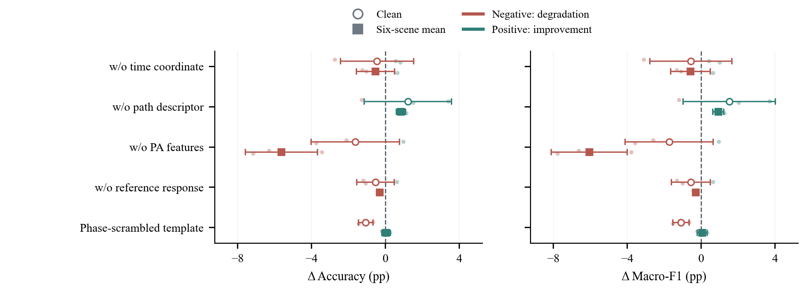
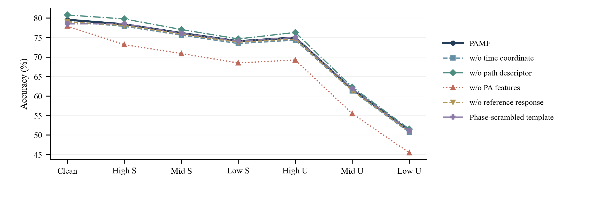
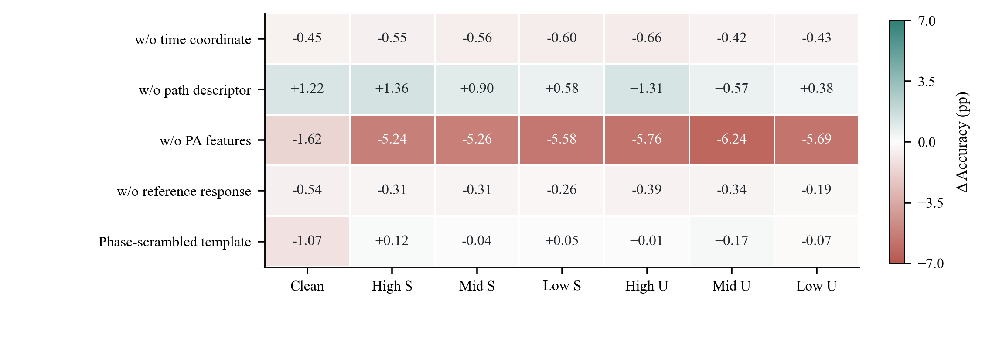

# PAMF网络分支消融：跨日跨接收机泛化

仅分类损失的监督训练 · IEEE 双栏版 · 2026-10-26

## 实验范围

本报告只使用日期与接收机同时未见的测试群体，以及PAMF直接识别的冻结结果。标准六类划分中，训练使用源接收机的三天数据，测试使用7个目标接收机在另一较早日期的观测；每景42000包。该日期早于训练日期，不解释为未来日期外推。

识别器采用仅分类损失的监督控制配方，保留原输入与信道增强设置，既有默认分类头联合训练。完整网络与五个结构变体均使用相同划分和50轮预算，每组3个独立模型种子，共18个已完成模型。本文没有新增训练、预测或目标真值访问。

每个模型的全部声明场景决策冻结后，由独立CPU完成评分。六景均值不含clean，先在每个种子内对六个信道场景等权平均，再报告三个种子的均值与样本标准差。宏平均F1按全部六类计算。所有指定变体、三个种子和七个场景均保留。

## 五项结构控制

| 结构变体 | 实际改动 |
|---|---|
| 去除显式时间坐标 | 保留路径描述及共享骨干，只去除描述中的显式时间坐标；不是删除时域骨干。 |
| 去除路径描述支路 | 完整移除SIG-TIME路径描述分支；基础时频表示继续训练。这就是“去SIG-TIME”，不能重复计为另一组。 |
| 去除功放相关支路 | 移除功放相关计算和统计投影，其他结构继续按同预算训练。 |
| 去除参考响应支路 | 移除公共参考响应及其投影，保留其他身份表示。 |
| 打乱参考模板相位 | 固定扰乱公共模板频谱相位并保留幅度谱；训练与测试使用同一模板。 |

## 完整结果

| 网络结构 | clean准确率（%） | clean宏平均F1（%） | 六景准确率（%） | 六景宏平均F1（%） |
|---|---|---|---|---|
| 完整 PAMF | 79.59±2.46 | 78.88±2.51 | 69.44±0.66 | 69.07±0.69 |
| 去除显式时间坐标 | 79.14±2.13 | 78.33±2.22 | 68.91±0.51 | 68.49±0.46 |
| 去除路径描述支路 | 80.81±1.20 | 80.40±1.23 | 70.29±0.44 | 70.00±0.48 |
| 去除功放相关支路 | 77.97±1.16 | 77.15±1.02 | 63.81±2.20 | 63.01±2.41 |
| 去除参考响应支路 | 79.05±1.45 | 78.33±1.46 | 69.14±0.60 | 68.79±0.60 |
| 打乱参考模板相位 | 78.52±2.14 | 77.78±2.17 | 69.48±0.58 | 69.13±0.64 |

## 相对完整 PAMF 的变化

相对变化统一定义为变体减完整PAMF，同种子相减后再统计。负值表示性能下降，正值表示性能提高；±表示三个配对差的样本标准差，不是置信区间，也不是两组标准差相加。暖红与青绿分别标记下降和提高，图中同时使用正负号与点形，避免只依赖颜色。

| 结构变体 | clean准确率Δ（百分点） | clean宏平均F1Δ（百分点） | 六景准确率Δ（百分点） | 六景宏平均F1Δ（百分点） |
|---|---|---|---|---|
| 去除显式时间坐标 | -0.45±1.98 | -0.55±2.22 | -0.54±1.04 | -0.58±1.08 |
| 去除路径描述支路 | +1.22±2.36 | +1.53±2.50 | +0.85±0.25 | +0.94±0.29 |
| 去除功放相关支路 | -1.62±2.40 | -1.73±2.38 | -5.63±1.95 | -6.06±2.06 |
| 去除参考响应支路 | -0.54±1.02 | -0.55±1.05 | -0.30±0.06 | -0.28±0.12 |
| 打乱参考模板相位 | -1.07±0.40 | -1.09±0.44 | +0.04±0.23 | +0.06±0.27 |

## 逐场景表现

| 网络结构 | clean | 高郊区 | 中郊区 | 低郊区 | 高城市 | 中城市 | 低城市 |
|---|---|---|---|---|---|---|---|
| 完整 PAMF | 79.59 | 78.43 | 76.18 | 74.09 | 75.02 | 61.76 | 51.18 |
| 去除显式时间坐标 | 79.14 | 77.89 | 75.62 | 73.48 | 74.37 | 61.34 | 50.75 |
| 去除路径描述支路 | 80.81 | 79.79 | 77.08 | 74.66 | 76.33 | 62.33 | 51.56 |
| 去除功放相关支路 | 77.97 | 73.19 | 70.92 | 68.50 | 69.27 | 55.52 | 45.49 |
| 去除参考响应支路 | 79.05 | 78.12 | 75.87 | 73.83 | 74.63 | 61.42 | 50.99 |
| 打乱参考模板相位 | 78.52 | 78.55 | 76.14 | 74.13 | 75.03 | 61.93 | 51.11 |

## 结果解读

去除功放相关支路的六景准确率变化为-5.63±1.95个百分点，宏平均F1变化为-6.06±2.06个百分点。三个种子的六景准确率变化均为负，说明这一结构在当前监督配方与双重变化群体中有较一致的作用。clean变化的种子方向仍不完全一致，不能声称所有条件都同等受益。

去除路径描述支路的六景准确率变化为+0.85±0.25个百分点，三个种子方向均为正；clean变化为+1.22±2.36个百分点。该结果不支持在本测试群体中声称完整SIG-TIME支路必然提高识别性能，也不能由此直接改变其他训练配方的结构。

去除参考响应支路的六景变化为-0.30±0.06个百分点，三个种子均为负。打乱参考模板相位在clean下变化为-1.07±0.40个百分点，但六景变化为+0.04±0.23个百分点，接近零。参考支路收益与“真实模板相位必不可少”不是同一个命题。

去除显式时间坐标的六景变化为-0.54±1.04个百分点，两个种子下降、一个提高。该控制保留路径描述和骨干中的时域信息，不能把结果解释成移除了整个时间建模能力。

本报告按用户指定范围事后筛选展示项，未依据成绩删除种子、重排训练或选择性重跑。结论只适用于当前六类划分、监督分类目标和跨日跨接收机测试群体；不能外推到其他群体或训练目标。三个种子不足以支撑普遍显著性结论；单支路改动的条件差异也不是可相加的独立因果贡献。
