# PAMF与对比方法：按监督条件分组的实验报告

本报告首先区分监督学习与普通PL半监督，再区分训练信道增强、推理恢复链和测试人群。各方法的训练条件在表题、图题和Excel工作表中明确标注；不把监督PAMF与半监督外部方法混成一张主比较图。证据截止2026年10月25日，本次没有新增训练、预测或真值评分。

## 1  实验分组、数据与统计规则

表：报告矩阵：学习方式是第一层分组

| 学习方式 | 训练增强 | 报告测试 | 主方法与恢复器处理 |
|---|---|---|---|
| 监督 | 有信道增强 | 目标CLEAN＋六种practical；源RX未见日另列诊断 | RIEI、DRIFT、IB-RFF、SDG、PAMF、DURA+PAMF；DURA只用有标签源IQ |
| 普通PL半监督 | 有信道增强 | 目标CLEAN＋六种practical；源RX未见日另列诊断 | 同六种主比较项；DURA可用全部允许源训练IQ |
| 监督 | 无信道增强 | 仅目标接收机CLEAN | 四种外部方法单列；当前有增强PAMF不挪入本组 |
| 普通PL半监督 | 无信道增强 | 仅目标接收机CLEAN | 四种外部方法单列；不报告历史practical结果 |

每个学习组均有165个独立主比较识别器：四种外部方法各33个，PAMF33个。PAMF和DURA+PAMF复用同一个识别器，故每组展示198个模型与推理链组合，两组共330个独立主比较识别器。含无增强控制时，全部594个逻辑模型由监督297个、半监督297个组成。

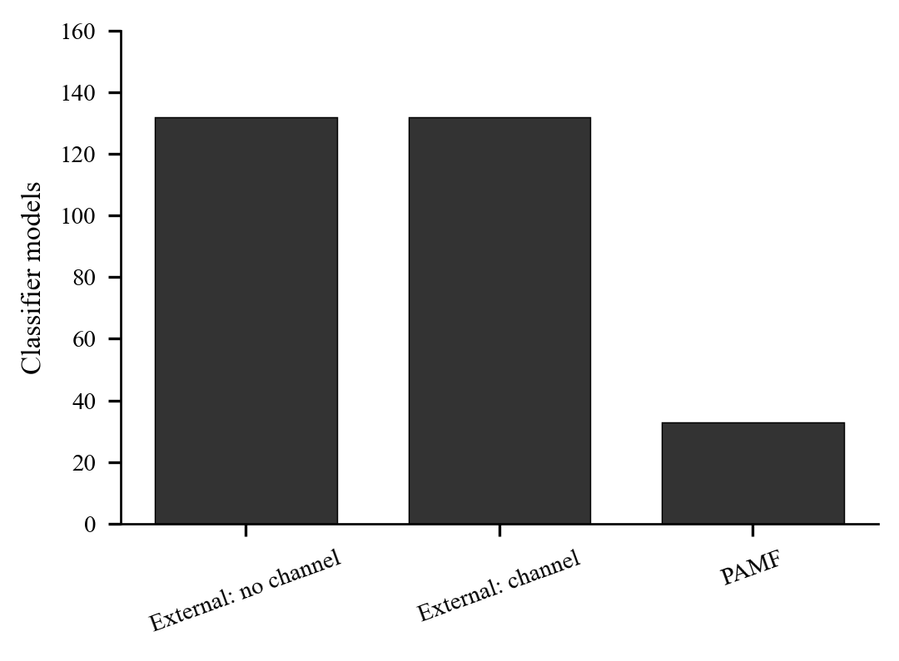

每种学习条件下均有132个无增强外部模型、132个有增强外部模型和33个PAMF模型。该图只统计覆盖，不比较跨学习条件的混合性能。

数据为WiSig地面代理。源日期为2021年3月8、15、23日，3月1日为更早的未见日期，不能解释为未来日期预测。三类互斥人群为源接收机跨日诊断、目标接收机跨RX、目标接收机与日期双跨。标准划分每景分别为30000、126000、42000包；ManyRx分别为31279、92597、30424包，不等样本单元不强行等权成总准确率。

表：源域划分与数据量；无标签池存在不等于监督组使用它

| 数据设置 | 类数 | 源RX数 | 有标签训练 | 无标签池 | 源验证 |
|---|---|---|---|---|---|
| 标准接收机划分 | 6 | 5 | 6300 | 56700 | 27000 |
| 接收机划分一 | 6 | 5 | 6300 | 56700 | 27000 |
| 接收机划分二 | 6 | 5 | 6300 | 56700 | 27000 |
| 大规模十类数据 | 10 | 16 | 6533 | 58828 | 28023 |
| 1%标注 | 6 | 5 | 630 | 62370 | 27000 |
| 5%标注 | 6 | 5 | 3150 | 59850 | 27000 |
| 1个源接收机 | 6 | 1 | 1260 | 11340 | 5400 |
| 2个源接收机 | 6 | 2 | 2520 | 22680 | 10800 |
| 3个源接收机 | 6 | 3 | 3780 | 34020 | 16200 |
| 4个源接收机 | 6 | 4 | 5040 | 45360 | 21600 |
| 6个源接收机 | 6 | 6 | 7560 | 68040 | 32400 |

监督识别器不读取无标签训练池。监督主系统的DURA也只使用有标签源集合的IQ；DURA不读取这些集合的发射机标签。半监督组的识别器按普通PL使用隐藏TX标签的源IQ，恢复器可使用全部允许源训练IQ。源验证不能更新模型状态；每行全部决策先冻结，再由独立CPU评分连接真值。

所有图均为竖向柱图。恢复网络实验采用双柱：同一方法未接入DURA与接入DURA，保持识别器、样本、场景与种子一致。变化值按种子内配对计算；误差线为三个模型种子的样本标准差，不是置信区间，也不自动表示显著性。三个识别器通常共用一份匹配恢复器，不能称为三套独立完整系统。

表：各方法的学习方式均显式区分

| 方法 | 监督组 | 普通PL半监督组 | 原生训练预算 |
|---|---|---|---|
| RIEI | 完整原生目标；关闭U训练 | 相同目标＋普通PL | 100轮，batch64，SGD，lr0.0001 |
| DRIFT | 完整原生目标；关闭U训练 | 相同目标＋普通PL | 100轮，batch256，Adam，lr0.0001 |
| IB-RFF | 原两阶段与HSIC0.04；关闭U训练 | 相同两阶段＋普通PL | 每阶段最多200轮，batch128；源NLL选模 |
| SDG | 原双视图与对比目标；关闭U训练 | 相同目标＋普通PL | 最多200轮，batch32；源NLL选模 |
| PAMF | 50轮全部仅L，11100更新，无U加载器 | 50轮13L＋37联合L/U，11100更新 | 默认头联合训练；不另训分类头 |

普通PL均采用当前模型eval/no_grad生成硬标签，阈值0.95、权重1、完整无标签批次平均，无EMA教师或复杂筛选。相同阈值不等于相同曝光剂量。外部有增强组保留0.68辅助分类槽，低郊区/中城市/低城市条件概率40%/35%/25%，施加概率依预算阶段为30%/60%/80%；无增强槽仍用原L。PAMF保留自身多视图有标签目标和三场景均匀抽取配方，监督版不是纯CE。

四种外部方法的主成绩默认直接识别。它们接入DURA后另列泛用性，不能把恢复后的成绩冒充识别方法本身。PAMF与DURA+PAMF在每个学习组均分列；监督组的完整系统不借用无标签源IQ恢复器。

## 监督实验结果

本节所有方法均属于监督。除单独标注的无增强CLEAN控制外，主比较均启用训练信道增强；RIEI、DRIFT、IB-RFF、SDG与PAMF直接识别，仅DURA+PAMF接入恢复器。

表：监督组：标准划分主比较，准确率均值±标准差（%）

| 测试人群/场景 | RIEI | DRIFT | IB-RFF | SDG | PAMF | DURA+PAMF |
|---|---|---|---|---|---|---|
| 源接收机跨日诊断 / CLEAN | 58.39±1.83 | 77.36±6.73 | 93.16±0.67 | 95.80±0.69 | 95.18±0.05 | 95.26±0.06 |
| 源接收机跨日诊断 / 六景平均 | 47.36±0.70 | 63.58±5.23 | 75.03±0.93 | 83.08±0.77 | 81.03±0.53 | 90.99±0.23 |
| 目标跨接收机 / CLEAN | 62.22±1.53 | 61.77±6.73 | 66.74±2.61 | 73.18±2.16 | 85.94±0.84 | 85.93±0.85 |
| 目标跨接收机 / 六景平均 | 50.08±1.60 | 55.22±5.28 | 53.10±1.83 | 65.16±2.03 | 71.29±0.90 | 77.36±0.55 |
| 目标日期与接收机双跨 / CLEAN | 61.25±1.51 | 60.70±8.85 | 66.13±3.36 | 70.95±2.19 | 81.33±1.27 | 81.29±1.28 |
| 目标日期与接收机双跨 / 六景平均 | 51.21±1.46 | 56.46±5.25 | 55.11±3.37 | 62.37±1.22 | 68.53±1.13 | 75.34±0.71 |

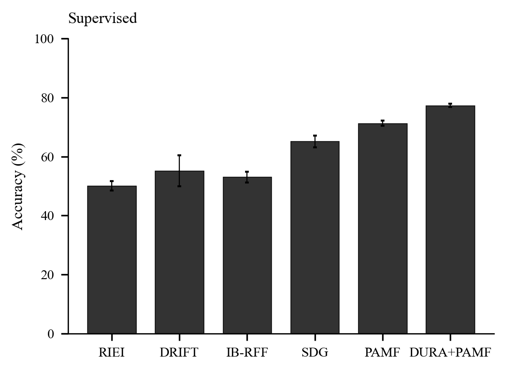

监督组有增强主比较：标准划分、目标跨接收机六景准确率。六项均属同一学习条件，外部方法未接入DURA。

表：监督组：11个设置的跨接收机六景准确率（%）

| 数据设置 | RIEI | DRIFT | IB-RFF | SDG | PAMF | DURA+PAMF |
|---|---|---|---|---|---|---|
| 标准接收机划分 | 50.08±1.60 | 55.22±5.28 | 53.10±1.83 | 65.16±2.03 | 71.29±0.90 | 77.36±0.55 |
| 接收机划分一 | 48.12±0.85 | 49.56±3.91 | 48.93±5.23 | 55.76±1.06 | 60.44±0.64 | 65.84±0.12 |
| 接收机划分二 | 51.67±0.36 | 58.54±1.94 | 57.94±0.13 | 62.11±1.36 | 69.72±0.56 | 74.99±0.25 |
| 大规模十类数据 | 25.43±2.16 | 37.20±2.49 | 49.86±2.78 | 61.29±0.78 | 63.39±0.29 | 71.96±0.03 |
| 1%标注 | 26.08±8.73 | 16.58±0.10 | 47.12±1.22 | 60.38±0.50 | 70.69±0.03 | 71.13±0.23 |
| 5%标注 | 42.83±4.15 | 38.81±4.92 | 53.18±2.29 | 63.16±1.39 | 71.24±0.51 | 74.92±0.76 |
| 1个源接收机 | 45.14±1.10 | 17.50±0.23 | 40.91±3.55 | 50.00±1.07 | 48.58±1.11 | 51.22±1.37 |
| 2个源接收机 | 37.38±1.82 | 21.46±9.69 | 41.30±1.83 | 52.87±3.53 | 59.39±0.70 | 63.66±1.96 |
| 3个源接收机 | 48.88±2.46 | 47.48±8.03 | 53.68±2.56 | 62.84±1.87 | 70.62±0.40 | 75.28±0.94 |
| 4个源接收机 | 50.14±2.08 | 50.35±8.73 | 55.13±2.28 | 61.75±0.73 | 68.91±0.29 | 74.28±0.16 |
| 6个源接收机 | 55.10±1.25 | 59.97±1.11 | 53.90±1.10 | 68.40±1.14 | 73.89±0.57 | 77.51±0.13 |

接收机重划分保持5源、7目标与日期/样本预算，三套源集合两两仅交一个接收机。每套使用自身匹配数据契约的模型与恢复器，不从标准划分初始化；三套划分不合并成九种子重复。

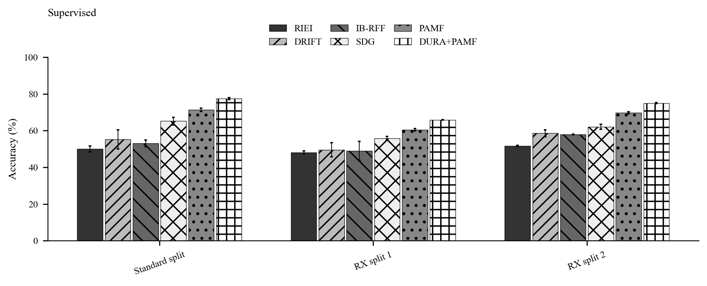

监督组：标准划分与两套接收机重划分的六景主结果。误差线为各设置内三个模型种子的标准差。

标注比例是相对源训练池的1%、5%、10%，对应630、3150、6300个有标签包，验证量均27000。源数量曲线只用1/2/3/4/6源并固定六目标，训练量也随源数改变；不插入标准5源/7目标点，不声称固定样本预算下纯接收机多样性的因果效果。

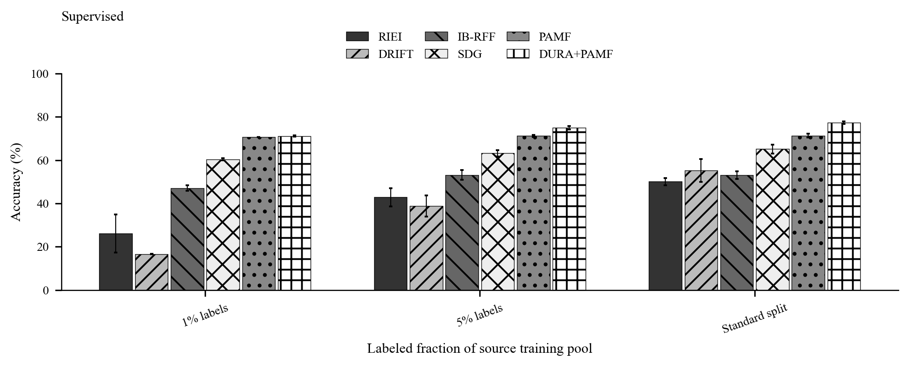

监督组：1%、5%、10%标注比例下的六景准确率，各组均报告全部六种主比较项。

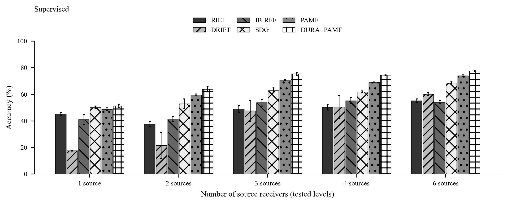

监督组：固定六目标的自然源数量结果，保留非单调变化；所有柱均属本学习条件。

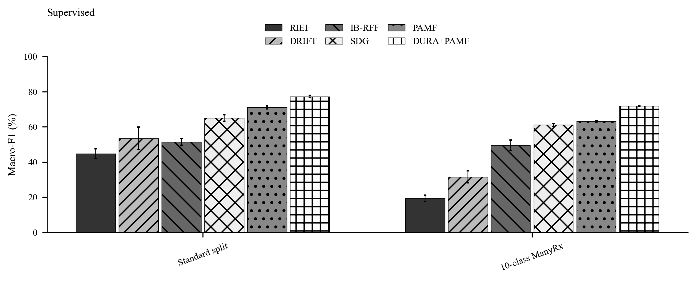

监督组：六类ManySig与十类ManyRx的六景Macro-F1。类别、接收机和样本量同时改变，只作规模条件对照。

表：监督组无增强控制：仅目标CLEAN准确率（%）

| 外部方法 | 目标跨RX CLEAN | 目标双跨CLEAN |
|---|---|---|
| RIEI | 66.93±0.71 | 64.89±1.09 |
| DRIFT | 66.21±3.30 | 66.16±3.34 |
| IB-RFF | 66.29±1.40 | 66.61±2.24 |
| SDG | 74.25±0.88 | 72.10±1.00 |

无增强页只展示同条件四种外部方法的CLEAN。当前PAMF主矩阵保留有标签信道视图，不搬入无增强组；缺少同条件项不补零、不用旧方法改名填齐。已冻结的无增强practical产物保留在历史包，本版不报告。

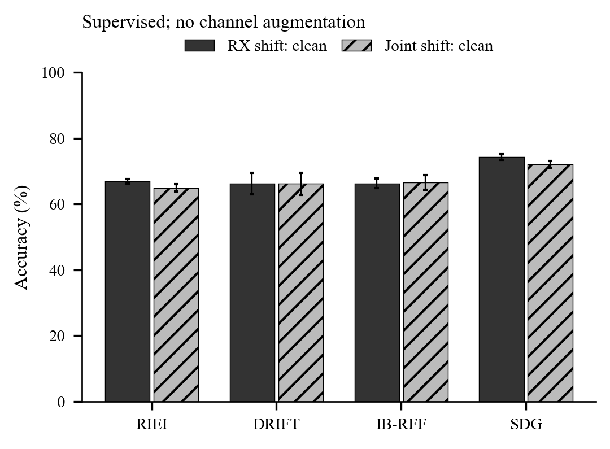

监督组无信道增强：只报告目标域CLEAN，跨RX与双跨分别成柱，均不经过DURA。

表：监督组有增强逐景主结果：标准划分跨RX准确率（%）

| 场景 | RIEI | DRIFT | IB-RFF | SDG | PAMF | DURA+PAMF |
|---|---|---|---|---|---|---|
| CLEAN | 62.22±1.53 | 61.77±6.73 | 66.74±2.61 | 73.18±2.16 | 85.94±0.84 | 85.93±0.85 |
| 高郊区 | 58.43±1.99 | 63.44±6.67 | 59.49±1.98 | 72.23±2.18 | 80.85±1.05 | 82.92±0.81 |
| 中郊区 | 56.20±1.99 | 61.12±6.34 | 58.23±2.02 | 70.61±2.11 | 78.34±1.02 | 81.32±0.68 |
| 低郊区 | 54.52±1.88 | 59.03±6.15 | 56.91±2.08 | 69.23±1.89 | 75.78±0.93 | 79.46±0.62 |
| 高城市 | 55.03±1.82 | 60.30±5.96 | 56.91±1.94 | 69.53±2.21 | 77.42±1.04 | 81.33±0.74 |
| 中城市 | 42.28±1.14 | 47.95±4.07 | 47.11±1.67 | 58.80±1.95 | 63.19±0.89 | 73.26±0.40 |
| 低城市 | 34.02±0.76 | 39.48±3.10 | 39.95±1.35 | 50.58±1.91 | 52.13±0.49 | 65.87±0.23 |

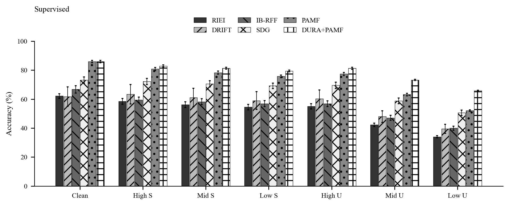

监督组有信道增强：CLEAN与全部六种practical逐景结果。只有DURA+PAMF在所有场景均经过恢复器，CLEAN也不旁路。

本组DURA泛用性固定每个外部识别器，只比较接入恢复器前后。同一输入与种子配对，恢复器仅使用有标签源训练集合IQ。结果不回流训练或参数选择。

表：监督组DURA泛用性：CLEAN，准确率%与配对百分点差

| 外部方法 | 未接DURA | 接入DURA | 配对变化（pp） |
|---|---|---|---|
| RIEI | 62.22±1.53 | 62.16±1.49 | -0.06±0.04 |
| DRIFT | 61.77±6.73 | 61.71±6.71 | -0.06±0.08 |
| IB-RFF | 66.74±2.61 | 66.77±2.59 | 0.02±0.03 |
| SDG | 73.18±2.16 | 73.25±2.16 | 0.07±0.10 |

表：监督组DURA泛用性：六种practical平均，准确率%与配对百分点差

| 外部方法 | 未接DURA | 接入DURA | 配对变化（pp） |
|---|---|---|---|
| RIEI | 50.08±1.60 | 57.59±0.75 | 7.52±1.56 |
| DRIFT | 55.22±5.28 | 57.05±4.48 | 1.84±2.28 |
| IB-RFF | 53.10±1.83 | 62.72±1.74 | 9.62±0.34 |
| SDG | 65.16±2.03 | 66.46±1.33 | 1.29±1.43 |

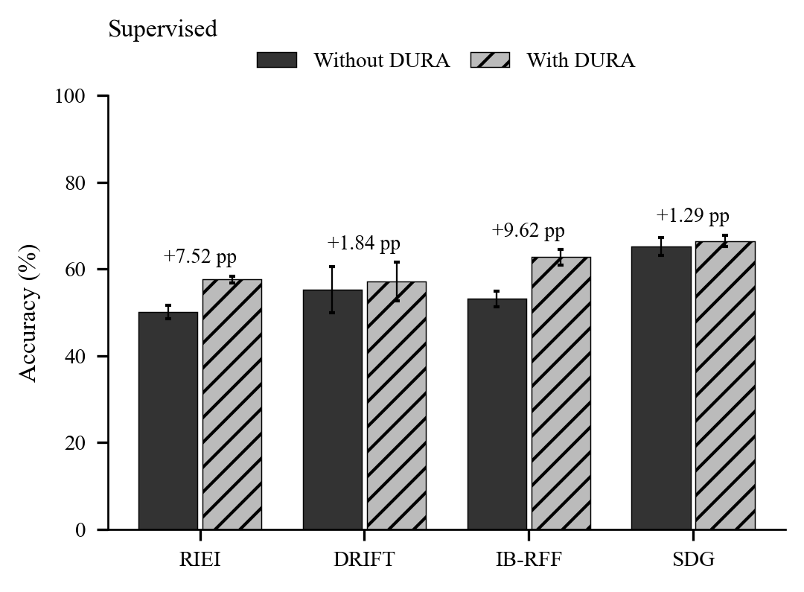

监督组DURA泛用性：标准划分、目标跨接收机六景准确率。每个方法左柱未接DURA、右柱接入DURA；柱顶为配对变化，保留负值。

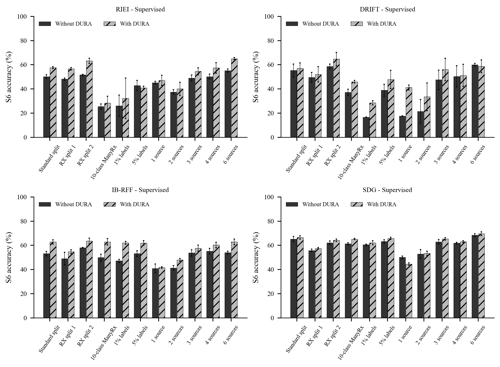

监督组：11个设置的目标跨接收机六景准确率，四种外部方法分别成面板；每一设置左柱未接DURA、右柱接入DURA。误差线为模型种子标准差，配对变化见数据表。

表：监督组PAMF恢复对照：标准划分六景准确率（%）

| 测试人群 | 未接DURA | 接入DURA | 配对变化（pp） |
|---|---|---|---|
| 源接收机跨日诊断 | 81.03±0.53 | 90.99±0.23 | 9.96±0.41 |
| 目标跨接收机 | 71.29±0.90 | 77.36±0.55 | 6.07±0.35 |
| 目标日期与接收机双跨 | 68.53±1.13 | 75.34±0.71 | 6.81±0.42 |

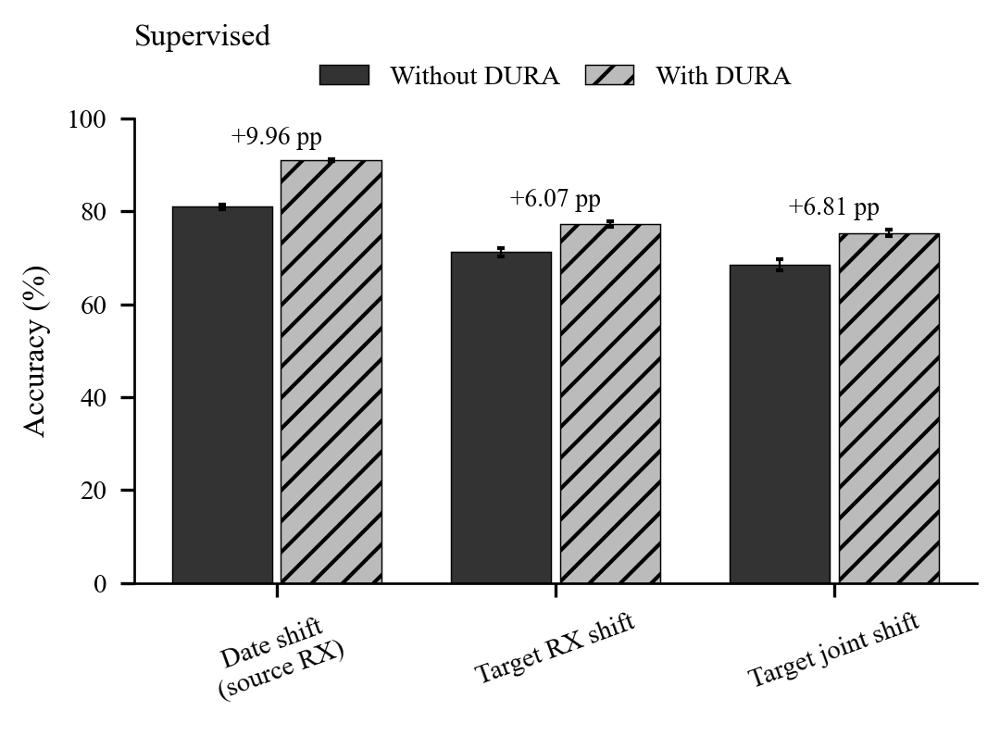

监督组PAMF恢复对照：标准划分、三类互斥人群的六景准确率，固定识别器与种子；变化值按种子配对，不含CLEAN。

表：监督识别器的实测时延：独占RTX3090、FP32

| 执行路径 | 批量 | 中位ms | P95 ms | IQ/秒 |
|---|---|---|---|---|
| 常规识别 | 1 | 7.4029 | 7.7351 | 135.1 |
| 常规识别 | 8 | 7.3559 | 7.7475 | 1087.6 |
| 常规识别 | 32 | 7.5352 | 7.9401 | 4246.7 |
| 常规识别 | 64 | 7.4890 | 8.0055 | 8545.8 |
| 常规识别 | 128 | 7.4365 | 7.8096 | 17212.4 |
| DURA+PAMF优化图 | 1 | 4.5629 | 4.5821 | 219.2 |
| DURA+PAMF优化图 | 8 | 13.5081 | 13.6138 | 592.2 |
| DURA+PAMF优化图 | 32 | 26.5446 | 26.7811 | 1205.5 |
| DURA+PAMF优化图 | 64 | 13.9775 | 14.0779 | 4578.8 |
| DURA+PAMF优化图 | 128 | 14.5229 | 14.5857 | 8813.7 |

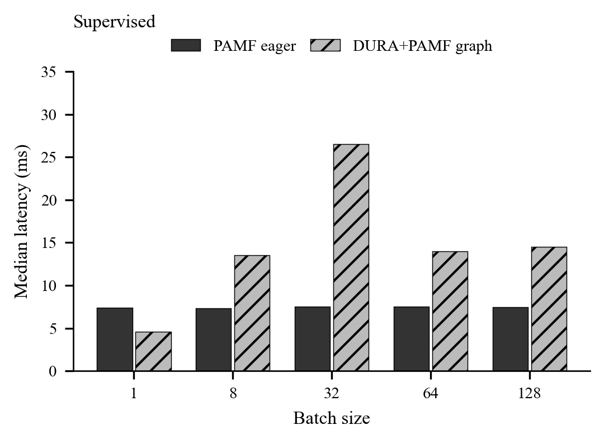

监督识别器的批量延迟竖柱图。两条路径分别为常规识别与DURA+PAMF优化图，5轮计时不是5个模型种子，不能把路径差当作恢复器算法加速。

## 普通PL半监督实验结果

本节所有方法均属于普通PL半监督。除单独标注的无增强CLEAN控制外，主比较均启用训练信道增强；RIEI、DRIFT、IB-RFF、SDG与PAMF直接识别，仅DURA+PAMF接入恢复器。

表：普通PL半监督组：标准划分主比较，准确率均值±标准差（%）

| 测试人群/场景 | RIEI | DRIFT | IB-RFF | SDG | PAMF | DURA+PAMF |
|---|---|---|---|---|---|---|
| 源接收机跨日诊断 / CLEAN | 58.47±1.74 | 71.42±1.79 | 92.89±0.58 | 96.10±0.72 | 95.40±0.23 | 95.49±0.23 |
| 源接收机跨日诊断 / 六景平均 | 47.57±0.67 | 59.32±1.88 | 74.32±4.69 | 82.99±0.55 | 81.00±0.36 | 92.07±0.13 |
| 目标跨接收机 / CLEAN | 61.63±1.89 | 66.12±3.20 | 66.63±2.29 | 74.32±1.52 | 86.04±0.36 | 86.08±0.34 |
| 目标跨接收机 / 六景平均 | 49.95±1.55 | 56.76±2.29 | 52.57±2.17 | 65.30±1.14 | 71.05±0.91 | 78.52±0.12 |
| 目标日期与接收机双跨 / CLEAN | 60.88±1.75 | 64.98±3.04 | 67.02±0.50 | 72.86±0.54 | 81.81±0.78 | 81.89±0.79 |
| 目标日期与接收机双跨 / 六景平均 | 51.11±1.45 | 57.00±2.11 | 56.35±1.33 | 63.59±1.63 | 68.29±1.12 | 76.75±0.47 |

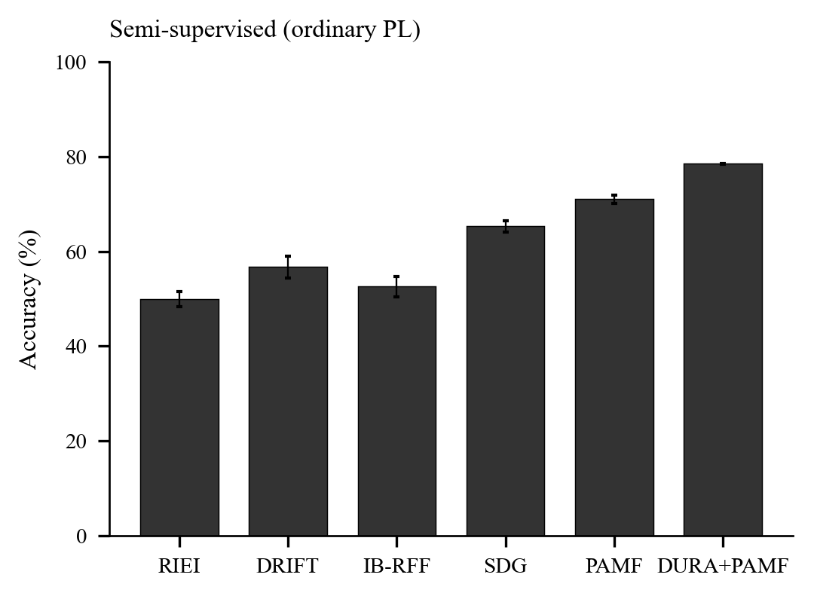

普通PL半监督组有增强主比较：标准划分、目标跨接收机六景准确率。六项均属同一学习条件，外部方法未接入DURA。

表：普通PL半监督组：11个设置的跨接收机六景准确率（%）

| 数据设置 | RIEI | DRIFT | IB-RFF | SDG | PAMF | DURA+PAMF |
|---|---|---|---|---|---|---|
| 标准接收机划分 | 49.95±1.55 | 56.76±2.29 | 52.57±2.17 | 65.30±1.14 | 71.05±0.91 | 78.52±0.12 |
| 接收机划分一 | 48.24±0.77 | 50.25±2.14 | 49.43±2.00 | 55.35±1.16 | 60.72±0.88 | 67.11±0.14 |
| 接收机划分二 | 51.75±0.31 | 54.57±2.00 | 56.56±3.01 | 60.66±0.21 | 69.64±0.57 | 74.64±0.23 |
| 大规模十类数据 | 25.58±1.98 | 34.09±3.23 | 48.59±2.74 | 61.40±0.54 | 63.31±0.43 | 72.44±0.18 |
| 1%标注 | 26.20±8.61 | 17.39±0.62 | 45.27±3.63 | 62.34±0.08 | 70.65±0.26 | 74.60±0.56 |
| 5%标注 | 42.90±4.07 | 35.73±1.15 | 51.83±0.65 | 63.62±1.48 | 71.00±0.30 | 76.28±0.62 |
| 1个源接收机 | 45.11±0.96 | 23.20±1.88 | 40.35±1.99 | 46.93±1.14 | 48.48±0.92 | 54.27±1.08 |
| 2个源接收机 | 37.56±2.13 | 36.05±4.27 | 40.44±3.12 | 53.11±2.01 | 59.25±0.64 | 63.19±1.69 |
| 3个源接收机 | 49.20±2.74 | 43.50±9.74 | 52.22±4.01 | 62.09±3.38 | 70.50±0.66 | 73.94±0.76 |
| 4个源接收机 | 50.23±1.96 | 52.59±1.52 | 54.22±2.12 | 62.75±2.54 | 68.97±0.32 | 74.39±0.59 |
| 6个源接收机 | 55.25±1.07 | 52.96±1.06 | 56.40±1.87 | 66.69±1.28 | 73.69±0.88 | 75.77±0.13 |

接收机重划分保持5源、7目标与日期/样本预算，三套源集合两两仅交一个接收机。每套使用自身匹配数据契约的模型与恢复器，不从标准划分初始化；三套划分不合并成九种子重复。

普通PL半监督组：标准划分与两套接收机重划分的六景主结果。误差线为各设置内三个模型种子的标准差。

标注比例是相对源训练池的1%、5%、10%，对应630、3150、6300个有标签包，验证量均27000。源数量曲线只用1/2/3/4/6源并固定六目标，训练量也随源数改变；不插入标准5源/7目标点，不声称固定样本预算下纯接收机多样性的因果效果。

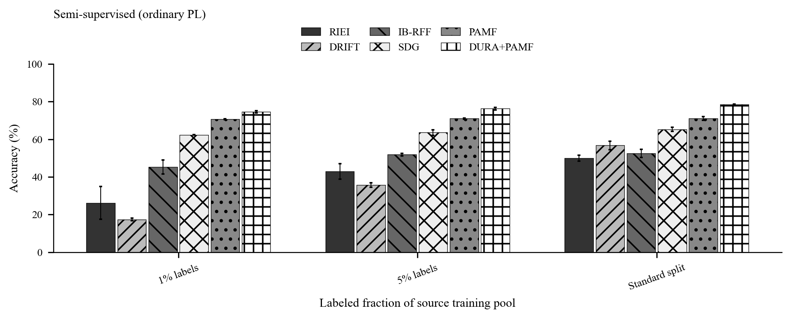

普通PL半监督组：1%、5%、10%标注比例下的六景准确率，各组均报告全部六种主比较项。

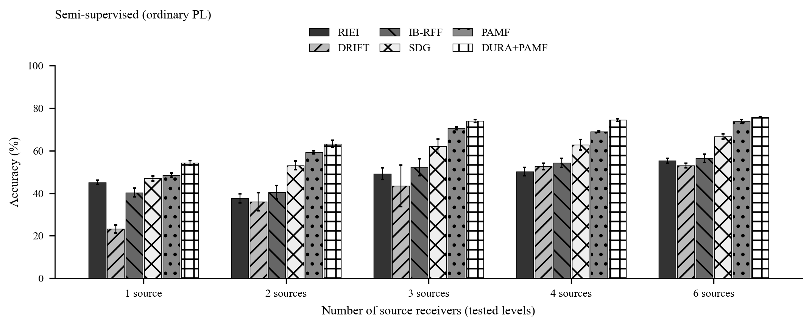

普通PL半监督组：固定六目标的自然源数量结果，保留非单调变化；所有柱均属本学习条件。

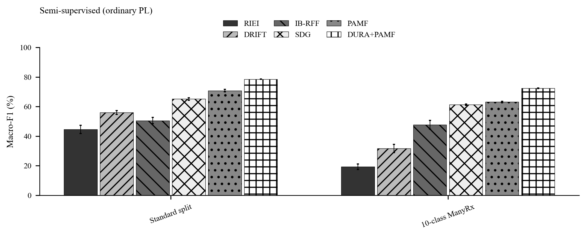

普通PL半监督组：六类ManySig与十类ManyRx的六景Macro-F1。类别、接收机和样本量同时改变，只作规模条件对照。

表：普通PL半监督组无增强控制：仅目标CLEAN准确率（%）

| 外部方法 | 目标跨RX CLEAN | 目标双跨CLEAN |
|---|---|---|
| RIEI | 67.28±0.88 | 65.16±1.21 |
| DRIFT | 67.69±1.71 | 66.70±1.12 |
| IB-RFF | 66.44±2.90 | 65.78±1.43 |
| SDG | 74.64±0.14 | 73.19±0.73 |

无增强页只展示同条件四种外部方法的CLEAN。当前PAMF主矩阵保留有标签信道视图，不搬入无增强组；缺少同条件项不补零、不用旧方法改名填齐。已冻结的无增强practical产物保留在历史包，本版不报告。

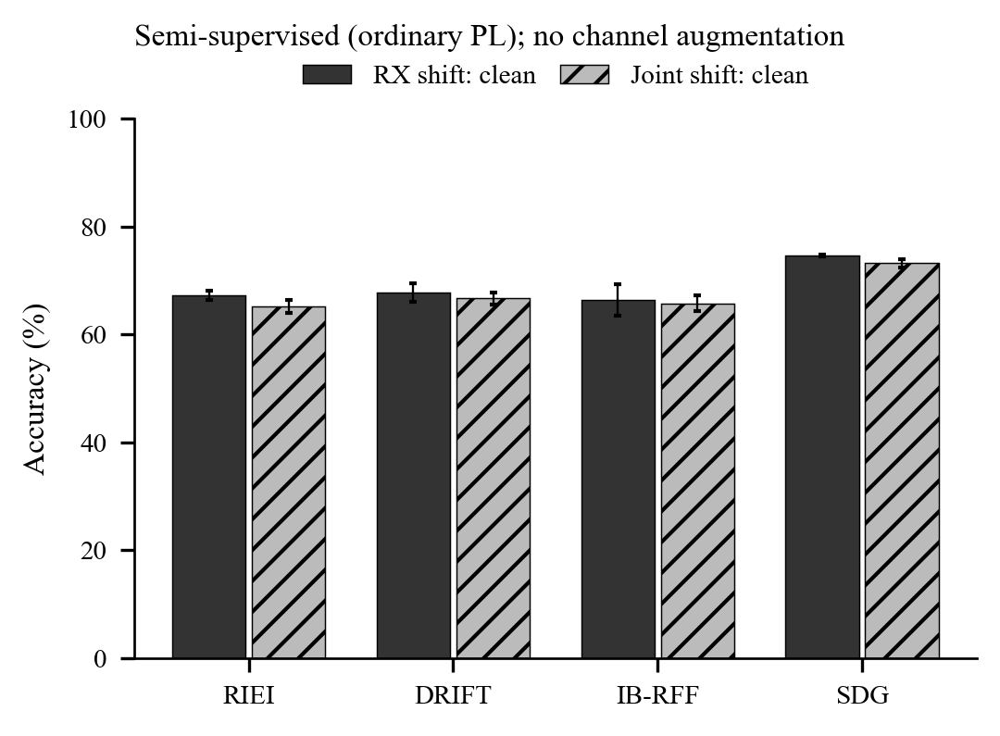

普通PL半监督组无信道增强：只报告目标域CLEAN，跨RX与双跨分别成柱，均不经过DURA。

表：普通PL半监督组有增强逐景主结果：标准划分跨RX准确率（%）

| 场景 | RIEI | DRIFT | IB-RFF | SDG | PAMF | DURA+PAMF |
|---|---|---|---|---|---|---|
| CLEAN | 61.63±1.89 | 66.12±3.20 | 66.63±2.29 | 74.32±1.52 | 86.04±0.36 | 86.08±0.34 |
| 高郊区 | 58.26±1.90 | 66.04±2.55 | 58.50±2.69 | 72.22±1.45 | 80.58±1.14 | 83.46±0.25 |
| 中郊区 | 56.06±1.95 | 63.08±2.42 | 57.41±2.39 | 70.60±1.34 | 78.05±1.04 | 82.03±0.15 |
| 低郊区 | 54.41±1.81 | 60.56±2.38 | 56.17±2.28 | 69.08±1.15 | 75.53±0.94 | 80.32±0.15 |
| 高城市 | 54.85±1.78 | 62.62±2.55 | 56.12±2.53 | 69.64±1.33 | 77.18±1.07 | 82.19±0.18 |
| 中城市 | 42.17±1.13 | 48.68±2.13 | 47.04±1.80 | 59.16±0.92 | 62.99±0.87 | 75.05±0.18 |
| 低城市 | 33.96±0.74 | 39.55±1.80 | 40.17±1.40 | 51.11±0.69 | 51.98±0.46 | 68.05±0.25 |

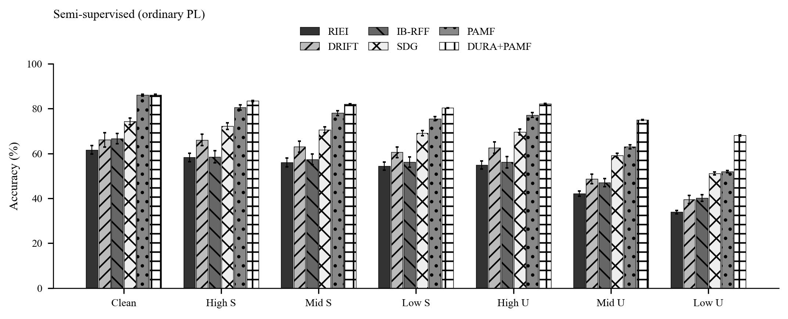

普通PL半监督组有信道增强：CLEAN与全部六种practical逐景结果。只有DURA+PAMF在所有场景均经过恢复器，CLEAN也不旁路。

本组DURA泛用性固定每个外部识别器，只比较接入恢复器前后。同一输入与种子配对，恢复器仅使用全部允许源训练IQ。结果不回流训练或参数选择。

表：普通PL半监督组DURA泛用性：CLEAN，准确率%与配对百分点差

| 外部方法 | 未接DURA | 接入DURA | 配对变化（pp） |
|---|---|---|---|
| RIEI | 61.63±1.89 | 61.68±1.85 | 0.05±0.05 |
| DRIFT | 66.12±3.20 | 66.11±3.18 | -0.01±0.01 |
| IB-RFF | 66.63±2.29 | 66.65±2.24 | 0.02±0.05 |
| SDG | 74.32±1.52 | 74.31±1.50 | -0.01±0.03 |

表：普通PL半监督组DURA泛用性：六种practical平均，准确率%与配对百分点差

| 外部方法 | 未接DURA | 接入DURA | 配对变化（pp） |
|---|---|---|---|
| RIEI | 49.95±1.55 | 56.73±0.91 | 6.77±0.89 |
| DRIFT | 56.76±2.29 | 60.75±4.42 | 4.00±4.28 |
| IB-RFF | 52.57±2.17 | 62.21±2.86 | 9.64±1.42 |
| SDG | 65.30±1.14 | 67.12±0.97 | 1.82±1.87 |

普通PL半监督组DURA泛用性：标准划分、目标跨接收机六景准确率。每个方法左柱未接DURA、右柱接入DURA；柱顶为配对变化，保留负值。

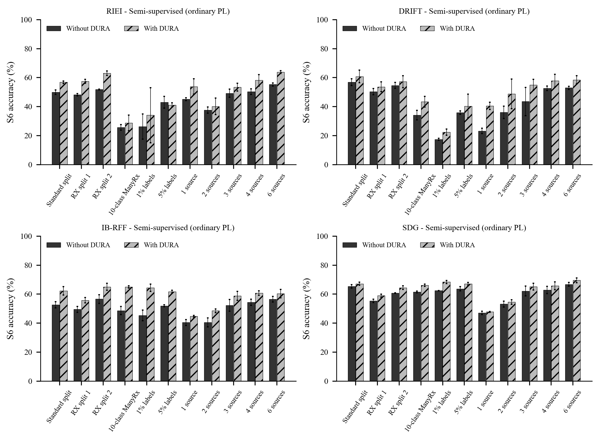

普通PL半监督组：11个设置的目标跨接收机六景准确率，四种外部方法分别成面板；每一设置左柱未接DURA、右柱接入DURA。误差线为模型种子标准差，配对变化见数据表。

表：普通PL半监督组PAMF恢复对照：标准划分六景准确率（%）

| 测试人群 | 未接DURA | 接入DURA | 配对变化（pp） |
|---|---|---|---|
| 源接收机跨日诊断 | 81.00±0.36 | 92.07±0.13 | 11.07±0.25 |
| 目标跨接收机 | 71.05±0.91 | 78.52±0.12 | 7.47±0.79 |
| 目标日期与接收机双跨 | 68.29±1.12 | 76.75±0.47 | 8.47±0.88 |

普通PL半监督组PAMF恢复对照：标准划分、三类互斥人群的六景准确率，固定识别器与种子；变化值按种子配对，不含CLEAN。

表：普通PL半监督识别器的实测时延：独占RTX3090、FP32

| 执行路径 | 批量 | 中位ms | P95 ms | IQ/秒 |
|---|---|---|---|---|
| 常规识别 | 1 | 7.4310 | 7.7949 | 134.6 |
| 常规识别 | 8 | 7.4652 | 7.9905 | 1071.6 |
| 常规识别 | 32 | 7.5759 | 8.1087 | 4223.9 |
| 常规识别 | 64 | 7.5067 | 7.9802 | 8525.7 |
| 常规识别 | 128 | 7.4950 | 8.1203 | 17078.1 |
| DURA+PAMF优化图 | 1 | 4.5657 | 4.5854 | 219.0 |
| DURA+PAMF优化图 | 8 | 13.5019 | 13.5335 | 592.5 |
| DURA+PAMF优化图 | 32 | 26.5107 | 26.6867 | 1207.1 |
| DURA+PAMF优化图 | 64 | 13.9635 | 14.0923 | 4583.4 |
| DURA+PAMF优化图 | 128 | 14.5251 | 14.5516 | 8812.3 |

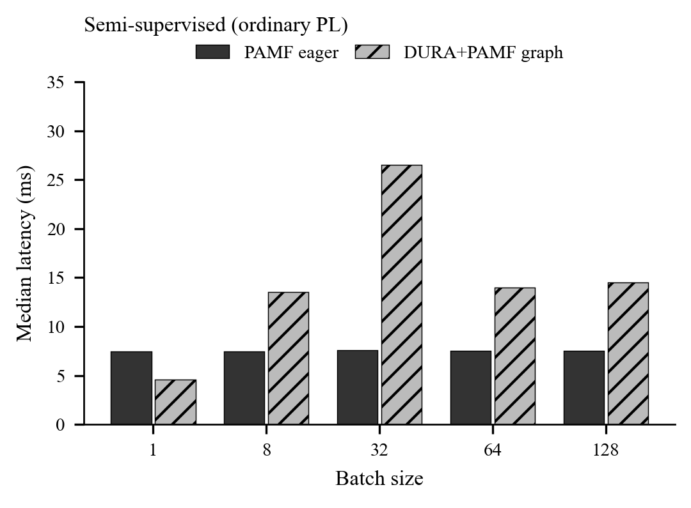

普通PL半监督识别器的批量延迟竖柱图。两条路径分别为常规识别与DURA+PAMF优化图，5轮计时不是5个模型种子，不能把路径差当作恢复器算法加速。

## 成本、缺项与可声明范围

监督与普通PL半监督分别比较，不把两者完整系统的分差全部归因于伪标签，因为匹配DURA的无标签IQ权限也不同。本版不把仅PAMF的监督/半监督控制混进其他方法未标明学习方式的主图。半监督264个外部模型中61个实际伪标签接受数为0：RIEI56个、DRIFT5个，均保留原结果，不调整阈值重跑。

当前PAMF主矩阵66个识别器，其中6个标准划分模型精确复用、60个此前新训。去重后此前新主矩阵成本为3000个模型轮、666000次更新、82.0506共享worker小时。它不是本次报告新训练，也不是独占GPU小时或墙钟时间；不能把先前全套已退出方案的8670轮全部计到普通PL。DURA本次新训练和新缓存均为0，历史祖先成本及缺失计时不能补零。

PAMF普通PL下的三核心八组合还缺9个训练模型，完整结构层还缺24个；若重建七个有标签细项还需21个。恢复器组件和交叉种子可分别补21、6行冻结读出，不需要重训DURA。这些不是已发布补实验。旧复杂无标签机制与已退出外推方案仅保留历史，不能改名成当前普通PL自身消融。

所有practical结果都是物理启发仿真压力测试，不是实测在轨链路。恢复收益不能证明完全分离硬件身份与信道，也不保证每种方法、每种场景都提高。原生预算、优化目标和曝光不同，不按轮数或参数量推断效率。方法选择已有公开基准背景，不称独立盲选。

## 附录  数据来源与可读名称追溯

表：仅用于追溯的原始记录字段

| 正文名称 | 原记录字段 | 含义 |
|---|---|---|
| 识别器 | F | 原默认头随骨干联合训练 |
| DURA恢复器 | G | 恢复接收IQ；不读取TX标签或识别器输出 |
| 监督组匹配恢复器 | G-L / DURA-L | 仅有标签源集合IQ，完整系统不读取U池 |
| 半监督组匹配恢复器 | G-LU / DURA-LU | 可用全部允许源训练IQ，U的TX标签仍隐藏 |
| 监督/半监督外部有增强组 | C / D | 两组性能分别成节、成图 |
| 监督/半监督外部无增强组 | A / B | 只报告目标域CLEAN |
| 普通PL识别器 | ordinary_PL / F21 | 当前半监督方案，标识不是方法版本名 |
| 历史教师/复杂门控配方 | T1 | 不是当前普通PL，不改名混入 |

科学源记录为20261023-phase1-practical-residual-full2x2-m600-r01及20261024-phase1-PAMF-REPL-completion-m201-r01。后者包含分别登记的监督与ordinary_PL行，历史run名称不决定每行实际方法。本报告只复用这些已冻结、独立评分统计，没有重新打开IQ、权重或逐样本目标真值。

PAMF60个新增主模型科学执行为dacafc8bfd7d3ef16e6f648cdc4491b65133ae8f；标准划分普通PL三模型精确复用原a462b7cf4c12a655e6c7a348ce2170a089f2d1cc。CPU评分恢复执行为a79bdf385489cb3822b37434a07e3c43e5ce839a，不是所有GPU训练的执行版本。

本版Excel按监督与半监督分别组织实验页，每页包含目的与设计、数据划分、竖柱图及双柱恢复对照、图表数据、完整结果。所有图保留PDF/SVG矢量和逐图数据CSV。新包不覆盖旧包，纯标准库核验器可从逐种子汇总复算均值与标准差。
