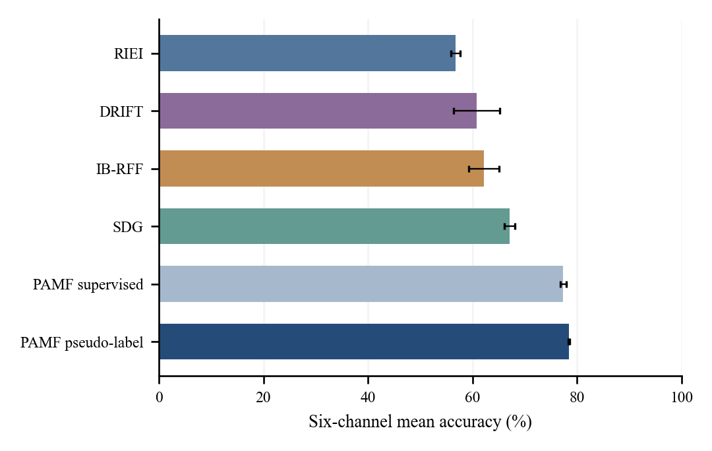
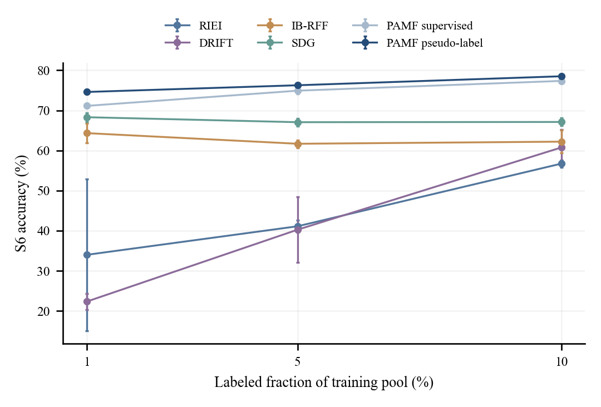
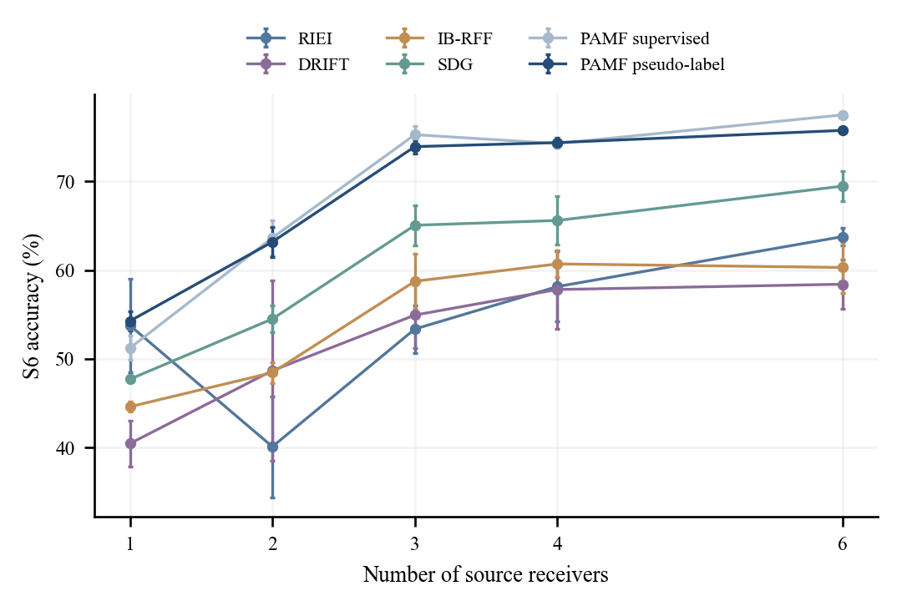
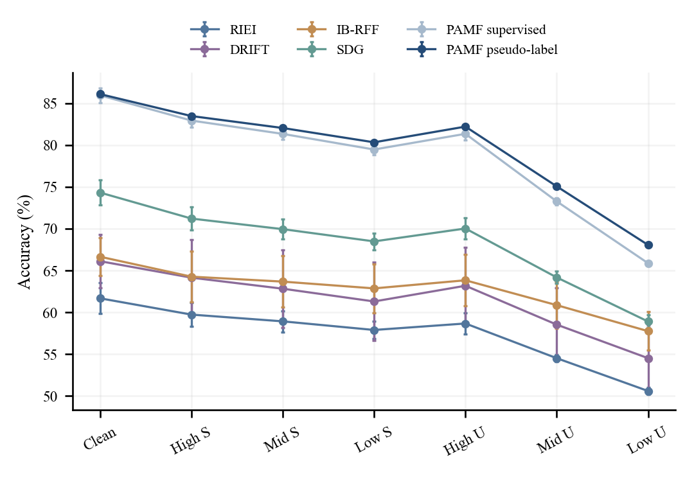

# PAMF 与四种对比方法实验报告

当前方案：PAMF 采用普通置信度伪标签；恢复部分沿用 DURA。证据截止：2026 年 10 月 25 日（香港）。本报告是对已冻结结果的重新组织，本次新增训练、预测和真值评分均为 0。

当前主比较保留 RIEI、DRIFT、IB-RFF、SDG 四种完整方法，以及 PAMF 的监督训练和普通伪标签训练。已退出的接收机外推伪标签方案不再作为当前 PAMF 主方法，也没有改名混入本报告。

标准接收机划分下，PAMF 经 DURA 恢复后的跨接收机六场景平均准确率为 78.5161±0.1221%；相对同一设置下的 SDG，三次训练内配对均值差为 11.3947±0.8521 个百分点。

在 11 个数据设置中，PAMF 普通伪标签版的恢复后六场景均值均高于这里固定设置的四种外部方法。但这比较的是公开披露的完整训练配方，不表示各方法全部可能设置下的最优成绩，也不是显著性检验。

标准接收机划分：经过恢复后的六场景平均准确率。图中方法名不带版本后缀；误差线是三次识别器训练的样本标准差。

最重要的解释边界：PAMF 的监督版仍保留表示学习与多视图损失，不是纯交叉熵网络；伪标签版与监督版比较时，必须另外固定恢复器的数据权限，才能讨论伪标签本身。

## 1  实验到底比较什么

IQ 指接收信号的同相、正交采样。测试链条只有两种：接收 IQ → 识别器 → 发射机类别；或接收 IQ → DURA 恢复器 → 识别器 → 发射机类别。前者在本报告叫“直接识别”，后者叫“恢复后识别”。

| 模块 | 负责的任务 | 本次怎样处理 |
|---|---|---|
| DURA 恢复器 | 把当前接收 IQ 变为恢复 IQ | 权重冻结；训练不读取发射机标签、识别器权重/输出或目标域数据；本次不重训 |
| PAMF 识别器 | 从 IQ 预测发射机类别 | 原骨干与原默认分类头联合训练；不另训分类头 |
| PAMF 监督训练 | 只用有标签源训练数据学习身份表示 | 保留有标签跨接收机对比、配对一致性及原信道视图；不建立无标签训练加载器 |
| PAMF 普通伪标签 | 在相同有标签配方上利用无标签源 IQ | 当前模型生成硬伪标签；置信度 0.95、权重 1；无教师模型和复杂筛选 |
| 四种外部方法 | 比较完整识别方法的实测表现 | 保留原生损失和分类头；统一增加可开关的信道辅助分类槽与普通伪标签 |

普通伪标签的实际定义：先把当前模型切到评估模式，在不计算梯度的情况下生成预测；只接受最大类别概率至少 0.95 的样本。再回到训练模式计算硬标签交叉熵，未接受样本贡献 0，损失仍除以整个无标签批次大小。

PAMF 的有标签批量为 128，无标签批量为 256；有标签端标签平滑为 0.01，普通伪标签交叉熵不加标签平滑。每次更新保留 6 个有标签包前向，共 768 个有标签包评估。累计 50 轮、11100 次更新，其中前 13 轮仅有标签，后 37 轮联合使用两类源训练数据；以 20＋10＋20 分段完成。

DURA 默认路径是双阶段展开恢复：两个学习先验调用、四次共轭梯度更新，固定 FP32 及既定优化图执行。它输出完整 256 点 IQ，不因测试场景不同而绕过恢复或额外归一化。恢复器当前有 266951 个唯一参数。

## 2  数据划分与测试任务

数据来自 WiSig 的 ManySig 与 ManyRx。除大规模十类数据外，其余设置均为 6 个发射机类别。源训练使用 2021 年 3 月 8、15、23 日；未见日期是更早的 3 月 1 日，不能称为未来日期预测。源和目标的物理记录保持原互斥划分。

| 数据设置 | 源接收机数 | 有标签训练 | 无标签训练 | 源验证 |
|---|---|---|---|---|
| 标准接收机划分 | 5 | 6300 | 56700 | 27000 |
| 接收机划分一 | 5 | 6300 | 56700 | 27000 |
| 接收机划分二 | 5 | 6300 | 56700 | 27000 |
| 大规模十类数据 | 16 | 6533 | 58828 | 28023 |
| 1% 标注 | 5 | 630 | 62370 | 27000 |
| 5% 标注 | 5 | 3150 | 59850 | 27000 |
| 1 个源接收机 | 1 | 1260 | 11340 | 5400 |
| 2 个源接收机 | 2 | 2520 | 22680 | 10800 |
| 3 个源接收机 | 3 | 3780 | 34020 | 16200 |
| 4 个源接收机 | 4 | 5040 | 45360 | 21600 |
| 6 个源接收机 | 6 | 7560 | 68040 | 32400 |

| 测试任务 | 接收机与日期组合 | 标准划分包数/视图 |
|---|---|---|
| 仅日期变化 | 源接收机，未见的 3 月 1 日 | 30000 |
| 仅接收机变化 | 目标接收机，训练所用的三个日期 | 126000 |
| 日期与接收机同时变化 | 目标接收机，未见的 3 月 1 日 | 42000 |

大规模十类数据实际分别为 31279、92597、30424 包/视图，单元样本数不等。1 至 6 个源接收机的自然预算曲线固定同六个目标接收机；5 源/7 目标的标准划分不插作曲线的 5 源点。源数量改变时，有标签、无标签和验证数据量一起变化。

1% 与 5% 表示相对于源训练池的标注比例；另有源验证标签，其数量独立披露。输入采用原均衡 IQ、中央 256 点窗口、信道变换前单位 RMS 归一化。每条物理记录的所有衍生视图保持同一物理身份。

## 3  外部方法与训练配方

| 方法 | 保留的完整目标 | 训练预算与冻结规则 |
|---|---|---|
| RIEI | 身份/接收机表征、分类及独立性相关目标；保留交替优化 | 100 轮；批量 64；SGD，学习率 0.0001；最终轮冻结 |
| DRIFT | 身份与接收机分支、对抗域目标、中心及分离相关目标 | 100 轮；批量 256；Adam，学习率 0.0001；最终轮冻结 |
| IB-RFF | 两阶段训练；第二阶段保留作者 HSIC 项，系数 0.04 | 每阶段最多 200 轮；批量 128；Adam，学习率 0.001；源验证 NLL 选模，降学习率/早停耐心 5/10 |
| SDG | 原生双视图、身份对比和域对抗对比目标 | 最多 200 轮；批量 32；Adam，学习率 0.001；源验证 NLL 选择 checkpoint |
| PAMF | 相同骨干/默认头及原有标签表示学习；按监督/普通伪标签区分 | 50 轮，11100 次更新；原优化器与分段日程；固定最终权重 |

这里比较的是经过输入长度、类别数及本项目数据接口适配的完整方法实现。RIEI 使用登记的一维短输入 stem；完整损失保留不等于逐字运行作者未适配脚本。各方法原生预算和优化步骤不同，不把相同轮数当作相同算力。

| 外部训练设置 | 附加信道增强 | 普通伪标签 | 识别器使用的源训练数据 |
|---|---|---|---|
| 无信道＋监督 | 关闭 | 关闭 | 只有有标签训练集合 |
| 无信道＋伪标签 | 关闭 | 启用 | 有标签与无标签训练集合 |
| 有信道＋监督 | 启用 | 关闭 | 只有有标签训练集合 |
| 有信道＋伪标签（主比较） | 启用 | 启用 | 有标签与无标签训练集合 |

四种设置都保留权重 0.68 的附加分类槽：无信道或未抽中变换时，槽中使用原始有标签 IQ。因此“无信道”不是删掉辅助损失，也不删除 SDG 自己的原生增强。信道辅助视图从原有标签 IQ 生成。

外部增强使用真实 practical residual 路径：训练场景为低郊区/中城市/低城市，条件概率 40%/35%/25%；按最大预算前 20%、20% 至 45%、后 55% 采用 30%/60%/80% 的施加概率。IB-RFF 各阶段重置预算进度。实际早停曝光量以记录为准。

PAMF 的原有标签信道视图在这三个环境中均匀抽取；普通伪标签与监督控制沿同一有标签配方。它不是外部 0.68 拼接配方的逐项相同复制。外部无标签/有标签批量比例为 1，PAMF 为 2；阈值与损失定义相同，不代表所有曝光剂量相同。

## 4  标准划分：三种泛化任务的主结果

表中均为准确率%，三次不同模型初始化的均值±样本标准差。clean 是未叠加新增信道的观测；“六景平均”先在同一次训练内平均六种信道，再汇总三次训练。外部主比较固定为有信道增强、有普通伪标签的完整训练，不按测试成绩选格。

直接识别

| 测试设置 | RIEI | DRIFT | IB-RFF | SDG | PAMF 监督 | PAMF 伪标签 |
|---|---|---|---|---|---|---|
| 跨日 / clean | 58.47±1.74 | 71.42±1.79 | 92.89±0.58 | 96.10±0.72 | 95.18±0.05 | 95.40±0.23 |
| 跨日 / 六景平均 | 47.57±0.67 | 59.32±1.88 | 74.32±4.69 | 82.99±0.55 | 81.03±0.53 | 81.00±0.36 |
| 跨接收机 / clean | 61.63±1.89 | 66.12±3.20 | 66.63±2.29 | 74.32±1.52 | 85.94±0.84 | 86.04±0.36 |
| 跨接收机 / 六景平均 | 49.95±1.55 | 56.76±2.29 | 52.57±2.17 | 65.30±1.14 | 71.29±0.90 | 71.05±0.91 |
| 跨日＋跨接收机 / clean | 60.88±1.75 | 64.98±3.04 | 67.02±0.50 | 72.86±0.54 | 81.33±1.27 | 81.81±0.78 |
| 跨日＋跨接收机 / 六景平均 | 51.11±1.45 | 57.00±2.11 | 56.35±1.33 | 63.59±1.63 | 68.53±1.13 | 68.29±1.12 |

恢复后识别

| 测试设置 | RIEI | DRIFT | IB-RFF | SDG | PAMF 监督 | PAMF 伪标签 |
|---|---|---|---|---|---|---|
| 跨日 / clean | 58.50±1.72 | 71.39±1.84 | 92.84±0.58 | 96.10±0.70 | 95.26±0.06 | 95.49±0.23 |
| 跨日 / 六景平均 | 57.87±1.40 | 70.54±0.52 | 90.50±0.16 | 91.45±0.21 | 90.99±0.23 | 92.07±0.13 |
| 跨接收机 / clean | 61.68±1.85 | 66.11±3.18 | 66.65±2.24 | 74.31±1.50 | 85.93±0.85 | 86.08±0.34 |
| 跨接收机 / 六景平均 | 56.73±0.91 | 60.75±4.42 | 62.21±2.86 | 67.12±0.97 | 77.36±0.55 | 78.52±0.12 |
| 跨日＋跨接收机 / clean | 60.92±1.68 | 64.90±3.12 | 66.99±0.49 | 72.87±0.54 | 81.29±1.28 | 81.89±0.79 |
| 跨日＋跨接收机 / 六景平均 | 57.11±0.72 | 59.78±3.53 | 62.84±0.98 | 65.66±0.76 | 75.34±0.71 | 76.75±0.47 |

恢复后比较中，监督 PAMF 的恢复器只用有标签源集合的 IQ；伪标签 PAMF 和四种外部主比较的恢复器可用有标签＋无标签源训练 IQ。完整系统比较允许这个权限差别；要把变化解释为伪标签本身，需要第 8 节的固定恢复器对照。

## 5  全部数据设置：跨接收机六景结果

直接识别：准确率均值±标准差（%）

| 测试设置 | RIEI | DRIFT | IB-RFF | SDG | PAMF 监督 | PAMF 伪标签 |
|---|---|---|---|---|---|---|
| 标准接收机划分 | 49.95±1.55 | 56.76±2.29 | 52.57±2.17 | 65.30±1.14 | 71.29±0.90 | 71.05±0.91 |
| 接收机划分一 | 48.24±0.77 | 50.25±2.14 | 49.43±2.00 | 55.35±1.16 | 60.44±0.64 | 60.72±0.88 |
| 接收机划分二 | 51.75±0.31 | 54.57±2.00 | 56.56±3.01 | 60.66±0.21 | 69.72±0.56 | 69.64±0.57 |
| 大规模十类数据 | 25.58±1.98 | 34.09±3.23 | 48.59±2.74 | 61.40±0.54 | 63.39±0.29 | 63.31±0.43 |
| 1% 标注 | 26.20±8.61 | 17.39±0.62 | 45.27±3.63 | 62.34±0.08 | 70.69±0.03 | 70.65±0.26 |
| 5% 标注 | 42.90±4.07 | 35.73±1.15 | 51.83±0.65 | 63.62±1.48 | 71.24±0.51 | 71.00±0.30 |
| 1 个源接收机 | 45.11±0.96 | 23.20±1.88 | 40.35±1.99 | 46.93±1.14 | 48.58±1.11 | 48.48±0.92 |
| 2 个源接收机 | 37.56±2.13 | 36.05±4.27 | 40.44±3.12 | 53.11±2.01 | 59.39±0.70 | 59.25±0.64 |
| 3 个源接收机 | 49.20±2.74 | 43.50±9.74 | 52.22±4.01 | 62.09±3.38 | 70.62±0.40 | 70.50±0.66 |
| 4 个源接收机 | 50.23±1.96 | 52.59±1.52 | 54.22±2.12 | 62.75±2.54 | 68.91±0.29 | 68.97±0.32 |
| 6 个源接收机 | 55.25±1.07 | 52.96±1.06 | 56.40±1.87 | 66.69±1.28 | 73.89±0.57 | 73.69±0.88 |

恢复后识别：准确率均值±标准差（%）

| 测试设置 | RIEI | DRIFT | IB-RFF | SDG | PAMF 监督 | PAMF 伪标签 |
|---|---|---|---|---|---|---|
| 标准接收机划分 | 56.73±0.91 | 60.75±4.42 | 62.21±2.86 | 67.12±0.97 | 77.36±0.55 | 78.52±0.12 |
| 接收机划分一 | 57.39±1.31 | 53.60±3.33 | 55.68±1.82 | 58.84±1.15 | 65.84±0.12 | 67.11±0.14 |
| 接收机划分二 | 62.96±1.55 | 57.15±4.16 | 65.00±2.36 | 64.34±1.25 | 74.99±0.25 | 74.64±0.23 |
| 大规模十类数据 | 28.70±5.43 | 43.34±3.64 | 64.99±0.77 | 66.07±0.75 | 71.96±0.03 | 72.44±0.18 |
| 1% 标注 | 33.99±18.93 | 22.33±2.03 | 64.34±2.47 | 68.31±1.09 | 71.13±0.23 | 74.60±0.56 |
| 5% 标注 | 41.11±1.49 | 40.26±8.18 | 61.69±0.97 | 67.06±0.94 | 74.92±0.76 | 76.28±0.62 |
| 1 个源接收机 | 53.77±5.27 | 40.44±2.59 | 44.60±0.57 | 47.71±0.32 | 51.22±1.37 | 54.27±1.08 |
| 2 个源接收机 | 40.10±5.69 | 48.68±10.18 | 48.45±1.20 | 54.50±1.47 | 63.66±1.96 | 63.19±1.69 |
| 3 个源接收机 | 53.37±2.68 | 54.94±3.77 | 58.75±3.13 | 65.07±2.26 | 75.28±0.94 | 73.94±0.76 |
| 4 个源接收机 | 58.15±3.94 | 57.82±4.44 | 60.71±1.53 | 65.61±2.70 | 74.28±0.16 | 74.39±0.59 |
| 6 个源接收机 | 63.78±0.97 | 58.42±2.75 | 60.31±2.88 | 69.48±1.66 | 77.51±0.13 | 75.77±0.13 |

不同设置有不同类数、训练量和目标接收机集合。这里逐设置比较，不把十类与六类样本混成一个总准确率，也不对这些设置计算一个隐藏权重的“总冠军分数”。

## 6  标注数量与源接收机数量

1%、5%、10%标注条件；10%使用标准划分。其余数据角色保持登记约定。

自然预算源数量：1、2、3、4、6个源接收机，固定六个目标接收机。横轴不是只改变多样性，也改变训练量。

PAMF 伪标签版恢复后六景均值从 1 源的 54.2681% 到 6 源的 75.7687%，但 3 源 73.9371% 与 4 源 74.3923% 接近。不能把非单调或小幅差异删去，也不能宣称固定标注预算下增加接收机必然提升。

## 7  逐信道场景与大规模十类结果

标准划分跨接收机、恢复后识别，准确率均值（%）；逐次训练与标准差保留于来源表。

| 测试场景 | RIEI | DRIFT | IB-RFF | SDG | PAMF 监督 | PAMF 伪标签 |
|---|---|---|---|---|---|---|
| clean | 61.68 | 66.11 | 66.65 | 74.31 | 85.93 | 86.08 |
| 高郊区 | 59.73 | 64.15 | 64.27 | 71.21 | 82.92 | 83.46 |
| 中郊区 | 58.93 | 62.83 | 63.67 | 69.94 | 81.32 | 82.03 |
| 低郊区 | 57.90 | 61.30 | 62.86 | 68.48 | 79.46 | 80.32 |
| 高城市 | 58.67 | 63.18 | 63.83 | 70.02 | 81.33 | 82.19 |
| 中城市 | 54.52 | 58.53 | 60.86 | 64.17 | 73.26 | 75.05 |
| 低城市 | 50.61 | 54.53 | 57.75 | 58.91 | 65.87 | 68.05 |

同一批冻结样本的逐景表现。高/中/低郊区与高/中/低城市均为物理启发仿真，不是实测卫星链路。

大规模十类数据的Macro-F1（%），始终覆盖全部10类。

| 十类数据端点 | RIEI | DRIFT | IB-RFF | SDG | PAMF 监督 | PAMF 伪标签 |
|---|---|---|---|---|---|---|
| 直接识别 / clean | 21.29±4.15 | 43.24±3.45 | 74.18±1.07 | 74.32±0.27 | 84.09±0.22 | 83.94±0.45 |
| 直接识别 / 六景平均 | 19.27±1.84 | 31.71±2.82 | 47.66±3.00 | 61.23±0.50 | 63.18±0.34 | 63.10±0.45 |
| 恢复后识别 / clean | 21.29±4.18 | 43.30±3.36 | 74.33±1.02 | 74.43±0.33 | 84.04±0.19 | 83.92±0.44 |
| 恢复后识别 / 六景平均 | 21.13±5.01 | 40.25±5.08 | 64.95±0.79 | 66.02±0.64 | 71.88±0.07 | 72.44±0.18 |

## 8  四种外部训练设置：不能只保留最高一格

直接识别：标准划分跨接收机六景准确率（%）

| 方法 | 无信道＋监督 | 无信道＋伪标签 | 有信道＋监督 | 有信道＋伪标签 |
|---|---|---|---|---|
| RIEI | 52.43±0.98 | 52.70±0.84 | 50.08±1.60 | 49.95±1.55 |
| DRIFT | 25.54±1.08 | 20.84±1.57 | 55.22±5.28 | 56.76±2.29 |
| IB-RFF | 14.21±3.49 | 16.02±2.91 | 53.10±1.83 | 52.57±2.17 |
| SDG | 56.08±3.95 | 57.01±0.78 | 65.16±2.03 | 65.30±1.14 |

恢复后识别：标准划分跨接收机六景准确率（%）

| 方法 | 无信道＋监督 | 无信道＋伪标签 | 有信道＋监督 | 有信道＋伪标签 |
|---|---|---|---|---|
| RIEI | 62.43±1.25 | 63.01±1.44 | 57.59±0.75 | 56.73±0.91 |
| DRIFT | 60.25±2.60 | 62.55±2.23 | 57.05±4.48 | 60.75±4.42 |
| IB-RFF | 62.20±0.64 | 61.43±1.79 | 62.72±1.74 | 62.21±2.86 |
| SDG | 66.81±0.74 | 68.48±0.61 | 66.46±1.33 | 67.12±0.97 |

四格里，信道效果在“相同伪标签开关”下比较；伪标签效果优先看直接识别结果。恢复后跨伪标签开关时，恢复器的无标签 IQ 权限也一起改变，差值属于完整系统变化。

直接识别的配对差（百分点）。所有负值保留，不把伪标签默认解释成增益。

| 方法 | 信道变化：无伪标签 | 信道变化：有伪标签 | 伪标签变化：无信道 | 伪标签变化：有信道 |
|---|---|---|---|---|
| RIEI | -2.36±0.64 | -2.75±0.73 | 0.27±0.20 | -0.13±0.24 |
| DRIFT | 29.68±6.30 | 35.91±3.84 | -4.70±2.50 | 1.54±7.05 |
| IB-RFF | 38.89±1.82 | 36.55±1.89 | 1.82±1.49 | -0.53±0.34 |
| SDG | 9.08±4.78 | 8.30±1.85 | 0.92±4.26 | 0.14±1.78 |

完整四格共 528 个外部模型。主表采用其中 132 个“有信道＋伪标签”模型，目的是固定比较设置；这不等于每种外部方法都在该格取得其最高分。完整表中能看到某些方法加信道或伪标签后反而降低。

## 9  PAMF：伪标签收益与恢复收益要分开

标准划分跨接收机六景准确率（%）

| 识别训练方式 | 直接识别 | 恢复器仅用有标签源 IQ | 恢复器使用全部允许源 IQ |
|---|---|---|---|
| PAMF（监督训练） | 71.29±0.90 | 77.36±0.55 | 78.37±0.43 |
| PAMF（普通伪标签） | 71.05±0.91 | 77.57±0.47 | 78.52±0.12 |

| 比较口径 | 配对均值差±标准差（百分点） |
|---|---|
| 直接识别：只增加普通伪标签 | -0.2352±0.1066 |
| 同一“仅有标签 IQ”恢复器：增加伪标签 | 0.2056±0.3186 |
| 同一“全部允许源 IQ”恢复器：增加伪标签 | 0.1422±0.3601 |
| 完整系统：伪标签识别器＋全部源 IQ 恢复器，对比监督系统 | 1.1563±0.4333 |

增加普通伪标签、固定恢复器：+0.1422 个百分点；直接识别：−0.2352 个百分点。

完整系统比较：+1.1563 个百分点。这里同时改变了恢复器训练数据范围，不能把全部差值归因于半监督。

在 11 个设置中，固定同一使用全部源训练 IQ 的恢复器，普通伪标签对监督识别器的六景均值在跨日为 11 个设置提高、跨接收机为 8 个提高、同时变化为 9 个提高。直接识别的跨接收机六景仅 2 个设置提高。选用普通伪标签作为暂定方法不等于已证明它在所有条件下都有效。

标准划分跨接收机六景：同一识别器恢复后减直接识别。

| 识别方法 | 加入匹配恢复器的配对差（百分点） |
|---|---|
| RIEI | 6.7746±0.8885 |
| DRIFT | 3.9972±4.2833 |
| IB-RFF | 9.6386±1.4242 |
| SDG | 1.8204±1.8656 |
| PAMF（监督训练） | 6.0738±0.3513 |
| PAMF（普通伪标签） | 7.4653±0.7901 |

## 10  实际训练曝光与成本

| 数据设置 | 单次训练无标签曝光最小值 | 最大值 | 三次合计接受率 |
|---|---|---|---|
| 标准接收机划分 | 2097900 | 2097900 | 94.85% |
| 接收机划分一 | 2097900 | 2097900 | 98.28% |
| 接收机划分二 | 2097900 | 2097900 | 95.95% |
| 大规模十类数据 | 2102784 | 2102784 | 77.82% |
| 1% 标注 | 2102784 | 2102784 | 92.92% |
| 5% 标注 | 2102784 | 2102784 | 94.81% |
| 1 个源接收机 | 2076144 | 2076144 | 99.48% |
| 2 个源接收机 | 2095088 | 2095088 | 96.05% |
| 3 个源接收机 | 2101748 | 2101748 | 95.92% |
| 4 个源接收机 | 2095088 | 2095088 | 95.99% |
| 6 个源接收机 | 2102784 | 2102784 | 94.95% |

曝光指加载参与伪标签判定的次数，不是不同物理样本个数；同一物理样本可跨轮重复。接受率按三次训练的接受数/曝光数合计计算，未把低接受率隐藏或把未接受样本从损失分母去掉。监督控制的无标签曝光为 0。

外部 264 个启用伪标签的模型中，61 个模型实际接受数为 0：RIEI 为 56 个，DRIFT 为 5 个，IB-RFF 与 SDG 为 0。它们仍属于启用同一置信度规则的有效负结果，不允许事后降低阈值重跑。

| 成本口径 | 核实数值与含义 |
|---|---|
| 当前 PAMF 两类主比较 | 66 个识别器：11 个设置×监督/伪标签×三次训练；其中 6 个标准划分模型精确复用，60 个此前新训 |
| 去重后的新 PAMF 主比较训练 | 3000 个模型轮、666000 次更新、82.0506 共享 worker 小时；不是本次报告新增训练 |
| 四种外部全部设置 | 528 个完整模型；原生双阶段训练与早停按实际记录，不把模型数当作阶段数 |
| 恢复器与缓存 | 本次新增训练 0、新建恢复 IQ 缓存 0；历史同契约恢复器祖先成本不能视为 0 |
| 没有混算的历史工作 | 此前全套 201 个 PAMF 模型的 8670 新模型轮和 265.9564 共享 worker 小时包含已退出方案；不能全记到当前普通伪标签主方法 |

共享 worker 小时来自各实际训练阶段的 elapsed 记录，已按唯一阶段去重。并发时它不是墙钟耗时或独占 GPU 小时。原标准划分一份恢复器的完整祖先计时未全部序列化，原缺失继续保留，不补零；技术失败的部分开销与成功模型成本分开。

## 11  现有工程效率证据

| 方法 | 执行路径 | 批量 | 中位延迟 ms | 95% 分位 ms | IQ/秒 |
|---|---|---|---|---|---|
| PAMF 监督 | 直接识别／常规执行 | 1 | 7.4029 | 7.7351 | 135.1 |
| PAMF 监督 | 直接识别／常规执行 | 128 | 7.4365 | 7.8096 | 17212.4 |
| PAMF 监督 | 恢复后识别／优化图执行 | 1 | 4.5629 | 4.5821 | 219.2 |
| PAMF 监督 | 恢复后识别／优化图执行 | 128 | 14.5229 | 14.5857 | 8813.7 |
| PAMF 伪标签 | 直接识别／常规执行 | 1 | 7.4310 | 7.7949 | 134.6 |
| PAMF 伪标签 | 直接识别／常规执行 | 128 | 7.4950 | 8.1203 | 17078.1 |
| PAMF 伪标签 | 恢复后识别／优化图执行 | 1 | 4.5657 | 4.5854 | 219.0 |
| PAMF 伪标签 | 恢复后识别／优化图执行 | 128 | 14.5251 | 14.5516 | 8812.3 |

测量使用独占 RTX3090、FP32、五轮计时重复。单包普通 PAMF 恢复后识别的中位延迟为 4.5657ms、95% 分位为 4.5854ms；含传输的 CPU 往返中位数为 4.6222ms。五轮是计时重复，不是五个训练模型。

单包“恢复后”比这里“直接识别”快，是因为两行采用不同执行路径：直接识别为常规执行，完整恢复链使用已有优化图。不能据此声称增加恢复器本身带来算法加速。大批量 128 时，恢复后完整链为 14.5251ms，直接识别为 7.4950ms，显示恢复链的实际额外计算。

这些是当前 PAMF 完整模型的实测数据。旧外部模型时延面板有其自己的权重和执行背景，本报告不把它改标成当前正确信道四种训练设置下最终权重的统一实测结果。四种外部最终权重与 PAMF 同卡同路径的直接效率排名仍需单独核对或补测，不能靠参数量推定。

共驻留显存不等于单模型峰值显存；CUDA 图缓冲区复用后的增量显存也不等于完整模型内存。缓存恢复 IQ 后的分类时间不能冒充在线“恢复＋识别”时间。

## 12  完成范围、论文安排与待补项目

| 实验模块 | 当前证据 | 处理建议 |
|---|---|---|
| 六方法主比较 | 198 模型，11 设置与三次训练，三种泛化、clean 与六景均已冻结评分 | 可直接写主文，不重训 |
| 四种外部增强/伪标签四格 | 528 模型、完整原生方法、所有正负结果 | 完整四格放附录；主表固定同一设置 |
| PAMF 监督与普通伪标签 | 66 模型，直接识别及两类恢复器均已读出 | 把识别器伪标签作用与恢复器无标签 IQ 作用分开 |
| PAMF 完整模型时延 | 监督与普通伪标签 100 个“设置×重复”计时组合已测 | 可用；说明执行路径、硬件和内存口径 |
| PAMF 结构与损失细项 | 监督无标签关闭格、严格交叉熵结构部分可沿用；原复杂方案的含无标签格不适用 | 单列自身实验报告；不得把旧方案改名 |
| 恢复器组件组合/交叉种子 | 恢复器训练权重可复用；旧识别器上的读出不是当前普通伪标签读出 | 需要时只补冻结读出，不重训 DURA |

建议主文依次呈现：数据与方法预算表、标准划分三类泛化结果、完整 11 设置跨接收机表、逐信道图、标注与源数量曲线、PAMF 固定恢复器公平性对照、实际效率与限制。完整四格、逐接收机/发射机/日期、完整混淆矩阵和负结果放补充材料。

当前不能声称：提出了一种新的半监督算法；普通伪标签在所有条件下必然有效；DURA 完全分离硬件身份与信道；仿真等于真实在轨验证；三个共用恢复器的识别器重复等于三套独立系统；或者当前暂定方法是从未暴露目标结果的独立盲选。

本次按用户要求先交付主比较报告，未发起补实验。更完整的自身消融梳理中，普通伪标签下三核心八组合还缺 9 个训练模型；完整普通伪标签结构层还缺 24 个训练模型；七个有标签细项若全部重建还需 21 个。恢复器组件与交叉种子可分别补 21、6 行冻结预测评分，不需要新恢复器训练。这些是待讨论的最小缺项，不是已发布队列。

## 附录  阅读名称与原始记录的对应

| 正文统一称呼 | 原始记录中的代号 | 解释 |
|---|---|---|
| 识别器 | F | 预测发射机身份的网络，当前 PAMF 默认头联合训练 |
| DURA 恢复器 | G | 先处理接收 IQ，再交给识别器 |
| 只用有标签源 IQ 的恢复器 | G-L / DURA-L | 集合有标签，但恢复器不读取发射机标签 |
| 使用全部允许源训练 IQ 的恢复器 | G-LU / DURA-LU | 使用有标签与无标签训练集合的 IQ，仍不读 TX 标签 |
| 直接识别 | raw | 不经过恢复器 |
| 普通伪标签 PAMF | ordinary_PL / F21 | 当前暂定半监督方法；F21 是兼容实现编号，不是新的论文方法名 |
| 旧版带教师与复杂筛选的识别器 | T1 | 历史方法；当前普通伪标签不继承其教师和筛选机制 |
| 已退出的外推伪标签方案 | PAMF-REPL | 历史对照，不能当作当前普通伪标签的消融 |
| 标准／接收机划分一／划分二 | F0 / F1_rx_repartition_r01 / F2_rx_repartition_r01 | 三套接收机成员不同、数量相同的训练数据划分 |
| 四种外部训练设置 | A / B / C / D | 对应无信道监督、无信道伪标签、有信道监督、有信道伪标签 |

标准源接收机索引为 1/3/4/6/8，接收机划分一为 0/1/2/5/7，接收机划分二为 0/3/9/10/11。三套源集合两两只交一个接收机；源日期保持相同。旧同名划分的不同成员不在本报告中冒充新划分。

源记录一：20261023-phase1-practical-residual-full2x2-m600-r01。本报告只取其中四种外部完整方法的 528 模型；旧 PAMF 配方没有混入当前主表。

源记录二：20261024-phase1-PAMF-REPL-completion-m201-r01。本报告只取其中监督/ordinary_PL 主比较 66 模型，以及已测 main_controls 时延；同一历史 run 名不决定其每行实际方法。

冻结统计来源为已交付 r17 包，完整序列化 CM 与净纠错已独立复算。本报告再次核对 20064 行汇总、60192 行总体逐次指标的三次覆盖，并从它们计算成对差；未重新打开 IQ、checkpoint 或逐样本目标真值。

表格文件：complete_summary.csv（全部四格及 PAMF 两类读出）；per_seed_overall.csv.gz（逐次指标）；paired_effects.csv（PAMF 监督/伪标签与恢复差）；external_factorial.csv（四格主效应/交互）；data_contracts.csv（原始集合与包数）；实际曝光、唯一训练阶段成本和时延另列。所有原始代号仅用于附录和机器可读追溯。

外部方法训练/接口执行分别沿原发布记录。PAMF 主比较 60 个新增模型的科学执行为 dacafc8bfd7d3ef16e6f648cdc4491b65133ae8f；标准划分精确复用模型沿各自原执行记录，其中普通伪标签三次模型为 a462b7cf4c12a655e6c7a348ce2170a089f2d1cc。独立 CPU 评分恢复执行为 a79bdf385489cb3822b37434a07e3c43e5ce839a，不能把它标成所有模型的训练版本。
