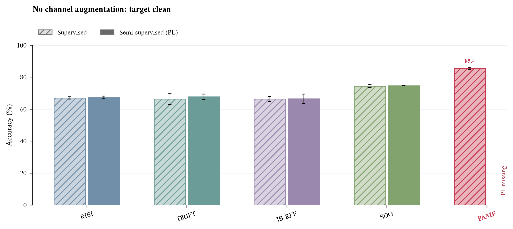
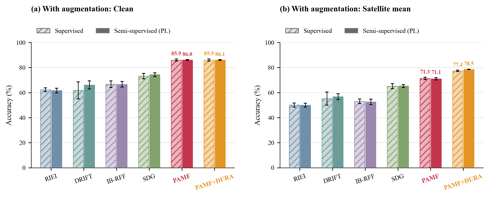
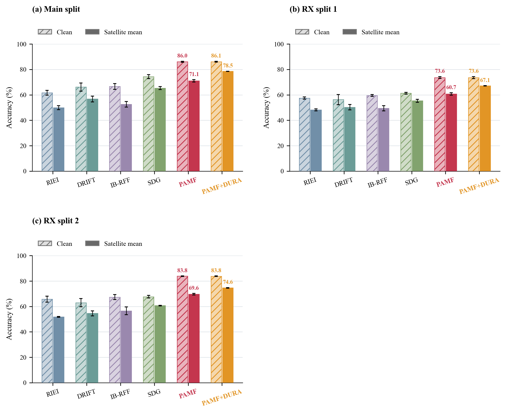
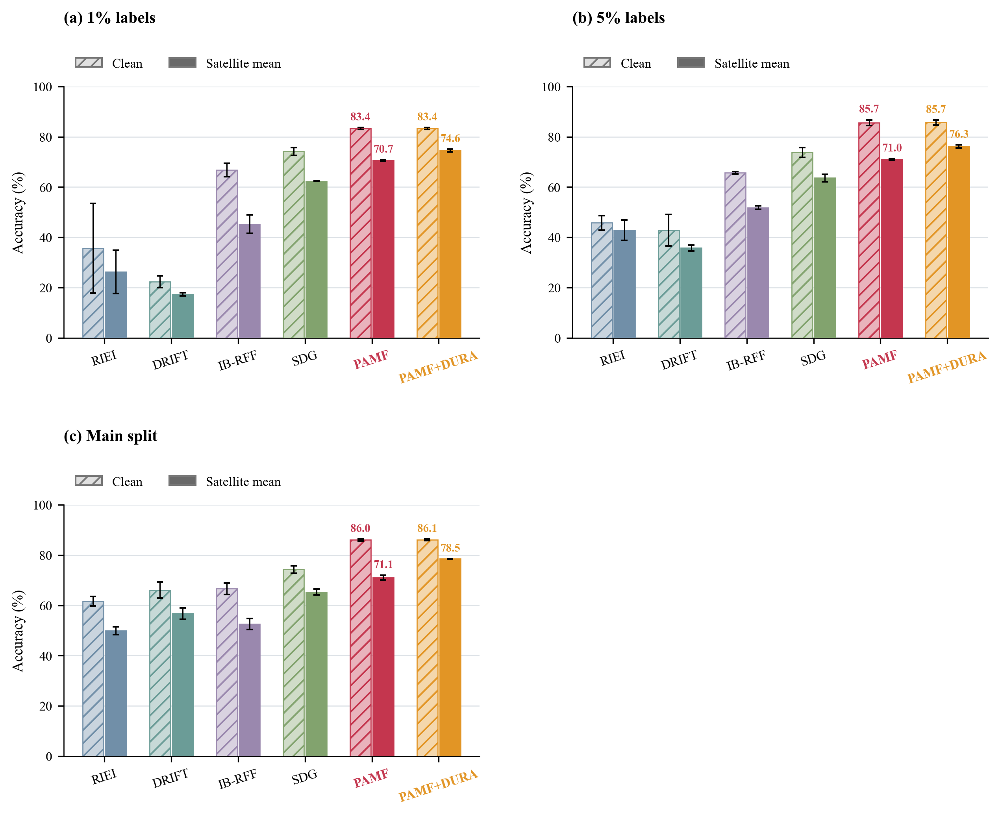
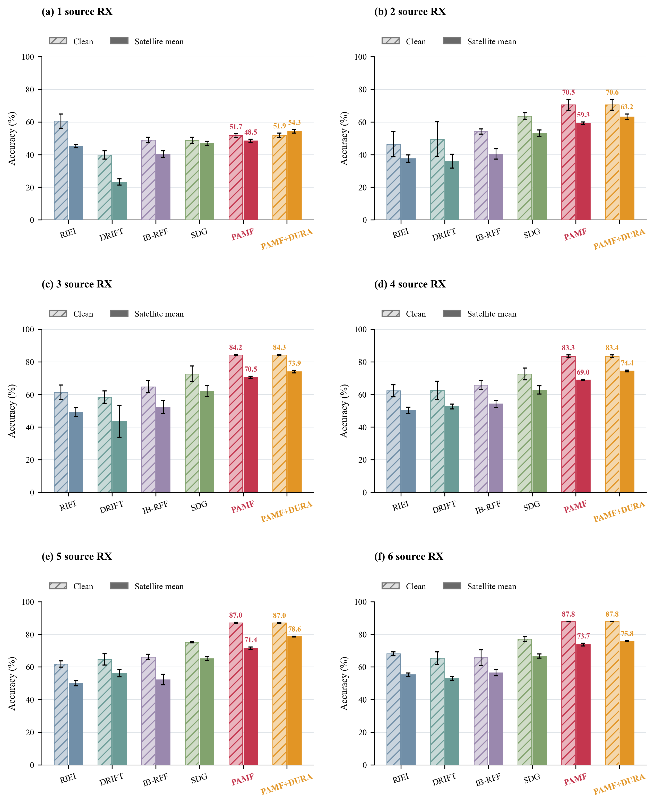
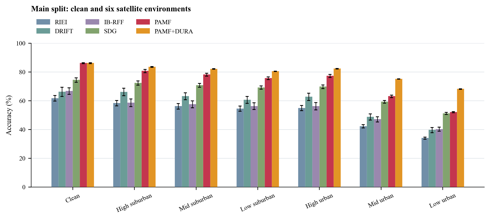
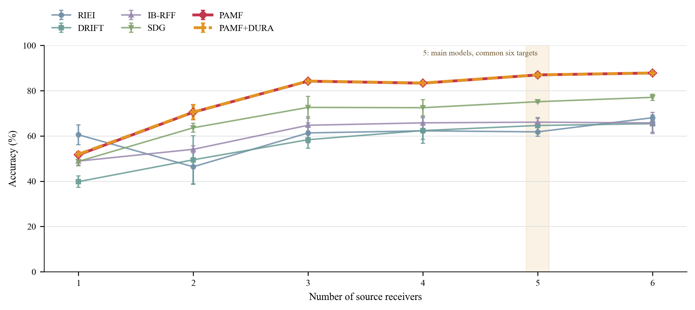
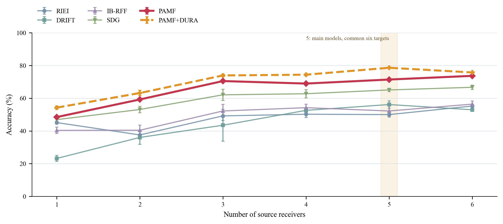
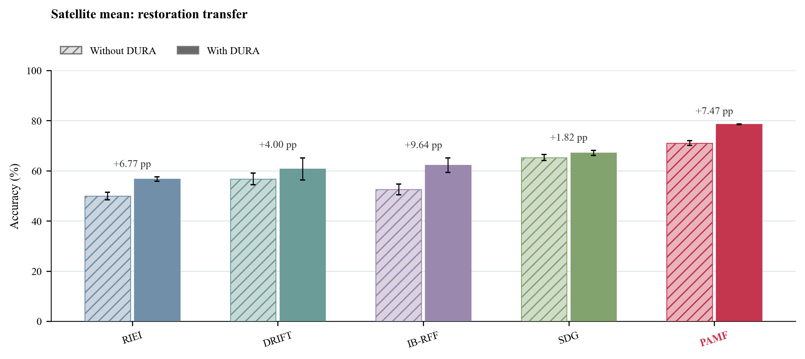

# PAMF 与对比方法的重点实验报告

本版按用户指定的五类问题组织主结果：先配对比较监督与普通 PL 半监督，再报告启用星地增强的半监督泛化、七场景、1 至 6 个源接收机和 DURA 泛用性。PAMF 及 PAMF+DURA 以红、橙色突出；颜色不改变坐标、统计或缺项含义。其余既有图表完整保留在 Excel 的补充工作表。证据整理日期为 2026 年 10 月 26 日。

## 1  实验定义与展示范围

表：本版重点实验的固定条件

|问题|训练条件|主图内容|
|---|---|---|
|监督与半监督|无增强、启用增强分别比较|无增强仅 CLEAN；有增强分别给 CLEAN 与综合星地|
|接收机划分、标注比例、源数量|普通 PL 半监督＋星地增强|每个设置内 CLEAN／综合星地双柱；均含 PAMF 与 PAMF+DURA|
|七场景|普通 PL 半监督＋星地增强|CLEAN、高/中/低郊区、高/中/低城市|
|1 至 6 源折线|普通 PL 半监督＋星地增强|固定共同 6 目标；CLEAN 和综合星地分图|
|DURA 泛用性|普通 PL 半监督＋星地增强|五种识别器各自未接入／接入恢复器双柱|

主比较方法为 RIEI、DRIFT、IB-RFF、SDG、PAMF、PAMF+DURA。前五项直接识别；PAMF+DURA 的实际顺序是先 DURA 恢复、再由同一 PAMF 识别器分类，不计为另一次识别器训练。外部方法接 DURA 的结果单列泛用性，不替换其主比较成绩。所有方法均保留原生完整目标、预算与默认分类头，不声称等计算比较。

普通 PL 采用当前模型 eval/no_grad 硬标签，阈值 0.95、权重 1、整批无标签损失平均，无 EMA 教师或复杂筛选。PAMF 监督为 50 轮有标签训练，普通 PL 为 13 轮有标签＋37 轮联合训练，均为 11100 次更新。保留 PAMF 自身有标签目标与信道视图，不把监督版称为纯交叉熵。外部方法的三场景概率为 40%/35%/25%，PAMF 主配方为三场景均匀；原生目标和增强剂量差异均保留。

综合星地指先在每个模型种子内平均六种 practical 的准确率，再计算三个模型种子的均值和样本标准差；CLEAN 不参加该平均。柱图和折线误差线均为模型种子样本标准差，不是置信区间或显著性结论。主图测试为目标接收机的已见日期跨接收机泛化；双跨、源接收机跨日诊断、Macro-F1、十类规模与时延等保留在 Excel 补充页。

数据来自 WiSig 地面代理。训练/源验证日期为 2021 年 3 月 8、15、23 日，3 月 1 日为更早的未见日期。仿真星地环境不是实测在轨链路。训练、选模和调度均不使用本次目标成绩反馈。

表：主要数据设置；监督组不读取无标签训练池

|设置|类数|源/原目标接收机数|有标签训练|无标签池|源验证|
|---|---|---|---|---|---|
|标准接收机划分|6|5/7|6300|56700|27000|
|接收机划分一|6|5/7|6300|56700|27000|
|接收机划分二|6|5/7|6300|56700|27000|
|1%标注|6|5/7|630|62370|27000|
|5%标注|6|5/7|3150|59850|27000|
|1个源接收机|6|1/6|1260|11340|5400|
|2个源接收机|6|2/6|2520|22680|10800|
|3个源接收机|6|3/6|3780|34020|16200|
|4个源接收机|6|4/6|5040|45360|21600|
|6个源接收机|6|6/6|7560|68040|32400|

## 2  监督与普通 PL 的双柱比较

无增强主图保留五种识别方法。此前导出没有纳入的 PAMF 无增强监督结果现已从完整冻结包补回，仍保留其原有监督参照配方；当前普通 PL 的匹配无增强结果不存在，按用户要求明确留缺，不填零、不用旧复杂半监督或已退出方法替代。PAMF 无增强监督参照与有增强主配方还存在辅助槽差异，因此两图之间的分差不能全部解释为信道增强的因果效果。

表：无增强、标准主划分、目标跨接收机 CLEAN 准确率（%）

|识别方法|监督|普通 PL 半监督|
|---|---|---|
|RIEI|66.93±0.71|67.28±0.88|
|DRIFT|66.21±3.30|67.69±1.71|
|IB-RFF|66.29±1.40|66.44±2.90|
|SDG|74.25±0.88|74.64±0.14|
|PAMF|85.41±0.74|缺项|

无附加星地增强的监督／普通 PL 双柱比较，仅报告目标 CLEAN。PAMF 监督柱为既有无增强参照，普通 PL 缺项以文字标出，未填零值。

表：启用星地增强的标准主划分准确率（%）；两类测试各自配对

|方法|监督 CLEAN|PL CLEAN|监督综合星地|PL 综合星地|
|---|---|---|---|---|
|RIEI|62.22±1.53|61.63±1.89|50.08±1.60|49.95±1.55|
|DRIFT|61.77±6.73|66.12±3.20|55.22±5.28|56.76±2.29|
|IB-RFF|66.74±2.61|66.63±2.29|53.10±1.83|52.57±2.17|
|SDG|73.18±2.16|74.32±1.52|65.16±2.03|65.30±1.14|
|PAMF|85.94±0.84|86.04±0.36|71.29±0.90|71.05±0.91|
|PAMF+DURA|85.93±0.85|86.08±0.34|77.36±0.55|78.52±0.12|

启用星地增强后，监督和普通 PL 半监督按方法配对；(a) CLEAN，(b) 六种 practical 的平均准确率。两幅均列单 PAMF 与 PAMF+DURA。监督恢复器只用有标签源 IQ，半监督恢复器可用全部允许源训练 IQ。

在固定的增强半监督主比较中，PAMF 的综合星地准确率为 71.05±0.91%，高于四种直接识别外部方法中的最高均值 65.30%；接入 DURA 后为 78.52±0.12%。普通 PL 相对 PAMF 监督的直接识别均值变化为 -0.24 个百分点，故该结果不支持把 PAMF 的全部优势归因于普通 PL。两种学习组的恢复器源 IQ 权限也不同，不能将完整系统的跨组差全部归因于识别器伪标签。

## 3  接收机划分、标注比例与源数量

本节全部使用普通 PL 半监督＋训练星地增强。每个数据设置均列六个主比较项，以 CLEAN／综合星地双柱展示；PAMF 不再只出现在标准划分图。三个接收机划分都为 5 源/7 目标，三套源集合两两仅交一个接收机；每个模型和恢复器均匹配该划分。标注比例为源训练池的 1%/5%/10%，对应 630/3150/6300 个有标签包。

三套接收机划分的增强半监督结果：每种方法的左、右柱分别为 CLEAN 与综合星地。PAMF 和 PAMF+DURA 在全部面板保留。

1%、5%、10% 标注比例的增强半监督结果，以 CLEAN／综合星地双柱比较六个主方法项。源验证量固定；保留非单调变化。

1 至 6 个源接收机的增强半监督双柱图，每种方法均给 CLEAN 和综合星地。全部面板使用共同 6 个目标接收机；5 源沿用同种子主实验模型，并由冻结逐接收机计数汇总。

## 4  主实验的 CLEAN 与六种星地环境

表：增强半监督主实验逐景准确率（%）

|场景|RIEI|DRIFT|IB-RFF|SDG|PAMF|PAMF+DURA|
|---|---|---|---|---|---|---|
|CLEAN|61.63±1.89|66.12±3.20|66.63±2.29|74.32±1.52|86.04±0.36|86.08±0.34|
|高郊区|58.26±1.90|66.04±2.55|58.50±2.69|72.22±1.45|80.58±1.14|83.46±0.25|
|中郊区|56.06±1.95|63.08±2.42|57.41±2.39|70.60±1.34|78.05±1.04|82.03±0.15|
|低郊区|54.41±1.81|60.56±2.38|56.17±2.28|69.08±1.15|75.53±0.94|80.32±0.15|
|高城市|54.85±1.78|62.62±2.55|56.12±2.53|69.64±1.33|77.18±1.07|82.19±0.18|
|中城市|42.17±1.13|48.68±2.13|47.04±1.80|59.16±0.92|62.99±0.87|75.05±0.18|
|低城市|33.96±0.74|39.55±1.80|40.17±1.40|51.11±0.69|51.98±0.46|68.05±0.25|

标准主划分、普通 PL 半监督＋增强的七场景结果。四种外部方法与单 PAMF 直接识别，PAMF+DURA 为恢复后识别；逐景单列 CLEAN 及六种 practical，不能以综合均值掩盖单景下降。

## 5  1 至 6 个源接收机的折线

5 个源接收机直接使用主对比实验的同种子模型，而不是另训模型。主实验原为 7 个目标接收机；其余源数量设置为共同 6 目标。为避免折线混入目标集合变化，本版从 5 源模型已经冻结的逐接收机统计中取共同 6 目标，按正确包数/总包数汇总：每个场景 108000 包。主表原 7 目标、每景 126000 包的成绩保持不变，也在 Excel 中保留。此操作仅重汇总冻结计数，没有重新预测或读取逐样本真值。

表：固定共同 6 目标的 CLEAN 准确率（%）

|源接收机数|RIEI|DRIFT|IB-RFF|SDG|PAMF|PAMF+DURA|
|---|---|---|---|---|---|---|
|1|60.52±4.39|39.82±2.55|48.89±1.73|48.75±1.96|51.68±1.09|51.92±1.20|
|2|46.39±7.74|49.47±10.58|54.10±1.59|63.62±1.99|70.49±3.30|70.56±3.30|
|3|61.33±4.36|58.35±3.76|64.72±3.75|72.61±4.82|84.21±0.26|84.26±0.23|
|4|62.27±3.71|62.39±5.68|65.79±2.81|72.48±3.61|83.32±0.83|83.40±0.79|
|5|61.81±1.93|64.61±3.54|66.10±1.68|75.13±0.42|86.97±0.30|86.98±0.26|
|6|68.05±1.20|65.43±3.75|65.76±4.70|77.05±1.37|87.81±0.10|87.84±0.10|

完整 1、2、3、4、5、6 源接收机折线：CLEAN。全部为增强半监督，固定共同 6 目标；5 源为同种子主实验模型的冻结计数重汇总。误差线为三种子样本标准差，保留非单调变化。

表：固定共同 6 目标的 综合星地 准确率（%）

|源接收机数|RIEI|DRIFT|IB-RFF|SDG|PAMF|PAMF+DURA|
|---|---|---|---|---|---|---|
|1|45.11±0.96|23.20±1.88|40.35±1.99|46.93±1.14|48.48±0.92|54.27±1.08|
|2|37.56±2.13|36.05±4.27|40.44±3.12|53.11±2.01|59.25±0.64|63.19±1.69|
|3|49.20±2.74|43.50±9.74|52.22±4.01|62.09±3.38|70.50±0.66|73.94±0.76|
|4|50.23±1.96|52.59±1.52|54.22±2.12|62.75±2.54|68.97±0.32|74.39±0.59|
|5|49.99±1.55|56.14±2.33|52.22±3.20|65.07±1.06|71.43±0.72|78.63±0.24|
|6|55.25±1.07|52.96±1.06|56.40±1.87|66.69±1.28|73.69±0.88|75.77±0.13|

完整 1、2、3、4、5、6 源接收机折线：综合星地。全部为增强半监督，固定共同 6 目标；5 源为同种子主实验模型的冻结计数重汇总。误差线为三种子样本标准差，保留非单调变化。

源训练量随源接收机数量自然增长，因此折线同时反映接收机覆盖与训练记录量变化，不是固定样本预算下仅接收机多样性的因果效应。各设置仍使用原冻结测试的场景配置。

## 6  包含 PAMF 的 DURA 泛用性

表：标准主划分、增强半监督、综合星地的恢复前后配对

|识别方法|未接 DURA（%）|接入 DURA（%）|配对变化（百分点）|
|---|---|---|---|
|RIEI|49.95|56.73|+6.77±0.89|
|DRIFT|56.76|60.75|+4.00±4.28|
|IB-RFF|52.57|62.21|+9.64±1.42|
|SDG|65.30|67.12|+1.82±1.87|
|PAMF|71.05|78.52|+7.47±0.79|

DURA 泛用性采用双柱，五种识别器均包括在内：RIEI、DRIFT、IB-RFF、SDG、PAMF。每种方法固定同一识别器、样本、场景和种子，只切换是否先恢复；柱顶标种子内配对百分点变化。全部为增强半监督、标准主划分的综合星地测试。

所有恢复后结果都使用匹配同一数据契约的恢复器。三个识别器种子共享一份匹配恢复器，不能称为三套独立完整系统。泛用性收益是识别器接入固定恢复网络的测试收益，不证明恢复器对每个方法、每个场景都提高。

## 7  保留资料与明确缺项

Excel 前 9 个工作表对应本报告重点图，共 19 个面板；后 26 个补充工作表保留此前的监督分组、半监督分组、十类规模、Macro-F1、双跨/跨日诊断、完整逐景、时延、覆盖与逐模型登记，并补入原两套 11 设置 DURA 面板。工作簿共 35 个工作表、51 个可编辑图表。每个重点实验页都有目的、设置、对应数据划分、图表数据、三种子数值和完整结果。

当前普通 PL 配方的无增强 PAMF 仍是缺项，已获用户确认先交付已有证据。没有启动新增训练、预测、真值评分或 DURA 训练。当前方法自身消融的其他缺项仍按原报告记录，不把旧复杂半监督或已退出方法改名为普通 PL。旧报告与不可覆盖导出包均保留。

## 附录  冻结来源与复算

当前主方法来自既有 practical residual 完整对比包及 PAMF 监督/ordinary_PL 完成矩阵。新增补入的无增强监督 PAMF 来自 20261024-practical-residual-full2x2-complete-r14.zip 的 PAMF 监督 A 组；其当前普通 PL 对照未完成。5 源曲线使用同种子 F0 主模型，仅从冻结的接收机统计中选择预先指定的共同目标集合 [0,2,5,7,9,10] 汇总。没有根据目标成绩筛接收机或挑模型。

导出包包含逐图来源表、冻结种子统计、共同 6 目标正确/总包计数、IEEE 源码、PDF/SVG/PNG 和纯标准库复核器。先按种子汇总六景和配对差，再计算跨种子样本标准差；缺失结果保持缺失。正文采用识别器、恢复器和数据设置的可读名称，原始编号只在机器可读追溯数据中保留。
